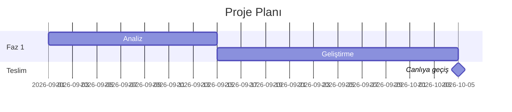

# Proje
- Versiyon: 1.98
- Bu dosya, projeden bağımsız genel yazılım geliştirme standartlarını içerir. Diğer projelere de aynen uygulanabilir — amaç, farklı uygulamaların tek elden çıkmış gibi tutarlı bir yapı/disipline sahip olmasıdır.
- Bu dosyada bir değişiklik yapıldığında yukarıdaki Versiyon numarası bir üst küçük sürüme çıkarılır (örn. 1.0 → 1.1).

# Genel / Süreç

### Yazılım Standartları
- Yazılım için kesinlikle tartışmasız şekilde uyulması gereken standartlar bu dosyadadır. Uygulama her zaman bu dosyada yazan şekilde kodlama yapar.
- Bu dosyada yer alan standartlar, tüm projelerde tutarlılığı sağlamak amacıyla uygulanmalıdır.
- Yapay zekâ ajanı, bu dosyada yer alan standartları öğrenmeli, hatırlamalı ve uygulamalıdır.

#### Yazılım Teknolojisi
- Python
- Flask
- PostgreSQL
- Bootstrap
- Docker
- Chart.js
- APScheduler
- Ubuntu (asla windows server üzerinde çalıştırılmaz, sadece geliştirme ortamında Windows kullanılabilir)

#### Yazılım Standartları
- Uygulama adı application.py

#### Test İşlemleri
- **Her kod değişikliğinden sonra uygulamaya bağlanıp elle test etme** — vakit kaybı. Kod yazılır, sürüm artırılır, commit+push yapılır; doğrulama kullanıcının kendi ekranında/akışında olur.
- **`py_compile` yeterli DEĞİLDİR — yalnızca sözdizimini kontrol eder.** Aşağıdaki hata sınıfları derlemeden geçer ama uygulama **ayağa kalkarken** çöker; bu yüzden ayrıca kontrol edilmeleri gerekir:
  - **Çözümlenemeyen import**: `from app.x import Y` yazıp `Y`'nin o modülde olmaması `ImportError`'dır ve worker'ın hiç boot etmemesine yol açar. Proje içi importlar statik olarak doğrulanmalıdır (bkz. `test/import_dogrula.py` — AST ile her `from app...import` hedefinin gerçekten tanımlı olup olmadığına bakar).
  - **Framework property çakışması**: bir kolon/alan adı, miras alınan sınıfın setter'ı olmayan property'siyle çakışırsa (ör. `UserMixin.is_active`) nesne oluşturma anında `AttributeError` verir. Kolon adı değiştirirken bu ayrıca kontrol edilir.
  - **Kod ile şablon arasındaki sözleşme**: bir Python sözlüğünün anahtarı ile şablonun okuduğu nitelik adı ayrı ayrı değiştirilirse şablon **hata vermez, sessizce boş basar** (Jinja2 tanımsız niteliği boş string olarak render eder). Menü/liste verisi gibi sözlüklerde anahtar adı değiştirilirken şablon tarafı MUTLAKA aynı commit'te güncellenir; şablon parse kontrolü bunu yakalamaz (bkz. `test/template_dogrula.py` kapsam notu).
  - **Şemada olmayan kolon**: model `__init__``__init__`'i `row["x"]` ile okuduğu kolon şemada yoksa ilk sorguda patlar. Kolon adı değişikliklerinden sonra modellerin okuduğu adların şemayla eşleştiği doğrulanır.
- Bunun yerine ucuz ve otomatik doğrulamalar yapılır: syntax/derleme kontrolü (`python -m py_compile`), **import doğrulaması**, şablon parse kontrolü, ve **veritabanı değişikliklerinin gerçekten uygulandığının teyidi** (bkz. "Veritabanı Standartları" — yeni tablo/kolon anında DB'ye uygulanır; bu adım atlanırsa uygulama ilk istekte `UndefinedTable` ile patlar).

**Deploy öncesi çalıştırılacak kontroller** (hepsi saniyeler sürer, uygulamayı ayağa kaldırmaya gerek yoktur):

```bash
python3 -m compileall -q app/          # sözdizimi
python3 test/import_dogrula.py         # from app...import X  -> X gerçekten var mı
python3 test/cagri_dogrula.py          # Sinif.metot(kw=...)  -> böyle bir parametre var mı
python3 test/template_dogrula.py       # Jinja şablonları parse ediliyor mu
```

Bu dört kontrol, yukarıdaki dört hata sınıfının üçünü yakalar (dördüncüsü —
kod/şablon sözleşmesi — elle kontrol gerektirir). Kolon veya tablo adı
değiştiren bir çalışmadan sonra ayrıca **koddaki tüm SQL'lerin canlı şemaya
karşı `EXPLAIN` ile doğrulanması** gerekir; bu, sorguları çalıştırmadan
eksik kolon/tablo atıflarını ortaya çıkarır.

Arayüz metni eklenen veya değiştirilen her çalışmadan sonra ayrıca
`python3 test/ceviri_dogrula.py` çalıştırılır: kodda geçen her çeviri
anahtarının her dilde tanımlı olduğunu denetler (bkz. "Çok Dillilik (i18n)
Standardı" > Doğrulama).

- İstisna: "Kritik hata kalıbı" başlıklarında açıkça **gerçek tarayıcıda gözle doğrulayın** denen görsel/layout durumları (grid akışı, stacking context, tema seçimi) — bunlar kod okumakla yakalanamadığı için o maddelerdeki doğrulama adımı geçerlidir.

#### Test Paketi (Tüm Projelerde)

Yukarıdaki statik kontroller kodun **ayağa kalkacağını** doğrular; kodun **doğru davrandığını** doğrulamaz. Bunun için her projede, `/test` altında, tek komutla çalışan bir test paketi bulunur.

```bash
python3 test/calistir.py            # statik doğrulamalar + tüm testler
python3 test/calistir.py --statik   # yalnızca veritabanı gerektirmeyenler (hızlı)
python3 test/test_izolasyon.py      # tek dosya
```

- **Ek bağımlılık yoktur**: testler düz Python ile yazılır ve çalışır (pytest kurulmaz); `requirements.txt` değişmez. Runtime'da okunmadıkları için `/test` altındadırlar (bkz. "/test Klasörü Kuralı").
- **Test dosyaları konuya göre ayrılır**:

  | Dosya | Neyi korur |
  |---|---|
  | `test_izolasyon.py` | **Çok kiracılılık**: bir işletmenin verisine başka işletmeden erişilemiyor |
  | `test_yetki.py` | Rol ayrıcalıkları, `perm_` bayrakları, `can()` karar sırası |
  | `test_regresyon.py` | Geçmişte bulunmuş somut hataların geri dönmemesi |
  | `test_is_mantigi.py` | Hesaplamaların **doğru sonuç** üretmesi (süre, oran, tutar, iş kuralı) |
  | `test_ekran_duman.py` | Ekranların ve uçların hata vermeden açılması (duman testi) |

- **Testler gerçek veritabanına yazar; mock kullanılmaz.** Bu bilinçli bir tercihtir: yanlış kolon adı, belirsiz kolon, kısıt ihlali, unutulan `commit` gibi hatalar yalnızca gerçek PostgreSQL'de ortaya çıkar.
- **Test verisi tek bir önekle işaretlenir** (`__test__`): her fixture adı bu önekle başlar ve temizlik **yalnızca** bu öneke bakar; gerçek veriye asla dokunmaz.
  - Test ortamı bir context manager'dır; test ortasında istisna fırlasa bile çıkışta temizlik yapılır.
  - Çalıştırıcı başlangıçta bir kez toplu temizlik yapar (önceki bir çökmeden artık kalmışsa).
  - Fixture adlarına artan sayaç eklenir; benzersiz index'lere takılmaz.
  - Temizlik **tek bağlantı ve tek transaction** içinde yapılır; her tablo için ayrı bağlantı açmak uzak veritabanında test süresinin çoğunu temizliğe harcatır.
- **Aynı anda tek çalıştırma**: testler ortak veritabanını paylaşır ve çıkışta önekli tüm kayıtları siler; iki koşu aynı anda çalışırsa biri diğerinin fixture'larını siler.
- **Ağ kesintisine dayanıklılık**: yalnızca **bağlantı hataları** (`OperationalError`, `InterfaceError`) yeniden denenir. Gerçek test başarısızlıkları ve veri hataları (FK/kısıt ihlali) **asla** yeniden denenmez — aksi halde kararsız bir hata gizlenmiş olur.
- Çalıştırıcı testlere başlamadan önce veritabanına bağlanabildiğini kontrol eder; erişilemiyorsa tek ve anlaşılır bir mesajla çıkar (her testin ayrı ayrı çökmesi gerçek sebebi gizler).
- **Canlı veritabanına yazan testler deploy sırasında çalıştırılmaz**; deploy yalnızca statik doğrulamaları koşar (bkz. "Şema Uygulama ve Deploy Araçları"). Test paketi geliştirme ortamında elle çalıştırılır.

**Yeni test yazarken**

- Bir hata düzeltildiyse, o hatayı yakalayan test `test_regresyon.py`'ye eklenir; docstring'e **hangi hatayı koruduğu** yazılır — testin değeri budur.
- İzolasyon ve yetki testinde hem **engellendiği** hem de meşru akışın **çalıştığı** test edilir; aksi halde "her şeyi reddet" de testi geçer.
- Yeni bir tablo veya uç eklendiğinde izolasyon testi de eklenir: başka işletmenin kimliğiyle yapılan istek veri döndürmemeli ve değiştirmemelidir.

**Bilinen sınırlar**: tarayıcı testi yoktur (JS yalnızca sözdizimi ve sunucu sözleşmesi düzeyinde doğrulanır); mail/SMS gönderimi ve dış servis çağrıları test edilmez; zamanlanmış görevler doğrudan test edilmez, fonksiyonları elle çağrılır.

### Sürümleme Standardı (Tüm Projelerde)

**Uygulama alanı**: Genel kural — her projede geçerli. **Zorunluluk**: Yüksek, her projede uygulanmalı.

**Amaç**: Sürüm numaralarını tüm projelerde aynı mantıkla yönetmek, böylece farklı projelerden gelen sürümler tek elden çıkmış gibi tutarlı bir yapı/disipline sahip olur.

**Ne zaman kullanılır**: **Her commit'te** sürüm numarası artırılır — sürüm numarası, yazılımın o anki hâlini ifade eder. Kod değişikliği içermeyen commit'ler (yalnızca dokümantasyon, yorum, biçimlendirme) için de sürüm artırılır — tek numara, tek commit ilkesi bozulmaz.

#### Dosya konumu ve kontrolü

- Dosya adı: `version.txt`
- Proje **kök dizininde**, tek bir dosya bulunur. Alt bileşenler (backend, frontend, worker vb.) ayrı sürüm tutmaz; tüm proje tek sürüm numarası taşır.
- Dosya içeriği **yalnızca sürüm numarasıdır**; başka içerik, açıklama veya etiket yoktur.
- Kodlama: UTF-8, BOM'suz. Dosya tek satırdır ve sonunda tek bir satır sonu (newline) bulunur.
- Eğer dosya yoksa: sürüm `1.1` kabul edilir, ilk sürüm sayılır ve dosya anında oluşturulur.

#### Format

- Sürüm numarası `MAJOR.MINOR` (`x.y`) formatındadır — örn. `1.1`, `1.4`, `2.7`.
- `x` = ana sürüm (MAJOR), `y` = küçük sürüm (MINOR).
- İlk sürüm `1.1`'dir. `y` daima 1 veya üzeridir; `y = 0` kullanılmaz (yani `1.0`, `2.0` gibi numaralar hiç oluşmaz).
- `y` en fazla `999` olabilir.

#### MINOR (`y`) ne zaman artar

- Geriye uyumlu **her** değişiklikte: yeni özellik, iyileştirme, **hata düzeltmesi**, yeniden düzenleme (refactor), dokümantasyon.
- Yani günlük geliştirmenin tamamı MINOR artışıdır.

#### MAJOR (`x`) ne zaman artar

MAJOR'ın **iki ayrı** tetikleyicisi vardır:

1. **Geriye dönük kıran değişiklik** — mevcut kullanıcıların/entegrasyonların çalışmasını bozan değişiklik. Örnek: API sözleşmesinin değişmesi, veritabanı şemasının geriye uyumsuz dönüşmesi, yapılandırma (config) biçiminin değişmesi, desteklenen bir özelliğin kaldırılması.
   - Bu durumda `x` bir artar, `y` **1**'e döner. Örnek: `1.87` → `2.1`.
2. **Sayaç taşması** — `y` değeri `999`'a ulaştıktan sonraki ilk artışta.
   - Bu durumda da `x` bir artar, `y` **1**'e döner. Örnek: `1.999` → `2.1`.
   - Bu artış **kıran değişiklik anlamına gelmez**; yalnızca numaralandırma sınırıdır.

Bu iki tetikleyici ayırt edilemediği için, MAJOR artışının hangi sebeple olduğu **commit mesajından** anlaşılır. Kıran değişiklikte commit mesajının açıklama maddelerinde bunun açıkça belirtilmesi zorunludur.

#### Monotonluk

- Sürüm numarası **asla düşürülmez** ve **asla yeniden kullanılmaz**.
- Bir değişiklik geri alınsa (revert) bile sürüm ileri gider; eski numaraya dönülmez.
- Karşılaştırma sayısaldır: `1.10` sürümü `1.9`'dan **büyüktür** (metin sıralaması değil).
- **Hatalı veya yarım kalmış bir commit fark edilirse**: `git commit --amend`, `git reset` veya benzeri geçmişi değiştiren komutlarla düzeltilmez. Düzeltme, `version.txt`'i yine bir üst küçük sürüme çıkaran **yeni bir commit** olarak atılır. Sürüm numarası bu durumda da asla geri düşürülmez veya tekrar kullanılmaz — zincir kırılmadan ileri gitmeye devam eder.

#### Standart dosyalarının kendi sürümü

Her standart dosyasının başlığında kendi sürüm satırı bulunur (bkz. bu dosyanın en üstündeki `- Versiyon: x.y` satırı):

- Bu sürüm `version.txt`'ten **bağımsızdır**; dosyanın kaç kez güncellendiğini gösterir.
- **İçerik değiştiğinde artar.** Yazım düzeltmesi ve bağlantı onarımı gibi anlam değiştirmeyen düzenlemeler bu kuralın dışındadır.
- Bir dosyayı güncelleyip sürümünü artırmamak, dosyanın güncelliğini yanıltıcı gösterir — okuyan kişi eski bir sürüm numarasına bakıp "bu dosya uzun süredir dokunulmamış" sanır.
- Aynı commit'te birden fazla standart dosyası değişiyorsa **her birinin** sürümü ayrı ayrı artırılır; ortak bir numara kullanılmaz.

#### Commit ile ilişkisi

- Commit mesajı sürüm numarasıyla başlar ve bu numara, o commit ile birlikte `version.txt`'e yazılan değerin aynısıdır (bkz. "Git İşlemleri > Commit mesajı formatı").
- `version.txt` güncellemesi, ilgili değişiklikle **aynı commit** içinde yer alır; ayrı bir "sürüm artır" commit'i açılmaz.

#### Değişiklik geçmişi

- Ayrı bir `CHANGELOG.md` dosyası **tutulmaz**.
- Sürüm geçmişi git commit geçmişinden okunur; commit mesajları zaten sürüm numarası + madde madde açıklama içerdiği için ayrıca tekrar edilmez.

#### Kontrol listesi

- [ ] Değiştirilen standart dosyalarının başlık sürümü artırıldı mı?
- [ ] Proje kökünde `version.txt` var mı?
- [ ] İçeriği yalnızca `x.y` biçiminde tek satır mı? (UTF-8, BOM'suz, sonunda newline)
- [ ] `y` değeri 1–999 aralığında mı?
- [ ] Her commit'te sürüm artırıldı mı?
- [ ] Commit mesajı `version.txt` içindeki numarayla mı başlıyor?
- [ ] Kıran değişiklikte MAJOR artırılıp `y` 1'e döndürüldü mü ve commit mesajında belirtildi mi?

### Git İşlemleri (Tüm Projelerde)

**Uygulama alanı**: Genel kural — her projede geçerli. **Zorunluluk**: Yüksek, her projede uygulanmalı.

#### Otomatik commit ve push

**Her tamamlanan iş/değişiklikten sonra onay istemeden** şu üçlü çalıştırılır:

```bash
git add <değişen dosyalar>
git commit -m "..."
git push
```

- Kullanıcıya "commit edeyim mi?" diye sorulmaz; iş bitince kaydedilir ve gönderilir.
- "Tamamlanan iş" bir özelliğin, düzeltmenin veya doküman değişikliğinin çalışır hâle gelmesidir — yarım kalmış kod commit edilmez.
- Her commit'te `version.txt` de artırılır ve aynı commit'e dahil edilir (bkz. "Sürümleme Standardı").

##### Onay gerektiren istisnalar — yıkıcı işlemler

Aşağıdaki işlemler otomatik kuralın **dışındadır** ve her zaman açık onay ister — başkasının çalışmasını geri döndürülemez biçimde bozabileceği için istisnadır:

| İşlem | Örnek |
|---|---|
| Geçmişi yeniden yazma | `git rebase`, `git commit --amend` (gönderilmiş commit'te), `filter-branch` |
| Zorla gönderme | `git push --force`, `--force-with-lease` |
| Dal silme | `git branch -D`, `git push origin --delete` |
| Sert geri alma | `git reset --hard`, `git clean -fd` |
| Etiket/sürüm silme veya taşıma | `git tag -d`, etiketi başka commit'e taşıma |

##### Commit edilmeden önce doğrulanacaklar
- Gizli değer içeren dosya staged listesinde olmamalı (bkz. aşağıdaki "Gizli değerler").
- Geçici/deneme dosyaları commit'e girmemeli — bunlar `/test` altına taşınır (bkz. "/test Klasörü Kuralı").
- `git status` ile beklenmeyen dosya olup olmadığı gözden geçirilir.

#### Commit mesajı formatı

Commit mesajı sürüm numarasıyla başlar, ardından kısa bir başlık ve **maddeli** bir gövde gelir:

```
x.y Kısa başlık (ne yapıldı)

- Değişiklik 1: ne değişti ve neden
- Değişiklik 2: hangi dosya, hangi fonksiyon, ne amaçla
- Varsa: edge case, kısıtlama, dikkat edilmesi gereken nokta
```

- **Tek satırlık mesaj yeterli değildir.** Gövdede madde madde açıklama zorunludur.
- Her madde şu dört unsuru içerir: **hangi dosya + hangi bölüm/fonksiyon + ne değişti + neden**.
- Eklenen özellikler, kaldırılanlar ve çözülen tutarsızlıklar ayrı maddelerde yazılır.
- Sadece dosya adı listelemek veya "güncellendi" demek yeterli değildir.
- Başlık satırı kısa tutulur (~70 karakter) ve nokta ile bitmez.
- Mesaj **Türkçe** yazılır.
- Başlıktaki `x.y`, o commit'te `version.txt`'e yazılan değerin aynısıdır.

**Örnek:**
```
1.7 Sidebar ikon standardı uygulandı

- app/menu.py: MENU_ITEMS içindeki her alt öğeye `ikon` alanı eklendi — her menü satırının kendine özgü ikonu olması için (bi-dot tekrarı kaldırıldı)
- templates/partials/sidebar.html: İkon artık menü verisinden okunuyor, template içindeki sabit ikon listesi silindi — tek kaynak ilkesi
- static/css/style.css: .nav-submenu için list-style:none eklendi — iç içe ul'de tarayıcı varsayılan bullet'ı ikonla üst üste biniyordu
- version.txt: 1.6 → 1.7
```

**Kötü örnek:**
```
guncelleme
```
```
1.7 Düzeltmeler yapıldı

- Birkaç dosya güncellendi
```

#### Gizli değerler

- **Gizli değer içeren dosya asla commit edilmez.** Uygulama ayarları `config.json` içinde tutulur ve bu dosya `.gitignore`'dadır; depoda yalnızca `config.example.json` bulunur.
- Kodda yalnızca anahtar adı geçer, değeri geçmez.
- `.gitignore` içinde en az şunlar bulunur: `config.json`, `.env`, `*.key`, `*.pem`, `__pycache__/`, `*.pyc`, `logs/`, `venv/`, `.venv/`, `.claude/`.
- Commit öncesi doğrulama:

```bash
git ls-files | grep -E "^(config\.json|\.env)$"
```

Çıktı **boş** dönmelidir.

##### Gizli değer yanlışlıkla gönderildiyse
Dosyayı silmek yeterli değildir — geçmişte kalır. Sıra şudur:

1. İlgili anahtar/şifre **derhal iptal edilir ve yenilenir** (rotasyon). En kritik adım budur.
2. Ardından geçmişten temizleme değerlendirilir — bu yıkıcı bir işlemdir, **onay ister** (bkz. yukarıdaki "Onay gerektiren istisnalar").

##### Token'lar
- Token'lar **dar kapsamlı** olur (gerektiği kadar yetki); iş bitince iptal edilir veya yenilenir.
- Token dosyaya veya depoya yazılmaz; cihazda Git Credential Manager ya da `gh` ile saklanır.
- Deploy ve sunucu kimlikleri geliştiriciye verilmez; platform erişimi IT yönetimindedir.

#### İlk commit'te bulunması gerekenler (yeni proje)

Kökte şunlar hazır olmalıdır:

- `version.txt` — sürüm numarası (bkz. "Sürümleme Standardı")
- `.gitignore` — gizli değerler ve üretilen dosyalar hariç
- `config.example.json` — gerçek değer içermeyen config şablonu
- `requirements.txt` — sabitlenmiş bağımlılıklar
- `README.md` — projenin ne olduğu ve nasıl çalıştırılacağı

Geliştirici notları, kurulum dokümanları ve tek seferlik scriptler köke değil `/test` altına konur (bkz. "/test Klasörü Kuralı").

#### Kontrol listesi

Her commit öncesi:
- [ ] `version.txt` artırıldı ve commit'e dahil edildi mi?
- [ ] Commit mesajı `x.y` ile mi başlıyor?
- [ ] Gövdede madde madde açıklama var mı (dosya + bölüm + ne + neden)?
- [ ] `git status` ile beklenmeyen dosya kontrol edildi mi?
- [ ] Gizli değer içeren dosya staged listesinde yok, değil mi?
- [ ] Yarım kalmış kod commit edilmiyor, değil mi?

Yeni repo açarken:
- [ ] `.gitignore` ilk commit'te hazır mı?
- [ ] `config.example.json` var, `config.json` yok — doğru mu?

### Geliştirme Ortamı

Geliştirme sırasında **sanal ortam** kullanılır; sistem Python'una paket kurulmaz. Klasör adı **`.venv`**'dir — nokta ile başlar (eski `venv`, noktasız, artık kullanılmaz).

#### Oluşturma
```bash
python -m venv .venv
```

#### Etkinleştirme
```bash
source .venv/bin/activate          # Linux / macOS
.venv\Scripts\Activate.ps1         # Windows PowerShell
```

- Geliştirme ekranı her açıldığında sanal ortam **otomatik olarak etkinleştirilir.**
- Bağımlılıklar etkin sanal ortama kurulur: `pip install -r requirements.txt`
- `.venv/` klasörü `.gitignore`'dadır; repoya girmez.

**Windows'ta PowerShell hatası**: `.venv\Scripts\Activate.ps1` çalıştırılırken "bu sistemde script çalıştırma devre dışı bırakılmış" (execution policy) hatası alınırsa, bu **kalıcı bir sistem ayarı değiştirilerek değil**, yalnızca o oturum için çözülür:
```powershell
Set-ExecutionPolicy -ExecutionPolicy RemoteSigned -Scope Process
```
`-Scope Process` sadece o PowerShell penceresini etkiler, kalıcı bir güvenlik politikası değişikliği yapmaz. Alternatif olarak `.venv\Scripts\activate.bat` (cmd.exe) execution policy'den etkilenmez.

#### Neden `.venv`

| Gerekçe | Açıklama |
|---|---|
| Araç desteği | VS Code, PyCharm ve `uv` `.venv`'i **kendiliğinden bulur**; `venv` için elle yorumlayıcı seçmek gerekir |
| Gizli klasör | `ls` ve dosya gezgininde proje dosyalarının arasına karışmaz |
| Yaygın kural | Python ekosisteminde fiilî standart hâline gelmiştir |

Mevcut projelerde `venv/` klasörü varsa: silinip `.venv` olarak yeniden oluşturulur. Sanal ortam üretilebilir bir klasördür, taşınmaz. `.gitignore` her iki adı da içerir ki eski kopyalar yanlışlıkla commit edilmesin.

Sanal ortam yalnızca geliştirme içindir. Container içinde ayrı bir venv kurulmaz — imajın kendisi zaten izole bir ortamdır.

### Dosya ve Klasör İsimlendirme Kuralları
- Klasör ve dosya isimleri küçük harflerle ve alt çizgi (`_`) ile ayrılmış olmalıdır. Örneğin, `my_folder` veya `my_file.py`.
- Klasör ve dosya isimlerinde Türkçe karakterler kullanılmamalıdır.
- Klasör ve dosya isimlerinde boşluk yerine alt çizgi (`_`) kullanılmalıdır.
- Klasör ve dosya isimlerinde özel karakterlerden kaçınılmalıdır (örn. `!`, `@`, `#`, `$`, `%`, `^`, `&`, `*`, `(`, `)`).

### Dosya ve Klasör Yapısı

Aşağıdaki ağaç, bu dosyadaki standartların tek bir örnek projede nasıl bir araya geldiğini gösterir — **bir örnektir, bu dosyaya her yeni standart eklendiğinde otomatik güncellenmez**. Gerçek/güncel dosya yapısını öğrenmek için her zaman ilgili projenin kendi kod tabanına bakın; burada bir dosya/route eksik veya eski görünüyorsa bu bir tutarsızlık değil, örneğin doğası gereği geride kalmasıdır.

```
app/
  __init__.py       # app factory, config yükleme, blueprint kayıtları, logging, DB-down errorhandler, version.txt okuyup app_version context processor'ıyla template'lere geçirme (bkz. "Sidebar Versiyon Gösterimi Standardı")
  db.py             # psycopg2 bağlantı yönetimi, seed_defaults() (sadece varsayılan kullanıcı seed)
  menu.py           # MENU_ITEMS — sidebar'ın 2 seviyeli menü verisi (grup, ikon, link, alt öğeler, rol bazlı görünürlük); sidebar.html bunun üzerinde tek döngü kurar
  models/
    user.py         # User (Flask-Login UserMixin), tam CRUD, soft-delete
    config.py       # Config sınıfı — config tablosuna key/value erişim
    userslogs.py    # UsersLog sınıfı — userslogs tablosuna kayıt ve sayfalı sorgulama
    error_log.py    # ErrorLog sınıfı — error_log tablosuna kayıt ve sayfalı sorgulama (Hata Logları sekmesi)
    maillogs.py     # MailLog sınıfı — maillogs tablosuna kayıt ve sayfalı sorgulama (Mail Logları sekmesi)
    notification.py # Notification sınıfı — notifications tablosuna kayıt, okundu işaretleme, navbar dropdown sorgusu
    help_article.py # HelpArticle sınıfı — help_articles tablosuna route bazlı kayıt/okuma (Navbar Yardım Modalı Standardı)
  routes/
    auth.py         # /auth/login, /auth/logout
    dashboard.py    # /dashboard — domain sayısı, kayıt sayısı gibi basit özet (rapor DEĞİL, sade sayaç)
    settings.py     # /ayarlar — sekmeli: kullanıcılar (CRUD+modal), bildirimler (mail+tercihler), işlem/hata/mail logları (AJAX)
    notifications.py # /bildirimler/veri (AJAX liste), /bildirimler/<id>/okundu (POST — navbar dropdown standardı)
    help.py         # /yardim/veri (AJAX — Navbar Yardım Modalı Standardı)
    dosya_yonetimi.py # /dosya-yonetimi — proje-özel ekran (liste/yükle/yeni klasör/indir/sil)
templates/
  base.html             # Ortak layout — sidebar, flash mesajlar, Bootstrap/Icons yükleme
  dashboard.html        # Basit sayaç ekranı
  settings.html         # Ayarlar ana sayfası (Bootstrap nav-tabs) + profil kısayolu JS'i
  settings/             # Sekme partial'ları: _kullanicilar.html, _bildirimler.html (Mail + Bildirim Tercihleri card'ları), _islem_loglari.html, _hata_loglari.html, _mail_loglari.html
  partials/sidebar.html # Sidebar navigasyonu — 2 seviyeli menü (grup+alt sayfa), MENU_ITEMS üzerinde tek döngü ile render (bkz. "sidebar standardı")
  partials/_yardim_modal.html # Navbar "?" ikonuyla açılan yardım modalı iskeleti (bkz. "Navbar Yardım Modalı Standardı")
  dosya_yonetimi.html   # Dosya Yönetimi sayfası (proje-özel ekran; bu dosyada ayrı bir standardı yoktur, genel "Tablo Standardı" ve "Form Input Tooltip Standardı" geçerlidir)
  auth/login.html       # Giriş sayfası
  errors/db_down.html   # DB bağlantı hatası sayfası (base.html extend ETMEZ, bağımsız)
static/
  css/style.css             # Sidebar, stat-card, help-icon vb. proje-özel bileşenler
  js/app.js                 # sidebar toggle (cookie), data-confirm, Bootstrap tooltip init
  js/settings.js            # İşlem/Hata/Mail log sekmeleri için ortak AJAX (fetch) tablo + sayfalama + filtre
  js/help.js                # Navbar yardım modalını açan/GET /yardim/veri çağıran AJAX mantığı
  vendor/bootstrap/         # Bootstrap 5.3.3 CSS/JS — YEREL, CDN KULLANILMAZ
  vendor/bootstrap-icons/   # Bootstrap Icons 1.11.3 — YEREL (form tooltip standardındaki gerçek ikon için)
config.json           # Çalışma zamanı config (postgres, flask secret) — GIT'TE TAKİP EDİLMİYOR
config.example.json   # config.json şablonu (gerçek değerler yok)
version.txt           # Sürüm numarası (x.y formatı)
application.py        # gunicorn giriş noktası (`app = create_app()`)
Dockerfile             # Flask uygulaması imajı
docker-compose.yml     # servisler: (Flask) — PostgreSQL burada YOK, harici bir sunucuda
requirements.txt
md/                   # TÜM dokümantasyon ve şema dosyaları (runtime'da okunmaz)
  softwarestandarts.md        # Proje bağımsız genel yazılım standartları
  KURULUM.md                  # Sıfırdan kurulum adımları (config.json, şema kurulumu)
  <projeadı>/                 # BU PROJEYE ait doküman + gerçek şema (ör. md/ornekproje/)
    <projeadı>.md             #   Projeyi anlatan ana doküman (ör. ornekproje.md)
    01_panel_schema.sql       #   Versiyonlu şema dosyaları, sadece yeni numara eklenir
    02_<projeadı>_schema.sql  #   Kurulum = bu dosyaları sırayla çalıştırmak
    03_<değişiklik>.sql       #   (ayrı bir install.sql tutulmaz)
  extentions/                 # TEK BİR YETENEĞE ait dokümanlar — yetenek kaldırılsa
    rag.md                    #   proje çalışmaya devam eder (ör. rag.md)
  sql/                        # GENEL STANDARDA ait referans şemalar (users.sql,
                              #   config.sql, ...) — çalıştırılmak için değil,
                              #   örnek/tanıtım amaçlıdır (bkz. "md/ klasör yapısı")
test/                 # Runtime'da kullanılmayan her şey (bkz. softwarestandarts.md > "/test Klasörü Kuralı")
```

#### docker-compose.yml örneği:
```yaml
services:
  <projeadı>:
    build: .
    container_name: <projeadı>
    restart: always
    environment:
      - PYTHONUNBUFFERED=1
      - TZ=Europe/Istanbul
    volumes:
      - <projeadı>files:/app/<projeadı>files
    ports:
      - "5123:5123"
    networks:
      - nginx
    expose:
      - "5123"

networks:
  nginx:
    external: true

volumes:
  <projeadı>files:
```

#### version.txt örneği:
```
1.8
```

#### Dockerfile örneği:
Container güvenliği ve named volume sahipliği için bkz. "Container Güvenliği Standardı" ve "Named volume ownership" (DevOps / Altyapı) — Dockerfile'da `USER` satırı **yazılmaz**, container root olarak başlar ve `entrypoint.sh` içinde `gosu` ile uygulama kullanıcısına düşer.
```dockerfile
FROM python:3.11-slim

WORKDIR /app

COPY requirements.txt .
RUN pip install --no-cache-dir -r requirements.txt

# gosu: root'tan uygulama kullanıcısına güvenli düşüş için (su/sudo yerine —
# bkz. "Named volume ownership" / DevOps).
RUN apt-get update && apt-get install -y --no-install-recommends gosu \
    && rm -rf /var/lib/apt/lists/*

COPY . .

RUN mkdir -p /app/logs

# bkz. "Container Güvenliği Standardı" — container root olarak çalışmaz.
# Kullanıcı adı <projeadı>appuser biçimindedir: proje adı ornekproje ise ornekprojeappuser.
# <projeadı> bir yer tutucudur; gerçek Dockerfile'a proje adı Türkçe karaktersiz,
# küçük harfle yazılır (bkz. "Container Güvenliği Standardı").
RUN useradd --create-home --uid 10001 <projeadı>appuser \
    && chown -R <projeadı>appuser:<projeadı>appuser /app \
    && chmod +x /app/entrypoint.sh

EXPOSE 5123

ENTRYPOINT ["/app/entrypoint.sh"]
CMD ["gunicorn", "-b", "0.0.0.0:5123", "--workers", "2", "--timeout", "60", "application:app"]
```

`entrypoint.sh` (proje kökünde, `COPY . .` ile image'a kopyalanır) — named volume mount yollarının sahipliğini her başlangıçta onarır, sonra `gosu` ile uygulama kullanıcısına düşer. Tam örnek ve gerekçe için bkz. "Named volume ownership" (DevOps / Altyapı).

#### .gitignore örneği:
```
config.json
__pycache__/
*.pyc
.DS_Store
logs/
.venv/
```

#### config.json örneği:
```json
{
  "postgres": {
    "host": "localhost",
    "port": 5432,
    "user": "<projeadı>_user",
    "password": "secret",
    "database": "<projeadı>"
  },
  "container": {
    "name": "<projeadı>",
    "publish_port": 5123,
    "publish_address": "http://localhost:5123"
  },
  "flask": {
    "secret_key": "your-secret-key"
  }
}
```

### /test Klasörü Kuralı (Tüm Projelerde)
Her projede root dizini **sadece uygulamanın çalışma zamanında (runtime) gerçekten kullanılan** dosyaları içermelidir. Diğer her şey — geliştirici dokümantasyonu, kurulum yardımcı dosyaları, tek seferlik veri yükleme/seed scriptleri, AI agent notları, güvenlik notları, veritabanı şema dosyaları, README, lisans dışı metinler — `/test` klasörü altında toplanır.

**Tek kriter**: "Bu dosya container/uygulama çalışırken (entrypoint, import zinciri, gunicorn/Flask/Node/diğer runtime başlatma) okunuyor mu?" Cevap **hayır** ise `/test`'e gider. README'de geçmesi, kurulum sırasında bir kez gerekli olması veya "dokümantasyon" olması **runtime kullanımı sayılmaz**.

**Nasıl uygulanır**:
- Yeni böyle bir dosya oluşturulurken doğrudan `/test` altında oluştur.
- Mevcut bir dosya bu kategoriye giriyorsa `git mv` ile `/test` altına taşı — kullanıcıya sormadan, otomatik commit+push kuralıyla birlikte.
- Karar belirsizse şu soruları sor: Runtime kodu bu dosyayı import/okuyor mu? Dockerfile aktif olarak (RUN/ENTRYPOINT/CMD) kullanıyor mu? `COPY . .` yeterli değil. docker-compose runtime'da referans veriyor mu (env_file, volumes vb.)? Cevaplardan biri "evet" ise root'ta kalır, hepsi "hayır" ise `/test`'e gider.
- Bir dosyanın yeri kodun davranışıyla birlikte değişir: runtime kullanımı eklenirse root'a, kaldırılırsa `/test`'e taşınır.
- `/test` klasörü `.gitignore`'da değildir (aksi belirtilmedikçe), repo'da takip edilir.

### Genel / Süreç Kategorisi Kontrol Listesi
- [ ] `application.py` uygulama giriş noktası olarak kullanılıyor mu (bkz. "Yazılım Standartları")?
- [ ] Kod değişikliğinden sonra elle tarayıcı testi yerine syntax/derleme kontrolü ve DB doğrulaması mı yapılıyor?
- [ ] `/test` altında tek komutla çalışan test paketi var mı (izolasyon, yetki, regresyon, iş mantığı); test verisi tek önekle işaretlenip yalnızca o önek mi temizleniyor (Test Paketi)?
- [ ] Düzeltilen her hata için regresyon testi eklendi mi?
- [ ] `version.txt` kökte var, her commit'te artırılıyor mu?
- [ ] Commit mesajları sürüm numarasıyla başlayıp maddeli gövde içeriyor mu?
- [ ] Her tamamlanan iş sonrası onay istenmeden commit+push yapılıyor mu (yıkıcı işlemler hariç)?
- [ ] Gizli değerler (`config.json`, `.env` vb.) `.gitignore`'da mı, hiç commit edilmiyor mu?
- [ ] Klasör/dosya isimleri İngilizce, küçük harf, alt çizgili ve Türkçe karaktersiz mi?
- [ ] Root dizini yalnızca runtime'da kullanılan dosyaları içeriyor mu, geri kalanı `/test` altında mı?
- [ ] Geliştirme ortamı `.venv` ile mi kuruluyor (sistem Python'u değil)?

# Backend / Kodlama

### Kodlama

#### Şema Yönetimi Prensibi
- Migration aracı kullanılmıyorsa, `db.py` (veya eşdeğeri) çalışma zamanında şema DDL'i (CREATE TABLE/ALTER TABLE) çalıştırmamalı — production'daki mevcut şemaya güvenilir. Sadece varsayılan kullanıcı/config seed'i gibi bir kerelik işlemler runtime'da yapılabilir.
- Yeni bir tablo/kolon gerektiğinde bu manuel olarak (psql ile) production DB'de oluşturulur, sonra modeller/route'lar buna göre güncellenir — otomatik DDL koduna geri dönülmez.
- Yeni bir ortamda sıfırdan kurulum yapılıyorsa şema elle oluşturulmalı (`pg_dump --schema-only` ile mevcut production'dan alınabilir).

#### Python Kodlama Standardı (Tüm Python Projelerinde)

**Uygulama alanı**: Python projeleri (dosya yapısı örnekleri Flask temellidir). **Zorunluluk**: Yüksek, her Python projesinde uygulanmalı. Başka diller/çatılar için ayrı standart dosyaları/bölümleri açılır.

##### İsimlendirme

**Dil kuralı**:

| Ne | Dil | Örnek |
|---|---|---|
| Dosya adları | **İngilizce (zorunlu)** | `file_manager.py`, `user_logs.py` |
| Klasör adları | **İngilizce (zorunlu)** | `templates/`, `models/`, `routes/` |
| Veritabanı tablo adları | **İngilizce (zorunlu)** | `users`, `error_log`, `help_articles` |
| Route / URL yolları | Türkçe (kullanıcıya görünür) | `/ayarlar`, `/dosya-yonetimi` |
| Değişken / fonksiyon / sınıf | **Yeni kodda İngilizce**; mevcut Türkçe adlar kademeli çevrilir (bkz. aşağıdaki dil kuralı) | `user_count` |
| Kolon adları | **İngilizce (zorunlu)** — hiçbir istisna yok | `is_deleted`, `created_at` |
| Kullanıcıya görünen metinler | **Türkçe** | `"Kaydedildi"`, `"Dosya Yönetimi"` |

Dosya/klasör/tablo adlarında Türkçe karakter (ç, ğ, ı, ö, ş, ü) **kullanılmaz** — Türkçeyse İngilizceye çevrilir (örn. `dosya_yonetimi.py` → `file_manager.py`).

**Kod içi isimlendirme (değişken/fonksiyon/sınıf) dil kuralı:**

- **Yeni yazılan her kod İngilizcedir.** Yeni fonksiyon, değişken, sınıf ve sözlük anahtarı İngilizce adlandırılır.
- **Mevcut Türkçe adlar yalnızca o kod zaten değiştirilirken çevrilir**; çalışan kodu yalnızca yeniden adlandırmak için elden geçirmek **gerekmez ve önerilmez**. Gerekçe: bu değişikliğin işlevsel kazancı sıfırdır, buna karşılık çağrı zincirini, `url_for` ile üretilen URL'leri (route fonksiyon adı endpoint adıdır) ve şablon sözleşmelerini kırma riski taşır. Tablo/kolon adlarının aksine bu adlar hiçbir dış sözleşmeye (veritabanı şeması, API) dahil değildir.
- **Aynı kavram bir dosyada tek bir dille adlandırılır**: aynı fonksiyonun içinde `user_count` ve `kullanici_sayisi` birlikte bulunmaz. Karışıklık dosya düzeyinde tolere edilir (kademeli geçişin doğal sonucu), ifade düzeyinde tolere edilmez.
- **İstisna — kullanıcıya görünen sabitler**: arayüz etiketi, hata mesajı ve rol/durum gibi kullanıcıya gösterilen enum değerleri Türkçe kalır (bkz. yukarıdaki tablo, "Kullanıcıya görünen metinler").

**Büyük/küçük harf kuralları**:

| Öğe | Biçim | Örnek |
|---|---|---|
| Modül / dosya | `snake_case.py` | `error_log.py` |
| Klasör | `snake_case` | `models`, `static` |
| Sınıf | `PascalCase` | `HelpArticle`, `UsersLog` |
| Fonksiyon / metot | `snake_case` | `get_active_users()` |
| Değişken | `snake_case` | `user_count` |
| Sabit | `UPPER_SNAKE_CASE` | `MENU_ITEMS`, `MAX_UPLOAD_SIZE` |
| Dahili (private) | `_` öneki | `_build_query()` |
| Tablo adı | `snake_case`, çoğul | `users`, `help_articles` |
| Birincil anahtar | `<tablo_tekil>_id` | `user_id` (bkz. "Veritabanı Standartları > Genel") |
| Kolon adı | `snake_case`, tekil | `username`, `created_at` |
| Index adı | `idx_<tablo>_<kolon>` | `idx_users_is_deleted` |
| Unique index adı | `uq_<tablo>_<kolon>` | `uq_users_email` |
| Template partial | `_` öneki | `_users.html` |
| SQL dosyası | `NN_<tablo>.sql` | `01_users.sql` |

**Yasaklar**: Tek harfli isimler kullanılmaz (döngü sayacı `i`, `j` ve comprehension dışında). Kısaltma uydurulmaz (`usr`, `cnt`, `tmp_lst` yerine `user`, `count`, `temp_list`). Python yerleşiklerinin üzerine yazılmaz (`list`, `dict`, `id`, `type`, `file`, `input`). Boolean isimleri durum bildirir (`is_active`, `has_permission`, `is_deleted` — `flag`, `check` değil).

##### Import düzeni

Import'lar dosyanın en üstünde, **üç blok** hâlinde ve bloklar arası bir boş satırla yazılır:

```python
# 1) Standart kütüphane
import os
import json
import logging
from datetime import datetime

# 2) Üçüncü parti
import psycopg2
from flask import Blueprint, render_template, request
from flask_login import login_required, current_user

# 3) Yerel (proje içi)
from app.db import get_connection
from app.models.user import User
```

- Her blok kendi içinde **alfabetik** sıralanır; `import x` satırları `from x import y` satırlarından önce gelir.
- `from module import *` **kesinlikle yasaktır** — hangi ismin nereden geldiği kaybolur.
- Kullanılmayan import bırakılmaz.
- Fonksiyon içinde import yapılmaz. Tek istisna: döngüsel import kırmak veya ağır/opsiyonel bir bağımlılığı geciktirmek — bu durumda satırın üstüne sebebi yorum olarak yazılır.
- Proje içi import'lar **mutlak** yoldan yapılır (`from app.models.user import User`), göreli (`from ..models import User`) değil.
- Döngüsel import (A → B → A) oluşuyorsa bu bir tasarım hatasıdır; ortak kod üçüncü bir modüle taşınarak çözülür, geç import ile gizlenmez.

##### Biçimlendirme

| Kural | Değer |
|---|---|
| Satır uzunluğu | En fazla **120** karakter |
| Girinti | **4 boşluk** (tab kullanılmaz) |
| Tırnak | Tek tip: çift tırnak tercih edilir; string içinde çift tırnak varsa tek tırnak kullanılır |
| Dosya kodlaması | **UTF-8, BOM'suz** |
| Satır sonu | **LF** — CRLF kullanılmaz |
| Dosya sonu | Tek bir satır sonu (newline) ile biter |
| Boş satır | Modül düzeyi tanımlar arası 2, sınıf içi metotlar arası 1 |

Satır sonunda boşluk (trailing whitespace) bırakılmaz. Uzun ifadeler parantez içinde bölünür; ters bölü ile satır devamı kullanılmaz. Operatörlerin iki yanına birer boşluk konur (`a = b + c`); varsayılan parametre değerinde boşluk kullanılmaz (`def f(x=1)`). Virgülden sonra boşluk konur, öncesine konmaz (`f(a, b)`). Çok elemanlı liste/sözlük satırlara bölünürse **son elemandan sonra da virgül** konur (trailing comma) — sonraki eklemede diff temiz kalır. Otomatik formatlayıcı zorunlu değildir; kullanılacaksa proje genelinde tek araç seçilir ve ayar dosyası depoya eklenir.

##### Fonksiyon ve sınıf disiplini

**Fonksiyon**:
- **Tek sorumluluk**: bir fonksiyon tek iş yapar. Adı "ve" içeriyorsa (`kaydet_ve_mail_gonder`) bölünmelidir.
- **Uzunluk**: gövde en fazla ~50 satır. Aşıyorsa alt fonksiyonlara ayrılır.
- **Parametre sayısı**: en fazla 5. Daha fazlası gerekiyorsa parametreler bir sözlükte veya veri sınıfında toplanır.
- **Dönüş tipi tutarlı olmalıdır**: bir fonksiyon bazen liste bazen `None` döndürmez; boş sonuç için boş liste döner.
- **Değiştirilebilir varsayılan değer yasaktır**: `def f(items=[])` yerine `def f(items=None)` yazılır, gövdede `if items is None: items = []` yapılır.
- Fonksiyon dışarıdaki durumu sessizce değiştirmez; global değişken yazımından kaçınılır.

**Sınıf**:
- Model sınıfları tek bir tabloyu temsil eder ve kendi CRUD işlemlerini barındırır (`app/models/<tablo>.py`).
- Her şey için sınıf açılmaz — modül düzeyi fonksiyon yetiyorsa o tercih edilir.
- Kalıtım en fazla bir seviye derinliğinde tutulur.
- Sınıf içinde yalnızca o sınıfla ilgili metotlar bulunur; genel yardımcı işlevler ayrı bir modüle taşınır.

##### Docstring ve yorum

**Docstring**: Tüm public fonksiyon, metot ve sınıflarda **zorunlu**. Adından işi açıkça anlaşılan, tek satırlık `_` önekli iç fonksiyonlarda gerekmez. Dil: **Türkçe**. Biçim: üç çift tırnak; tek satırlık açıklama yeterliyse tek satır, parametre/dönüş açıklaması gerekiyorsa çok satırlı:

```python
def get_active_users(page=1, per_page=500):
    """Silinmemiş kullanıcıları sayfalı olarak döndürür.

    Args:
        page: 1'den başlayan sayfa numarası.
        per_page: Sayfa başına kayıt sayısı (uygulama genelinde varsayılan 500,
            bkz. "Tablo Standardı").

    Returns:
        (kullanici_listesi, toplam_kayit) ikilisi.

    Raises:
        psycopg2.DatabaseError: Bağlantı kurulamazsa.
    """
```

**Yorum**: Yorum **"ne" değil "neden"** anlatır. Kodun tekrarı olan yorum yazılmaz:

```python
# KÖTÜ: sayaci bir artir
counter += 1

# İYİ: FortiAnalyzer 0-indeksli döndürdüğü için 1 ekleniyor
counter += 1
```

Karmaşık iş kuralı, geçici çözüm (workaround) veya dış sistem tuhaflığı mutlaka yorumlanır. Kullanılmayan kod yorum satırına alınıp bırakılmaz — silinir, geçmiş git'te durur. `TODO`/`FIXME` yazılacaksa yanına sebebi eklenir: `# TODO: sayfalama eklenecek — 10k+ kayıtta yavaşlıyor`.

**Markdown dokümanları** için (standart dokümanları, README, kurulum notları):
- **Emoji kullanılmaz.** Onay işareti, uyarı üçgeni, ok, el işareti gibi süs karakterleri yazılmaz. Gerekçe: emoji terminalde ve bazı editörlerde kodlama hatası verir (`UnicodeEncodeError`), grep/diff çıktısını bozar, ekran okuyucuda beklenmedik okunur ve platforma göre farklı çizilir. Vurgu gerekiyorsa metin kullanılır: `**(T)**`, `**ZORUNLU**`, `> **Not:**`, `**KÖTÜ** / **İYİ**`.
- Başlık hiyerarşisi atlanmaz (`#` → `###` geçilmez); dosyada tek bir `#` bulunur.
- Kod blokları dil etiketiyle açılır (```python, ```sql, ```bash).
- Var olmayan dosyaya atıf verilmez.

##### Hata yönetimi

- **Çıplak `except:` yasaktır.** Yakalanacak hata tipi açıkça yazılır:

```python
# KÖTÜ
try:
    ...
except:
    pass

# İYİ
try:
    ...
except psycopg2.DatabaseError as e:
    logger.error("Kullanıcı sorgusu başarısız: %s", e)
    raise
```

- **Hata yutulmaz.** `except ...: pass` yalnızca hatanın gerçekten önemsiz olduğu durumda ve sebebi yorumla açıklanarak kullanılır.
- `try` bloğu mümkün olan en dar kapsamda tutulur; tüm fonksiyon gövdesi `try` içine alınmaz.
- Hata yeniden fırlatılırken orijinal izleme (traceback) korunur; `raise Exception(str(e))` yazılmaz, sade `raise` kullanılır.
- Kaynak temizliği `finally` veya `with` ile yapılır.
- Beklenen iş hataları için özel exception sınıfları tanımlanabilir; ancak normal kontrol akışı exception ile yürütülmez.
- Yakalanan her hata `error_log` tablosuna yazılır (bkz. "Veritabanı Bağlantı Hatası Standardı" ve aşağıdaki "Logging"). Kullanıcıya teknik ayrıntı (traceback, SQL, dosya yolu) gösterilmez; anlaşılır Türkçe bir mesaj verilir. Uygulama genelinde bir `errorhandler` bulunur; veritabanına erişilemediğinde bağımsız bir hata sayfası gösterilir (bkz. "Veritabanı Bağlantı Hatası Standardı").

##### Logging

- **`print()` kullanılmaz.** Tüm çıktı `logging` modülü üzerinden verilir.
- Logger modül düzeyinde oluşturulur: `logger = logging.getLogger(__name__)`.
- Log mesajları **Türkçe** yazılır.
- Biçimlendirme `%s` ile logger'a bırakılır, f-string ile önceden birleştirilmez:

```python
logger.info("Kullanıcı giriş yaptı: %s", username)   # İYİ
logger.info(f"Kullanıcı giriş yaptı: {username}")    # KÖTÜ
```

**Seviyeler**:

| Seviye | Ne zaman |
|---|---|
| `DEBUG` | Geliştirme ayrıntısı; üretimde kapalı |
| `INFO` | Normal akış olayları — giriş/çıkış, kayıt oluşturma, servis başlangıcı |
| `WARNING` | Beklenmedik ama akışı durdurmayan durum — yeniden deneme, eksik opsiyonel config |
| `ERROR` | İşlemin başarısız olduğu hata — istisna yakalandığında |
| `CRITICAL` | Uygulamanın çalışamaz hâle geldiği durum — DB'ye erişilemiyor |

**Hassas veri**: Şifre, token, oturum anahtarı, API anahtarı, kimlik/kart numarası **loglanmaz**. Zorunluysa maskelenir (`****1234`). Bu kural log dosyaları, `error_log` tablosu ve konsol çıktısı için aynı şekilde geçerlidir.

##### Veritabanı erişimi

**Parametreli sorgu — zorunlu**: SQL sorguları **asla** string birleştirme veya f-string ile kurulmaz; parametreler daima sürücüye bırakılır:

```python
# KÖTÜ — SQL injection
cur.execute(f"SELECT * FROM users WHERE username = '{username}'")

# İYİ
cur.execute("SELECT * FROM users WHERE username = %s", (username,))
```

Tablo/kolon adı gibi parametreleştirilemeyen kısımlar kullanıcı girdisinden alınmaz; koddaki sabit bir beyaz listeden seçilir.

**Bağlantı ve cursor yönetimi**: Bağlantı ve cursor `with` bloğu içinde kullanılır; elle `close()` çağrısına güvenilmez. Bağlantı açma tek bir yerde (`app/db.py`) toplanır; her modül kendi bağlantısını kurmaz. Yazma işlemleri açık şekilde commit edilir; hata durumunda rollback yapılır. Uzun süren işlemler boyunca bağlantı açık tutulmaz.

**Soft delete**: bkz. "Soft Delete Standardı" — bu bölümde tekrarlanmaz, kural aynen geçerlidir (asla `DELETE`, her tabloda `is_deleted` kolonu + partial unique index).

**Şema dosyaları**: bkz. "Veritabanı Standartları > Genel" (`md/<projeadı>/0N_*.sql` — numaralı dosyalar sırayla çalıştırılır, ayrı bir install dosyası tutulmaz).

##### Config yönetimi

- Çalışma zamanı ayarları `config.json` dosyasından okunur (bkz. "Config / Ayarlar Yönetimi").
- **`config.json` git'e girmez** (`.gitignore` içinde). Depoda yalnızca gerçek değer içermeyen `config.example.json` bulunur.
- **Yeni bir config anahtarı eklendiğinde `config.example.json` da aynı commit'te güncellenir.**
- Gizli değerler (şifre, secret key, API anahtarı) **koda gömülmez**; varsayılan değer olarak da yazılmaz.
- Config uygulama açılışında bir kez okunur ve merkezî bir yerden erişilir; her modül dosyayı tekrar tekrar açmaz.
- Zorunlu bir anahtar eksikse uygulama sessizce varsayılana düşmez — açılışta anlaşılır bir hata ile durur.
- Ortama göre değişen değerler (host, port, dosya yolu) sabit olarak koda yazılmaz.

##### Route ve Blueprint yapısı

- Her işlev grubu için bir blueprint ve `app/routes/` altında bir dosya bulunur (`auth.py`, `settings.py`, `file_manager.py`).
- Blueprint kayıtları `app/__init__.py` içindeki app factory'de yapılır.
- **URL yolları Türkçedir** (kullanıcıya görünür), kelimeler tire ile ayrılır: `/dosya-yonetimi`, `/ayarlar`. Alt çizgi veya camelCase kullanılmaz.
- Dosya adı İngilizce, route Türkçe olabilir — bu bilinçli bir ayrımdır (bkz. yukarıdaki "İsimlendirme").

**HTTP metotları**:

| Metot | Kullanım |
|---|---|
| `GET` | Yalnızca okuma. Durum değiştirmez. |
| `POST` | Yeni kayıt, form gönderimi, durum değiştiren işlemler |
| `PUT` / `PATCH` | Güncelleme (API tarzı uçlarda) |
| `DELETE` | Soft delete tetikler — DB'den fiziksel silme yapmaz |

Silme işlemi `GET` ile yapılmaz; link tıklaması veya önbellek kazayla tetikleyebilir.

**Diğer kurallar**: Kimlik gerektiren tüm route'larda `@login_required` bulunur; istisna açıkça gerekçelendirilir. Rol/yetki kontrolü route'un başında yapılır; template içinde menüyü gizlemekle yetinilmez. Route fonksiyonu **ince** tutulur: istek doğrulama + model çağrısı + yanıt — iş mantığı `models/` veya yardımcı modüllere taşınır. AJAX uçları JSON döndürür ve uygun HTTP durum kodunu kullanır (`200`, `400`, `403`, `404`, `500`). Kullanıcı girdisi doğrulanmadan modele geçirilmez.

##### Güvenlik

**Kimlik ve oturum**: Şifreler **hashlenerek** saklanır (`werkzeug.security` veya eşdeğeri) — düz metin veya geri çevrilebilir şifreleme kullanılmaz. Oturum çerezleri `HttpOnly` ve HTTPS altında `Secure` işaretlenir. `secret_key` config'ten okunur; koda gömülmez ve örnek dosyada gerçek değeri bulunmaz (bkz. "Config / Ayarlar Yönetimi").

**Girdi ve çıktı**: Tüm form gönderimlerinde **CSRF** koruması bulunur (istisna: tarayıcı oturumuna dayanmayan makine-makine uçları — dış sağlayıcının çağırdığı webhook'lar gibi — CSRF'den açıkça muaf tutulur ve kendi imza/gizli değer mekanizmasıyla doğrulanır, bkz. "Mesajlaşma Botu Entegrasyonu Standardı" > Webhook ucu). Kullanıcı girdisi sunucu tarafında doğrulanır; istemci tarafı doğrulama tek başına yeterli sayılmaz. Template'lerde otomatik kaçış (autoescape) açık bırakılır; `|safe` yalnızca içeriğin güvenli olduğu kanıtlıysa kullanılır. SQL sorguları parametrelidir (bkz. yukarıdaki "Veritabanı erişimi").

**Dosya yükleme**: Uzantı ve MIME tipi beyaz liste ile doğrulanır. Dosya boyutu sınırlanır. Kullanıcının verdiği dosya adı doğrudan kullanılmaz; güvenli hâle getirilir (`secure_filename`) veya yeniden üretilir. Yüklenen dosyalar web kökü dışında, ayrı bir dizinde/volume'de tutulur. Global kural gereği fiziksel dosyalar da silinmez; yalnızca DB kaydı `is_deleted` olarak işaretlenir.

**CSRF Token Süresi ve Hata Deneyimi (Tüm Projelerde)**: CSRF koruması (bkz. yukarıdaki "Girdi ve çıktı") varsayılan ayarlarla bırakılmaz — iki nokta ayrıca ele alınır:

- **Token süresi** (Flask-WTF'de `WTF_CSRF_TIME_LIMIT`, varsayılan 3600 sn/1 saat) **8 saate** (bir çalışma günü) çıkarılır. Gerekçe: bir kullanıcı bir formu/modalı açık bırakıp bir saatten uzun süre sonra gönderirse token süresi dolar; bu, özellikle uzun kalabilen modallarda (kullanıcı ekleme, düzenleme gibi) sık karşılaşılan, gereksiz bir sürtünmedir. Süre **asla sıfır/None yapılmaz** — CSRF koruması tamamen devre dışı bırakılmış olur; 8 saat, korumayı korurken pratikte bu senaryoyu önemli ölçüde seyreltir.
- **Hata sayfası** özelleştirilir. Flask-WTF'in/eşdeğerinin varsayılan davranışı çıplak "Bad Request: The CSRF token has expired/is missing" sayfasıdır — layout'suz, flash mesajsız, geri dönecek bir bağlantısı olmayan bir sayfa; kullanıcıya ne olduğunu anlatmaz ve kötü bir deneyimdir. Bunun yerine global bir hata yakalayıcı (`CSRFError` / eşdeğeri) eklenir:
  - Normal form POST'ları: kullanıcı dostu bir flash mesajıyla ("Oturumunuzun güvenlik doğrulaması zaman aşımına uğradı. Lütfen sayfayı yenileyip tekrar deneyin.") geldiği sayfaya (`Referer`, yalnızca aynı host'a — açık yönlendirme/open redirect riskine karşı `request.host_url` ile başladığı doğrulanır) veya bulunamazsa ana sayfaya/login ekranına yönlendirilir.
  - AJAX istekleri (`X-Requested-With: XMLHttpRequest`): JSON gövdeyle (`{"ok": false, "message": "..."}`) 400 döner, böylece formun kendi toast/hata gösterimi devreye girer — sayfa yenilenmez (bkz. 413/dosya-çok-büyük handler'ıyla aynı desen, tutarlılık için aynı kalıp kullanılır).
  - Form verisi bu yönlendirmede kaybolur (bilinen sınırlama) — otomatik token yenileme (arka planda periyodik olarak taze token çekip forma yazma) daha kapsamlı bir çözümdür ama bu standart onu zorunlu kılmaz, yalnızca ham hata sayfasının önüne geçmeyi zorunlu kılar.

**Container**: bkz. "Container Güvenliği Standardı" — bu bölümde tekrarlanmaz, kural aynen geçerlidir (root olarak çalışmaz, gizli değerler imaja gömülmez).

##### Bağımlılık yönetimi

- Bağımlılıklar `requirements.txt` dosyasında tutulur.
- **Sürümler `==` ile sabitlenir** (pin): `Flask==3.0.3`. Sabitlenmemiş bağımlılık, farklı sunucularda farklı sürüm kurulmasına ve tekrarlanamayan hatalara yol açar.
- Dosya alfabetik sırada tutulur.
- Kullanılmayan paket dosyada bırakılmaz.
- Geliştirme sırasında **sanal ortam (`.venv`)** kullanılır; sistem Python'una paket kurulmaz (bkz. "Geliştirme Ortamı").
- `pip freeze` çıktısı olduğu gibi dosyaya yazılmaz — yalnızca doğrudan kullanılan paketler listelenir, geçişli bağımlılıklar eklenmez.
- Yeni paket eklendiğinde `requirements.txt` **aynı commit'te** güncellenir.
- Paket eklemeden önce standart kütüphanenin yeterli olup olmadığına bakılır.

##### Platform kuralı

- Hedef ortam **Ubuntu + Docker**'dır. **Windows'a özgü kod yazılmaz.**
- Yasak örnekler: sürücü harfli yollar (`C:\...`), ters bölü ayraç, `os.system("dir")`, Windows'a özel kütüphaneler, `.bat` betikleri.
- Dosya yolları birleştirilirken elle ayraç eklenmez; `os.path.join()` veya `pathlib.Path` kullanılır.
- Dosyalar açılırken kodlama açıkça verilir: `open(path, encoding="utf-8")` — sistem varsayılanına güvenilmez.
- Satır sonu **LF**'tir; depoda CRLF bulunmaz.
- Linux dosya sistemi **büyük/küçük harf duyarlıdır**: `User.py` ile `user.py` farklı dosyalardır. Import ve şablon yollarında harf durumu birebir eşleşmelidir.
- Zaman damgaları için sunucunun yerel saatine değil, açıkça belirlenmiş zaman dilimine (`TZ=Europe/Istanbul`) güvenilir; bu değer `docker-compose.yml` içinde tanımlıdır.

### Veritabanı Standartları

#### Genel
- Veritabanı olarak PostgreSQL kullanılmalıdır.
- Veritabanı bağlantısı için config.json dosyası kullanılmalıdır.
- Örnek tablo şemaları (amaç açıklamalarıyla):
  - **ai_agent** — Ayarlar > AI sekmesinde tanımlanan AI ajanları: sağlayıcı (`provider_type`), `category`, `model`, `is_default` ve api_key / base_url gibi bağlantı bilgileri. Varsayılan kayıt seti örneği `md/sql/ai_agent_seed.sql` içindedir. md > sql > ai_agent.sql
  - **ai_chat_contexts** — AI Chat widget'ında "robot" butonuyla bir dökümana/klasöre sabitlenen aktif bağlam; kullanıcı başına tek aktif kayıt (bkz. "AI Chat Widget Standardı > Döküman bağlamı"). md > sql > ai_chat_contexts.sql
  - **ai_chat_messages** — AI Chat widget'ındaki kullanıcı/asistan sohbet geçmişi (bkz. "AI Chat Widget Standardı"). md > sql > ai_chat_messages.sql
  - **audit_sessions** — Denetim (audit) rolündeki kullanıcılara belirli bir işletmenin verisini zaman sınırlı görüntüleme yetkisi veren geçici oturum kaydı. md > sql > audit_sessions.sql
  - **businesses** (işletme) — İşletme (tenant) kaydı: business_name, publish_url, logo, is_active/is_deleted (bkz. "Bayilik / İşletme / Kullanıcı Mimarisi" bölümü, bu dosyada). md > sql > businesses.sql
  - **config** — Çalışma zamanı ayarlarının (mail, bildirim, entegrasyon token'ları vb.) tutulduğu key/value tablo. md > sql > config.sql
  - **error_log** — Uygulamanın verdiği hataların (500, 503 vb.) kaydedildiği tablo. md > sql > error_log.sql
  - **help_articles** — Navbar "?" yardım modalının route bazlı içerikleri. md > sql > help_articles.sql
  - **help_articles_seed** — help_articles için elle çalıştırılan seed dosyası (şema dosyalarının parçası değildir, ayrıca çalıştırılır). md > sql > help_articles_seed.sql
  - **login_attempts** — Başarısız giriş denemeleri; IP bazlı sayaç ve denetim izi (bkz. "Başarısız Giriş ve IP Bloklama Standardı"). append-only, `is_deleted` taşımaz, retention'a tabidir.
  - **ip_blocks** — Kaba kuvvet korumasıyla konulan geçici IP blokları; süresi dolan kayıt silinmez, `blocked_until` ile pasifleşir.
  - **maillogs** — Uygulama tarafından gönderilen e-postaların kopyası/durumu. md > sql > maillogs.sql
  - **notifications** — Navbar bildirim (zil) dropdown'ının verisi. md > sql > notifications.sql
  - **release_notes / release_note_items / release_note_reads** — Navbar "Neler Yeni" (sparkle) penceresinin sürüm notu başlıkları, maddeleri ve kullanıcı başına okunmamış rozeti (bkz. "Navbar 'Neler Yeni' (Sürüm Notları) Standardı"). Proje şemasında `md/<projeadı>/` altında numaralı bir dosyada tanımlanır.
  - **notification_templates** — Ayarlar > Şablonlar sekmesinde düzenlenen, bildirim olaylarının mail konu/içerik ve sms içeriğini tutan tablo (bkz. "E-posta / SMS Şablon Standardı"). md > sql > notification_templates.sql
  - **users** — Kullanıcı kaydı: full_name, email, role, 2fa alanları, `business_id` ile işletme ilişkisi, `audit_session_id` ile audit_sessions ilişkisi. md > sql > users.sql
  - **userslogs** — Aktivite logu: login/logout, CRUD, ayar değişikliği gibi her önemli işlem (bkz. "Aktivite Logu Standardı"). md > sql > userslogs.sql
  - **smslog** — Referans şeması yoktur: `md/sql/smslog.sql` bilinçli olarak **oluşturulmamıştır**. SMS gönderimini loglaması gereken projede önce tasarım kararı alınıp tablo veritabanında oluşturulur, sonra referans dosya ve bu madde eklenir (bkz. "Şema Yönetimi Prensibi" — önce DB'de oluşturmadan dosya/kod yazılmaz).
- Uygulama içerisinde, veritabanı tablo, kolon, index vb için create if not exists gibi "varsa bırak, yoksa oluştur" mantığı kullanılmaz.
- Tüm tablo/kolon/index değişiklikleri uygulama geliştirme sürecinde yapılır.

#### `md/` klasör yapısı ve iki ayrı SQL kaynağı

Dokümantasyon ve şema dosyalarının tamamı `md/` altında toplanır; proje kökünde `sql/` gibi ayrı bir klasör **bulunmaz** (kök yalnızca runtime dosyalarını taşır, bkz. "/test Klasörü Kuralı"). Yapı şöyledir:

| Yol | İçerik | Kim değiştirir |
|---|---|---|
| `md/softwarestandarts.md` | Proje bağımsız genel yazılım standartları (bu dosya) | Standart değiştikçe güncellenir |
| `md/<projeadı>/<projeadı>.md` | **Projeyi anlatan ana doküman** — uygulamanın ne olduğu, kavramları, iş kuralları (ör. `md/ornekproje/ornekproje.md`) | Proje geliştikçe güncellenir |
| `md/<projeadı>/0N_*.sql` | **Uygulamanın kendi** şeması — versiyonlu dosyalar (`01_panel_schema.sql`, `02_<projeadı>_schema.sql`, ...) | Geliştirme sırasında yeni numara eklenir |
| `md/extentions/<yetenek>.md` | **Tek bir yeteneğe** ait doküman (ör. `md/extentions/rag.md`) — o yetenek olmadan proje çalışmaya devam eder | O yetenek geliştikçe güncellenir |
| `md/sql/*.sql` | **Genel standartlara ait** ortak/referans SQL parçaları (`users.sql`, `config.sql` vb.) — tüm projelerde aynı kavramı örnekler | Uygulama tarafından değiştirilmez; tanıtım/referans amaçlıdır |

**İki SQL kaynağı karıştırılmaz**: `md/<projeadı>/` altındaki dosyalar o projenin **gerçek, çalıştırılabilir** şemasıdır; `md/sql/` altındakiler ise standardın **referans örnekleridir** ve hiçbir projede olduğu gibi çalıştırılmak üzere tutulmaz.

**Ana doküman mı, extension mı?** Ölçüt şudur: o dosyada anlatılan şey kaldırılırsa proje hâlâ anlamlı çalışır mı? Cevap **evet** ise (RAG arama, OCR, bir dış entegrasyon gibi eklenti niteliğinde yetenekler) `md/extentions/` altına gider. Cevap **hayır** ise (uygulamanın temel kavramları, ana iş akışı, kiracılık modeli) `md/<projeadı>/<projeadı>.md` içinde kalır. Bir yeteneğin dokümanı büyüdüğü için değil, **bağımsız/opsiyonel olduğu için** ayrı dosyaya çıkar.

**Klasör adı proje adıyla aynıdır** (`md/ornekproje/`, `md/digerproje/`) — jenerik `md/proje/` veya `md/app/` kullanılmaz; birden fazla projenin dokümanı bir araya geldiğinde (yedek, destek ekibine gönderilen arşiv) hangisinin hangi projeye ait olduğu klasör adından anlaşılmalıdır.

- Yapılan tüm veritabanı değişiklikleri, **`md/<projeadı>/`** dizininde versioned SQL dosyaları olarak tutulur (örn. `03_drive_check_kolonlari.sql`, `03_kullanici_genel_yetkiler.sql` vb.) — mevcut dosyalar elle değiştirilmez, sadece yeni bir numaralı dosya eklenir.
- **Ayrı bir "sıfırdan kurulum" (`install.sql`) dosyası tutulmaz.** Yeni bir sunucuya kurulum, `md/<projeadı>/` altındaki numaralı dosyaların **sıra numarasına göre** çalıştırılmasıyla yapılır:
  ```bash
  for f in md/<projeadı>/[0-9]*.sql; do
      psql "$DATABASE_URL" -v ON_ERROR_STOP=1 -f "$f" || break
  done
  ```
  - Gerekçe: birleştirilmiş bir kurulum dosyası, numaralı dosyaların **ikinci bir kopyası** olur ve iki kaynağın elle eşit tutulması gerekir. Pratikte biri güncellenip diğeri geride kalır (yaşanmış örnek: migration'lar uygulandı, kurulum dosyası aylarca eski şemada kaldı ve yeni bir sunucu kurulumu çalışmaz hale geldi). Tek kaynak ilkesi, senkron tutulması gereken iki dosyadan daha güvenlidir.
  - Numaralı dosyalar **geriye dönük düzenlenmez**; şema değişikliği her zaman yeni bir numaralı dosya olarak eklenir. Sıra, kurulumun tekrarlanabilirliğini garanti eder.
  - Bu dosyalar elle çalıştırılır, runtime'da hiç okunmaz — bu yüzden `CREATE TABLE IF NOT EXISTS` gibi kalıplar burada kullanılabilir (yukarıdaki "uygulama içerisinde create if not exists kullanılmaz" kuralı **uygulama runtime kodu** içindir).
- tablolardaki id kolonları, tablo adının kısaltması + _id şeklinde olmalı (örn. users tablosu için user_id, vehicles tablosu için vehicle_id). Bu, join ve alias kullanımını kolaylaştırır.
- Uygulama geliştirme sürecinde, uygulamayı geliştiren insan veya yapay zeka ajanı, veritabanı işlemlerini anında uygular.

#### Kolon İsimlendirme Standardı
- **Tüm kolon isimleri küçük harf ve alt çizgi (`_`) ile ayrılmış olmalıdır.**
- **Türkçe karakter (ç, ğ, ı, ö, ş, ü) kullanılmamalıdır** (örn. `drive_yedegi_var`, NOT `drive_yedeği_var`).
  - Sebep: Veritabanı encoding sorunları, identifier'larda inconsistency, uygulamalararası veri taşıma hataları.
- **Boolean kolonları:** `is_` veya `has_` öneki kullanılır (örn. `is_active`, `has_backup`, `is_deleted`).
- **Tarih/saat kolonları:** `_at` soneki kullanılır (örn. `created_at`, `updated_at`, `drive_checked_at`). Türkçe `_tarihi` soneki **kullanılmaz** — aşağıdaki istisnasız İngilizce kuralı tarih kolonlarını da kapsar.
- Tek sözcük kolon adları sade yazılır: `name`, `description`, `status`, `message`.
- Çok sözcüklü adlar alt çizgiyle ayrılır: `first_name`, `last_name`, `email_address`, `customer_id`.
- Kısaltmalar kullanılmamalıdır (`usr` yerine `user`, `msg` yerine `message`, `desc` yerine `description`).
- Tablo isimleri ve kolon isimleri İngilizce olmalıdır. Bu kuralın hiçbir istisnası yoktur — soft-delete kolonu da (`is_deleted`) İngilizcedir.
- **Tablo adları İngilizce, `snake_case` ve ÇOĞULdur** (`users`, `documents`, `document_chunks`, `missing_files`). Tekil tablo adı kullanılmaz: tablo bir satır değil satır kümesi tutar, ve çoğul ad `JOIN`'lerde takma adla (`d`, `dc`) doğal okunur. Türkçe tablo adı hiçbir koşulda kullanılmaz — modelin dosya adı ve sınıf adı da tabloyla birlikte çevrilir (`document_chunks` tablosu → `app/models/document_chunk.py` → `class DocumentChunk`).
- **İzin/yetki kolonları `perm_` önekiyle adlandırılır** (`perm_view`, `perm_download`, `perm_delete`). Tek bir önekte toplanmaları, izin matrisi tablolarında (`document_permissions`, `folder_permissions`, `user_default_permissions`) hangi kolonların izin bayrağı olduğunu isimden ayırt etmeyi sağlar ve `SELECT perm_%` gibi şema sorgularını mümkün kılar. Türkçe `yetki_` öneki kullanılmaz.
- **Index adlandırma**: normal index `idx_<tablo>_<kolon>`, **unique** index `uq_<tablo>_<kolon>` önekiyle adlandırılır. Bir index'in unique olup olmadığı adından anlaşılmalıdır — unique bir kısıtı `idx_` ile adlandırmak, şemayı okuyanın onu sıradan bir performans index'i sanmasına ve kısıtı ihlal eden bir yazma yolu eklemesine yol açar.
- Tablolardaki id kolonları, **tablo adının tekili** + `_id` şeklinde olmalıdır (örn. `users` tablosu için `user_id`, `vehicles` tablosu için `vehicle_id` — `vehicles_id` değil).

#### Soft Delete Standardı
- Tüm silme işlemleri `UPDATE ... SET is_deleted=true` şeklinde yapılır, `DELETE FROM` kullanılmaz.
- Üst kayıt silindiğinde alt kayıtlar da cascade olarak `is_deleted=true` yapılır (DB seviyesindeki `ON DELETE CASCADE` davranışının soft-delete karşılığı).
- Dosya/belge içeren tablolarda, kayıt soft-delete olsa bile disk dosyası silinmez (geri alma ihtimali için korunur).
- Soft-delete kolonları `BOOLEAN DEFAULT FALSE` olmalı; neredeyse her SELECT sorgusunda `WHERE is_deleted=false` filtresi unutulmamalı.
- **İstisna — yeniden üretilen önbellek tabloları**: Kaynağı başka bir tablo olan, her çalıştırmada sıfırdan yeniden üretilen tarama/hesaplama sonucu tabloları (ör. "kayıp dosya taraması" sonuçları) `is_deleted` taşımaz ve yeni tarama öncesi `DELETE FROM ...` ile tamamen boşaltılabilir. Gerekçe: bu satırlar kullanıcının oluşturduğu bir kayıt değil, o anki durumun bir görüntüsüdür; eski bir tarama sonucunu soft-delete ile saklamak, "geri yüklenebilir" olmayan ölü satır biriktirmekten başka işe yaramaz. Ölçüt: **tablo silinse ve süreç yeniden çalıştırılsa aynı içerik yeniden oluşuyor mu?** Cevap evet ise bu istisna geçerlidir. Böyle bir tabloda `DELETE`, kodda gerekçesiyle birlikte yorumlanır.
- **İstisna — yalnızca-ekleme (append-only) tabloları**: Log/kayıt tabloları (`userslogs`, `error_log`, `maillogs`, `notifications` dışındaki denetim izleri) `is_deleted` kolonu **taşımaz**, çünkü bu tablolardan kullanıcı arayüzü üzerinden hiçbir zaman kayıt silinmez — yazılır ve okunur. Bu tabloların temizliği, silme değil **arşivleme** yoluyla olur (bkz. "Aktivite Logu Standardı" — 2 yıllık retention, CSV'ye aktarıp tablodan kaldırma). Bir tabloya `is_deleted` eklenmesinin ölçütü, "kullanıcı bu kaydı silebilir mi?" sorusudur; cevap hayırsa kolon eklenmez, boş bir kolon taşınmaz.
  - Aynı gerekçeyle `config` (ayar satırı silinmez, üzerine yazılır), `help_articles` (sayfa kılavuzu içerik olarak güncellenir) ve `audit_sessions` (süresi dolan oturum `is_active=false` olur, silinmez) tablolarında da `is_deleted` bulunmaz.
- **İstisna — geri yükleme beklenmeyen tablolar**: bazı tablolar soft-delete kuralına uyar (asla `DELETE` kullanılmaz) ama "Silinme Raporu" ekranına dahil edilmez ve geri yükleme imkânı sunulmaz, çünkü kayıt zaten doğası gereği geri getirilecek bir şey değildir. Örnek: `notifications` tablosunda okunan bir bildirim `is_deleted=true` yapılır (bkz. "Navbar Bildirim Dropdown Standardı") ama bu, kullanıcının "bu bildirimi geri iste"yeceği bir senaryo değildir. Bu istisna proje/tablo bazında açıkça gerekçelendirilerek uygulanır, varsayılan davranış değildir.

#### Silme Koruması Standardı (Tüm Projelerde)

Soft delete bir kaydın geri getirilebilmesini sağlar, ama **başka kayıtların hâlâ kullandığı bir kaydın silinmesini** engellemez. Kullanımdaki bir tanım (kategori, cari, etiket, grup) silinirse onu gösteren ekranlar boş alan basar, raporlar sahipsiz satır üretir. Bu yüzden silme, yalnızca soft delete yapmakla kalmaz, önce **kullanımı kontrol eder**.

- **Kullanımdaki kayıt silinmez; silme reddedilir.** Bağlantı sessizce koparılmaz, bağlı kayıtlar sessizce silinmez.
- **Ret mesajı nedeni ve sayıyı söyler, ne yapılması gerektiğini de yazar**: "Bu kategoriye bağlı 3 doküman var; önce dokümanları başka kategoriye taşıyın." "Silinemedi" demekle yetinilmez. Sayı içeren mesaj çoğul nesnesidir (bkz. "Çok Dillilik (i18n) Standardı" > Yer tutucular ve çoğul).
- Kullanım, model katmanında tek bir fonksiyonda sayılır (`kullanim_sayilari(business_id, kayit_id)` → `{neden: adet}`); route ilk sıfırdan büyük nedeni kullanıcıya bildirir. Sayım tek sorguda yapılır, her bağlı tablo için ayrı istek atılmaz.
- **Neyin engel sayıldığı açıkça seçilir**, "herhangi bir referans" değil:
  - Hâlâ **açık/aktif** olan bağlı kayıtlar silmeyi engeller (açık sipariş, tamamlanmamış görev, süresi devam eden sözleşme, aktif kullanıcı).
  - Kapanmış geçmiş kayıtlar engellemez; geçmiş, silinen kaydın adını göstermeye devam eder (silinmiş kayıt soft delete olduğu için adı okunabilir).
  - Silinmiş (`is_deleted = true`) bağlı kayıtlar sayılmaz.
- **Sahipsiz kalacak alt kayıtlar aynı işlemde silinir**: yalnızca üst kayıtla anlamlı olan ve artık hiçbir ekrandan yönetilemeyecek alt kayıtlar (ör. bir carinin süresi dolmuş sözleşmeleri) üst kayıtla birlikte, **aynı transaction'da** soft-delete edilir. Hangi alt kayıtların silindiği log `detail`'ine yazılır ki geri yükleme onları da geri getirebilsin.
- Kontrol **sunucudadır** ve silme işleminin hemen öncesinde yapılır. Butonu gizlemek veya devre dışı bırakmak yeterli değildir: liste açıldıktan sonra başka bir kullanıcı kaydı kullanmaya başlamış olabilir.
- Tüm sayımlar `business_id` ile sınırlıdır (bkz. "İşletmeler Arası Veri İzolasyonu").
- Veritabanı FK'leri son savunma hattıdır (`ON DELETE RESTRICT`, bkz. "Soft Delete Standardı"); kullanıcıya gösterilen anlamlı mesaj ise uygulama katmanındaki bu kontrolden gelir — kullanıcı ham bir bütünlük hatası görmemelidir.
- Aynı ilke silme dışındaki geri dönüşü zor geçişlerde de uygulanır: açık işi olan kayıt pasifleştirilemez, kullanılan durum/tür tanımı kaldırılamaz.

#### Silinme Raporu ve Geri Yükleme Standardı (Tüm Projelerde)

Soft delete kullanan bir sistemde geri alma arayüzü opsiyonel değildir, **zorunludur**: silinen kayıt veritabanında duruyorsa kullanıcının onu geri getirebileceği bir ekran da olmalıdır. Bu ekran **Silinme Raporu**'dur.

- **Kaynak `userslogs` tablosudur**; ayrı bir "silinenler" tablosu tutulmaz. Rapor, adı `_delete` veya `_update` ile biten işlemleri listeler (bkz. "Aktivite Logu Standardı").
- **Ekran**: kullanım bilgisi kutusu, arama kutusu (işlem veya kayıt türü), 500 kayıt/sayfa tablo — Tarih · Kullanıcı · İşlem · Kayıt Türü · Kayıt Adı · İşletme (yalnızca birden fazla işletme gören rollerde) · İşlem.
- **Ayrıntı penceresi** (göz ikonu): işlemin `detail` alanını **Kolon / Eski Değer / Yeni Değer** tablosu olarak gösterir. Bu yüzden güncelleme logları değişen alanların eski ve yeni değerini taşımalıdır; yalnızca "güncellendi" yazan bir log raporda işe yaramaz.
- **Geri Yükle** butonu yalnızca silme işlemlerinin satırında ve yalnızca geri yükleme yetkisi olan rolde görünür.
- **Hangi kayıt türlerinin geri yüklenebileceği tek bir haritada tanımlıdır** (`ENTITY_TABLO_HARITASI`: `entity_type` → tablo, birincil anahtar, görünen ad kolonu). Haritada olmayan tür geri yüklenemez; tablo adı hiçbir zaman istekten veya log satırından üretilmez.
  - `is_deleted` taşımayan (yalnızca-ekleme) tablolar haritada yer almaz.
  - Geri yüklendiğinde benzersizlik veya tutarlılık sorunu çıkaracak türler bilerek haritaya alınmaz.
- **Geri yükleme sunucuda şu sırayla doğrulanır**:
  1. Log satırı var mı?
  2. **İzolasyon**: satırın `business_id`'si kullanıcının erişebildiği işletmeler arasında mı? URL'den gelen log kimliğine güvenilmez. `business_id`'si NULL olan platform kayıtlarını yalnızca ana kullanıcı geri yükleyebilir.
  3. İşlem gerçekten bir silme mi (`_delete`)?
  4. Kayıt türü haritada mı?
  5. Asıl kayıt hâlâ var ve hâlâ silinmiş mi? (Zaten aktifse "zaten aktif" mesajı döner.)
  6. **Benzersizlik çakışması**: silinen kaydın benzersiz alanı (ör. e-posta, kod) bu arada başka bir aktif kayıt tarafından alınmış mı? Alınmışsa geri yükleme reddedilir ve çakışan kayıt kullanıcıya gösterilir.
- Geri yükleme `is_deleted = false` yapar ve kendisi de loglanır (`restore`).
- **Görüntüleme ve geri yükleme ayrı yetkilerdir**: salt okunur roller (ör. `denetim`) raporu görür ama geri yükleyemez.
- **Platform düzeyi kayıtlar işletme kapsamlı rollere gösterilmez**: `business_id`'si NULL olan loglar başka kiracılara ait bilgi (grup adı, yönetici e-postası, altyapı adresi) taşıyabilir.
- Raporda gösterilen `detail`, görüntüleyenin yetkisine göre süzülür: görmeye yetkili olmadığı alanlar (ör. tutarlar) log ayrıntısında da gizlenir (bkz. "Bayilik / İşletme / Kullanıcı Mimarisi" > 10.8).

#### Sıra Numarası Üretimi Standardı (Tüm Projelerde)

Kullanıcıya görünen ve **boşluksuz, tekrarsız** artması gereken numaralar (belge no, etiket no, iş emri no) veritabanı `SERIAL`'ına veya `SELECT max(...) + 1`'e bırakılmaz.

- **`max() + 1` yasaktır**: iki eşzamanlı istek aynı değeri okur ve aynı numarayı üretir.
- **Sayaç bir kolonda tutulur ve atomik olarak ilerletilir** — okuma ile artırma tek ifadedir:
  ```sql
  UPDATE businesses SET belge_sayac_sonraki_deger = belge_sayac_sonraki_deger + 1
  WHERE business_id = %s
  RETURNING belge_sayac_sonraki_deger - 1 AS sonraki_deger;
  ```
- İşletme bazlı numaralarda sayaç **işletme başınadır** ve **hiç sıfırlanmaz** (yıl değişse bile); yıl, numaranın ayrı bir parçası olarak eklenir.
- **Toplu üretim tek transaction'da ve tek kilit altında yapılır**: aynı işlem içinde ardışık numara üreten akışlar `pg_advisory_xact_lock` ile serileştirilir; kilit transaction bitince kendiliğinden bırakılır.
- Numara **metin** kolonunda saklanır (`VARCHAR`): baştaki sıfırlar korunmalıdır.
- **Benzersizlik index'i `is_deleted` koşulu taşımaz**: silinmiş bir kaydın numarası asla yeniden kullanılmaz. Basılmış, paylaşılmış veya yazışmaya girmiş bir numara ikinci bir kayda verilirse eski belge yeni kaydı gösterir.
- Numara biçimi kullanıcı tarafından ayarlanabiliyorsa (hane sayısı vb.) değişiklik yalnızca **sonraki** numaraları etkiler; üretilmiş numaralar yeniden yazılmaz.
- Biçim farklı uzunlukta parçaların birleşiminden oluşuyorsa farklı işletmelerin numaraları çakışabilir (önek-bağımsız olmayan birleşim); üretim, çakışmada sayacı ilerleterek yeniden dener ve nihai güvence yine benzersizlik index'idir.

#### Aktivite Logu Standardı
- Her önemli işlem (login/logout, CRUD, ayar değişikliği, bildirim gönderimi) bir `userslogs` tablosuna kaydedilir.
- Kayıt formatı: user_id (ON DELETE SET NULL), action, entity_type, entity_id, detail, ip_address, created_at.
- Bu tablonun retention/arşivleme politikası düşünülmeli; index'ler en azından `created_at DESC` üzerine eklenmeli.
- Silinenler, değiştirilenler için Silinme Raporu isimli bir menü bulunur. tablo halinde işlemler gözükür (paging 500 — uygulama genelinde tüm tablolarda sayfalama 500'dür). sağdaki ayrıntı modalına tıklandığında, işlem detayları açılır. Detayda, işlem yapılan kayıt bilgileri ve değişiklikler listelenir. Değişiklikler, kolon adı, eski değer, yeni değer alanlarını içerecektir.
- `userslogs` tablosu için retention süresi 2 yıl olmalıdır.
- Her ayın ilk günü saat 03:00'da, `userslogs` tablosundaki 2 yıldan eski kayıtlar virgül ile ayrılmış csv dosyasına otomatik olarak aktarılır ve tablodan silinir.
- CSV dosyasının adı, aktarım tarihi ve tablonun adını içermelidir (örn. `userslogs_2024-06-01.csv`)
- CSV dosyalarının saklanacağı dizin `/app/<projeadı>files/logs` olmalıdır.

#### Durum Geçmişi Tablosu Standardı (Tüm Projelerde)

Bir kaydın durumu zaman içinde değişiyorsa ve bu değişikliklerden **süre veya oran** hesaplanacaksa (bir kayıt ne kadar süre beklemede kaldı, bir aşamada geçen süre, kullanılabilirlik oranı), durum değişiklikleri genel işlem loguna ek olarak **kendi tablosunda** tutulur.

- Tablo `<varlık>_status_history` olarak adlandırılır; her değişiklik bir satırdır: `business_id`, varlığın kimliği, `old_status`, `new_status`, `changed_at`, `changed_by_user_id`, `reason`, `related_entity_type`, `related_entity_id`.
- **Gerekçe**: rapor kaynağı olarak `userslogs`'u sorgulamak hem yavaş hem kırılgandır — log metni değişir, retention ile silinir, `detail` JSON'u ayrıştırılır. Durum geçmişi tablosu raporun doğrudan sorgulayabildiği yapılandırılmış bir kaynaktır.
- **Durum yalnızca tek bir fonksiyondan değiştirilir** (`durum_degistir(...)`); bu fonksiyon hem asıl kaydı günceller hem geçmiş satırını yazar. Durumu doğrudan `UPDATE` eden ikinci bir kod yolu olursa geçmiş eksik kalır ve raporlar yanlış çıkar.
- Geçmiş satırı, durum değişikliğiyle **aynı transaction'da** yazılır; çağıranın açık imleci varsa o kullanılır.
- **İlk durum da yazılır**: kayıt oluşturulurken `old_status` NULL, `new_status` başlangıç durumu olan bir satır eklenir; aksi halde ilk aralığın başlangıcı bilinmez.
- `related_entity_type` / `related_entity_id`, değişikliği **neyin tetiklediğini** gösterir (ör. bir onay kaydı, bir görev); kullanıcı "neden bu durumda" sorusunun cevabına tek tıkla ulaşır.
- `reason` serbest metindir ve kolon uzunluğuna kırpılarak yazılır; uzun bir gerekçe durum değişikliğini hataya düşürmez.
- Geçerli durum değerleri tek bir sabitte tanımlıdır; tanımsız bir değer reddedilir. Geçişi engelleyen iş kuralları (ör. açık sorunu olan kayıt "aktif" yapılamaz) aynı fonksiyonda uygulanır.
- Tablo **yalnızca-ekleme**dir: satırlar güncellenmez ve silinmez, `is_deleted` taşımaz (bkz. "Soft Delete Standardı").
- Geçmiş, kaydın detay ekranında zaman sıralı bir sekme/liste olarak gösterilir.

#### Veritabanı Bağlantı Hatası Standardı (Tüm Projelerde)

Veritabanı sunucusu kapanır/ağ kopar/kimlik doğrulama başarısız olursa uygulama kullanıcıya çıplak 500 hata sayfası (stack trace, WSGI hata ekranı vb.) göstermemeli; bunun yerine anlaşılır bir "bağlantı sorunu" uyarı ekranı ve uygun HTTP durum kodu (503) döndürmelidir.

- Flask'ta bu, driver'ın bağlantı hatası sınıfı için (`psycopg2.OperationalError`/`psycopg2.InterfaceError`, MySQL için `mysql.connector.errors.OperationalError`, vb.) app factory içinde tanımlanan bir `@app.errorhandler(...)` ile yapılır — her route'ta ayrı ayrı try/except yazılmaz, merkezi tek bir handler yeterlidir.
- Handler, hatayı `app.logger.error(...)` ile loglar ve ayrı, **bağımsız** bir hata şablonunu (örn. `templates/errors/db_down.html`) 503 koduyla render eder.
- Bu hata şablonu ana layout'u (`base.html` vb.) extend ETMEMELİDİR — çünkü DB koptuğunda `current_user`, sidebar navigasyonu, dinamik menü gibi DB'ye bağımlı öğeler de render edilemeyebilir ve hata sayfasının kendisi patlayabilir. Sade, bağımsız bir HTML/CSS ile hazırlanır.
- Uygulama açılışında (app factory içinde) çalışan tek seferlik DB işlemleri (varsayılan kullanıcı/config seed'i gibi) de aynı bağlantı hatası sınıfına karşı `try/except` ile sarmalanmalı — DB o an ayakta değilse uygulama süreci (worker) hiç ayağa kalkmadan çökmemeli, ilk gelen isteğe kadar beklemeli ve o istekte yukarıdaki errorhandler devreye girmelidir.
- Diğer framework'lerde eşdeğer mekanizma kullanılır (Express'te merkezi error-handling middleware, Django'da `process_exception` vb.) — konsept aynı kalır: tek merkezi yakalama noktası + bağımsız uyarı sayfası + uygun HTTP kodu.

##### Bağlantı hatalarının dosyaya yazılması ve gün sonunda DB'ye aktarılması

Bağlantı hatasının kendisi `error_log` tablosuna yazılamaz — tablo, erişilemeyen veritabanının içindedir. Bu yüzden bağlantı hataları önce **diske** yazılır, veritabanı geri geldiğinde toplu olarak tabloya aktarılır.

**1. Dosyaya yazma (hata anında)**

- Bağlantı hatası yakalandığında, hatanın tüm bilgileri günlük bir log dosyasına eklenir (append). Dosya adı **`GG-AA-YYYY.log`** biçimindedir (ör. `06-09-2026.log`) — her gün ayrı dosya.
- Dizin: **`/app/<projeadı>files/logs`** (CSV arşivleriyle aynı yer, bkz. "Aktivite Logu Standardı"). Bu yol bir named volume'dur; container yeniden başlatıldığında dosyalar kaybolmaz.
- Her satır, `error_log` tablosundaki bir satıra birebir dönüşebilecek **tek satırlık JSON** (JSON Lines) olarak yazılır — böylece aktarım sırasında ayrıştırma (parse) belirsizliği olmaz ve yarım yazılmış bir satır diğerlerini bozmaz:
  ```json
  {"created_at": "2026-09-06T14:22:31+03:00", "error_code": "503", "url": "/dokumanlar", "reason": "OperationalError: could not connect to server", "ip_address": "10.0.0.5", "user_id": null}
  ```
- Alanlar tablo şemasıyla aynı adı taşır (`created_at`, `error_code`, `url`, `reason`, `ip_address`, `user_id`). `user_id`, DB'ye gidilemediği için genelde `null`'dır; oturumdan güvenle okunabiliyorsa yazılır.
- Yazma işlemi **asla isteği düşürmez**: dosyaya yazarken hata olursa (disk dolu, izin sorunu) bu durum `logging` ile bildirilir ama kullanıcıya yine 503 uyarı sayfası döner. Log yazımı, hata sayfasının önüne geçmez.
- Aynı hatanın her istekte tekrar yazılması diski şişirebilir; DB uzun süre kapalıysa saniyede yüzlerce satır oluşur. Bu yüzden **aynı (`error_code`, `url`, `reason`) üçlüsü için kısa bir bastırma penceresi** (ör. 60 saniye) uygulanır: pencere içinde tekrarlayan hata yeni satır açmaz, ilk satırın `occurrence_count` alanı artırılır.

**2. Gün sonunda DB'ye aktarma (zamanlanmış görev)**

- Her gün **saat 00:05**'te çalışan bir APScheduler görevi, `/app/<projeadı>files/logs` altındaki **bugüne ait olmayan** tüm `GG-AA-YYYY.log` dosyalarını işler. Bugünün dosyası atlanır — hâlâ yazılıyor olabilir.
- Görev "Performans / Ölçeklenebilirlik Standardı"na uyar: `max_instances=1`, `coalesce=True` ve satırlar **batch'ler hâlinde** (ör. 500 satırlık `execute_values` blokları) eklenir; dev bir dosya tek `INSERT`'te belleğe alınmaz.
- **Silme sırası kritiktir**: dosya, aktarımın **başarıyla commit edildiği doğrulandıktan sonra** silinir. Sıra şudur:
  1. Dosya okunur, satırlar tabloya eklenir.
  2. Transaction **commit** edilir.
  3. Commit başarılıysa dosya silinir.
- Aktarım herhangi bir sebeple başarısız olursa (**veritabanı hâlâ kapalı**, transaction hatası, bozuk satır) **dosya silinmez** — bir sonraki gün tekrar denenir. Bu, standardın en önemli maddesidir: dosya, DB erişilemediği için oluşmuştur; DB hâlâ erişilemezken dosyayı silmek, o hataların **tek kopyasını yok etmek** demektir. "Aktar ve sil" değil, "aktarıldığını doğrula, sonra sil".
- Ayrıştırılamayan (bozuk/yarım) bir satır tüm dosyayı reddettirmez: o satır atlanır ve `logging` ile `WARNING` olarak bildirilir, geri kalan satırlar aktarılır. Dosyada **hiç** geçerli satır yoksa dosya `.bozuk` uzantısıyla yeniden adlandırılıp bırakılır, sessizce silinmez.
- Aktarılan satırların `created_at` değeri **dosyadaki orijinal zaman damgasıdır**, aktarım anı değil — aksi halde tüm günün hataları gece 00:05'te olmuş gibi görünür ve zaman analizi bozulur.
- Aktarım sonucu (kaç dosya, kaç satır, kaç hata) `userslogs`'a bir işlem kaydı olarak yazılır (bkz. "Aktivite Logu Standardı") — aktarımın çalıştığı denetlenebilir olmalıdır.
- Bu dosyalar, aktarılamadıkları sürece birikeceği için: dizinde **7 günden eski** ve hâlâ aktarılamamış bir dosya varsa bu, DB'nin uzun süredir kapalı olduğunun işaretidir; görev bu durumu `CRITICAL` seviyesinde loglar (bkz. "Logging" > seviyeler).

**3. Kapsam**

- Bu dosya-önce akışı **yalnızca veritabanı bağlantı hataları** içindir. Veritabanı ayaktayken oluşan normal uygulama hataları (500, yakalanan exception'lar) doğrudan `error_log` tablosuna yazılır, dosyaya uğramaz — aksi halde her hata bir gün gecikmeyle görünür olurdu.
- `error_log` tablosuna, dosyadan gelen kayıtları ayırt etmek için ek bir kolon gerekmez; `error_code` zaten `503` olur ve `reason` bağlantı hatasının sınıf adını taşır.

#### Performans / Ölçeklenebilirlik Standardı (Tüm Projelerde)

**Uygulama alanı**: Genel kural — her projede geçerli. **Zorunluluk**: Yüksek, her projede uygulanmalı.

##### Connection pooling

- Veritabanı bağlantısı **connection pool** üzerinden yönetilir (`psycopg2.pool.ThreadedConnectionPool` veya eşdeğeri) — her istekte yeni bir TCP bağlantısı açılıp kapatılmaz.
- Havuzdan alınan bağlantı kullanılmadan önce canlı olup olmadığı doğrulanır (pre-ping); ölü bir bağlantı sessizce kullanılıp `OperationalError` ile route'un ortasında patlamasına izin verilmez.
- Havuzun kendisi bozulursa (ör. DB uzun süre erişilemez kaldıysa) yeniden kurulabilir olmalıdır — tek bir bozuk bağlantı yüzünden tüm uygulamanın yeniden başlatılması gerekmemelidir.
- `minconn`/`maxconn` sabit, makul değerlerle (örn. 1-10) başlatılır; ortam değişkenine bağlanabilir ama koda gömülü büyük bir sabit sayı olmaz.

##### N+1 sorgu yasağı

- Bir liste döndükten sonra **listenin her elemanı için ayrı ayrı sorgu atmak yasaktır.** Bir belge/kayıt listesinde her satır için (yetki kontrolü, ilişkili kayıt sayısı, alt tablo verisi gibi) tek tek `query_one`/`query_all` çağrılması N+1 sorgu deseni oluşturur — 200 kayıtlık bir listede 200 ekstra sorgu anlamına gelir.
- Bunun yerine ilgili tüm ID'ler tek bir toplu sorguda (`WHERE id = ANY(%s)` veya `WHERE id IN (...)`) çekilir, sonuç bir sözlükte (`{id: değer}`) tutulup döngüde bu sözlükten okunur.
- Bu deseni uygularken kod yorumla açıklanır (ör. "N sorgu yerine tek sorgu — N kayıtlık listede N ekstra sorgu demek olurdu") ki sonradan gelen bir değişiklik yanlışlıkla tekrar döngü-içi sorguya dönmesin.
- Kod incelemesinde/yeni bir liste ekranı yazılırken bu özellikle kontrol edilir: "bu döngünün içinde bir sorgu var mı?" sorusu her satır render mantığı için sorulur.

##### Sayfalama ve sorgu sınırları

- **Her liste/tablo sorgusu bir üst sınır (LIMIT) taşır** — "veri küçük, sınırsız çekilebilir" gerekçesiyle LIMIT'siz `SELECT` yazılmaz; sayfalama kuralı (bkz. "Tablo Standardı" — 500 kayıt/sayfa) her endpoint'e uygulanır, istisna açılmaz.
- Tek kiracıya/tek bağlama özgü doğası gereği küçük kalan listeler (ör. bir işletmenin kendi kullanıcı listesi) bile ileride büyüyebileceği varsayılarak LIMIT'li yazılır — "şu an küçük" bir garanti değildir.

##### Index kuralı

- Sık `WHERE`/`JOIN` koşuluna giren her kolon (özellikle `business_id`, `user_id`, `is_deleted`, `created_at`) ilgili tabloda index'lidir (bkz. "Veritabanı Standartları > Genel" — soft-delete filtresi için partial index deseni).
- Yeni bir sorgu fonksiyonu yazılırken WHERE koşuluna yeni bir kolon eklendiğinde, o kolonun ilgili tabloda index'i olup olmadığı kontrol edilir; yoksa aynı şema değişikliğiyle birlikte index de eklenir (bkz. "Şema Yönetimi Prensibi").

##### Dosya / IO işlemleri

- Büyük dosyalar (PDF, Office, görüntü) **tamamı belleğe okunmadan**, chunk'lar hâlinde işlenir (ör. hash hesaplama, checksum gibi işlemlerde sabit boyutlu bloklar hâlinde okuma).
- Harici bir sürece devredilen dönüşümler (LibreOffice ile Office önizleme, OCR) **süre sınırı (timeout)** taşır — sınırsız bekleyen bir subprocess, worker'ı süresiz bloklayabilir.
- Sayfa/satır sayısı pratik bir üst sınıra tabidir (ör. OCR'da maksimum sayfa sayısı, Excel önizlemede maksimum satır sayısı) — devasa bir dosya tüm worker kapasitesini tek başına tüketmez.
- Ara ürünler (dönüştürülmüş PDF, geçici görüntü) diskte tutulur, düzenli olarak (zamanlanmış bir görevle) temizlenir — disk sızıntısına izin verilmez.

##### Arka plan işleri (zamanlanmış görevler)

- APScheduler (veya eşdeğeri) ile çalışan periyodik görevler **batch'lenir** — bir turda işlenecek kayıt sayısı sabit bir `limit` ile sınırlanır (ör. bir turda en fazla 200 kayıt); tüm veri setini tek turda işlemeye çalışmak worker'ı uzun süre kilitleyebilir.
- Aynı görevin üst üste binmesi engellenir (`max_instances=1`, `coalesce=True` veya eşdeğeri) — önceki tur bitmeden yenisi başlamaz, kaçırılan tetiklemeler birikip art arda patlamaz.
- Büyük veri setleri üzerinde çalışan indeksleme/tarama görevleri **artımlı (incremental)** olmalıdır — her turda sadece değişen/yeni kayıtlar işlenir, tüm veri seti sıfırdan yeniden işlenmez.

##### Basit önbellekleme

- Nadiren değişen ama sık okunan veri (config tablosu, sidebar menü verisi, mevcut işletme/tenant bilgisi gibi) **her istekte yeniden DB'den okunmaz** — en azından istek-içi bir önbellek (Flask'ın `g` objesi üzerinde, aynı istek boyunca tekrar sorgulamayı önleyen basit bir cache) kullanılır.
- Zamanlanmış görevler her tetiklendiğinde aynı config anahtarını art arda okuyorsa (ör. bir görev içinde birden fazla `Config.get` çağrısı), bu değerler görevin başında bir kez okunup yerel değişkende tutulur, her adımda tekrar sorgulanmaz.
- Daha ileri bir önbellekleme katmanı (Redis, Flask-Caching, TTL'li in-memory cache) gerekiyorsa proje ihtiyacına göre eklenir; ama hiç önbellekleme olmaması (her okuma DB'ye gitmesi) bu standardın kapsamında bir eksiklik sayılır.

##### Kontrol listesi

- [ ] Veritabanı bağlantısı connection pool üzerinden mi yönetiliyor (her istekte yeni bağlantı açılmıyor mu)?
- [ ] Bir listenin her elemanı için ayrı sorgu atan bir döngü var mı — varsa toplu sorguya (`ANY`/`IN`) çevrildi mi?
- [ ] Her liste/tablo sorgusu bir LIMIT/sayfalama taşıyor mu?
- [ ] Sık filtrelenen kolonlarda (`business_id`, `user_id`, `is_deleted`, `created_at`) index var mı?
- [ ] Büyük dosya işlemleri chunk'lı mı okunuyor, timeout'lu mu çalışıyor?
- [ ] Zamanlanmış görevler batch limitiyle mi çalışıyor, üst üste binme engelleniyor mu (`max_instances=1`)?
- [ ] Nadiren değişen veri (config, menü) her istekte yeniden mi okunuyor, yoksa en azından istek-içi cache mi var?

### Dosya Saklama ve Servis Standardı (Tüm Projelerde)

Yüklenen dosyalar **iki ayrı kalıcı alanda** tutulur; ayrım güvenlik amaçlıdır ve dosyanın kime açık olduğuna göre yapılır.

| Alan | İçerik | Servis |
|---|---|---|
| `<projeadı>files/` | Belgeler, ekler, üretilen çıktılar, log dosyaları | **Web'e kapalıdır**: hiçbir URL'den doğrudan servis edilmez; yalnızca yetki kontrolü yapan bir route üzerinden okunur |
| `<projeadı>gorseller/` | İşletme logosu, giriş ekranı arka planı gibi doğası gereği **herkese açık** görseller | Kimlik doğrulaması aranmadan servis edilir (giriş ekranı, oturum açmamış ziyaretçiye logoyu göstermek zorundadır) |

- İki alan da container'da named volume'dur (`/app/<projeadı>files`, `/app/<projeadı>gorseller`); yollar koddan tek bir modülde üretilir (`app/paths.py`). Yerel geliştirmede aynı adlı klasörler proje kökünde kullanılır, kod iki ortamda değişmeden çalışır.
- **Deploy'daki volume hedefleri koddaki klasör adlarıyla birebir aynı olmalıdır.** Farklı bir yola bağlanırsa uygulama container'ın geçici katmanına yazar ve yüklenen dosyalar bir sonraki yeniden oluşturmada kaybolur.

**Yükleme** — tek bir ortak yardımcıdan geçer (`app/helpers/upload.py`); ekranlar dosyayı kendileri kaydetmez:

- **Uzantı VE içerik imzası birlikte doğrulanır**: uzantı beyaz listede olmalı ve dosyanın ilk baytları o uzantının imzasıyla (magic bytes) eşleşmelidir. Yalnızca uzantıya veya tarayıcının gönderdiği `Content-Type`'a güvenilmez.
- Hangi uzantıların kabul edileceğini çağıran belirler (belge yüklemede belge türleri, görsel yüklemede yalnızca görseller).
- **SVG görsel olarak kabul edilmez**: içine `<script>` gömülebildiği için aynı kökenden servis edildiğinde XSS taşıyıcısı olur.
- **Boyut sınırlanır**; sınırı aşan dosya reddedilir.
- **Diskteki ad kullanıcıdan gelmez**: dosya `uuid4` + uzantı adıyla kaydedilir. Kullanıcının verdiği ad yalnızca veritabanında (`file_name`) saklanır ve indirirken `download_name` olarak kullanılır.
- Veritabanında yol **göreli** tutulur (`<alt_klasör>/<uuid>.<uzantı>`), ayraç her zaman `/`'dir; kök klasör değişse bile kayıtlar geçerli kalır.
- Geçersiz dosya reddedilir ve nedeni loglanır; kullanıcıya anlaşılır bir mesaj döner.

**Korumalı dosyaların servisi** (`<projeadı>files/`):

- Route `@login_required` taşır ve yetkiyi kontrol eder; kayıt, **oturumdaki `business_id` ile** sorgulanır — dosya yolu veya dosya adı URL'den alınmaz, yalnızca kaydın kimliği alınır.
- Dosya `send_from_directory` ile gönderilir (dizin dışına çıkmayı engeller). Diskte bulunmayan dosya 404 döner ve loglanır.
- Tarayıcıda güvenle açılabilen türler (PDF, görsel) satır içi, diğerleri indirme olarak gönderilir.
- Yanıt `X-Content-Type-Options: nosniff` (yüklenen dosya HTML gibi yorumlanmasın) ve `Cache-Control: private, no-store` (paylaşılan cihazda önbellekte kalmasın) başlıklarını taşır.

**Herkese açık görsellerin servisi** (`<projeadı>gorseller/`):

- Yalnızca uygulamanın kendi yazdığı alt klasörler açılır (**beyaz liste**); ileride köke başka amaçla eklenen bir klasör istemeden herkese açık hale gelmez.
- Yol tam olarak `<alt_klasör>/<dosya_adı>` biçiminde olmalıdır; daha derin yol, `..` veya nokta ile başlayan ad 404 döner.
- Görsel değiştiğinde **yeni bir `uuid` dosya adı** aldığı için uzun süreli önbellek güvenlidir.
- Bu alandan belge servis edilmez; bir belge yanlışlıkla buraya yazılırsa girişsiz erişilebilir olur.

**Silme**: kayıt soft-delete edildiğinde disk dosyası silinmez (bkz. "Soft Delete Standardı"); geri yüklemede dosya yerinde durur.

### Config / Ayarlar Yönetimi
- Çalışma zamanı ayarları (mail, bildirim, entegrasyon token'ları vb.) bir `config` tablosunda (key/value: `setting_key` VARCHAR PK, `setting_value` JSONB) tutulur — kod içine veya sadece dosyaya gömülmez.
- Veritabanı bağlantı bilgisi ve gizli anahtarlar (Flask secret_key vb.) DB'ye bağlanmadan önce gerektiği için bir `config.json` dosyasında kalabilir; bu dosya `.gitignore`'dadır, git'e commit edilmez.
- `config.json` için bir `config.example.json` şablonu (gerçek değerler olmadan) repoda tutulur.
- Dış sistem (ör. Telegram) ayarları sadece ilk kurulumda config.json'dan config tablosuna bir kerelik seed edilir; runtime'da asıl kaynak her zaman DB'deki config tablosudur.
- **Flask `secret_key` elle yazılmaz, uygulama üretilirken (kurulum/ilk çalıştırma anında) otomatik üretilir.** `config.example.json`'da bir placeholder (`"your-secret-key"` gibi) durabilir, ama gerçek `config.json` hiçbir zaman elle girilmiş sabit bir değer içermemelidir.
  - App factory içinde (`app/__init__.py`), `config.json`'daki `flask.secret_key` alanı boşsa veya placeholder değerdeyse, `secrets.token_hex(32)` (veya eşdeğeri kriptografik olarak güvenli bir üretici) ile yeni bir anahtar üretilir ve `config.json`'a geri yazılır — bir sonraki başlatmada aynı anahtar korunur (her başlatmada değişip mevcut oturumları/imzaları geçersiz kılmaması için).
  - Bu üretim mantığı, "Veritabanı Bağlantı Hatası Standardı"ndaki DB seed işlemleri gibi, uygulamanın ilk ayağa kalkışında tek seferlik çalışır; sonraki çalıştırmalarda `config.json`'da zaten değer olduğu için tekrar üretilmez.

#### Config tablosu (key/value ayar deposu)

Mail/Bildirimler gibi "kendi tablosu olmayan" sekmelerin ayarları, tek bir merkezi **key/value** tabloda tutulur. Her ayar kendi satırında ayrı bir anahtar (`setting_key`) olarak durur, ama satırın değeri (`setting_value`) artık düz bir string değil, **o ayara özgü alanları taşıyan serbest yapılı bir JSON objesidir** (`setting_value` kolonu `TEXT` değil `JSONB`). JSON'un iç şeması her `setting_key` için farklıdır — sabit/ortak bir şema (örn. hep aynı `name`/`version`/`description` alanları) dayatılmaz, her ayar kendi ihtiyacına göre alan taşır. Örnek:

```json
{"name": "Örnek Uygulama", "version": "1.9", "description": "Uygulamanın kısa açıklaması"}
```

- Erişim, ince bir `Config` sınıfı üzerinden yapılır (doğrudan SQL her yerde tekrarlanmaz):
  - `Config.get(key, default=None)` — DB'de yoksa kod içindeki `DEFAULTS` sözlüğüne düşer; dönen değer bir **dict**'tir (JSONB otomatik parse edilir), düz string değil.
  - `Config.set(key, value)` — `value` bir dict/JSON-serializable obje olarak beklenir; `INSERT ... ON CONFLICT (setting_key) DO UPDATE` ile upsert yapar.
  - `Config.set_many(pairs)` — bir form'un birden fazla alanını tek çağrıda yazar.
  - `Config.all()` — `DEFAULTS` ile DB satırlarını birleştirip tam bir sözlük (anahtar → JSON obje) döner (şablonlara `config=Config.all()` olarak geçirilir).
  - `Config.bool(key, field, default=False)` gibi bir yardımcı, artık tek bir string yerine JSON objesinin **belirli bir alanını** (`field`) okuyup `"true"/"1"/"yes"/"on"` gibi değerleri boolean'a çevirir.
- Kod içinde bir `DEFAULTS` sözlüğü tutulur; DB'de satır yoksa (ilk kurulum, henüz kaydedilmemiş ayar) oradan varsayılan JSON obje okunur — `None` dönüp UI'da patlamaz.
- Bu tablo yalnızca "çalışma zamanı ayarları" içindir (mail, bildirim tercihleri, entegrasyon token'ları gibi). Veritabanı bağlantı bilgisi ve `secret_key` gibi DB'ye bağlanmadan önce gereken sırlar burada DEĞİL, `config.json` dosyasında tutulur (bkz. yukarıdaki "Config / Ayarlar Yönetimi" bölümü).
- Yeni bir ayar eklenirken: (1) `DEFAULTS` sözlüğüne varsayılan değer eklenir, (2) ilgili sekmenin partial'ına form alanı eklenir, (3) ilgili `POST` route'unda `Config.set_many` çağrısına alan eklenir. Ayrı bir migration gerekmez çünkü tablo şeması (`setting_key`/`setting_value`) sabittir, sadece yeni bir satır/anahtar eklenir.
- **JSON şekli doğrulaması önerilir**: `setting_value` kolonu serbest şemalı `JSONB` olduğu için `Config.set(key, value)` çağrısında yazılan objenin, o `key` için beklenen alanları taşıdığı uygulama katmanında doğrulanmalıdır (ör. Pydantic modeli veya basit bir `dict` şekil kontrolü — her `setting_key` kendi beklenen alan kümesine sahip). Amaç, bir form/route'ta yapılan yazım hatasının (yanlış alan adı, eksik alan) DB'ye sessizce bozuk bir obje olarak yazılıp UI'da ancak okuma sırasında fark edilmesini önlemektir. Bu doğrulama zorunlu değildir ama yeni bir ayar eklenirken göz önünde bulundurulmalıdır.

#### İşletme bazlı ayarlar (çok kiracılı projelerde)

Çok kiracılı projelerde ayarların bir kısmı her işletme için ayrıdır (bildirim ayarları, etiket biçimi, dashboard düzeni), bir kısmı platform genelidir (güvenlik politikası). İkisi aynı `config` tablosunda tutulur; tablo bir `business_id` kolonu taşır:

```sql
ALTER TABLE config ADD COLUMN config_id SERIAL;
ALTER TABLE config ADD COLUMN business_id INTEGER REFERENCES businesses(business_id) ON DELETE RESTRICT;
ALTER TABLE config DROP CONSTRAINT config_pkey;
ALTER TABLE config ADD PRIMARY KEY (config_id);

-- Her anahtardan bir platform satırı, her işletme için de bir satır olabilir.
CREATE UNIQUE INDEX uq_config_setting_key_platform ON config (setting_key) WHERE business_id IS NULL;
CREATE UNIQUE INDEX uq_config_setting_key_business ON config (setting_key, business_id) WHERE business_id IS NOT NULL;
```

- **Platform satırı** (`business_id IS NULL`) varsayılandır; **işletme satırı** varsa onun yerine geçer.
- **Okuma sırası**: işletme satırı → platform satırı → koddaki `DEFAULTS` → çağıranın verdiği `default`.
  - `Config.get(key, default=None, business_id=None)` — `business_id` verilmezse doğrudan platform satırı okunur.
  - `Config.set(key, value, business_id=None)` — `business_id` verilmezse platform satırına yazar. İki durum ayrı `ON CONFLICT` hedefi kullanır (iki partial unique index).
  - `Config.all(business_id=None)` — platform satırları ile işletme satırlarını birleştirir; işletme satırı platformunkinin üzerine yazar.
- **`business_id` her zaman istek bağlamından gelir** (`g.business_id`), formdan veya URL'den alınmaz. Ana kullanıcıların `users.business_id`'si her zaman NULL olduğu için `current_user.business_id` **okunmaz**; simülasyondaki işletme `g` üzerindedir.
- **Kim neyi düzenler**: işletme yöneticisi kendi işletmesinin satırını; ana kullanıcı işletme seçmeden platform satırını, bir işletmeye girdiğinde o işletmenin satırını düzenler. Ayar ekranı hangi kapsamın düzenlendiğini açıkça gösterir (bkz. "Kullanım Bilgisi Kutusu Standardı" > bağlama göre değişen metin).
- **İşletme seçmemiş grup yöneticisi ayar ekranına giremez** (403): aksi halde kaydettiği değer platform satırına yazılır ve tüm işletmeleri etkiler. Yalnızca kişisel tercih uçları (tema, dil, sidebar) açık kalır.
- **Platform geneli kalması gereken ayarlar işletme satırına yazılmaz**: güvenlik politikası (2FA, giriş koruması), tüm işletmelerde ortak şablonlar. Bunların formu yalnızca ana kullanıcıya gösterilir ve route'u yalnızca o role açıktır.
- **Genel fallback her ayar için doğru değildir.** İşletme satırı var ama "kapalı" ise platform değerine düşülmesi gereken ayarlarda (ör. işletmenin kapattığı bir botun yerine platform botunun kullanılması) çözümleme, satırın içeriğine bakan kendi fonksiyonunda yapılır (bkz. "Mesajlaşma Botu Entegrasyonu Standardı" > Ayar ve kapsam).
- **"Varsayılana dön"**: işletme satırını siler, okuma platform satırına düşer. Platform satırı bu yolla silinmez.
- Gizli değer içeren ayarlar (parola, token) şablona basılmaz; `Config.all()` çıktısı şablona verilirken bu alanlar çıkarılır.

### Backend / Kodlama Kategorisi Kontrol Listesi
- [ ] Şema değişiklikleri (yeni tablo/kolon) elle mi uygulanıyor, uygulama runtime'da DDL çalıştırmıyor mu?
- [ ] Soft delete (`is_deleted` kolonu, partial unique index) her tabloda tutarlı mı, hiçbir yerde fiziksel `DELETE` yok mu?
- [ ] Kullanımdaki kaydın silinmesi sunucuda reddediliyor, nedeni sayıyla birlikte kullanıcıya söyleniyor mu (Silme Koruması Standardı)?
- [ ] Silinme Raporu var mı; geri yükleme izolasyonu, kayıt türü haritasını ve benzersizlik çakışmasını kontrol ediyor mu (Silinme Raporu ve Geri Yükleme Standardı)?
- [ ] Sıra numaraları `max()+1` ile değil atomik sayaçla mı üretiliyor, silinmiş numara yeniden kullanılmıyor mu (Sıra Numarası Üretimi Standardı)?
- [ ] Süre/oran hesaplanan durum değişiklikleri kendi geçmiş tablosuna, tek fonksiyondan mı yazılıyor (Durum Geçmişi Tablosu Standardı)?
- [ ] Belgeler web'e kapalı alanda, herkese açık görseller ayrı alanda mı; yüklemede uzantı ve içerik imzası birlikte doğrulanıyor mu (Dosya Saklama ve Servis Standardı)?
- [ ] Çok kiracılı projede ayarlar işletme satırı → platform satırı → `DEFAULTS` sırasıyla mı okunuyor, `business_id` bağlamdan mı geliyor?
- [ ] SQL sorguları parametreli mi (string birleştirme/f-string ile SQL kurulmuyor mu)?
- [ ] `config.json` git'e girmiyor, `config.example.json` güncel mi?
- [ ] `requirements.txt` sürümleri `==` ile sabitlenmiş mi?
- [ ] Hata yönetimi çıplak `except:` içermiyor, hatalar `error_log`'a yazılıyor mu?
- [ ] Loglama `print()` yerine `logging` modülü ile mi yapılıyor, hassas veri loglanmıyor mu?
- [ ] Route'larda `@login_required` ve rol/yetki kontrolü sunucu tarafında mı yapılıyor?
- [ ] `md/<projeadı>/` (gerçek şema) ve `md/sql/` (referans örnekler) karıştırılmıyor mu, eşitlik kuralına uyuluyor mu?
- [ ] Ana proje dokümanı `md/<projeadı>/<projeadı>.md` yolunda mı, tek yeteneğe ait dokümanlar `md/extentions/` altında mı?
- [ ] `config` tablosu key/value (JSONB) yaklaşımıyla mı yönetiliyor, gizli anahtarlar `config.json`'da mı kalıyor?
- [ ] Veritabanı bağlantı hataları `GG-AA-YYYY.log` dosyasına yazılıyor mu (tabloya yazılamaz, DB erişilemez durumda)?
- [ ] Gün sonu aktarım görevi, dosyayı **yalnızca commit doğrulandıktan sonra** mı siliyor (aktarım başarısızsa dosya korunuyor mu)?
- [ ] Aktarılan kayıtların `created_at`'i dosyadaki orijinal zaman damgası mı (aktarım anı değil)?

# Frontend / Tasarım

### Tasarım
- Kontrol Paneli için uygulanacak tasarım kuralları burada belirtilmiştir. 

#### Favicon
- Uygulamaya uygun bir favicon üretilir.
- Favicon, `static/favicon.ico` olarak yerel olarak tutulur — CDN veya başka bir sunucudan çekilmez.

#### Global Renk Paleti (Tüm Projelerde)

Her projede aynı renk seti, aynı değişken isimleriyle kullanılır — CSS custom property (`--renk-adi`) olarak tek bir yerde (`base.html` içinde `:root` veya `static/css/style.css` başında) tanımlanır, sayfalarda ham hex kod kullanılmaz. Bir admin panelde ihtiyaç duyulan renkler 5 kategoriye ayrılır: marka/vurgu, durum (status), yüzey/arka plan, metin, kenarlık/ayraç. Light ve dark mod için aynı değişken adı, farklı değer taşır.

##### 1. Marka / Vurgu Rengi (Primary)

| Değişken | Light | Dark | Kullanım |
|---|---|---|---|
| `--primary` | `#2a78d6` | `#3987e5` | Buton, aktif link, sidebar vurgusu, checkbox/radio işaretli hali |
| `--primary-hover` | `#2064b8` | `#4c96ea` | Buton/link hover durumu |
| `--primary-subtle` | `#e8f1fb` | `#1a2c40` (bkz. not) | Seçili satır arka planı, hafif vurgu alanı |

Not: `--primary-subtle` dark mod değeri projeye özgü türetilir (primary rengin ~12-15% opaklıkla yüzeye karıştırılmış hali); sabit bir hex yerine `color-mix(in oklab, var(--primary) 15%, var(--surface-card))` gibi bir hesaplama tercih edilebilir.

##### 2. Durum Renkleri (Status — sabit, temalanmaz)

| Değişken | Hex | Kullanım |
|---|---|---|
| `--status-good` | `#0ca30c` | Başarı mesajı, aktif/onaylı durum, "kaydedildi" bildirimi |
| `--status-warning` | `#fab219` | Uyarı mesajı, dikkat gerektiren durum |
| `--status-serious` | `#ec835a` | Ciddi uyarı, geciken/riskli durum |
| `--status-critical` | `#d03b3b` | Hata mesajı, silme onayı, pasif/iptal durumu |

Durum renkleri light/dark ayrımı yapılmaz (her iki yüzeyde de 3:1 kontrastı sağlayacak şekilde sabittir), her zaman bir ikon + metin ile birlikte kullanılır — sadece renkle anlam taşınmaz (bkz. Form Input Tooltip Standardı'ndaki erişilebilirlik yaklaşımı).

##### 3. Yüzey / Arka Plan Renkleri (Surface)

| Değişken | Light | Dark | Kullanım |
|---|---|---|---|
| `--surface-page` | `#f9f9f7` | `#0d0d0d` | Sayfanın en altındaki zemin (body arka planı) |
| `--surface-card` | `#fcfcfb` | `#1a1a19` | Card, modal, tablo, sidebar gibi yüzeyler |
| `--surface-hover` | `#f1f0ed` | `#242422` | Tablo satırı / liste öğesi hover |

##### 4. Metin Renkleri (Ink)

| Değişken | Light | Dark | Kullanım |
|---|---|---|---|
| `--text-primary` | `#0b0b0b` | `#ffffff` | Başlıklar, ana içerik metni |
| `--text-secondary` | `#52514e` | `#c3c2b7` | İkincil metin, açıklama satırları |
| `--text-muted` | `#898781` | `#898781` | Placeholder, disabled metin, yardım/tooltip metni, tablo alt başlıkları |

##### 5. Kenarlık / Ayraç Renkleri (Border & Divider)

| Değişken | Light | Dark | Kullanım |
|---|---|---|---|
| `--border` | `#e1e0d9` | `#2c2c2a` | Input kenarlığı, card kenarlığı, tablo hücre ayracı (hairline) |
| `--border-strong` | `#c3c2b7` | `#383835` | Aktif input odak kenarlığı, tab alt çizgisi, ayırıcı çizgi |

##### Uygulama kuralı

- Bu değişkenler `base.html` (veya layout dosyası) içinde tek bir `<style>` bloğunda `:root` altında tanımlanır; dark mod değerleri `@media (prefers-color-scheme: dark)` ve/veya kullanıcı tema seçimi varsa `[data-theme="dark"]` seçicisiyle override edilir.
- Sayfa/şablon/CSS dosyalarında asla ham hex kod yazılmaz — her zaman `var(--degisken-adi)` üzerinden erişilir. Yeni bir renk ihtiyacı doğduğunda önce yukarıdaki 5 kategoriden birine uyup uymadığına bakılır, uymuyorsa bu tabloya yeni bir satır olarak eklenir (rastgele proje-özel hex kod eklenmez).
- Grafik/rapor bileşenlerinde (Chart.js serileri vb.) kullanılacak kategorik renk paleti bu tablonun dışındadır, ayrı bir "grafik renk paleti" seti kullanılır — UI rengi ile veri serisi rengi karıştırılmaz.

#### App Shell Fixed Layout Standardı (Tüm Projelerde)

Navbar ve sidebar, sayfa aşağı kaydırıldığında **viewport'a sabit** kalmalı — sadece ana içerik alanı (başlık, tab'lar, filtre/araç çubuğu, tablo dahil, o sekmenin içindeki her şey) kaymalıdır. Bu davranış `position: sticky` + CSS Grid ile değil, **`position: fixed`** ile kurulur; sticky, bir üst container'da beklenmedik bir `overflow`/`transform` olduğunda ya da satır/sütun tanımı eksik bir grid'de sessizce bozulabildiği için (bkz. aşağıdaki geçmiş kritik hata kalıpları) tercih edilmez — fixed, hiçbir üst container koşuluna bağlı olmadan garanti eder.

```css
:root {
  --topbar-height: 56px;
  --sidebar-width: 220px;
  --sidebar-width-collapsed: 64px;
}

.app-navbar {
  position: fixed;
  top: 0; left: 0; right: 0;
  height: var(--topbar-height);
  z-index: 1030;
}
body { padding-top: var(--topbar-height); }

.app-sidebar {
  position: fixed;
  top: var(--topbar-height);
  left: 0; bottom: 0;
  width: var(--sidebar-width);
  overflow-y: auto;   /* menü sayfanın kendi scroll'undan bağımsız, kendi içinde kayabilsin */
  z-index: 1025;
  transition: width .2s ease;
}
.app-shell.sidebar-collapsed .app-sidebar { width: var(--sidebar-width-collapsed); }

.app-content {
  margin-left: var(--sidebar-width);
  transition: margin-left .2s ease;
}
.app-shell.sidebar-collapsed .app-content { margin-left: var(--sidebar-width-collapsed); }

@media (max-width: 768px) {
  .app-sidebar { display: none; }
  .app-content { margin-left: 0; }
  .app-shell.sidebar-mobile-open .app-sidebar { display: flex; width: 240px; z-index: 1040; }
}
```

- **Navbar**: `top:0; left:0; right:0` ile tam genişlikte sabittir, `z-index` sidebar ve içerikten yüksektir. `body`'ye navbar yüksekliği kadar `padding-top` verilir ki sayfanın gerçek ilk içeriği navbar'ın altından başlasın, navbar üstüne binmesin.
- **Sidebar**: `top: var(--topbar-height)` (navbar'ın hemen altından başlar) `left:0; bottom:0` ile dikey olarak tam sabittir; kendi menüsü uzunsa `overflow-y: auto` ile kendi içinde kayar, sayfanın geri kalanını etkilemez. Genişliği (`width`) daraltılmış/genişletilmiş duruma göre değişir (bkz. Sidebar Daralt/Genişlet Standardı), `.app-content`'in `margin-left`'i bununla senkron tutulur.
- **İçerik alanı**: `.app-shell`/`.app-content` normal `body`/`window` scroll'una bırakılır (ayrı bir iç scroll container kurulmaz) — `margin-left` ile sidebar'ın kapladığı alanın dışına itilir. Sayfa kaydırıldığında `body`/`window` scroll olur, ama `position: fixed` navbar ve sidebar viewport'a göre sabit kaldığı için yerlerinden kımıldamaz; kayan tek şey `.app-content`'in içindeki her şeydir (sayfa başlığı, tab'lar, filtre kutusu, tablo — hiçbiri ayrıca sabitlenmez).
- Mobilde sidebar tamamen gizlenir (`display:none`), `.app-content`'in `margin-left`'i `0`'a döner; hamburger menüyle açıldığında sidebar `fixed` konumunu korumaya devam eder (mobil overlay/backdrop davranışı için bkz. Sidebar Daralt/Genişlet Standardı).

#### Erişilebilirlik (a11y) Standardı (Tüm Projelerde)

Bu bölüm, projede dağınık şekilde geçen a11y kurallarının (bkz. "Form Input Tooltip Standardı > Erişilebilirlik", "İkon Standardı > Erişilebilirlik") **tamamlayıcısıdır** — burada sadece belirli bir bileşene özgü olmayan, sayfa/uygulama genelindeki kurallar toplanır.

##### Semantik HTML / landmark'lar

App Shell'in ana bölgeleri (bkz. yukarıdaki "App Shell Fixed Layout Standardı") uygun semantik etiketlerle işaretlenir — hepsi `<div>` olarak bırakılmaz:

```html
<nav class="app-navbar" aria-label="Üst menü">...</nav>
<aside class="app-sidebar" aria-label="Ana menü">...</aside>
<main class="app-content" id="ana-icerik">...</main>
```

- Navbar `<nav>`, sidebar `<aside>` (veya `role="navigation"` taşıyan bir `<nav>`), ana içerik alanı `<main>` etiketiyle sarılır — ekran okuyucu kullanıcısı sayfanın bu üç bölgesi arasında (rotor/landmark navigasyonuyla) doğrudan atlayabilir.
- Bir sayfada yalnızca **bir** `<main>` bulunur.

##### Skip-to-content linki

Sayfanın en başında, görsel olarak gizli ama klavye focus'u aldığında görünür hâle gelen bir "İçeriğe atla" linki bulunur — klavye kullanıcısı her sayfada navbar+sidebar'ın onlarca linkini Tab'layıp geçmek zorunda kalmaz:

```html
<a href="#ana-icerik" class="skip-link">İçeriğe atla</a>
```
```css
.skip-link { position: absolute; left: -9999px; top: 0; z-index: 2000; }
.skip-link:focus { left: 8px; top: 8px; padding: 8px 16px; background: var(--surface-card); color: var(--text-primary); }
```

Bu link `base.html`'de `<body>`'nin ilk çocuğu olarak durur — sayfanın en başında Tab'lanan ilk öğe budur.

##### Klavye navigasyonu ve focus yönetimi

- **Her interaktif öğe Tab ile ulaşılabilir olmalıdır** — çıplak bir `<div onclick="...">` veya `<span onclick="...">` tıklanabilir yapılmaz; buton işlevi gören her öğe gerçek bir `<button>`/`<a>` olur veya en azından `tabindex="0"` + `role` + klavye event handler'ı (Enter/Space) taşır.
- **Focus sırası** DOM sırasıyla mantıklı bir okuma akışı izler; `tabindex` ile görsel sırayı değiştirip DOM sırasını görmezden gelmek (ör. pozitif `tabindex` değerleri) kullanılmaz — tek geçerli değerler `0` (normal akışa dahil et) ve `-1` (Tab sırasından çıkar, ama JS ile odaklanılabilir kalsın)'dir.
- **Modal açıkken focus trap zorunludur**: Tab tuşu modalin dışına çıkmaz, modal içindeki son öğeden sonraki Tab ilk öğeye döner (ve tersi, Shift+Tab için). Bootstrap 5'in kendi modal bileşeni bunu **varsayılan olarak sağlar** — modal `bootstrap.Modal` API'si yerine elle `display:block`/`show` class'ı toggle edilerek açılıyorsa (bkz. bazı eski ajax-modal desenleri) bu davranış kaybolabilir, bu durumda focus trap elle test edilir.
- Modal açıldığında focus otomatik olarak modal içindeki ilk odaklanabilir öğeye (genelde ilk form alanı) gider (bkz. "Modal yapısı" bölümü); modal kapandığında focus, modalı açan tetikleyici öğeye (butona) geri döner — focus havada kalıp `<body>`'ye düşmez.
- Dropdown/açılır menüler (navbar bildirim/kullanıcı menüsü, sidebar flyout) ok tuşlarıyla gezinilebilir, Esc ile kapanır ve kapanınca focus tetikleyici öğeye döner — sadece fare ile açılıp kapanan bir dropdown standarda uymaz.
- Doğrulama yöntemi: bir ekranı fareye hiç dokunmadan, sadece Tab/Shift+Tab/Enter/Esc/ok tuşlarıyla uçtan uca kullanmayı deneyin — bir öğeye ulaşılamıyorsa veya focus modalden kaçıyorsa bu standart ihlal edilmiş demektir.

##### Kontrol listesi

- [ ] App Shell'in ana bölgeleri (`<nav>`, `<aside>`, `<main>`) semantik etiketlerle mi işaretli?
- [ ] Sayfanın başında bir "İçeriğe atla" linki var mı?
- [ ] Tüm interaktif öğeler gerçek `<button>`/`<a>` mi (çıplak `onclick` div/span yok mu)?
- [ ] Modal açıkken Tab, modal dışına çıkmıyor mu (focus trap)?
- [ ] Modal kapanınca focus, tetikleyici butona geri dönüyor mu?
- [ ] Toast'lar `aria-live` bölgesinde mi (bkz. "Uygulama içi form durum bildirimleri standardı")?
- [ ] Hata mesajları `aria-describedby`/`aria-invalid` ile ilgili input'a bağlı mı (bkz. "Form alanı stilleri")?
- [ ] Pozitif (`1`, `2`, ...) `tabindex` değeri kullanılmıyor mu?

#### Navbar standardı (Tüm Projelerde)

- Navbar, sayfanın en üstünde **sabit** (`position: fixed`, bkz. App Shell Fixed Layout Standardı) yatay bir çubuktur; sidebar'ın daraltılmış/genişletilmiş durumundan bağımsız olarak tam genişlikte kalır (içerik alanı ile sidebar arasındaki üst şeridi kapatır). Sayfa aşağı kaydırıldığında navbar ve sidebar viewport'ta yerinde kalır, kayan tek şey `.app-content`'in içindeki her şeydir (sayfa başlığı, tab'lar, filtre/araç çubuğu, tablo dahil).
- **En solda: marka/logo alanı** (`navbar-brand-slot`) — navbar'ın kendi içinde, **sidebar ile aynı genişlikte** ayrı bir bölümdür, sağında `var(--border)` renginde dikey bir ayraç çizgisi (`border-right`) ile navbar'ın geri kalanından net şekilde ayrılır. Sidebar genişken tam logo/isim, sidebar daraltılmışken kısa/mini logo gösterir (`.brand-full`/`.brand-mini` görünürlüğü, sidebar'ın daraltılmış/genişletilmiş durumuna göre CSS ile değişir); genişliği sidebar'ın güncel genişliğiyle senkron kalır (`transition` ile birlikte). **Marka alanı sidebar'ın kendi içinde değil, navbar'ın içindedir** — böylece navbar ile sidebar'ın üst kenarı görsel olarak tek bir bütün gibi kaynaşır (logo alanı ile sidebar birleşik dursun, navbar'dan kopuk durmasın).
- Solda logodan hemen sonra: masaüstünde sidebar toggle butonu navbar'da **değil**, sidebar'ın kendi kenarında durur (bkz. Sidebar Daralt/Genişlet Standardı); navbar'ın geri kalan sol tarafı sadece mobilde (bkz. aşağıdaki mobil davranış) bir hamburger butonu içerir, (varsa) sayfa başlığı/breadcrumb de bu tarafta yer alır.
- Sağ tarafta, soldan sağa şu öğeler bulunur:
  1. **Dark Mode Toggle** (uyuyan ay) — dark mode toggle butonu (bkz. Dark Mode Standardı).
  2. **Yardım ikonu** (`?`) — tıklanınca geçerli sayfanın kullanım kılavuzunu gösteren bir modal açar (bkz. aşağıdaki "Navbar Yardım Modalı Standardı").
  3. **Neler Yeni ikonu** (sparkle, `bi-stars`) — tıklanınca yayınlanmış sürüm notlarını listeleyen bir modal açar (bkz. aşağıdaki "Navbar 'Neler Yeni' (Sürüm Notları) Standardı").
  4. **Bildirim ikonu** (zil) — okunmamış bildirim sayısını kırmızı badge ile gösterir, tıklanınca dropdown içinde son N bildirim listelenir (bkz. aşağıdaki "Navbar Bildirim Dropdown Standardı").
  5. **Kullanıcı adı + avatar/inisiyal** — tıklanınca dropdown açılır:
     - "Ayarlar" — kullanıcıyı Ayarlar sayfasına değil, doğrudan **kendi kullanıcı kaydının düzenleme modalına** düşürür; modal içinde kullanıcı bilgileri (ad soyad, e-posta, telefon, rol, şifre) gelir ve buradan güncellenebilir (bkz. Ayarlar Sayfası Tasarım Standardı > "Üst menüden kendi profilini düzenle kısayolu" — aynı modal, ayrı bir form yazılmaz).
     - "Telegram" — kullanıcının kendi hesabını bildirim botuna bağladığı/ayırdığı pencereyi açar (bkz. "Mesajlaşma Botu Entegrasyonu Standardı" > Kullanıcı bağlama). Her role görünür; başka bir kanal eklendiğinde o da ayrı bir öğe olarak buraya gelir.
     - **Dil listesi** — desteklenen her dil için bayrak + dilin kendi dilindeki adı; aktif dil kalın gösterilir, seçilince tercih kaydedilip sayfa yeniden yüklenir (bkz. aşağıdaki "Navbar Dil Değiştirme Standardı"). Proje tek dil destekliyorsa liste gösterilmez.
     - "Çıkış Yap"
- Navbar arka planı `var(--surface-card)`, alt kenarlığı `var(--border)` olacak (bkz. Global Renk Paleti) — proje bazlı ayrı renk tanımlanmaz.
- Mobilde navbar'ın sol tarafında bir hamburger butonu (☰) belirir — bu, masaüstündeki sidebar kenar butonundan ayrı bir elementtir (masaüstünde gizlidir, mobilde görünür); ikisi de aynı aç/kapa JS mantığını paylaşır (bkz. Sidebar Daralt/Genişlet Standardı > mobil davranış).
- Navbar'da arama kutusu varsa (proje özelinde gerekiyorsa) sol tarafta, başlık ile sağ öğeler arasında ortalanmış konumda yer alır; zorunlu değildir.

##### Navbar Yardım Modalı Standardı

- Navbar'daki `?` ikonuna tıklanınca, sayfa değiştirmeden bir **modal** açılır ve o an içinde bulunulan sayfaya özel, WYSIWYG ile yazılmış ayrıntılı bir kullanım kılavuzu gösterilir — "o sayfa" geçerli route/path ile belirlenir.
- İçerik bir `help_articles` tablosunda tutulur (bkz. `md/sql/help_articles.sql`): her satır bir route/sayfa anahtarına (ör. `/eticaret/urunler`) bağlı başlık + WYSIWYG içerik alanıdır.
- **Bu içerikler kullanıcı tarafından girilmez** — bir sayfa/ekran geliştirilirken (AI ajan veya geliştirici tarafından) o sayfanın kılavuzu aynı anda `help_articles`'a yazılır; Ayarlar sayfasında veya sidebar'da ayrı bir "Yardım İçerikleri" yönetim ekranı **bulunmaz**. Yeni bir sayfa eklendiğinde o sayfanın kılavuzunun da eklenmesi, o sayfayı geliştiren tarafın sorumluluğudur.
- Modal, sol tarafta tüm kılavuz konularının bir listesini (`GET /yardim/liste`), sağ tarafta seçilen konunun içeriğini gösterir — geçerli sayfaya ait konu listede otomatik seçili gelir, kullanıcı listeden başka bir konuya da geçebilir.
- Veri **AJAX** ile gelir: `GET /yardim/veri?route=<geçerli-path>` — o route'a ait `title`/`content` varsa döner.
- İçerik dile bağlıdır: tablo dil başına ayrı satır tutar (`language` kolonu, unique index `(route_key, language)`). Uç aktif dildeki satırı döner; o dilde kayıt yoksa Türkçe satıra düşülür (bkz. "Çok Dillilik (i18n) Standardı" > Dile bağlı veritabanı içerikleri). Kılavuz, sayfa geliştirilirken desteklenen tüm dillerde birlikte yazılır.
- Eşleşen bir kayıt yoksa modal yine açılır, içinde "Bu sayfa için henüz kılavuz eklenmedi." gibi nazik bir boş durum mesajı gösterilir — `?` ikonu her sayfada aynı yerde durur, sayfadan sayfaya kaybolup görünmez.
- Route eşleşmesi tam path üzerinden yapılır; dinamik segmentli route'larda (ör. `/eticaret/urunler/<id>/duzenle`) `<id>` kısmı yardım anahtarına dahil edilmez, kılavuz o ekran *türü* için yazılır (ör. anahtar `/eticaret/urunler/duzenle` gibi sabit bir kalıp olur).
- Modalın altında (footer'da), ihtiyaç duyulursa bir **destek/iletişim bilgisi** (kişi adı, telefon vb.) gösterilebilir — bu bilgi koda **sabit yazılmaz**, `config` tablosundan okunur (bkz. "Config / Ayarlar Yönetimi") ve DB'de satır yoksa `DEFAULTS` sözlüğündeki değere düşer. Bilgi hiç tanımlı değilse (her iki alan da boşsa) footer hiç render edilmez.

##### Navbar "Neler Yeni" (Sürüm Notları) Standardı

- Navbar'da Yardım (`?`) ile Bildirim (zil) ikonları arasında bir **sparkle** (`bi-stars`) ikonu bulunur; tıklanınca sayfa değiştirmeden bir **modal** açılır ve yayınlanmış sürüm notlarını en yeniden eskiye listeler.
- Bu buton **tüm rollere** gösterilir (sürüm notları kullanıcıya dönük metindir), yönetimi (ekle/düzenle/sil) ise yalnızca `yonetici` rolüne özel bir ekrandan yapılır.
- İçerik `release_notes` (sürüm başlığı/özeti) + `release_note_items` (madde listesi, tür: `ozellik`/`iyilestirme`/`duzeltme`) tablolarında tutulur — **elle yazılır**, commit mesajından/koddan otomatik üretilmez (commit mesajı geliştirici için yazılır: dosya adı, fonksiyon adı, doğrulama kanıtı içerir; kullanıcıya gösterilecek metin ayrı bir iştir).
- Okunmamış sayısı **DB'de** (`release_note_reads` — kullanıcı başına en son görülen id) tutulur, cookie/localStorage **kullanılmaz** (tarayıcı/cookie temizlenince aynı notun tekrar okunmamış görünmesini önlemek için).
- Veri **AJAX** ile gelir: `GET /neler-yeni/veri` → `{kayitlar, okunmamis}`; modal kapanınca `POST /neler-yeni/okundu` en yeni notu "görüldü" işaretler ve rozet sıfırlanır.
- Sürüm numarası karşılaştırması **sayısal** yapılır (`string_to_array(version, '.')::int[]`) — metin sıralamasında "1.9" > "1.10" gibi yanlış sonuçları önlemek için.

##### Navbar Bildirim Dropdown Standardı

Bildirim ikonu (zil) tıklanınca açılan panel, **her zaman bir dropdown'dur** (modal değil) — ikon tıklanınca doğrudan modal açılmaz.

**Dropdown içeriği**:
- Dropdown, o kullanıcıya ait **sadece okunmamış** (`is_read=false`, `is_deleted=false`) son **10** kaydı listeler. Ekran görüntüsündeki referans desende olduğu gibi her bildirim kendi **ikonu** (olay türüne göre, bkz. "İkon Standardı") + **tam açıklama metni** + **zaman damgası** ile, kısa özet değil, alt alta gösterilir.
- Dropdown'ın en üstünde **"Tümünü okundu işaretle"** linki/butonu bulunur.
- Dropdown'ın en altında (veya üstünde, proje kararına göre) **"Tüm Bildirimler"** linki bulunur — tıklanınca aynı içeriği (okunmamış son 10 kayıt, dropdown ile birebir aynı veri) daha büyük/rahat bir görünümde gösteren bir **modal** açar. Bu modal ayrı bir veri kaynağı kullanmaz, sadece dropdown'daki listeyi büyütülmüş bir pencerede sunar.
- Dropdown'ın verisi **AJAX** ile gelir: `GET /bildirimler/veri?limit=10` — `rows` (id, başlık, ayrıntı, ikon/olay türü, created_at) ve `unread_count` alanlarını içeren bir JSON döner; navbar'daki kırmızı badge sayısı da bu `unread_count`'tan gelir (sayfa yenilenmeden periyodik olarak veya sayfa geçişlerinde tazelenir).

**Bir bildirime tıklanınca**:
- Sadece o kayıt **okundu işaretlenir** (`POST /bildirimler/<id>/okundu`) ve varsa bildirimin `link` alanına gidilir — ayrı bir detay modalı **açılmaz**, çünkü dropdown/modal listesi zaten bildirimin tam metnini gösteriyor.
- Okundu işaretlenen kayıt, aynı anda **soft-delete edilir** (`is_deleted=true`, `is_read=true`, `read_at=now()`) — okunan bildirim dropdown/modal listesinden **kaybolur**, soluk/işaretli hâlde listede kalmaz. `unread_count` ve liste, sayfa yenilenmeden JS ile güncellenir.
  - **İstisna**: bu tabloya özgü bir kuraldır — genel "Soft Delete Standardı"ndaki "silinen kayıt Silinme Raporu'nda görünüp geri yüklenebilir" kuralı **bildirimler için geçerli değildir**. Okunmuş bir bildirim geri getirilecek bir kayıt değildir, bu yüzden `notifications` tablosu Silinme Raporu ekranına dahil edilmez.

**"Tümünü okundu işaretle"**:
- `POST /bildirimler/tumunu-okundu-isaretle` — kullanıcının tüm okunmamış bildirimlerini tek seferde `is_read=true, is_deleted=true, read_at=now()` yapar. Dropdown/modal listesi anında boşalır, badge sıfırlanır.

**Diğer kurallar**:
- Hangi olay türlerinin (`notifications` satırlarının) bu dropdown'a düşeceği projeye özgü bir karardır, bu standardın kapsamı dışındadır.
- Dropdown, "Erişilebilirlik (a11y) Standardı"ndaki klavye navigasyonu kurallarına uyar (ok tuşlarıyla gezinme, Esc ile kapanma).

##### Navbar Dil Değiştirme Standardı

Kullanıcı arayüz dilini navbar'dan, sayfa değiştirmeden ve Ayarlar'a girmeden değiştirir. Dil altyapısının tamamı için bkz. "Çok Dillilik (i18n) Standardı"; bu bölüm yalnızca navbar'daki bileşeni tanımlar.

- **Yer**: sağ üstteki kullanıcı dropdown'ının içinde, "Ayarlar" ve mesajlaşma botu öğelerinden sonra, "Çıkış Yap" ayracından önce. Navbar'a ayrı bir dil ikonu/menüsü eklenmez — dil nadiren değişen bir kişisel tercihtir, tema toggle'ı gibi sürekli görünür bir yer kaplamaz.
- **İçerik**: desteklenen her dil bir satırdır — **bayrak + dilin kendi dilindeki adı** (`🇹🇷 Türkçe`, `🇬🇧 English`, `🇷🇺 Русский`). Dil adı arayüz diline çevrilmez: dili yanlışlıkla değiştiren kullanıcı, okuyamadığı bir arayüzde kendi dilini yine tanıyabilmelidir.
- Liste `DIL_BILGILERI` üzerinde döngüyle üretilir; şablonda dil kodu veya adı elle yazılmaz. Yeni dil eklendiğinde navbar kendiliğinden güncellenir.
- **Aktif dil kalın** gösterilir (`fw-bold`); ayrıca işaret/ikon eklenmez.
- Her satır kendi `lang` niteliğini taşır (ekran okuyucu dil adını doğru telaffuz eder).
- Her satır, kendi `<form>`'u içinde **POST** eden bir butondur (CSRF token + gizli `language` alanı); bağlantı (`GET`) değildir, çünkü kullanıcı kaydını değiştirir:
  ```jinja
  
  <li>
      <form method="post" action="{{ url_for('settings.dil_degistir') }}" class="px-3">
          <input type="hidden" name="csrf_token" value="{{ csrf_token() }}">
          <input type="hidden" name="language" value="{{ kod }}">
          <button type="submit" lang="{{ kod }}" class="dropdown-item ps-0 {{ 'fw-bold' if aktif_dil == kod }}">{{ dil.bayrak }} {{ dil.ad }}</button>
      </form>
  </li>
  
  ```
- **Route** — `POST /ayarlar/dil-degistir` (`@login_required`, her role açık):
  1. `language` değeri desteklenen diller arasında değilse hiçbir şey değiştirilmeden önceki sayfaya dönülür (hata sayfası gösterilmez).
  2. `users.language` güncellenir — doğruluk kaynağı veritabanıdır.
  3. `dil` cookie'si yazılır (1 yıl, `SameSite=Lax`, HTTPS'te `Secure`, `httponly` değil).
  4. Kullanıcı **bulunduğu sayfaya** geri yönlendirilir (`request.referrer`, yoksa ana sayfa); dil değişince başka bir ekrana atılmaz.
- **Sayfa yeniden yüklenir**: metinler sunucuda render edildiği için dil, tema gibi yalnızca CSS/JS ile yerinde değiştirilemez. Bu yüzden AJAX değil, normal form gönderimi kullanılır.
- Değişiklik yalnızca o kullanıcıyı etkiler; işletmenin veya diğer kullanıcıların dili değişmez. İşletme simülasyonundayken de değişen, simülasyonu yapan kullanıcının kendi tercihidir.
- Aynı tercih Ayarlar > Kullanıcılar düzenleme modalındaki "Dil" alanından da değiştirilebilir; navbar bunun kısa yoludur.
- Proje tek dil destekliyorsa liste hiç basılmaz.
- Giriş yapılmamış ekranlarda navbar yoktur; orada dil, giriş formunun altındaki bağlantılarla değiştirilir (bkz. "login ekranı standardı").

#### Sidebar standardı

Sidebar menüsü **2 seviyeli** bir hiyerarşi ile kurulur — 1. seviye ana menü grupları, 2. seviye o grubun altındaki sayfa linkleridir. Tek bir sayfaya çıkan menüler (alt menüsü olmayanlar) doğrudan 1. seviyede bir link olarak durabilir, yapay şekilde tek elemanlı bir alt menüye sarılmaz.

- **Satır düzeni**: her menü satırı `[ikon] [sayfa/grup adı]` biçimindedir — ikon solda sabit genişlikte bir alanda, sayfa/grup adı hemen yanında. Bu düzen hem 1. hem 2. seviye öğeleri için geçerlidir. **Her alt menü (2. seviye) öğesi de kendine özgü, anlamlı bir Bootstrap Icons ikonu taşımalıdır** (ör. barkod ekranı için `bi-upc-scan`, kargo takibi için `bi-truck`, müşteriler için `bi-people`) — jenerik `bi-dot` (küçük bir nokta) tüm satırlarda tekrarlanan, ayırt edici olmayan bir varsayılan olarak kullanılmaz. Menü verisi tek bir yapıda tutuluyorsa (bkz. aşağıdaki "Menü verisi" maddesi) her alt öğe kaydına kendi `ikon` alanı eklenir; `bi-dot` yalnızca menü verisinde o öğeye henüz bir ikon atanmamışsa geçici bir fallback olarak kullanılabilir, kalıcı/nihai durum değildir.
  ```html
  <li class="nav-item">
    <a class="nav-link" href="#menu-musteriler" data-bs-toggle="collapse">
      <i class="bi bi-people"></i><span class="label">Müşteriler</span>
      <i class="bi bi-chevron-down chevron"></i>
    </a>
    <ul class="collapse nav-submenu" id="menu-musteriler">
      <li><a class="nav-link" href="/musteriler"><i class="bi bi-people"></i><span class="label">Tüm Müşteriler</span></a></li>
      <li><a class="nav-link" href="/musteriler/gruplar"><i class="bi bi-diagram-3"></i><span class="label">Gruplar</span></a></li>
    </ul>
  </li>
  ```
  **Kritik hata kalıbı**: ana menü `<ul>`'u genelde Bootstrap'ın `.nav` sınıfını taşır (`<ul class="nav flex-column">`), bu sınıf `list-style:none` + `padding-left:0` uygular. İç içe alt menü `<ul>`'u (`class="collapse nav-submenu"`) ise `.nav` sınıfını **taşımaz** — eğer proje CSS'i `.nav-submenu` için ayrıca `list-style:none` tanımlamazsa, tarayıcının varsayılan `<ul><li>` disc bullet'ı ("o") her satırdaki ikonla (anlamlı bir ikon ya da fallback `bi-dot`) yan yana/üst üste biner, çift işaretli ve hizası bozuk bir görünüm ortaya çıkar. Bu yüzden proje CSS'inde `.nav-submenu { list-style: none; padding-left: 0; margin-bottom: 0; }` mutlaka tanımlanmalıdır — ya `.nav` sınıfını iç içe `<ul>`'a da eklemek ya da bu satırı ayrıca yazmak yeterlidir, ikisinden biri atlanırsa hata ortaya çıkar. Doğrulama: alt menü açıldığında her satırda **tek** bir işaret (ikon) olduğunu, tarayıcı varsayılan bullet'ının görünmediğini gerçek tarayıcıda kontrol edin.
- **1. seviye (grup) davranışı**: tıklanınca Bootstrap `collapse` ile alt menü açılır/kapanır; sağ tarafında yön değiştiren bir chevron ikonu bulunur (açıkken aşağı, kapalıyken sağa/aşağı — projeye göre sabit bir kural seçilip tüm gruplarda aynı uygulanır).
- **Aktif sayfa vurgusu**: geçerli URL hangi 2. seviye linke denk geliyorsa o link `active` class alır, ebeveyni olan 1. seviye grup da `active`/`show` durumunda otomatik açık gelir (sayfa yüklendiğinde JS ile mevcut path kontrol edilip ilgili `collapse` açık başlatılır — kullanıcı içeride olduğu grubu her seferinde elle açmak zorunda kalmaz).
- **Daraltılmış sidebar'da 2 seviye**: sidebar dar ikon şeridi haldeyken (bkz. aşağıdaki Sidebar Daralt/Genişlet Standardı) accordion açılışı dar alanda sığmaz — bu durumda 1. seviye grup satırının (`.has-submenu`) üzerine hover (veya klavyeyle focus) edildiğinde alt menü, sidebar'ın sağına taşan bir **flyout/popover** olarak açılır: üstte grup adı (bir başlık satırı, çünkü daraltılmış modda grup linkinin kendi `.label` metni zaten gizlidir), altında alt sayfa listesi. Tetikleyici sidebar'ın tamamı değil, sadece `.has-submenu` linkidir — bir gruba hover edilince sadece o grubun flyout'u açılır, sidebar'ın kendi genişliği değişmez (sidebar'ın tamamına hover ile geçici genişleme denendi ve kullanışsız bulunup vazgeçildi, bkz. Sidebar Daralt/Genişlet Standardı). Sidebar genişletilince (accordion moduna dönülünce) flyout tetiklenmez, normal Bootstrap `collapse` davranışı geçerli olur ve flyout'un başlık satırı da gizli kalır.
- Renkler Global Renk Paleti değişkenlerine bağlanır: aktif link arka planı `var(--primary-subtle)` + metin/ikon rengi `var(--primary)`, pasif link metni `var(--text-secondary)`, hover arka planı `var(--surface-hover)`.
- Menü verisi (grup adı, ikon, link, alt öğeler) `app/menu.py` içindeki tek bir `MENU_ITEMS` yapısından gelir; `partials/sidebar.html` bu yapı üzerinde tek bir döngü kurar — her sayfa için ayrı ayrı sidebar HTML'i kopyalanmaz, roller bazlı görünürlük (her menü öğesinde izinli rol listesi tutulur, bkz. "Bayilik / İşletme / Kullanıcı Mimarisi" > 3) bu tek yapı üzerinde filtrelenerek uygulanır.

#### Sidebar Versiyon Gösterimi Standardı (Tüm Projelerde)

Sidebar'ın **sol alt köşesinde**, menü listesinin en altında, ince bir üst kenarlıkla (`border-top: 1px solid var(--border)`) menüden ayrılan, küçük ve soluk (`var(--text-muted)`, `font-size` normal metinden küçük) bir satırda uygulamanın güncel sürüm numarası gösterilir (ör. `v1.97`) — kullanıcının/desteğin hangi sürümde olduğunu ekran görüntüsü almadan görebilmesi içindir.

- Sürüm, `version.txt` (bkz. "Sürümleme Standardı" bölümü) dosyasından okunur — sidebar şablonuna veya koda ayrıca elle yazılmaz; `version.txt` her değiştiğinde bu gösterim otomatik güncellenmiş olur, ekstra bir adım gerekmez.
- Uygulama başlarken (app factory içinde) `version.txt` bir kere okunup `app.config`'e yazılır, tüm template'lere bir context processor ile (`app_version` gibi bir anahtarla) geçirilir — her sayfa isteğinde dosya tekrar tekrar okunmaz.
- Sidebar `flex-direction: column` bir kapsayıcıdır; menü listesi `flex: 1 1 auto` ile üst alanı doldurur, versiyon satırı `margin-top: auto` ile en alta itilir — sidebar içeriği kısa olsa bile versiyon dip köşede sabit kalır, menünün hemen altına yapışık kalmaz.
- Sidebar daraltılmış modda (bkz. aşağıdaki Sidebar Daralt/Genişlet Standardı) versiyon metni gizlenmez, sadece font boyutu küçültülüp yatay padding daraltılır ki dar ikon şeridine sığsın (`vX.Y` kısa olduğu için genelde sorunsuz sığar).
- Bu bilgi salt görüntüleme amaçlıdır — tıklanabilir bir link/buton değildir, ayrı bir "sürüm notları" sayfasına gitmez.

##### Yedekleme (Drive) bağlantı durumu göstergesi

Sadece `yonetici` rolündeki kullanıcıya, versiyon satırının kendisi bir durum göstergesine dönüşür — ayrı bir ikon/badge eklenmez, satırın **arka plan rengi** değişir:

- Google Drive yedekleme bağlantısı testi **sadece yönetici hesabıyla giriş yapıldığında** ve **günde bir kez** (sonuç bir cookie'de ~1 gün ömürle cache'lenir) sunucudan (`/api/drive/test-durumu`) sorgulanır — her sayfa yüklemesinde gerçek bir Drive isteği atılmaz, cookie'de sonuç varsa doğrudan ondan okunur.
- Bağlantı **başarılıysa**: versiyon satırının arka planı **yeşil** olur (light: `#d7f5df` zemin + `#14532d` yazı; dark: `#123a22` zemin + `#d7f5df` yazı).
- Bağlantı **başarısızsa**: arka plan **kırmızı** olur (light: `#fadada` zemin + `#7f1d1d` yazı; dark: `#4a1e1e` zemin + `#fadada` yazı).
- Hiç test yapılmamışsa veya sonuç henüz gelmemişse satır varsayılan (renksiz/nötr) görünümünü korur — yeşil/kırmızı sadece bir sonuç elde edildiğinde uygulanır.
- Diğer rollerdeki kullanıcılar için bu test hiç çalıştırılmaz, versiyon satırı her zaman nötr görünür — yedekleme durumu sadece yöneticiyi ilgilendiren bir bilgidir.

##### "Bugün Bağlananlar" göstergesi

Sadece `yonetici` rolündeki kullanıcıya, versiyon satırında sürüm numarasının yanında **bugün giriş yapan kullanıcı sayısını** gösteren küçük yeşil bir rozet bulunur. Platformun o gün kullanılıp kullanılmadığı ayrı bir rapor açmadan görülür.

- Rozet bir `<button>`'dır; tooltip'i ne olduğunu söyler ("Bugün bağlanan kişi sayısı — listeyi gör"). Diğer rollere **hiç basılmaz** (sayı şablona `None` olarak gelir).
- **Sayı**: `users.last_login_at >= CURRENT_DATE` olan, silinmemiş **farklı** kullanıcı sayısı. Ayrı bir istatistik tablosu tutulmaz; değer her sayfa render'ında tek bir sayım sorgusuyla üretilir.
- **Tıklanınca** "Bugün Bağlananlar" modalı açılır: üstte kullanım bilgisi kutusu ve bir arama kutusu (işletme veya kişi adı), altında tablo — **İşletme**, **Ad Soyad**, **Bağlanma Zamanı**; en son bağlanan en üstte.
- Liste modal açıldığında AJAX ile çekilir (`GET /bugun-baglananlar/veri`); sayfa yüklenirken çekilmez.
- `business_id`'si NULL olan kullanıcılar (ana kullanıcılar) için İşletme kolonunda "Admin panel" yazar.
- **Rozetteki sayı ile listedeki satır sayısı aynı koşuldan üretilir**; iki sorgu ayrı koşul kullanırsa rozet "7" derken liste 6 satır gösterir.
- **Uç yalnızca `yonetici` rolüne açıktır** (sunucu tarafı kontrol): liste tüm işletmeleri kapsar, bir işletmenin kullanıcısı diğer işletmelerin kullanıcı adlarını görmemelidir. Grup yöneticisi ve işletme yöneticisi bu rozeti görmez.
- İşletme simülasyonundayken de rozet platform genelini gösterir; simüle edilen işletmeye göre daralmaz.

#### Sidebar Daralt/Genişlet Standardı

Masaüstünde (tablet+ breakpoint) sidebar/menü çubuğu şu iki durum arasında geçiş yapmalı, overlay/backdrop kullanılmamalı:

- **Daraltılmış**: dar bir şerit (~60-70px), sadece ikonlar görünür, her ikon yine tıklanabilir/navigasyon sağlar. İkon yanındaki metin etiketleri (`.label` gibi bir span'a alınıp) CSS ile gizlenir.
- **Genişletilmiş**: normal genişlik, ikon + metin birlikte görünür.
- Her iki durumda da sidebar **sabit** kalır (`position: fixed`, bkz. App Shell Fixed Layout Standardı) — mobildeki gibi tam ekranı kaplayan overlay + karartma (backdrop) kullanılmaz, içerik alanı sidebar'ın güncel genişliğine göre yana kayar (`.app-content`'in `margin-left`'i ile, `transition` ile yumuşatılır).
- **Toggle butonu**: navbar'da değil, sidebar'ın sağ kenarında durur — dikey konumu **viewport'un ortası değil, navbar'ın (topbar) dikey ortasıdır** (`position: fixed; top: calc(var(--topbar-height) / 2); transform: translate(-50%, -50%)`), böylece buton sidebar ile navbar'ın kesiştiği köşede görünür. `left` değeri sidebar'ın güncel genişliğine göre kaydırılır; buton küçük ve **dairesel**dir. İkon daraltılmış/genişletilmiş duruma göre değişir: genişletilmişken sola bakan ok (`bi-chevron-left`), daraltılmışken sağa bakan ok (`bi-chevron-right`) — buton kendisi hep aynı yerde (sidebar'ın o anki sağ kenarında) kalır, sadece ok yönü değişir.
- **Tercih (daraltılmış/genişletilmiş) kalıcı olarak veritabanında, kullanıcı kaydında saklanır** (`users.sidebar_collapsed BOOLEAN`) — `localStorage`'da tutulmaz. Böylece kullanıcı farklı bir tarayıcı/cihazdan girdiğinde de kendi düzenini bulur (tema tercihiyle aynı mantık, bkz. Dark Mode Standardı).
  - **Okuma zinciri (cookie önce, DB yedek)**: kullanıcı login olurken DB'deki tercih okunur ve bir cookie'ye yazılır; uygulama içinde her sayfa render'ında **cookie'den** okunur — böylece her istekte tercih için ayrıca DB'ye gidilmez. Cookie yoksa (süresi dolmuş, kullanıcı temizlemiş, farklı tarayıcı) DB'deki değer devreye girer ve cookie yeniden yazılır. Cookie salt önbellektir, doğruluk kaynağı (source of truth) her zaman DB'dir.
  - **Yazma**: toggle'a basıldığında JS hem sınıfı anında uygular (sayfa yenilenmeden), hem de bir AJAX `POST` ile tercihi DB'ye yazar; sunucu aynı yanıtta cookie'yi de günceller. İki kaynak (DB + cookie) tek bir istekte senkron tutulur, ayrı ayrı yazılmaz.
  - Cookie `httponly` **olmamalıdır** değilse JS okuyamaz — ama zaten hassas veri taşımadığı için (tek bir `0`/`1`) bu bir risk değildir; `samesite="Lax"` ve HTTPS ortamda `secure=True` yeterlidir.
  - İlk render'da sınıf **sunucu tarafında** (`<body class="sidebar-collapsed">` gibi) basılır — JS ile sonradan eklenirse sayfa daraltılmamış halde bir an görünüp sonra daralır (FOUC/zıplama). Bu, Dark Mode Standardı'ndaki "temayı sunucu tarafında `data-theme` ile bas" kuralıyla aynı gerekçedir.
- Mobilde (küçük ekran) bu daraltma davranışı uygulanmaz — dar ikon şeridi mobilde pratik değildir; mobilde mevcut tam aç/kapa + backdrop overlay davranışı korunur. Sidebar kenarındaki dairesel buton mobilde **gizlenir** (sidebar tamamen ekran dışına kaydığında görünmez kalacağı için pratik değildir); onun yerine navbar'ın sol tarafında beliren bir hamburger butonu (☰) aç/kapa işlevini üstlenir. İki buton (masaüstü kenar butonu, mobil navbar hamburger'ı) ayrı DOM elemanlarıdır ama aynı JS click-handler'ını paylaşır, hangisinin görünür olacağına CSS media query karar verir.
- Marka/logo alanı navbar'ın içindeki `navbar-brand-slot`'tur (bkz. yukarıdaki navbar standardı) — sidebar'ın kendi içinde ayrı bir logo alanı **olmaz**; daraltılmış modda kısa bir simge (mini logo), genişletilmiş modda tam isim/logo gösterilir, sidebar'ın genişliğiyle senkron genişler/daralır.
- **Hover ile geçici genişleme kullanılmaz — denendi, kullanışsız bulundu ve vazgeçildi.** Sidebar sadece toggle butonuna tıklanınca daralır/genişler; fare üzerine gelip gitmesi hiçbir şeyi değiştirmez. Vazgeçme gerekçesi: beklenmedik anda genişleyip daralması toggle butonuna tıklamayı zorlaştırıyor, fare sidebar üzerinden geçerken içerik alanı sürekli kayıyordu. Bu karar kapanmıştır, yeniden denenmez.

##### Kritik hata kalıbı: toggle butonu `<aside>` içindeyken navbar'ın arkasında kaybolması

Toggle butonu (bkz. yukarıdaki "Toggle butonu" maddesi) `position: fixed` + yüksek `z-index` ile sidebar'ın kenarında görünmesi gerekirken, DOM'da sidebar'ın (`<aside>`) **içine** yerleştirilirse görünmez/tıklanamaz hale gelebilir:

- Sidebar elementi `position: fixed` ile konumlanır (bkz. App Shell Fixed Layout Standardı) — `position: fixed` (ve `sticky`/`transform`/`filter` gibi diğer özellikler) olan bir eleman **kendi stacking context'ini** oluşturur.
- Toggle butonu bu `<aside>`'ın çocuğuysa, butonun `z-index` değeri yalnızca `<aside>`'ın kendi stacking context'i **içinde** anlamlıdır; `<aside>`'ın stacking context'inin tamamı (butonun yüksek z-index'ine rağmen) navbar'ın (ayrı, fixed bir stacking context) arkasında/altında kalabilir — buton görsel olarak kayıp gibi görünür.
- **Doğru uygulama**: toggle butonu `<aside>`'ın **dışına**, sidebar ile kardeş bir eleman olarak (ör. `.app-shell`'in doğrudan altına, sidebar'ın hemen yanına) yerleştirilir. `position: fixed` olduğu için akışı etkilemez, ama artık kendi başına navbar ile aynı seviyede karşılaştırılan bir z-index'e sahip olur ve beklendiği gibi üstte görünür.
- Doğrulama yöntemi: sidebar'ı daraltılmış duruma getirip toggle butonunun (küçük, dairesel ok ikonu) navbar'ın üzerinde gerçekten **görünür ve tıklanabilir** olduğunu gözle kontrol edin — sadece kodu okuyarak "z-index yeterince yüksek, görünmeli" varsaymak yeterli değildir, stacking context sorunları görsel/gerçek tarayıcı testiyle ortaya çıkar.

##### Kritik hata kalıbı: toggle butonunun `left` konumu daraltılmış durumda güncellenmiyor (yanlış CSS selector)

Toggle butonunun `left` değeri sidebar genişliğine göre iki farklı durumda (genişletilmiş/daraltılmış) değişmelidir (bkz. yukarıdaki "Toggle butonu" maddesi). Bu geçiş genelde şu iki yoldan biriyle yazılır ve **ikisi de yanlış yazılırsa** buton daraltılmış modda eski (genişletilmiş) konumunda sabit kalır, sidebar'la birlikte kaymaz — görsel olarak sidebar'ın kenarından kopup navbar'ın ortasında sebepsizce asılı duran bir ok işareti gibi görünür:

- `.app-shell.sidebar-collapsed ~ .sidebar-toggle-btn { left: ...; }` gibi bir **sibling combinator (`~`)** kuralı yazılabilir — ama toggle butonu DOM'da `.app-shell`'in **çocuğu**dur (bkz. yukarıdaki kritik hata kalıbı, buton `<aside>`'ın da dışına, `.app-shell`'in doğrudan altına konur), `.app-shell`'in kardeşi değil. `~` kardeş seçicisi bu durumda **hiçbir zaman eşleşmez**.
- Alternatif olarak `.sidebar-toggle-btn.collapsed { left: ...; }` gibi ayrı bir class'a bağlı bir kural yazılabilir — ama bu, JS tarafında (`app.js` veya eşdeğeri) toggle sırasında butona da ayrıca bir `collapsed` class'ı eklenmesini gerektirir; JS yalnızca `.app-shell`'e `sidebar-collapsed` ekleyip butona dokunmuyorsa bu kural da hiç tetiklenmez.
- **Doğru uygulama**: butonun konumu, `.app-shell` üzerindeki mevcut duruma bağlı bir **descendant combinator** (boşluk, `~` değil) ile yazılır: `.app-shell.sidebar-collapsed .sidebar-toggle-btn { left: var(--sidebar-width-collapsed); }`. Bu, JS'te ekstra bir class eklemeye gerek bırakmaz — `.app-shell` üzerindeki tek bir `sidebar-collapsed` toggle'ı hem sidebar'ın `width`'ini hem `.app-content`'in `margin-left`'ini hem buton konumunu aynı anda doğru yönetir.
- Doğrulama yöntemi: toggle butonuna tıklayıp sidebar'ı daraltın, butonun gerçekten sidebar'ın yeni (daraltılmış) kenarına kaydığını — navbar'ın ortasında sabit kalmadığını — gerçek tarayıcıda gözle kontrol edin.

#### Dark Mode Standardı
- Dark mode toggle butonu navbar'da sağ üstte bulunur (bkz. Navbar Standardı).
- Dark mode toggle butonuna tıklanınca sayfa yenilenmeden, JS ile `data-theme="dark"` attribute'u `<html>` elementine eklenir/çıkarılır.
- Dark mode toggle durumu veritabanında, kullanıcı kaydında (`users.theme`) saklanır. Aynı ayar Ayarlar > Kullanıcılar sekmesindeki kullanıcı düzenle modalında da bir "Tema" seçimi (Açık/Koyu) olarak bulunur (bkz. "Standart sekmeler" > Kullanıcılar, modal alanları).
- Varsayılan tema light moddur; dark mode toggle butonuna tıklanırsa dark mode açılır ve kullanıcı tercihi DB'ye kaydedilir. Kullanıcı logout olursa, bir sonraki login'de DB'deki tercihi okunur ve sayfa JS ile dark mod açılır/kapalı başlatılır.
- Dark mode tüm sayfada uygulanır; modal, dropdown, tooltip, toast, alert gibi tüm Bootstrap bileşenleri de dark modda uygun renklerle görünür. Dark modda kontrast ve okunabilirlik sağlanmalıdır (bkz. Global Renk Paleti).

##### Kritik hata kalıbı: sistem/tarayıcı tercihinin DB tercihini ezmesi

Bu standardın CSS tarafı genelde şöyle kurulur:
```css
:root[data-theme="dark"] { /* dark değerler */ }
@media (prefers-color-scheme: dark) {
  :root:not([data-theme="light"]) { /* dark değerler (sistem tercihi fallback'i) */ }
}
```
Bu ikinci (`@media`) kural **`data-theme` attribute'u hiç yoksa da** eşleşir — "light değilse dark say" mantığındadır. İki bağımsız hata bir araya gelince kullanıcının DB'deki `theme="light"` tercihi görmezden gelinip panel, kullanıcının işletim sistemi/tarayıcısı karanlık modda olduğu için sessizce dark açılabilir:

1. **Attribute yanlış elemana yazılır**: `data-theme` `<body>`'ye eklenir ama CSS seçicileri `:root` (yani `<html>`) üzerinden yazılmıştır — ikisi hiç eşleşmez, tarayıcı sadece `@media` fallback'ine göre karar verir.
2. **"Light" durumu için attribute hiç yazılmaz**: şablon sadece `data-theme="dark"` gibi tek yönlü bir koşulla eklenir, `light` durumunda `data-theme` attribute'u tamamen boş bırakılır — bu da yukarıdaki `:not([data-theme="light"])` kuralının tetiklenmesine yol açar.

**Doğru uygulama, ikisi birden zorunlu:**
- `data-theme` her zaman `<html>` (`:root` seçicisinin hedeflediği eleman) üzerine yazılır, `<body>`'ye değil.
- `data-theme` her koşulda **açık bir değer** taşır — `light` durumunda da `data-theme="light"` yazılır, attribute hiçbir zaman boş/eksik bırakılmaz:
  ```html
  <html lang="{{ aktif_dil }}" data-theme="{{ 'dark' if current_user.is_authenticated and current_user.theme == 'dark' else 'light' }}">
  ```
- Bu iki kural sağlanırsa `@media (prefers-color-scheme: dark)` fallback'i yalnızca **giriş yapılmamış** sayfalarda (login, DB-down ekranı gibi `data-theme` yazan bir layout'u hiç kullanmayan bağımsız sayfalarda) devreye girer; giriş yapılmış her sayfada DB'deki kullanıcı tercihi sistem ayarını her zaman ezer.
- Doğrulama yöntemi: tarayıcıyı/işletim sistemini dark tercih eder şekilde ayarlayıp (veya CDP `Emulation.setEmulatedMedia` ile `prefers-color-scheme: dark` emüle edip) DB'de `theme="light"` olan bir kullanıcıyla giriş yapıldığında panelin **light** kaldığını, tersi durumda da DB `theme="dark"` iken sistem light tercih etse bile panelin **dark** kaldığını gözle (ekran görüntüsüyle) doğrulayın — sadece kodu okuyarak "olması gerekeni" varsaymak yeterli değildir, bu hata kalıbı kod okumayla fark edilmesi zor, görsel/gerçek tarayıcı testiyle ortaya çıkar.

#### Responsive Kırılım Noktaları Standardı (Tüm Projelerde)

Proje kendi özel piksel eşiklerini icat etmez — **Bootstrap 5'in kendi breakpoint sözlüğü** tek kaynak olarak kullanılır:

| Ad | Genişlik | Kullanım |
|---|---|---|
| `sm` | `576px` | Küçük telefon → büyük telefon geçişi (nadiren gerekir) |
| `md` | `768px` | Telefon/tablet → masaüstü geçişi — uygulamadaki **ana** kırılım noktası (sidebar gizleme, mobil hamburger menü vb. bkz. "Sidebar Daralt/Genişlet Standardı") |
| `lg` | `992px` | Tablet → küçük masaüstü — dar masaüstü ekranlarda toolbar/form daralması gerekiyorsa kullanılır |
| `xl` | `1200px` | Geniş masaüstü — proje genelinde nadiren gerekir |
| `xxl` | `1400px` | Çok geniş ekran — proje genelinde nadiren gerekir |

- CSS'te `@media (max-width: 768px)` gibi Bootstrap'in `md` değerine denk gelen sabitler yazılabilir (Bootstrap'in kendi SCSS değişkenlerine bağımlı olmadan, ham CSS'te de bu sayılar kullanılır) — ama proje kendi **farklı** bir eşik (ör. `800px`, `750px`) icat etmez, her zaman yukarıdaki 5 değerden biri kullanılır.
- Bir proje sadece tek bir kırılım noktasına (`md`, 768px) ihtiyaç duyabilir — bu normaldir, tüm 5 breakpoint'in zorunlu kullanılması gerekmez; ama gerektiğinde eklenecek YENİ bir breakpoint her zaman bu tablodan seçilir.

#### Mobil Kullanım ve PWA Standardı (Tüm Projelerde)

Kullanıcıların önemli bir kısmı uygulamayı telefondan kullanır. Mobil uyum sonradan eklenen bir özellik değil, her ekranın tasarım koşuludur; uygulama ayrıca telefona **uygulama gibi kurulabilir** (PWA).

##### Mobil tasarım kuralları
- Ana kırılım `md` (768px)'dir (bkz. yukarıdaki "Responsive Kırılım Noktaları Standardı"): altında sidebar gizlenir, navbar'da hamburger devreye girer (bkz. "Sidebar Daralt/Genişlet Standardı").
- **Sayfa gövdesi yatay kaymaz.** Tablolar `table-responsive` kapsayıcısı içindedir; taşan tablo kendi içinde kayar.
- Dokunmayla kullanılan öğeler (buton, satır aksiyonu, anahtar) en az **44×44 px** dokunma alanı taşır.
- Tooltip ikonları dokunmayla da açılır (bkz. "Form Input Tooltip Standardı"); yalnızca fareyle üzerine gelince görünen bilgi mobilde kaybolur.
- Formlar tek sütuna düşer (`row-cols-1 row-cols-md-2` gibi); iki sütunlu düzen yalnızca `md` ve üzerinde kurulur.
- Sahada kullanılan ekranlar (kod okutma, kendine atanmış işler, hızlı kayıt) **kart** düzeninde, tek sütun ve büyük dokunma alanlarıyla tasarlanır; tablo yalnızca masaüstü ağırlıklı ekranlarda kullanılır.
- **Kamera gerektiren her akışın yedek bir giriş yolu vardır**: kamera izni verilmemiş veya tarayıcı desteklemiyorsa aynı değer elle girilebilir. Kamera, tek erişim yolu olmaz.
- Kamerayla okunan değer doğrulanmadan kullanılmaz: yalnızca uygulamanın kendi adres kalıbına veya beklenen kod biçimine uyan değer kabul edilir; başka bir site adresi içeren kod reddedilir.

##### PWA — ana ekrana eklenebilir uygulama
- **Manifest** (`static/pwa/manifest.webmanifest`): `name`, `short_name`, `start_url: "/"`, `scope: "/"`, `display: "standalone"`, `theme_color`, `background_color`, 192 ve 512 px ikonlar (`purpose: "any maskable"`). Sık kullanılan saha ekranları `shortcuts` olarak eklenir (ör. "Kod Okut", "Benim İşlerim").
- Layout'ta manifest bağlantısı, `theme-color` meta etiketi ve iOS için `apple-touch-icon` bulunur. İkonlar yerelden gelir, CDN kullanılmaz.
- **Service worker** kök kapsamla servis edilir: dosya `static/pwa/sw.js`'te durur, `/sw.js` route'u onu `Service-Worker-Allowed: /` başlığıyla ve **önbelleklenmeden** döner (güncelleme hemen alınsın). Kayıt layout'un sonunda, `load` olayında yapılır; kayıt hatası sessizce yutulur — service worker'sız tarayıcıda uygulama aynen çalışır.

##### Service worker ne önbelleğe alır, ne almaz
- **Oturum gerektiren HTML sayfaları ve JSON/API yanıtları önbelleğe ALINMAZ.** Gerekçe: paylaşılan cihazda bir sonraki kişi öncekinin verisini görmemeli, kullanıcı bayat veriyle işlem yapmamalıdır.
- Yalnızca **statik dosyalar** (CSS, JS, font, ikon) ve **çevrimdışı sayfası** saklanır.
- Yalnızca `GET` ve aynı kökenli (same-origin) istekler ele alınır; diğerleri service worker'a hiç uğramaz.
- **Sayfa gezintisi**: önce ağ; ağ yoksa `/offline` sayfası gösterilir.
- **Statik dosyalar**: önbellekten hızlı yanıt, arkada tazeleme (stale-while-revalidate).
- **Statik dosya adresleri içerik özetiyle sürümlenir**: `url_for('static', ...)` her adrese dosya içeriğinin özetini `?v=` olarak ekler (app factory'de `url_defaults`). Dosya değişince adres de değişir ve önbellek kendiliğinden atlanır; sürümsüz adreste deploy sonrası ilk açılışta yeni HTML eski JS ile çalışır. Aynı dosyanın eski sürümleri, yenisi saklanırken önbellekten silinir.
- Önbellek adı sürüm taşır (`<proje>-v2`); service worker'ın davranışı değiştiğinde ad artırılır ve `activate` aşamasında eski önbellekler silinir.
- **Çevrimdışı veri girişi (kuyruklama) yoktur**: ağ yokken yapılan işlem saklanıp sonra gönderilmez. Kullanıcı çevrimdışı olduğunu açıkça görür; sessizce kaybolan bir kayıt, yapılamayan bir kayıttan kötüdür.

##### Çevrimdışı sayfası
- `GET /offline` giriş gerektirmez ve **bağımsızdır**: layout'u extend etmez, stil sayfa içine gömülüdür, `static/` dosyalarına bağımlı değildir (bkz. "Font Standardı" > bağımsız sayfalar istisnası).
- İçerik: kısa bir başlık, açıklama ve **"Tekrar dene"** butonu (`location.reload()`). Metinler istek dilindedir (bkz. "Çok Dillilik (i18n) Standardı").

##### Kontrol listesi
- [ ] Sayfa gövdesi telefonda yatay kaymıyor, tablolar kendi kapsayıcısında mı kayıyor?
- [ ] Dokunma alanları en az 44×44 px mi?
- [ ] Kamera gerektiren akışlarda elle giriş yolu var mı?
- [ ] Manifest, tema rengi ve ikonlar tanımlı, uygulama ana ekrana eklenebiliyor mu?
- [ ] Service worker oturumlu HTML ve JSON yanıtlarını önbelleğe almıyor mu?
- [ ] Statik dosya adresleri içerik özetiyle (`?v=`) sürümleniyor mu?
- [ ] Ağ yokken çevrimdışı sayfası gösteriliyor mu?

#### Modal / Dialog Boyut Standardı (Tüm Projelerde)

Bootstrap modal'ların boyutu (`modal-dialog` üzerindeki `modal-sm`/`modal-lg`/`modal-xl` sınıfı veya boyut class'ı hiç olmaması = varsayılan ~500px) içeriğin karmaşıklığına göre üç kademede seçilir:

| Kademe | Ne zaman kullanılır | Örnek |
|---|---|---|
| **Varsayılan** (class yok) | Basit onay diyaloğu veya en fazla 3 form alanı içeren tekli form | Silme onayı, klasör oluşturma, yeniden adlandırma |
| **`modal-lg`** | 3'ten fazla form alanı İÇEREN form, veya içinde küçük/orta bir tablo/liste olan modal | İşletme düzenleme (çok alanlı form), revizyon/kayıt/not listesi modalleri |
| **`modal-xl`** | Çok sekmeli içerik, veya 6+ sütunlu geniş bir tablo, veya birden fazla form+tablo bir arada | RAG ayarları, yetkilendirme modalı (çok satır/sütunlu izin matrisi), yardım modalı |

- **Farklı işlevi olan iki modal aynı ID'yi paylaşmaz** — yaşanmış örnek: bir projede "kullanıcının varsayılan yetkileri" (kart grid, `modal-lg`) ve "döküman/klasör özel yetkisi" (çok sütunlu tablo, `modal-xl`) modalleri aynı `yetkiModal` ID'sini taşıyordu; ikisi hiçbir sayfada birlikte render edilmediği için pratik bir çakışma yaratmıyordu, ama farklı boyutta iki tanım aynı ID altında durması kod okuyanı yanıltıyordu (`kullaniciYetkiModal` / `kaynakYetkiModal` olarak ayrıştırıldı). Bir modal ID'si birden fazla dosyada geçiyorsa, bu ancak gerçekten **aynı içeriği** gösteriyorsa kabul edilir — o zaman boyut class'ı da birebir aynı olmalıdır; farklı işlev/farklı içerikse ID de baştan ayrı seçilir.
- Karar kriteri net bir eşiğe bağlıdır (3 form alanı, 6 sütun) — "bana büyük göründü" gibi öznel bir karara bırakılmaz.

#### Onay Penceresi Standardı (Tüm Projelerde)

Geri alınması zor her işlem (silme, kaldırma, toplu gönderim, sıfırlama) öncesinde kullanıcıdan onay alınır. Onay, tarayıcının yerleşik `confirm()` kutusuyla **değil**, uygulamanın kendi tek ortak modalıyla sorulur — yerleşik kutu temaya (koyu mod) uymaz, metni çevrilemez butonlar taşır ve bazı tarayıcılarda "bu sayfa başka iletişim kutusu açmasın" seçeneğiyle kalıcı olarak bastırılabilir.

- **Tek bir modal** layout'ta bir kez tanımlanır (`#onayModal`); her ekran kendi onay modalını yazmaz:
  - Başlık: soru ikonu (`bi-question-circle`) + "Onay Gerekiyor".
  - Gövde: işlemin sonucunu söyleyen tek bir cümle.
  - Alt bölüm: solda **"Vazgeç"** (`btn-outline-secondary`), sağda **"Onayla"** (`btn-primary`).
- **Bildirimsel kullanım — `data-confirm`**: onay isteyen form, metni nitelik olarak taşır; ayrı JS yazılmaz:
  ```html
  <form method="post" action="/isletmeler/12/sil" data-confirm="Bu işletme silinsin mi?">
      <input type="hidden" name="csrf_token" value="{{ csrf_token() }}">
      <button type="submit" class="btn btn-outline-danger"><i class="bi bi-trash"></i></button>
  </form>
  ```
  Global bir `submit` dinleyicisi gönderimi durdurur, onayı sorar; onaylanırsa formu `data-confirmed` bayrağıyla yeniden gönderir (bayrak, ikinci gönderimin tekrar onaya takılıp sonsuz döngüye girmesini önler).
- **Programatik kullanım — `window.onayIste(mesaj)`**: `Promise<boolean>` döner; AJAX akışlarında kullanılır:
  ```javascript
  window.onayIste(t("bot.telegram.user.disconnect_confirm")).then(function (onay) {
      if (!onay) return;
      // işlemi yap
  });
  ```
- Modal "Vazgeç", çarpı, Esc veya dışına tıklamayla kapanırsa sonuç **`false`**'tur; yalnızca "Onayla" `true` döndürür.
- Mesaj DOM'a `textContent` ile yazılır (`innerHTML` değil): metin kayıt adı gibi kullanıcı verisi içerebilir.
- Modal bulunmayan bir sayfada (bağımsız sayfalar) aynı fonksiyon yerleşik `confirm()`'e düşer; çağıran kod değişmez.
- **Onay metni işlemin sonucunu yazar**, "Emin misiniz?" demekle yetinmez: neyin silineceği, kaç kaydın etkileneceği, geri alınıp alınamayacağı belirtilir ("Mesaj 42 hesaba toplu gönderilecek, emin misiniz?"). Bağlama göre sonuç değişiyorsa metin de değişir.
- **Onay, başka bir modalın üstünde açılmaz** (Bootstrap iç içe modalı desteklemez): açık modal kapatılıp onay sorulur; vazgeçilirse modal, girilen değerler korunarak yeniden açılır.
- Onay yalnızca arayüz katmanıdır; işlemin yetkisi ve geçerliliği sunucuda ayrıca kontrol edilir.
- Geri alınabilen sıradan işlemlerde (kaydetme, filtreleme, sekme değiştirme) onay **sorulmaz** — her adımda çıkan onay kutusu okunmadan geçilir ve asıl önemli olanı da değersizleştirir.

#### Loading / Yükleniyor Durumu Standardı (Tüm Projelerde)

Bir AJAX isteği devam ederken kullanıcıya **görsel bir bekleme göstergesi** verilir — sadece butonun tıklanamaz hale gelmesi (disabled) yeterli değildir, kullanıcı "tıklama çalıştı mı, çalışmadı mı" belirsizliğinde kalır.

- **Form/aksiyon butonları**: istek atılırken buton `disabled` olur VE içine küçük bir Bootstrap spinner eklenir (`<span class="spinner-border spinner-border-sm" aria-hidden="true"></span>`), buton metni durumu bildirecek şekilde değişir (ör. "Kaydet" → "Kaydediliyor..."). İstek bitince buton eski hâline (metin + spinner'sız + enabled) döner.
  ```html
  <button type="submit" class="btn btn-primary" id="kaydetBtn">
    <span class="spinner-border spinner-border-sm d-none" aria-hidden="true"></span>
    <span class="btn-text">Kaydet</span>
  </button>
  ```
- **AJAX ile yüklenen modal/panel içerikleri** (ör. bir modal açılırken içeriği sunucudan çekiliyorsa): içerik gelene kadar ortada bir spinner (`spinner-border`, normal boyut) gösterilir; "Yükleniyor..." düz metni tek başına yeterli değildir, spinnerla birlikte kullanılır.
- Spinner'lar Bootstrap'in kendi `spinner-border`/`spinner-border-sm` sınıflarıyla kurulur — özel bir CSS animasyonu/GIF yazılmaz.
- İstek başarısız olursa spinner kaldırılır, buton/panel eski hâline döner ve hata toast/mesajıyla bildirilir (bkz. "Uygulama içi form durum bildirimleri standardı") — spinner sonsuza kadar dönmeye devam etmez.

#### Tablo Standardı
- Tüm tablolar html tabanlı olacaktır.
- Filtrelenebilir olacaktır: arama kutusu (bkz. aşağıdaki "Arama/Filtre Standardı") ve kolon başlıklarının altında dropdown filtreler (bkz. "Kolon Başlığı Filtreleri")
- Yeni butonu sağ üstte olacaktır (modal açılacaktır)
- Düzenle butonuna basınca modal açılacaktır
- Tüm butonlar ve sayısal değerler sağa yaslı
- Tüm butonlar buttongroup olacak
- Her tabloda excel aktar butonu olacak (tamamı sadece yönetici yetkisi ile gözükecek — bkz. aşağıdaki "Excel Aktarım Standardı")
- Kayıtları birkaç ana duruma ayrılan listelerde tablonun üstünde sayaç kartları bulunur (bkz. aşağıdaki "Sayaç Kartlarıyla Filtreleme")
- **Sayfalama (paging) uygulama genelinde 500 kayıt/sayfadır** — log sekmeleri, silinme raporu, liste ekranları, tüm tablolar dahil. Sayfa başına kayıt sayısı ekran bazında farklılaşmaz; `per_page` varsayılanı her yerde 500'dür (bkz. "Log Sekmesi Standardı").

##### Arama/Filtre Standardı (Tüm Projelerde)

Her liste/tablo ekranında **en az bir arama kutusu** bulunur — arama/filtre imkânı sunmayan bir liste ekranı eksik sayılır (ör. "Kullanıcılar" ve "Silinme Raporu" gibi ekranlarda arama kutusunun hiç bulunmaması bu standardın ihlalidir, geriye dönük tamamlanmalıdır).

- **Mimari: her zaman server-side, AJAX ile.** Veri hacmi az (birkaç kayıt) ya da çok (binlerce kayıt) fark etmez — arama/filtre isteği daima sunucuya AJAX ile gönderilir, sunucu filtrelenmiş sonucu döner. Sayfa yüklenirken tüm veri çekilip istemci tarafında (JS ile) filtrelenmesi **yasaktır** — küçük listelerde bile bu yapılmaz, çünkü mimari tek bir deseni izlemelidir; "veri az, client-side yeterli" gerekçesiyle istisna açılmaz.
- **Tetikleme: debounce'lu, submit/Enter beklemez.** Kullanıcı arama kutusuna yazdıkça, her tuş vuruşunda değil, **300ms debounce** ile AJAX isteği tetiklenir. Form submit'i veya Enter tuşuna basılmasını bekleyen bir arama kutusu bu standarda uymaz — kullanıcı yazmayı bitirir bitirmez (300ms sessizlik sonrası) sonuç güncellenir.
- **Yalnızca arama kutusu olan tabloda "Temizle" butonu eklenmez.** Kullanıcı arama kutusunu elle boşaltarak filtreyi kaldırır. Kolon başlığı filtreleri olan tablolarda ise birden fazla filtreyi tek tek sıfırlamak zahmetli olduğu için, yalnızca bir filtre doluyken görünen tek bir "Temizle" düğmesi bulunur (bkz. aşağıdaki "Kolon Başlığı Filtreleri").
- **Filtre durumu URL'e yazılmaz, kalıcı değildir.** Arama/filtre yalnızca o anki sayfa durumunu etkiler; sayfa yenilenince veya link paylaşılınca filtre otomatik olarak sıfırlanır — bir önceki filtre durumunu URL query string'i veya başka bir mekanizma ile hatırlamaya çalışmak bu standardın kapsamı dışındadır.
- **Boş sonuç mesajı tek bir kalıba oturtulur**: `"<Varlık adı> bulunamadı."` — örn. "Kullanıcı bulunamadı.", "Kayıt bulunamadı.", "Döküman bulunamadı.". Ekran ekran farklı ifadeler ("Bu klasörde henüz içerik yok.", "Silinmiş klasör yok." gibi) kullanılmaz; hepsi bu tek şablona çevrilir.
- Arama kutusunun yerleşimi ve responsive davranışı için bkz. "Tablo Üstü Filtre/Araç Çubuğu (toolbar) Yerleşimi".

##### Kolon Başlığı Filtreleri (Tüm Projelerde)

Her liste tablosunda, seçenekleri sayılabilir olan kolonların **başlığının hemen altında** bir dropdown filtre bulunur. Arama kutusu serbest metinle arar; kolon filtreleri ise kullanıcının "yalnızca şu kategori", "yalnızca şu durum" gibi daraltmaları yazmadan, tek seçimle yapmasını sağlar. İkisi birlikte çalışır.

**Hangi kolona filtre konur**

- **Durum / enum kolonları** — durum, öncelik, tür, sonuç gibi sabit değer kümesi olan kolonlar.
- **İlişkisel tanım kolonları** — kategori, lokasyon, marka, personel, tedarikçi gibi başka bir tablodan gelen değerler.
- **Var / Yok kolonları** — belge, sertifika, ek gibi bir şeyin bulunup bulunmadığını gösteren kolonlar.
- Serbest metin (ad, kod, seri no), tarih ve sayı kolonlarına dropdown konmaz; bunlar arama kutusunun işidir. Seçilecek anlamlı bir değer kümesi olmayan kolonun filtre hücresi boş bırakılır.

**Yerleşim**

- Filtreler `<thead>` içinde, başlık satırının altındaki **ikinci satırdadır** (`tr.tablo-filtre-satiri`); her filtre, süzdüğü kolonun altındaki `<th>` içinde durur. Tablonun üstünde ayrı bir filtre paneli veya açılır "Filtrele" menüsü kurulmaz — filtrenin hangi kolonu süzdüğü konumundan anlaşılır.
- Filtre satırı başlık satırıyla **aynı sayıda hücre** taşır; filtresi olmayan kolonun hücresi boş `<th></th>`'dir. Yetkiye bağlı görünen kolonlar (seçim kutusu, işlem kolonu) filtre satırında da aynı koşulla basılır, aksi halde filtreler bir kolon kayar.
- Bir kolon birden fazla bilgiyi birlikte gösteriyorsa (ör. ad + kategori + lokasyon) altına iki filtre yan yana konabilir (`d-flex gap-1`).

```jinja
<table class="table table-hover align-middle mb-0" id="dokumanTablo">
    <thead>
        <tr>
            <th>{{ t("document.field.code") }}</th><th>{{ t("document.field.name") }}</th>
            <th>{{ t("document.field.category") }}</th><th>{{ t("document.field.status") }}</th>
            <th class="text-end">{{ t("common.actions") }}</th>
        </tr>
        <tr class="tablo-filtre-satiri">
            <th></th><th></th>
            <th>
                <select class="form-select form-select-sm" data-kolon-filtre="category_id" aria-label="{{ t('document.field.category') }}">
                    <option value="">{{ t("document.list.filter.category_all") }}</option>
                    <option value="{{ k.category_id }}">{{ k.category_name }}</option>
                </select>
            </th>
            <th>{{ kolon_filtresi("status", t("document.field.status"), t("common.all"), durum_secenekleri) }}</th>
            <th></th>
        </tr>
    </thead>
    <tbody></tbody>
</table>
```

**Filtre elemanı**

- `form-select form-select-sm`; `data-kolon-filtre` niteliği, liste ucunun **sorgu parametresinin adını** taşır (`category_id`, `status`). Ayrı bir eşleme tablosu tutulmaz.
- Görünür bir label yoktur (kolon başlığı zaten üstündedir); erişilebilirlik için `aria-label` kolon adını taşır.
- İlk seçenek boş değerlidir ve filtrenin kapalı olduğunu söyler: "Tümü" veya kolona özel "Tüm kategoriler". Hiçbir filtre varsayılan olarak seçili gelmez.
- Seçenekler sayfa açılırken **sunucuda** basılır: tanım kolonlarında işletmenin kendi kayıtları, enum kolonlarında çevrilmiş etiketler (bkz. "Çok Dillilik (i18n) Standardı").
- "Hiç yok" durumu da seçilebilir olmalıysa (ör. "Kategorisiz") tanım listesinin üstüne ayrı bir seçenek olarak eklenir.
- Var / Yok filtrelerinin değerleri her ekranda aynıdır: `var` / `yok`.
- Basit filtreler ortak makrodan üretilir (`templates/macros/ui.html`):
  ```jinja
  
  <select class="form-select form-select-sm" data-kolon-filtre="{{ parametre }}" aria-label="{{ etiket }}">
      <option value="">{{ tumu }}</option>
      <option value="{{ deger }}">{{ ad }}</option>
  </select>
  
  ```
- Birçok ekranda tekrarlanan filtre grupları (ör. kategori + lokasyon) kendi makrosunda toplanır; her ekran aynı select'i yeniden yazmaz.

**Davranış**

- **Her zaman server-side** (bkz. yukarıdaki "Arama/Filtre Standardı"): seçim değişince liste aynı AJAX ucundan, filtre parametreleriyle yeniden çekilir. İstemcide satır gizleyerek filtreleme yapılmaz.
- Seçim **anında** uygulanır; "Uygula" butonu ve debounce yoktur (debounce yalnızca yazılan arama kutusu içindir).
- Filtreler birbirleriyle ve arama kutusuyla **VE** mantığıyla birleşir.
- Dinleme ve sorgu üretimi tek bir ortak yardımcıdadır (`static/js/app.js > window.kolonFiltreleriKur`); ekran JS'i yalnızca listeyi yeniden yükleyen fonksiyonunu verir:
  ```javascript
  var kolonFiltreleri = window.kolonFiltreleriKur("dokumanTablo", listeyiYukle, {
      ekDolu: function () { return !!durum.q; },                        // arama kutusu dolu mu
      temizlenince: function () { filtre.value = ""; durum.q = ""; },   // Temizle arama kutusunu da sıfırlar
  });

  function listeyiYukle() {
      var url = "/dokumanlar/veri?filtre=" + encodeURIComponent(durum.filtre) +
          (durum.q ? "&q=" + encodeURIComponent(durum.q) : "") + kolonFiltreleri.sorgu();
      kolonFiltreleri.guncelle();
      // fetch(url) ...
  }
  ```
  Yardımcı `{sorgu(), dolu(), guncelle()}` döner: `sorgu()` dolu filtreleri `&ad=deger` olarak verir, `dolu()` en az bir kolon filtresinin seçili olup olmadığını söyler, `guncelle()` Temizle düğmesinin görünürlüğünü ayarlar.
- **Temizle düğmesi** (`kolon_filtre_temizle(tablo_id)` makrosu): arama kutusunun yanında durur, **yalnızca bir filtre veya arama doluyken** görünür (`hidden` niteliği), tıklanınca tüm kolon filtrelerini ve arama kutusunu birlikte sıfırlar.
- Eşleşen kayıt sayısı arama kutusunun yanında gösterilir (`aria-live="polite"`), böylece filtrenin etkisi tabloya bakmadan görülür.
- **Excel aktarımı ekrandaki filtrelerle yapılır**: aktar bağlantısı o anki arama ve kolon filtrelerini aynı parametrelerle taşır; kullanıcı ekranda ne görüyorsa onu indirir.
- Filtre doluyken sonuç boşsa "bulunamadı" mesajı, filtresizken boşsa ekranın boş durumu gösterilir (bkz. "Boş Durum (Empty State) Tasarım Standardı").
- Filtre durumu URL'e yazılmaz ve saklanmaz; sayfa yenilenince sıfırlanır (bkz. "Arama/Filtre Standardı").

**Sunucu tarafı**

- Filtre parametreleri kullanıcı girdisidir ve **doğrulanır**: kimlikler `request.args.get(ad, type=int)` ile okunur, enum değerleri beyaz listeyle karşılaştırılır. **Geçersiz değer hata döndürmez, filtre yokmuş gibi yok sayılır.**
- Koşullar parametreli SQL ile eklenir; kolon adı hiçbir zaman istekten alınmaz (bkz. "Veritabanı erişimi").
- Filtre, sorgunun `business_id` koşulunu **değiştirmez**: başka işletmenin tanım kimliği verilirse sonuç boş döner (bkz. "İşletmeler Arası Veri İzolasyonu").
- **Ağaç yapılı tanımlarda üst dal seçilince alt dallar da gelir** ("Elektronik" seçilince altındaki "Televizyon" da listelenir). Bu koşul her ekranda aynı davranması için tek bir yardımcıda üretilir (`app/models/kolon_filtre.py`, özyinelemeli CTE); ekranlar kendi alt sorgusunu yazmaz.
- Aynı filtre parametrelerini liste ucu ve Excel aktarım ucu **aynı fonksiyonla** okur; ikisi ayrı ayrı yazılırsa zamanla farklılaşır.

**Görünüm**

```css
.tablo-filtre-satiri th { padding-top: 0; font-weight: normal; }
/* Başlık ile filtresi tek blok görünsün: aradaki satır çizgisi kaldırılır. */
thead tr:has(+ .tablo-filtre-satiri) > th { border-bottom-width: 0; }
/* Dar kolonlarda seçenek metni okunabilsin. */
.tablo-filtre-satiri .form-select { min-width: 140px; }
```

**Kontrol listesi**

- [ ] Durum, tanım ve var/yok kolonlarının başlığı altında dropdown filtre var mı?
- [ ] Filtre satırı başlık satırıyla aynı sayıda hücre taşıyor mu (koşullu kolonlar dahil)?
- [ ] Her filtre `data-kolon-filtre` ile sorgu parametresini, `aria-label` ile kolon adını taşıyor mu?
- [ ] İlk seçenek "Tümü" mü, hiçbir filtre varsayılan seçili gelmiyor mu?
- [ ] Filtreleme sunucuda mı yapılıyor, seçim anında uygulanıyor mu?
- [ ] Ortak yardımcı (`kolonFiltreleriKur`) ve makrolar kullanılıyor mu?
- [ ] Temizle düğmesi yalnızca filtre doluyken görünüyor, arama kutusunu da sıfırlıyor mu?
- [ ] Geçersiz filtre değeri hata vermeden yok sayılıyor mu?
- [ ] Ağaç yapılı tanımda üst dal alt dalları da kapsıyor mu?
- [ ] Excel aktarımı ekrandaki filtrelerle mi yapılıyor?

##### Sayaç Kartlarıyla Filtreleme (Tüm Projelerde)

Kayıtları birkaç ana duruma ayrılan liste ekranlarında (tümü / açık / gecikmiş / kapalı gibi), tablonun üstünde her durumun **sayısını gösteren kartlar** bulunur ve bu kartlar aynı zamanda **filtre butonudur**: karta tıklamak tabloyu o duruma süzer. Kullanıcı hem "kaç tane var" sorusunun cevabını hem de o kayıtlara giden yolu aynı yerde görür.

- **Yer**: kullanım bilgisi kutusunun altında, tablo card'ının üstünde; `row g-3` içinde `col-sm-6 col-lg-3` — masaüstünde dört kart yan yana, tablette iki, telefonda tek sütun.
- **Kart sayısı üç–dört** ile sınırlıdır ve ilk kart her zaman **"Tümü"**dür. Daha ince ayrımlar kolon başlığı filtrelerinin işidir (bkz. yukarıdaki "Kolon Başlığı Filtreleri").
- Her kart bir `<button type="button">`'dır (bağlantı veya tıklanabilir `div` değil): solda renkli zeminli ikon, sağda büyük puntoyla sayı ve altında durumun adı.
  ```html
  <div class="row g-3 mb-3" role="group" aria-label="{{ t('document.list.filter.aria') }}">
      <div class="col-sm-6 col-lg-3">
          <button type="button" class="filtre-sayac active" data-filtre="tumu" aria-pressed="true">
              <span class="filtre-sayac-ikon"><i class="bi bi-box-seam"></i></span>
              <span><span class="filtre-sayac-deger" id="dokumanSayacTumu">{{ ozet.toplam }}</span>
                    <span class="filtre-sayac-ad">{{ t("document.counter.all") }}</span></span>
          </button>
      </div>
      <!-- diğer kartlar: data-filtre="taslak" ... -->
  </div>
  ```
- **Seçili kart** çerçevesiyle vurgulanır (`active` sınıfı: `border-color` + ince `box-shadow`, renk `var(--primary)`) ve `aria-pressed="true"` taşır; kart grubu `role="group"` ve `aria-label` ile işaretlenir. Aynı anda tek kart seçilidir; sayfa "Tümü" seçili açılır.
- Karta tıklamak `data-filtre` değerini liste ucuna `filtre` parametresi olarak gönderir ve tabloyu **sunucudan** yeniden çeker; kart filtresi, arama kutusu ve kolon filtreleriyle **VE** mantığıyla birleşir.
- **Sayılar arama ve kolon filtrelerinden bağımsızdır**: kartlar işletmenin o durumdaki tüm kayıtlarını sayar, kullanıcı arama yazınca değişmez. Aksi halde kartlar özet olma işlevini yitirir.
- **Sayılar her liste yanıtıyla birlikte tazelenir**: liste ucu satırların yanında bir `ozet` nesnesi döner, JS kartları bununla günceller. Kayıt eklenip silindikçe sayfa yenilenmeden sayılar doğru kalır; sayı için ayrı bir istek atılmaz.
- **Kartın sayısı ile kartın süzdüğü liste aynı koşuldan üretilir**; iki ayrı sorgu yazılırsa kartta "12" yazıp listede 11 satır görünür.
- `filtre` parametresi sunucuda beyaz listeyle doğrulanır; tanınmayan değer "tümü" sayılır.
- Dashboard veya bildirimden gelen bağlantı listeyi belirli bir kartla açabilir (`?filtre=suresi_dolan`); sayfa o kart seçili olarak yüklenir.
- Renkler değişkenlerden gelir (bkz. "Global Renk Paleti"):
  ```css
  .filtre-sayac {
      display: flex; align-items: center; gap: 0.875rem; width: 100%;
      padding: 0.875rem 1rem; text-align: left;
      color: var(--text-primary); background: var(--surface-card);
      border: 1px solid var(--border); border-radius: 0.5rem;
      transition: border-color 0.15s, box-shadow 0.15s;
  }
  .filtre-sayac:hover { border-color: var(--border-strong); }
  .filtre-sayac.active { border-color: var(--primary); box-shadow: 0 0 0 1px var(--primary); }
  .filtre-sayac-ikon {
      display: inline-flex; align-items: center; justify-content: center;
      flex: 0 0 2.5rem; height: 2.5rem; font-size: 1.25rem;
      color: var(--primary); background: var(--primary-subtle); border-radius: 0.5rem;
  }
  .filtre-sayac-deger { display: block; font-size: 1.375rem; font-weight: 600; line-height: 1.1; }
  .filtre-sayac-ad { display: block; font-size: 0.8125rem; color: var(--text-secondary); }
  ```
- Dashboard'daki sayaç kutuları farklı bir bileşendir: onlar tıklanınca kayıtları pencerede listeler (bkz. "Dashboard Düzeni Standardı"); liste ekranındaki sayaç kartları ise altındaki tabloyu süzer.

##### Excel Aktarım Standardı — dışa ve içe (Tüm Projelerde)

**Dışa aktarma**

- Her liste tablosunun araç çubuğunda **"Excel Aktar"** butonu bulunur (`bi-file-earmark-excel`, `btn-outline-secondary`), "Yeni" butonunun solunda.
- **Yetkiye bağlıdır**: buton yalnızca dışa aktarma yetkisi olan kullanıcıya basılır ve uç aynı yetkiyi sunucuda kontrol eder (`export_yetkisi()` — yönetici rolleri ve ilgili `perm_export` bayrağı; bkz. "Bayilik / İşletme / Kullanıcı Mimarisi" > 10).
- Dosya tek bir ortak yardımcıyla üretilir (`app/helpers/excel.py > excel_olustur(basliklar, satirlar)`); ekranlar kendi çalışma kitabını kurmaz. Biçim `.xlsx`'tir (openpyxl), CSV değil — Türkçe karakter ve ayraç sorunları yaşanmaz.
- **Tarih ve sayılar metin değil gerçek tarih/sayı tipinde yazılır**; kullanıcı dosyada toplama ve sıralama yapabilmelidir. Biçimi Excel'in kendi yerel ayarı belirler.
- **Başlıklar kullanıcının dilindedir** (bkz. "Çok Dillilik (i18n) Standardı"); enum değerleri de çevrilmiş etiketleriyle yazılır.
- **Ekrandaki filtreler uygulanır**: arama, kolon filtreleri ve sayaç kartı seçimi dışa aktarıma taşınır (bkz. "Kolon Başlığı Filtreleri").
- **İşletme izolasyonu ve görünürlük kuralları aynen geçerlidir**: dışa aktarım yalnızca kullanıcının erişebildiği işletmenin verisini içerir; ekranda yetki nedeniyle gizlenen kolonlar (ör. fiyat) dosyaya da yazılmaz.
- **Formül enjeksiyonuna karşı nötrleştirme zorunludur**: `=`, `+`, `-`, `@`, sekme veya satır başı karakteriyle başlayan metin Excel'de formül olarak yorumlanır. Bu metinlerin başına tek tırnak eklenir. Açıklama ve başlık gibi alanlar anonim formlardan bile gelebildiği için bu kural istisnasız uygulanır.
- Kontrol karakterleri (`\x00`–`\x1f`) hücreye yazılmadan atılır; tek bir bozuk kayıt tüm dışa aktarımı 500'e düşürmemelidir.

**İçe aktarma**

- Toplu veri girişi gereken tanım ekranlarında "Excel Yükle" bulunur; dosya ortak yardımcıyla okunur (`excel_oku(dosya)` → başlığa göre sözlük listesi).
- **İlk satır başlıktır**; kolonlar sırayla değil **başlık adıyla** eşlenir. Boş satırlar atlanır.
- **İçe aktarma, başlıkları desteklenen her dildeki karşılığıyla tanır.** Dışa aktarma kullanıcının dilinde başlık yazdığı için, İngilizce arayüzden indirilen dosya Türkçe arayüzden geri yüklenebilmelidir. Durum gibi enum hücreleri de her dildeki etiketiyle kabul edilir.
- **Dışa aktarılan dosya değiştirilmeden geri yüklenebilir**: dışa aktarma kayıt kimliğini de yazar; içe aktarmada kimliği olan satır günceller, olmayan satır ekler.
- Dosya okunamıyorsa veya başlık satırı yoksa kullanıcıya anlaşılır bir hata döner; ham istisna gösterilmez.
- **Her satır ayrı işlenir ve ayrı commit edilir**: geçersiz bir satır (zorunlu alanı boş, biçimi hatalı, bir iş kuralına takılan) tüm yüklemeyi durdurmaz, atlanır ve sayılır. Sonuçta kaç satırın **eklendiği, güncellendiği ve atlandığı** kullanıcıya bildirilir. Yalnızca veri kaynaklı hatalar satır bazında yutulur; bağlantı hatası gibi altyapı hataları yüklemeyi durdurur.
- Yüklenen dosya "Dosya yükleme" güvenlik kurallarına (uzantı/MIME beyaz listesi, boyut sınırı) tabidir; satır sayısı pratik bir üst sınıra bağlanır (bkz. "Performans / Ölçeklenebilirlik Standardı").
- İçe aktarılan kayıtlar her zaman oturumdaki işletmeye yazılır; dosyadaki bir işletme kimliği kolonu dikkate alınmaz.

##### Boş Durum (Empty State) Tasarım Standardı

Boş durum mesajı her ekranda kendi HTML'i elle yazılarak üretilmez — tek bir ortak Jinja2 makrosu/partial üzerinden gösterilir, böylece görünüm (ikon, boşluk, metin rengi) tüm projede birebir aynı kalır.

```jinja

<div class="empty-state text-center text-muted py-4">
  <i class="bi {{ ikon }} fs-1 d-block mb-2"></i>
  <span>{{ mesaj }}</span>
</div>

```

- Kullanımı: `{{ empty_state("Kullanıcı bulunamadı.") }}` — mesaj metni yukarıdaki "Boş sonuç mesajı" kalıbına (`"<Varlık adı> bulunamadı."`) uyar.
- Bir tabloda gösteriliyorsa, satır `colspan` ile tüm sütunları kaplar ve içine bu makro render edilir — tablo çerçevesi/başlıkları kaybolmaz, sadece gövde tek bir "boş durum" satırına dönüşür.
- İkon **soluk** (`text-muted` ile aynı renk) ve **büyük** (`fs-1` veya eşdeğeri) olur — dekoratif bir vurgu değil, boşluğu göze hoş gösteren nötr bir işarettir. Varsayılan ikon `bi-inbox`; ekrana özgü daha anlamlı bir ikon varsa (ör. kullanıcı listesi için `bi-people`) `ikon` parametresiyle değiştirilir.
- Salt metin (ikonsuz) bir boş durum artık standarda aykırıdır — mevcut ekranlardaki (`dash-empty` class'ı, satır içi `text-muted` metinleri gibi) ikonsuz/dağınık uygulamalar bu makroya geçirilerek düzeltilir.

##### Buttongroup İçinde Form Kullanımı (Sil Butonu vb.)
Sil butonu genellikle `data-confirm` onayı için çıplak bir `<button>` değil, bir `<form method="post">` içine sarılı `<button type="submit">` olarak yazılır (CSRF/POST gereksinimi). Bu durumda o `<form>`, `.btn-group` container'ının **doğrudan çocuğu** olur — Bootstrap'in `.btn-group > .btn:not(:first-child)` gibi kenarlık/köşe birleştirme kuralları doğrudan-çocuk (`>`) seçicisi kullandığı için form araya girince zincir kırılır ve buton grubun geri kalanından kopuk, tam yuvarlak köşeli, aralarında boşluk varmış gibi görünür.

- **`display: contents` çözümü işe yaramaz** — bu özellik yalnızca elemanın kendi kutusunu layout'tan kaldırır, **CSS seçici eşleşmesini hiç etkilemez**. `.btn-group > .btn` seçicisi, `<form>` içine yuvalanmış bir `.btn`'i hiçbir tarayıcıda eşleştirmez; yani bu bir tarayıcı tutarsızlığı değil, yaklaşımın kategorik olarak çalışmamasıdır. Denenip görsel olarak bozuk çıktığı da teyit edilmiştir.
- Doğru çözüm: proje CSS'ine bir `.btn-group-with-form` yardımcı class'ı eklenir ve kenarlık/köşe birleşimi Bootstrap'in `>` seçicisine bağımlı kalmadan elle verilir:
  ```css
  .btn-group-with-form { display: inline-flex; }
  .btn-group-with-form > .btn:not(:last-child),
  .btn-group-with-form > form:not(:last-child) > .btn {
    border-top-right-radius: 0;
    border-bottom-right-radius: 0;
  }
  .btn-group-with-form > .btn:not(:first-child),
  .btn-group-with-form > form:not(:first-child) > .btn {
    border-top-left-radius: 0;
    border-bottom-left-radius: 0;
    margin-left: -1px;
  }
  .btn-group-with-form > .btn,
  .btn-group-with-form > form > .btn {
    position: relative;
  }
  .btn-group-with-form > .btn:hover,
  .btn-group-with-form > .btn:focus,
  .btn-group-with-form > form > .btn:hover,
  .btn-group-with-form > form > .btn:focus {
    z-index: 1;
  }
  ```
- Kullanım: `<div class="btn-group btn-group-sm btn-group-with-form">` — mevcut `btn-group`/`btn-group-sm` class'larına ek olarak yazılır, onların yerine geçmez.
- İçindeki tüm işlemler çıplak `<button onclick="...">` ise (form yoksa, ör. dosya yöneticisi ekranı) bu class'a gerek yoktur, standart `.btn-group` yeterlidir.

##### Tablo Üstü Filtre/Araç Çubuğu (toolbar) Yerleşimi
Tablonun üstündeki araç çubuğu (arama/filtre formu solda, Excel Aktar/Yeni butonları sağda) tek bir flex satırında tutulur, ama filtre formunun genişliği sınırsız büyümeye bırakılmaz — aksi halde geniş ekranlarda form içindeki arama input'u ile yanındaki arama butonu birbirinden ayrılıp alt alta düşebilir (satıra sığmıyormuş gibi dağınık bir görüntü oluşur).

- Dış konteyner (`.table-toolbar` veya eşdeğeri): `display:flex; justify-content:space-between; gap:12px; flex-wrap:wrap;` — dar ekranda tüm blok (filtre formu / buton grubu) alt alta sarabilir.
- Filtre formu (`.filters` veya eşdeğeri): kendi içinde `display:flex; gap:8px; flex-wrap:nowrap;` — form içindeki input ve arama butonu HER ZAMAN yan yana kalmalı, aralarında wrap olmamalı.
- Filtre formuna bir üst sınır konur: `flex:1; min-width:220px; max-width:420px;` — input, mevcut boşluğu doldurmak için sonsuza kadar büyümez, belirli bir genişlikten sonra büyümeyi durdurur.
- Form içindeki input (`.form-control` vb.) için `flex:1 1 auto; min-width:0;` tanımlanır — **CSS Flexbox spesifikasyonunun** varsayılanı olan `min-width:auto` (Bootstrap'in değil; flex item'larda içerik tabanlı asgari genişliğe çözümlenir) item'ın büzülmesini engelleyip taşmaya sebep olabildiğinden, bu açıkça sıfırlanır.
- Örnek CSS:
  ```css
  .table-toolbar { display:flex; align-items:center; justify-content:space-between; gap:12px; margin-bottom:12px; flex-wrap:wrap; }
  .table-toolbar .filters { display:flex; gap:8px; flex-wrap:nowrap; flex:1; min-width:220px; max-width:420px; }
  .table-toolbar .filters .form-control { flex:1 1 auto; min-width:0; }
  ```
- Bu standart, ortak bir CSS class'ı (`.table-toolbar`/`.filters`) üzerinden tüm tablo sayfalarına (müşteriler, stoklar, sözleşmeler, raporlar, servis araçları vb.) uygulanır — sayfa bazlı ayrı stil tanımlanmaz.

#### Form Input Tooltip Standardı (Tüm Projelerde)

**Uygulama alanı**: Genel kural — veri girişi olan her ekran (form, modal, satır içi düzenleme). **Zorunluluk**: Yüksek, her projede uygulanmalı. İstisna yalnızca teknik olarak gerçekten mümkün olmayan durumdur; mevcut projeler yeni/değişen formlardan başlayarak bu standarda kademeli olarak uyarlanır.

Her form input'unun label'ı içinde, label metninin yanında bir **soru işareti ikonu** olmalı. Bu ikonun üzerine gelince (hover/focus) **tooltip** olarak o input için **açıklama metni** çıkmalı.

- Eski "hint alttaki küçük gri metin" yaklaşımı bırakılır. Hint metni label içindeki `?` ikonunun tooltip'ine taşınır.
- **Simge**: Bootstrap Icons `bi-question-circle`, **yerelden** yüklenir (`static/vendor/bootstrap-icons/`) — CDN kullanılmaz: `<i class="bi bi-question-circle text-muted ms-1" style="cursor:help;" data-bs-toggle="tooltip" data-bs-placement="right" title="Açıklama metni"></i>` label içine eklenir.
- **Erişilebilirlik**: simge klavyeyle odaklanabilir olmalıdır (`tabindex="0"`); ekran okuyucu için `aria-label`, tooltip metniyle aynı içeriği taşır; simge yalnızca fare ile değil **focus** ile de tooltip açar (Bootstrap varsayılanı `hover focus`). Tooltip, alanın kendisinin yerine geçmez — label metni her zaman görünür kalır.
- Bootstrap tooltip'leri opt-in; `base.html` (veya layout dosyası) / `app.js` içinde tek bir yerden global init scripti olmalı: `DOMContentLoaded`, `htmx:afterSwap`, `shown.bs.modal` event'lerinde `[data-bs-toggle="tooltip"]` elementlerini taraması gerekir (modal içindeki ve dinamik yüklenen alanlar için). Dinamik olarak (AJAX ile) forma alan eklendiğinde, eklenen düğüm için init tekrar çağrılır.
- Tek bir merkezi `field()` makrosu / component varsa, tooltip mantığını oraya koy — tüm formlar otomatik kazansın (bkz. aşağıdaki "Tek kaynak — label makrosu"). Manuel HTML label kullanan eski sayfaları da bu standarda çevir (refactor küçükse hemen, büyükse hint olan input'larda öncelikli).
- `form-floating` (Bootstrap floating label) kullanan input'larda ikon, input'a kardeş `position-absolute` span olarak sağ üst köşeye konur (label'ın içine giremez, floating CSS bozar).
- Hint metni input alanının altında **kalmasın** — sadece tooltip olarak gösterilsin. Validation hata mesajları (`invalid-feedback`) ayrı bir şey, onlar input altında kalmaya devam eder (bkz. aşağıdaki "Doğrulama").
- Diğer framework'lerde (Tailwind, plain CSS, React vb.) eşdeğer tooltip çözümü kullanılır; ama ikon (`?` veya bilgi simgesi) label'ın yanında, açıklama hover/focus tooltip — bu konsept aynı kalır.
- Açıklama metni yoksa ikon eklenmez; her input için **anlamlı bir açıklama** gerekir (sadece dekoratif `?` koyma).

> **Neden Bootstrap tooltip, neden saf CSS değil?** Saf CSS balonu (`::after` + `data-*`) ekran kenarındaki alanlarda dışarı taşar ve `overflow: hidden` olan kapsayıcılarda (modal gövdesi, tablo hücresi, card) kırpılır — form alanları tam olarak bu bağlamlarda bulunur. Bootstrap tooltip konumu otomatik çevirir ve balonu `<body>` düzeyine taşıyarak kırpılmayı önler. Bootstrap zaten yerel olarak yüklendiği için ek bağımlılık getirmez.

##### Tooltip metni nasıl yazılır
- Kısa ve **Türkçe**, Türkçe karakterler doğru kullanılır (ç, ğ, ı, İ, ö, ş, ü).
- Alanın **ne işe yaradığını** ve **nasıl doldurulacağını** anlatır.
- Mümkünse **örnek** verir: `Örn: 1234567890`
- **Alan adını tekrar etmez.** `Vergi No` alanı için "Vergi numarası" yazmak bilgi vermez; biçim, sınır ve amaç yazılır.
- Bir cümleyi geçmez; uzun açıklama gerekiyorsa yardım modalına taşınır (bkz. "Navbar Yardım Modalı Standardı").

| Kötü | İyi |
|---|---|
| "Vergi numarası" | "Müşterinin vergi kimlik numarası. Örn: 1234567890 (10-11 hane)" |
| "E-posta adresi" | "Bildirimlerin gönderileceği adres. Örn: ad.soyad@firma.com" |
| "Tarih" | "İşlemin gerçekleştiği tarih. Örn: 31.08.2026" |

##### Tek kaynak — label makrosu

Label'lar elle yazılmaz. Ortak bir Jinja2 makrosu aynı simge + tooltip davranışını her formda birebir üretir. Makro `templates/macros/form.html` içinde tanımlanır.

```jinja

<label class="form-label" for="{{ for_id }}">
  {{ text }}<span class="text-danger ms-1">*</span>
  <span class="ipucu"
        tabindex="0"
        data-bs-toggle="tooltip"
        data-bs-placement="top"
        title="{{ ipucu }}"
        aria-label="{{ ipucu }}">
    <i class="bi bi-question-circle" aria-hidden="true"></i>
  </span>
</label>

```

Kullanımı:

```jinja


{{ field_label("Vergi No", "Müşterinin vergi kimlik numarası. Örn: 1234567890 (10-11 hane)", "vergi_no", zorunlu=True) }}
<input type="text" class="form-control" id="vergi_no" name="vergi_no" required>
```

Tooltip'lerin başlatılması (`static/js/app.js` içinde tek yerde). Fonksiyon bir kök düğüm alır ki AJAX ile eklenen parçalar için tekrar çağrılabilsin; zaten başlatılmış bir elemanı ikinci kez sarmamak için `getInstance` kontrolü yapılır:

```javascript
function initTooltips(root = document) {
    root.querySelectorAll('[data-bs-toggle="tooltip"]').forEach(function (el) {
        if (!bootstrap.Tooltip.getInstance(el)) {
            new bootstrap.Tooltip(el);
        }
    });
}

document.addEventListener('DOMContentLoaded', () => initTooltips());
document.addEventListener('shown.bs.modal', (e) => initTooltips(e.target));
document.body.addEventListener('htmx:afterSwap', (e) => initTooltips(e.target));
// AJAX ile forma alan eklendiğinde: initTooltips(eklenenDugum);
```

##### Form alanı stilleri

Bootstrap 5 form sınıfları kullanılır; özel CSS yalnızca Bootstrap'in karşılamadığı yerde yazılır.

| Öğe | Sınıf |
|---|---|
| Label | `form-label` |
| Metin girişi | `form-control` |
| Açılır liste | `form-select` |
| Onay kutusu / radyo | `form-check-input` + `form-check-label` |
| Alan grubu | `mb-3` |
| Hata durumu | `is-invalid` + `invalid-feedback` |
| Başarı durumu | `is-valid` |
| Yardımcı metin | `form-text` |

- Formdaki **ilk alan** sayfa açılışında odaklanır (`autofocus`).
- Zorunlu alanlarda hem `required` özniteliği hem görsel işaret (label yanında kırmızı `*`) bulunur.
- **Placeholder tek başına etiket yerine geçmez.** Alan doldurulunca kaybolduğu için label her zaman ayrıca yazılır.
- Her `input` bir `id` taşır ve label `for` ile ona bağlanır.
- Alan genişlikleri grid ile ayarlanır (`row` / `col-md-6`); sabit piksel değeri verilmez.
- Salt okunur alanlar `readonly`, pasif alanlar `disabled` ile işaretlenir; gizlemek yerine devre dışı bırakılır.
- **Hata mesajı ekran okuyucuya bağlanır**: `is-invalid` sınıfı eklenen bir input aynı zamanda `aria-invalid="true"` taşır ve `aria-describedby`, o alana ait `invalid-feedback` bloğunun `id`'sini gösterir — ekran okuyucu kullanıcısı sadece "bu alan hatalı" değil, hatanın ne olduğunu da otomatik duyar:
  ```html
  <input type="email" class="form-control is-invalid" id="email" aria-invalid="true" aria-describedby="emailHata">
  <div class="invalid-feedback" id="emailHata">Geçerli bir e-posta adresi girin.</div>
  ```
  Alan geçerli hâle dönünce (`is-invalid` kalkınca) `aria-invalid` de kaldırılır veya `"false"` yapılır — statik/unutulmuş bir `aria-invalid="true"` kalıcı hatalıymış gibi okunmaya devam eder.

##### AJAX Aranabilir Dropdown Standardı (Tüm Projelerde)

Veritabanından gelen **çok sayıda kayıt** içeren bir açılır liste (örn. binlerce kullanıcı, ürün, müşteri arasından seçim), tüm seçenekleri tek seferde `<select>` içine basan klasik bir `form-select` ile doldurulmaz — sayfa yükünü şişirir ve kullanıcı uzun bir listede kaydırarak arama yapmak zorunda kalır.

- Bu tür alanlarda **AJAX ile yüklenen, içinde arama yapılabilen** bir dropdown bileşeni kullanılır (Select2 veya eşdeğeri — Bootstrap 5 ile uyumlu bir sürüm/tema tercih edilir, yerelden vendor edilir, CDN kullanılmaz).
- Kullanıcı yazdıkça (300ms debounce ile, bkz. "Arama/Filtre Standardı") sunucuya bir arama isteği gider, sonuçlar sayfalanmış/sınırlı sayıda (ör. ilk 20 eşleşme) döner — tüm tablo tek seferde istemciye gönderilmez.
- **Ne zaman kullanılır**: seçenek sayısı büyüyebilecek/öngörülemeyen her ilişkisel alanda (bir kaydı başka bir kullanıcıya/müşteriye/kayda bağlama gibi). Sabit ve az sayıda seçeneği olan alanlarda (örn. rol seçimi: Kullanıcı/Yönetici, durum: Aktif/Pasif) klasik `form-select` yeterlidir — AJAX dropdown'a gerek yoktur, gereksiz karmaşıklık katar.
- Seçilen değer, formun geri kalanıyla aynı şekilde `name` özniteliğiyle submit edilir; bileşenin kendi iç ID/etiket ayrımı sunucu tarafında bir karmaşıklık yaratmaz.
- Erişilebilirlik: bileşen klavyeyle açılabilir/kapatılabilir olmalı (ok tuşlarıyla gezinme, Enter ile seçim, Esc ile kapatma) — sadece fare ile kullanılabilen bir dropdown bu standarda uymaz.

##### Modal yapısı

Bootstrap 5 modal bileşeni kullanılır.

```jinja
<div class="modal fade" id="kullaniciModal" tabindex="-1" aria-labelledby="kullaniciModalBaslik" aria-hidden="true">
  <div class="modal-dialog modal-dialog-centered">
    <div class="modal-content">
      <form class="ajax-form" method="post" action="/ayarlar/kullanicilar/yeni">
        <div class="modal-header">
          <h5 class="modal-title" id="kullaniciModalBaslik">
            <i class="bi bi-person-plus me-2" aria-hidden="true"></i>Yeni Kullanıcı
          </h5>
          <button type="button" class="btn-close" data-bs-dismiss="modal" aria-label="Kapat"></button>
        </div>
        <div class="modal-body">
          <!-- form alanları -->
        </div>
        <div class="modal-footer">
          <button type="button" class="btn btn-secondary" data-bs-dismiss="modal">İptal</button>
          <button type="submit" class="btn btn-primary">Kaydet</button>
        </div>
      </form>
    </div>
  </div>
</div>
```

- Başlıkta bir Bootstrap Icons simgesi ve modalın adı bulunur; sağ üstte kapatma düğmesi (`btn-close`) yer alır.
- **`aria-labelledby`, başlık (`modal-title`) elemanının `id`'sini gösterir** — ekran okuyucu modal açıldığında adını okur. Başlıktaki dekoratif ikon `aria-hidden="true"` taşır ki ad iki kez okunmasın (bkz. "Erişilebilirlik (a11y) Standardı").
- **`<form>` etiketi `modal-content`'i sarar**, `modal-body` ile `modal-footer`'ı birlikte kapsar — aksi halde footer'daki `type="submit"` butonunun göndereceği bir form olmaz. Gönderim AJAX'tır (bkz. "Uygulama içi form durum bildirimleri standardı"); `action` yalnızca JS'siz geriye dönük yedek yoldur.
- Alt bölümde **birincil aksiyon sağda**, `İptal` onun solunda ve ikincil (`btn-secondary`) olur.
- Modal içindeki formda da tooltip kuralı aynen geçerlidir.
- `modal-body`'nin ilk elemanı, modalın ne yaptığını anlatan kullanım bilgisi kutusudur; form alanları onun altında başlar (bkz. "Kullanım Bilgisi Kutusu Standardı").
- Modal açıldığında odak ilk form alanına gider.
- Kaydedilmemiş değişiklik varken kapatma denemesinde kullanıcı uyarılır.

##### Doğrulama

- Doğrulama **hem istemcide hem sunucuda** yapılır. İstemci tarafı kullanıcı deneyimi içindir; **güvenlik kararı yalnızca sunucuda verilir** — istemci doğrulaması atlanabilir.
- Sunucu, gelen her alanı tip, uzunluk ve biçim yönünden yeniden doğrular.

**Hata gösterimi**:
- Alan bazlı hata, alanın hemen altında `invalid-feedback` içinde gösterilir; alana `is-invalid` sınıfı eklenir.
- Genel/özet hatalar sayfa üstünde uyarı kutusu (`alert alert-danger`) veya toast ile gösterilir.
- Hata mesajları **Türkçe** ve eylem bildirir: "Vergi numarası 10 veya 11 hane olmalıdır" — "Geçersiz değer" değil.
- Teknik ayrıntı (SQL, traceback, dosya yolu) kullanıcıya gösterilmez.

**Gönderim durumu**:
- Gönderim sırasında birincil düğme `disabled` yapılır ve metni durum bildirir ("Kaydediliyor...").
- Çift gönderim engellenir.
- İşlem bitince düğme eski hâline döner; sonuç kullanıcıya bildirilir.

##### Biçimlendirme

| Veri | Biçim | Örnek |
|---|---|---|
| Tarih | `dd.MM.yyyy` | `31.08.2026` |
| Tarih + saat | `dd.MM.yyyy HH:mm` | `31.08.2026 14:30` |
| Saat | `HH:mm` (24 saat) | `14:30` |
| Ondalık ayracı | Virgül | `1234,56` |
| Binlik ayracı | Nokta | `1.234.567` |
| Para | Tutar + simge | `1.234,56 ₺` |

- Yerel ayar: **`tr_TR`**.
- Tarih alanlarında girişi kolaylaştırmak için `type="date"` kullanılabilir; ancak gösterimde yukarıdaki biçim uygulanır.
- Biçimlendirme sunucu tarafında tek bir yardımcı fonksiyondan yapılır; her template kendi biçimini kurmaz.

##### Kontrol listesi

Yeni bir form veya modal eklerken:

- [ ] Her alanın label'ında `?` simgesi ve tooltip var mı?
- [ ] Tooltip metni alan adını tekrar etmek yerine biçim/amaç/örnek veriyor mu?
- [ ] Label'lar `field_label` makrosu ile mi üretildi (elle yazılmadı)?
- [ ] Her `input` bir `id` taşıyor ve label `for` ile bağlı mı?
- [ ] İlk alanda `autofocus`, zorunlu alanlarda `required` + `*` var mı?
- [ ] Placeholder, label yerine kullanılmamış mı?
- [ ] Doğrulama sunucu tarafında da yapılıyor mu?
- [ ] Hata mesajları Türkçe ve eylem bildiriyor mu?
- [ ] Gönderim sırasında düğme devre dışı bırakılıyor mu?
- [ ] Bootstrap Icons yerelden mi yükleniyor (CDN yok)?
- [ ] Dinamik eklenen alanlar için tooltip init tekrar çağrılıyor mu?

#### Kullanım Bilgisi Kutusu Standardı (Tüm Projelerde)

Her ekranın, sekmeli sayfalarda **her sekmenin** ve her modalın en üstünde, o ekranın ne işe yaradığını ve orada ne yapılabileceğini birkaç cümleyle anlatan mavi bir bilgilendirme kutusu (`alert alert-info`) bulunur. Amaç, kullanıcının bir ekranı ilk açtığında "burası ne, ne yapabilirim?" sorusunun cevabını başka bir yere tıklamadan, ekranın kendisinde görmesidir.

Uygulamadaki üç yardım katmanı birbirinin yerine geçmez; her biri farklı bir soruyu cevaplar:

| Katman | Kapsam | Görünüm | Cevapladığı soru |
|---|---|---|---|
| `?` tooltip'i | Tek bir form alanı | Üzerine gelince (bkz. "Form Input Tooltip Standardı") | Bu alana ne yazmalıyım? |
| **Kullanım bilgisi kutusu** | Bir ekran, sekme veya modal | **Her zaman görünür** | Bu ekran ne işe yarar, burada ne yapabilirim? |
| Yardım modalı | Bir sayfanın ayrıntılı kılavuzu | Navbar `?` ikonuna tıklanınca (bkz. "Navbar Yardım Modalı Standardı") | Bu işlemi adım adım nasıl yaparım? |

##### Nerede bulunur
- **Tek ekranlı sayfalarda**: sayfa başlığının (`<h1>`) hemen altında, ilk card'dan önce.
- **Sekmeli sayfalarda**: her sekmenin (`tab-pane`) ilk elemanı olarak — her sekme kendi kutusunu taşır. Sekme partial dosyadan geliyorsa kutu partial'ın ilk satırlarındadır. Sekme iskeletini kuran ana şablona (ör. `settings.html`) ayrıca kutu konmaz.
- **Sekmeli detay sayfalarında** (bir kaydın Genel / Geçmiş / Belgeler gibi sekmeleri): yine her sekmede ayrı kutu.
- **Modallarda**: `modal-body`'nin ilk elemanı olarak, form alanlarından veya tablodan önce. Yalnızca onay soran diyaloglarda (`data-confirm`) kutu bulunmaz; onay metni zaten açıklamadır.
- Bir kapsayıcının içeriği JS ile yeniden çiziliyorsa (`innerHTML` her yüklemede eziliyorsa) kutu o kapsayıcının **dışına**, hemen üstüne konur — aksi halde ilk veri yüklemesinde kaybolur:
  ```jinja
  <div class="px-3 pt-3">{{ kullanim_bilgisi(t("menu.all_notifications.usage_info")) }}</div>
  <div class="modal-body p-0" id="bildirimModalListesi">...</div>
  ```
- **Kutu bulunmayan yerler**:
  - Dashboard — özet ekranıdır, içeriği kendini açıklar.
  - Giriş ekranı ve 2FA kod girişi (bkz. "login ekranı standardı" — ekran sade kalır).
  - Giriş gerektirmeyen genel sayfalar, yazdırma çıktıları ve bağımsız hata sayfaları.

##### Tek kaynak — `kullanim_bilgisi` makrosu
Kutu elle yazılmaz; tek bir makrodan üretilir (`templates/macros/ui.html`). Görünüm değişecekse yalnızca makro değişir, tüm ekranlar birlikte güncellenir:

```jinja

<div class="alert alert-info d-flex gap-2 align-items-start" role="note">
    <i class="bi bi-info-circle mt-1" aria-hidden="true"></i>
    <div>{{ caller() }}{{ metin }}</div>
</div>

```

İki kullanım biçimi vardır:

```jinja


{# Düz metin #}
{{ kullanim_bilgisi(t("ai.usage_info")) }}

{# HTML içeren metin (buton adları kalın) #}
{{ t("document.list.usage_info_html") | safe }}
```

- Solda `bi-info-circle` ikonu, sağda metin bulunur; ikon dekoratiftir (`aria-hidden="true"`).
- `role="note"` kullanılır, `role="alert"` **değil**: kutu sabit bir açıklamadır, ekran okuyucunun akışı kesip duyurması gereken bir uyarı değildir.
- Kutu **kapatılamaz** (`btn-close` yoktur) ve kapatma durumu hiçbir yerde saklanmaz; ekranı her açan kullanıcı açıklamayı görür.
- Renk Bootstrap'ın `alert-info` sınıfından gelir; kutuya özel renk tanımlanmaz (bkz. "Global Renk Paleti").
- Bu kutu yalnızca **kullanım açıklaması** içindir. İşlem sonucu toast ile (bkz. "Uygulama içi form durum bildirimleri standardı"), kayıt yokluğu boş durumla (bkz. "Boş Durum (Empty State) Tasarım Standardı"), dikkat gerektiren durum `alert-warning`/`alert-danger` ile gösterilir — hiçbiri bu makroyla basılmaz.

##### Metin nasıl yazılır
- **Ekranın ne gösterdiğini** ve **burada ne yapılabileceğini** anlatır; gerekiyorsa önemli bir kuralı veya yan etkiyi ekler (ör. "Kaydettiğinizde düzen bu işletmedeki tüm kullanıcılar için geçerli olur").
- **Kullanıcının diliyle** yazılır: tablo, kolon, route, config anahtarı gibi teknik adlar geçmez.
- Buton ve menü adları ekrandaki yazımıyla **birebir aynı** ve **kalın** (`<strong>`) yazılır — kullanıcı metindeki adı ekranda arar.
- **Kısa tutulur**: iki-dört cümle. Adım adım anlatım gerekiyorsa yardım modalına taşınır.
- **Ekran başlığını tekrar etmez.** "Kullanıcılar" başlıklı ekranda "Bu ekranda kullanıcılar listelenir" yazmak bilgi vermez.
- **Alan açıklaması içermez**; tek tek alanların nasıl doldurulacağı tooltip'in işidir.
- Modaldaki metin, o modalın yaptığı işi ve kaydedince ne olacağını anlatır; arkasındaki ekranın açıklamasını tekrar etmez.

| Kötü | İyi |
|---|---|
| "Bu ekranda dokümanlar listelenir." | "İşletmenize ait tüm dokümanların listesidir; ad veya etiketle arayabilir, kolon başlıklarının altındaki filtrelerle daraltabilirsiniz. **Yeni Doküman** ile dosya yükler, satırdaki kalem ikonuyla bilgilerini düzenlersiniz." |
| "Kayıtlar `documents` tablosundan gelir." | "Silinen dokümanlar burada görünmez; geri almak için **Silinme Raporu** ekranını kullanın." |
| "Lütfen formu doldurunuz." | "Seçtiğiniz dokümanlar tek seferde aynı klasöre taşınır; zaten hedef klasörde olanlar atlanır." |

##### Çeviri anahtarı
- Metin şablona sabit yazılmaz; çeviri dosyasından gelir (bkz. "Çok Dillilik (i18n) Standardı").
- Anahtar, ait olduğu ekranın/sekmenin/modalın anahtarına sonek eklenerek türetilir:
  - `.usage_info` — düz metin; `{{ kullanim_bilgisi(t("...usage_info")) }}` ile basılır.
  - `.usage_info_html` — HTML içeren metin (`<strong>` gibi biçim etiketleri); `` biçimi ve `| safe` ile basılır.
- `_html` sonekli metin yalnızca geliştiricinin yazdığı çeviri metnini taşır; **kullanıcı verisi parametre olarak girmez** (`| safe` bu yüzden güvenlidir). Metne JS'in güncelleyeceği bir sayaç gömülecekse parametre, şablonda sabit yazılmış bir etiket olur:
  ```jinja
  {{ t("document.bulk_move.usage_info_html", selected_count='<strong id="seciliSayi">0</strong>') | safe }}
  ```
- Desteklenen her dilde yazılır; uzunluk dilden dile değiştiği için kutu sabit yükseklik taşımaz.

##### Yetkiye ve bağlama göre değişen metin
- Kutu, kullanıcının **göremediği bir butonu veya yapamayacağı bir işlemi anlatmaz.** Yalnızca belirli bir yetkiyle görünen işlemler ayrı bir anahtarda tutulur ve aynı koşulla eklenir:
  ```jinja
  
      {{ t("document.list.usage_info") }}
       {{ t("document.list.usage_info_manage_html") | safe }}
  
  ```
- Ek parçaların anahtarı, eklendiği koşulu soneke taşır: `usage_info_manage_html` (yönetim yetkisi), `usage_info_request_html` (talep yetkisi) gibi.
- Aynı ekran farklı bağlamlarda farklı anlama geliyorsa (ör. platform varsayılanı ile işletmeye özel ayar) her bağlamın **ayrı tam metni** olur; tek metin içinde "eğer ... ise" diye iki durumu birden anlatmak yerine bağlama uyan metin basılır:
  ```jinja
  {{ kullanim_bilgisi(t("settings.dashboard.usage_info.business")) }}
  {{ kullanim_bilgisi(t("settings.dashboard.usage_info.platform")) }}
  ```
- Koşullu parçalar kendi başına tam cümledir; bir cümlenin yarısı bir anahtarda, yarısı diğerinde olmaz (bkz. "Çok Dillilik (i18n) Standardı" > Kodlama kuralları — cümle parçası birleştirilmez).

##### Kontrol listesi

Yeni bir ekran, sekme veya modal eklerken:

- [ ] Ekranın/sekmenin başında ve modalın `modal-body`'sinin ilk satırında kullanım bilgisi kutusu var mı?
- [ ] Kutu `kullanim_bilgisi` makrosuyla mı üretildi (elle `alert` yazılmadı)?
- [ ] Sekmeli sayfada her sekme kendi kutusunu taşıyor mu?
- [ ] Metin ekranın ne işe yaradığını ve ne yapılabileceğini anlatıyor mu (başlığı tekrar etmiyor mu)?
- [ ] Buton adları ekrandaki yazımıyla aynı ve kalın mı?
- [ ] Metin çeviri dosyasından mı geliyor, anahtar `.usage_info` / `.usage_info_html` sonekli mi, her dilde yazıldı mı?
- [ ] Kutu, kullanıcının yetkisi olmayan bir işlemi anlatmıyor mu?
- [ ] İçeriği JS ile yeniden çizilen kapsayıcılarda kutu kapsayıcının dışında mı?
- [ ] Ekran değiştiğinde (buton eklendi/kalktı, davranış değişti) kutunun metni de güncellendi mi?

#### Ayarlar Sayfası Tasarım Standardı (Tüm Projelerde)
- Her projede Ayarlar sayfası **aynı sekmeli (tab) yapıda** kurulur — kullanıcı farklı projeler arasında geçse bile Ayarlar sayfasının davranışı ve yerleşimi tanıdık kalır.
- Standart sekmeler:
  - Kullanıcılar card olarak (CRUD ekranı) tablo alanları adı, email, telefon, rol, aktif/pasif, 2fa (aktif,pasif), son giriş altında card olarak Rol Yönetimi (her sayfa/sekme için roller bazında görebilir/göremez yetkilerinin tanımlandığı ekran)
    - Adı Soyadı
    - Email
    - Telefon
    - Rol
    - Aktif / Pasif
    - Şifre
    - Son Giriş (kullanıcının en son login olduğu tarih/saat; hiç giriş yapmamışsa "-" gösterilir — bu alan salt-okunurdur, düzenleme modalında yer almaz, sadece listeleme tablosunda gösterilir)
  - Bildirimler tek sekme, üç card halinde:
    - Üstte, yan yana `col-md-4` genişliğinde **Mail** ve **SMS** card'ları (her biri config tablosunda key/value tutulan ayar formu + kendi test gönderimi; Mail card'ının test gönderimi sonucu adım adım debug modalında gösterilir — bkz. "Standart sekmeler" > Bildirimler > Mail Gönderim Adımları modalı)
    - Altta tam genişlikte (`col-12`) **Bildirim Tercihleri** card'ı (görev × kanal matrisi — bkz. aşağıdaki "Standart sekmeler" > Bildirimler); bu card'ın tablosu (Olay + 4 kanal sütunu) dar bir sütuna sığmayacağı için satır dışında tam genişlikte tutulur
  - İşlem Logları (salt-okunur, `userslogs` tablosu)
  - Hata Logları (salt-okunur, `error_log` tablosu)
  - Mail Logları (salt-okunur, `maillogs` tablosu)
  - AI
  - Şablonlar (bildirim mail/SMS içerikleri — bkz. "E-posta / SMS Şablon Standardı")
  - Dashboard (dashboard nesnelerinin aç/kapat, sıra ve genişlik ayarı — bkz. "Dashboard Düzeni Standardı")
  - Bot (Telegram / WhatsApp bildirim botu ayarları ve bağlı hesaplar — bkz. "Mesajlaşma Botu Entegrasyonu Standardı")
- **Kilidi aç butonu** — yalnızca **doğrudan sayfa içinde düzenlenen ayar formu** taşıyan sekmelerde (Bildirimler: Mail/SMS/Bildirim Tercihleri card'ları; Bot: kanal card'ları) bulunur, her card'ın sağ üstünde. Buton basılana kadar o card'ın tüm input'ları `readonly`/`disabled`'dır; basılınca düzenlenebilir hale gelir. Kilit durumu hiçbir yere kaydedilmez — sayfa yenilenince tekrar kilitli başlar. Amaç, sık okunan bir ayar ekranında yanlışlıkla değer değiştirilmesini önlemektir.
  - Bu buton **salt-okunur sekmelerde** (İşlem/Hata/Mail Logları) bulunmaz — düzenlenecek input yoktur.
  - **Modal üzerinden CRUD yapan sekmelerde** (Kullanıcılar, AI, Şablonlar) da bulunmaz: oradaki form zaten kasıtlı bir "Düzenle" tıklamasıyla açılan bir modalın içindedir, ayrıca kilitlemek gereksiz bir adım ekler. Bu sekmelerin card/tablo başlığındaki butonlar ("Yeni Kullanıcı", "Yeni Ajan Ekle" vb.) kilitten etkilenmez.
  - **Dashboard sekmesinde** de bulunmaz: anahtar/sıra/genişlik değişiklikleri "Kaydet"e basılana kadar yalnızca sekmedeki önizlemeye yansır, kaydedilen düzen de "Varsayılana dön" ile geri alınabilir (bkz. "Dashboard Düzeni Standardı").
- Ayarlar sayfasında tüm formlar, ajax ile sayfa yenilenmeden gönderilir. Form gönderildikten sonra sayfa yenilenmez.

#### Ayarlar > AI Sekmesi Standardı
- AI sekmesi, birden fazla AI ajani eklenecek şekilde tasarlanır. Her kayıt bir **sağlayıcı + model** çiftidir (bkz. `md/sql/ai_agent.sql`).
- Sağ üstte Yeni Ajan Ekle butonu bulunur. Bu butona basınca modal açılır ve yeni ajan eklenir.
- Modal içerisinde şu alanlar bulunur: **ajan adı, ajan açıklaması, ajan türü** (OpenAI, Anthropic, Google (Gemini), Ollama), **kategori** (Sohbet/chat, Kod/code, Görsel/vision, Embedding — ajanın kullanım amacı), **model** (sağlayıcıya gönderilecek model adı, ör. `gemma4:latest`, `gpt-4o-mini` — zorunlu metin alanı), **kategorisinde varsayılan ajan** onay kutusu, **API key**/**Sunucu Adresi**.
  - Ajan türü Ollama seçildiğinde API Key alanı gizlenir, yerine zorunlu bir **Sunucu Adresi** (base URL, örn. `http://localhost:11434`) alanı gösterilir — Ollama yerel/self-hosted çalıştığı için API key gerektirmez, bunun yerine sunucu adresine ihtiyaç duyar. Diğer türlerde (OpenAI, Anthropic, Google) API Key alanı zorunludur, Sunucu Adresi alanı kullanılmaz.
  - Düzenleme formunda API Key alanı boş bırakılırsa mevcut key değişmeden kalır.
  - Aynı sağlayıcı + model çifti bir kez tanımlanabilir (partial unique index, `uq_ai_agent_provider_type_model`) — aynı model ikinci kez eklenmeye çalışılırsa hata döner.
  - **Kategorisinde varsayılan ajan** işaretlenirse, aynı kategoride önceden varsayılan olan ajan otomatik olarak varsayılan olmaktan çıkar (her kategoride en fazla bir varsayılan bulunur, `uq_ai_agent_category_default` partial unique index). Bu, kullanıcının önce eski varsayılanı elle kaldırması gerekmeden tek adımda yeni varsayılanı seçebilmesini sağlar.
- Aynı ajan türünden birden fazla ajan eklenebilir. Örn: OpenAI için 2 farklı API key ile 2 farklı ajan eklenebilir; bu durumda farklı model adı taşımaları gerekir (unique kısıt sağlayıcı+model ikilisine göredir).
- Ajanlar listesi, tablo şeklinde gösterilir. Tablo alanları: ajan adı, ajan açıklaması, ajan türü, **kategori**, **model**, **varsayılan** (Evet/-), ajan durumu (aktif/pasif), işlemler (düzenle, sil, test et).
- Düzenle butonuna basınca modal açılır ve ajan bilgileri düzenlenir. Sil butonuna basınca, silme işlemi için onay istenir. Test et butonuna basınca, ajan test edilir ve test sonucu kullanıcıya bildirilir.
  - Test et işlemi, kayıtlı API key/sunucu adresi/**model** ile ilgili sağlayıcıya gerçek bir istek gönderir (ör. OpenAI için `/v1/models`, Anthropic için kayıtlı modelle minimal bir `/v1/messages` isteği, Google için `/v1/models`, Ollama için `/api/tags`); sadece key'in formatını kontrol etmez, gerçek geçerliliğini doğrular. Ağ/HTTP hataları da başarısız test sonucu olarak kullanıcıya bildirilir, sunucuda hataya düşürülmez.
- Ajanlar listesi, sayfa yenilenmeden AJAX ile güncellenir. Ajan ekleme, düzenleme, silme ve test etme işlemleri, sayfa yenilenmeden AJAX ile yapılır. İşlem sonucu kullanıcıya toast ile bildirilir. Toast, 20 saniye sonra otomatik kapanır.

##### Kategoriye göre ajan seçimi (uygulama içi kullanım)
- Uygulamanın kendi içinde bir AI özelliği (AI Chat Widget, RAG indeksleme embedding üretimi vb.) bir ajana ihtiyaç duyduğunda, sabit/ilk aktif ajanı almaz — kendi kategorisindeki **varsayılan** (`is_default=true`) ajanı kullanır; o kategoride varsayılan işaretli ajan yoksa aynı kategorideki ilk aktif ajana düşülür (bkz. `AiAgent.get_default_for_category(category)`).
- AI Chat Widget (bkz. "AI Chat Widget Standardı") `chat` kategorisini, RAG indeksleme (bkz. `app/rag_index.py`) `embedding` kategorisini kullanır. Yeni bir AI destekli özellik eklenirken de aynı kalıp izlenir: özelliğin kullandığı kategori kodda sabit bir sabit/parametre olarak belirtilir, ajan seçimi asla "ilk aktif ajan" gibi kategori-körü bir sorguya geri dönmez.
- Bir kategoride hiç aktif ajan yoksa, o özelliğin kendi hata/fallback davranışı devreye girer (embedding için bkz. `app/embedding.py` — API ajanı yoksa/başarısızsa yerel CPU modeline düşülür); sunucu tarafında 500'e düşülmez.
- **Embedding kategorisinde Ollama da desteklenir** (Ollama'nın kendi embedding modelleriyle) — `app/embedding.py > _ollama_embed()` Ollama'nın `/api/embeddings` ucunu çağırır. OpenAI/Google'ın aksine bu uç toplu (batch) istek kabul etmediği için parçalar tek tek gönderilir.
  - **Tek dilli embedding modeli seçilmez.** `nomic-embed-text` (v1) denendi ve Türkçe metinlerde anlamlı ayrım yapamadığı (alakasız bir metne, gerçekten ilgili bir metinden daha yüksek benzerlik skoru verdiği) kosinüs-benzerliği testiyle doğrulandı — bu model esasen İngilizce için eğitilmiştir. Bunun yerine **çok dilli** bir embedding modeli (ör. `nomic-embed-text-v2-moe`, `bge-m3`) kullanılır; referans seed dosyasındaki varsayılan ajan `nomic-embed-text-v2-moe`'dur (bkz. `md/sql/ai_agent_seed.sql`).
  - Yeni bir embedding modeli denenirken, karar koda/DB'ye işlenmeden önce **basit bir kosinüs-benzerliği testiyle** doğrulanır: bir sorgu metni + gerçekten alakalı bir metin + tamamen alakasız bir metin embed edilip, alakalı metnin skorunun alakasızdan **belirgin şekilde yüksek** çıktığı kontrol edilir. Skorlar birbirine yakın/dar bir bantta toplanıyorsa (ör. hepsi 0.55-0.70 arası) model o dilde ayrım yapamıyor demektir, kullanılmaz.

#### E-posta / SMS Şablon Standardı (Tüm Projelerde)

Uygulamanın gönderdiği bildirim e-postaları ve SMS'lerin içeriği koda sabit yazılmaz; Ayarlar sayfasındaki **Şablonlar** sekmesinden yönetici tarafından düzenlenebilir olmalıdır.

##### Veri modeli

`notification_templates` tablosu (bkz. `md/sql/notification_templates.sql`):

| Kolon | Açıklama |
|---|---|
| `notification_template_id` | Birincil anahtar |
| `event_code` | Bildirim olayının kodu (config'teki `bildirim_<event_code>_*` anahtarlarıyla aynı isim uzayı, bkz. "Config / Ayarlar Yönetimi") |
| `language` | Şablonun dili (`users.language` ile aynı kod kümesi, bkz. "Çok Dillilik (i18n) Standardı") |
| `mail_subject` | E-posta konu satırı — placeholder içerebilir |
| `mail_content` | E-posta gövdesi, HTML (WYSIWYG editörden gelir) |
| `sms_content` | SMS metni, düz metin (textarea'dan gelir) |
| `updated_by_user_id` | Son düzenleyen kullanıcı (FK → users, `ON DELETE SET NULL`) |
| `is_deleted` | Soft delete (bkz. "Soft Delete Standardı") |
| `created_at`, `updated_at` | Zaman damgaları |

- `(event_code, language)` üzerinde partial unique index bulunur (`WHERE is_deleted = false`) — bir olay için **dil başına** tek şablon kaydı olur; hem mail hem sms içeriği aynı satırda tutulur, kanal başına ayrı kayıt açılmaz.
- Şablon alıcının dilinde aranır; o dilde kayıt yoksa Türkçe satıra, o da yoksa (henüz özelleştirilmemiş olay) koddaki **varsayılan** metne düşülür — `None`/boş dönüp bildirim gönderiminin patlamasına izin verilmez.

##### Placeholder (değişken) sistemi

- Şablon metninde `{{variable_name}}` sözdizimiyle olaya özgü değişkenler kullanılabilir (örn. `{{full_name}}`, `{{date}}`, `{{file_name}}`).
- Her olay kodunun **hangi placeholder'ları desteklediği** kod tarafında (`app/notify.py` veya eşdeğeri) sabit bir sözlükte tanımlanır ve Şablonlar sekmesinde o olay seçiliyken kullanıcıya "Kullanılabilir alanlar: {{full_name}}, {{date}}" gibi bir bilgi notu olarak gösterilir.
- Gönderim anında placeholder'lar basit string `replace` ile doldurulur; şablon motoru (Jinja2 vb.) mail/sms içeriğine **açılmaz** — kullanıcı girdisi şablon koduna dönüşmemelidir (güvenlik).
- **HTML kaçışı, hedef kanala göre yapılır**: `mail_content` HTML olduğu için, yerine konan değer `replace`'ten **önce** HTML-kaçışlanır (`html.escape`) — aksi halde içinde `<` veya `&` geçen bir değer (ör. `"Acme <Ltd> & Co"`) mail gövdesine ham HTML olarak girer, biçimi bozar ve enjeksiyon yüzeyi açar. Düz metin olan `sms_content` ve `mail_subject` için kaçış **uygulanmaz** (orada `&amp;` gibi diziler kullanıcıya olduğu gibi görünürdü).
- Tanımlı olmayan bir placeholder kullanıcı tarafından yazılırsa (yazım hatası vb.), gönderim sırasında olduğu gibi (`{{yanlis_alan}}`) bırakılır — sessizce silinmez, hata da fırlatılmaz; kullanıcı sonucu mailde/smste görüp fark eder.

##### Ayarlar > Şablonlar Sekmesi — UI Standardı

- Sağ üstte **"Yeni Şablon"** butonu bulunur; tıklanınca bir modal açar.
- Şablon listesi tablo halinde gösterilir: **Olay** (okunabilir Türkçe adı), **Son Güncelleme** tarihi, **Güncelleyen** kullanıcı, **İşlem** (düzenle). Liste, "Arama/Filtre Standardı"na uyan bir arama kutusu taşır (server-side AJAX, 300ms debounce, Temizle butonu yok) ve genel 500 kayıt/sayfa sayfalama kuralına tabidir (bkz. "Tablo Standardı") — olay sayısı bugün az olsa da liste LIMIT'siz sorgulanmaz (bkz. "Performans / Ölçeklenebilirlik Standardı > Sayfalama ve sorgu sınırları").
- Bir olay için zaten şablon varsa liste satırına tıklanınca (veya "Düzenle" ikonuna basınca) aynı modal, mevcut içerikle önceden dolu olarak açılır.

**"Yeni Şablon" / "Şablonu Düzenle" modalı**:
1. **Bildirim olayı** — açılır liste (select). Sistemdeki tüm bildirim olaylarını listeler (config'teki `bildirim_*` anahtarlarının kök olay kodları). Zaten şablonu olan olaylar listede ayırt edici gösterilebilir (örn. yanında bir nokta/badge) ama seçimden çıkarılmaz — mevcut şablon üzerine düzenleme yapılabilir.
2. **Mail İçeriği** — WYSIWYG editör (bkz. aşağıdaki "WYSIWYG editör — Quill"). Üstünde ayrı bir **Mail Konusu** metin alanı bulunur (tek satır input, WYSIWYG'in parçası değil).
3. **SMS İçeriği** — düz `textarea`. SMS'in karakter sınırlaması nedeniyle üstünde canlı bir karakter sayacı gösterilir (ör. "142 / 160 karakter — 1 SMS").
   - **Sayaç kodlamaya duyarlı olmak zorundadır.** Sınır sabit 160 değildir: metin yalnızca GSM-7 alfabesindeki karakterlerden oluşuyorsa tek SMS 160 karakter, çok parçalı gönderimde parça başına 153 karakterdir. Metin GSM-7 dışında **bir tek** karakter içeriyorsa (Türkçe `ğ, Ğ, ı, İ, ş, Ş` bunlara dahildir — `ç, ö, ü, Ç, Ö, Ü` GSM-7'de vardır) mesaj UCS-2'ye düşer ve sınır **70** karaktere (çok parçalıda parça başına 67) iner.
   - Bu yüzden sayaç, metni her tuş vuruşunda kontrol edip aktif kodlamayı ve buna göre hesaplanmış parça sayısını gösterir: `"142 / 160 karakter — 1 SMS (GSM-7)"` veya `"88 / 70 karakter — 2 SMS (UCS-2)"`. Türkçe şablonlarda UCS-2 kuralı büyük olasılıkla devreye gireceği için sabit 160 varsayan bir sayaç yanlış sonuç verir.
4. İki alan da **her zaman birlikte** görünür (aralarında geçiş yapılan bir sekme/drop yoktur) — kullanıcı istediği kanalı boş bırakabilir (örn. sadece mail şablonu güncellenip SMS alanı boş kalabilir; boş alan, o kanaldan bildirim gönderilirken varsayılan metne düşer).
5. Modalın altında sağa yaslı tek **"Kaydet"** butonu — mail ve SMS içeriğini tek POST'ta birlikte kaydeder.

Diğer kurallar: form AJAX ile gönderilir, sayfa yenilenmez (bkz. "Ayarlar Sayfası Tasarım Standardı"). Şablon kaydı/güncellemesi `userslogs`'a kaydedilir (bkz. "Aktivite Logu Standardı"). Her iki alanın da label'ında açıklama tooltip'i bulunur (bkz. "Form Input Tooltip Standardı").

##### WYSIWYG editör — Quill

- Kütüphane: **Quill**, yerelden yüklenir (`static/vendor/quill/`) — CDN kullanılmaz (bkz. "İkon Standardı > Neden CDN kullanılmıyor" ile aynı gerekçeler).
- Quill'in ürettiği HTML, e-posta istemcileri arasında tutarlı görünmesi için **inline stil** üretecek şekilde yapılandırılır (mail HTML'i harici bir CSS dosyasına güvenemez — çoğu mail istemcisi `<style>` bloklarını veya harici CSS'i yok sayar/kırpar).
- Gönderim öncesi, kaydedilen HTML `bleach` (veya eşdeğeri bir HTML sanitizer) ile temizlenir — WYSIWYG'den gelen içerik güvenilir kabul edilmez, script/iframe gibi tehlikeli etiketler süzülür.

##### Gönderim tarafı (mevcut `mail_gonder`/`sms_gonder` ile ilişki)

- `app/notify.py` (veya eşdeğeri) içindeki gönderim fonksiyonu, artık sabit `title`/`message` parametreleri yerine önce `notification_templates` tablosundan `event_code`'a göre şablonu okur; kayıt yoksa koddaki varsayılan metne düşer.
- Placeholder doldurma, gönderim fonksiyonunun içinde, mail/sms'e özel iki ayrı adımda yapılır (mail HTML placeholder'ları HTML-safe, sms düz metin placeholder'ları düz doldurulur).

##### Kontrol listesi

- [ ] `notification_templates` tablosunda `event_code` unique mi (partial index, `is_deleted=false`)?
- [ ] Şablon yoksa koddaki varsayılan metne düşülüyor mu (None/boş dönmüyor)?
- [ ] Placeholder'lar `{{degisken}}` sözdiziminde mi, şablon motoru mail içeriğine açılmıyor mu (güvenlik)?
- [ ] Her olayın desteklediği placeholder listesi kullanıcıya modalde gösteriliyor mu?
- [ ] Quill yerelden mi yükleniyor (CDN yok)?
- [ ] WYSIWYG çıktısı gönderim öncesi sanitize ediliyor mu (script/iframe temizleniyor mu)?
- [ ] Mail HTML'i inline stil kullanıyor mu (harici CSS'e güvenmiyor mu)?
- [ ] SMS alanında canlı karakter sayacı var mı?
- [ ] Mail ve SMS alanı aynı anda görünüyor mu (drop ile geçiş yok)?
- [ ] Şablon kaydı/güncellemesi userslogs'a yazılıyor mu?
- [ ] Şablon listesindeki arama kutusu "Arama/Filtre Standardı"na uyuyor mu (server-side AJAX, debounce, Temizle yok) ve sorgu LIMIT/sayfalama taşıyor mu?
- [ ] `mail_content` placeholder'ları HTML-kaçışlanarak, `sms_content`/`mail_subject` kaçışsız mı dolduruluyor?


#### Uygulama içi form durum bildirimleri standardı
- Tüm formlar, sayfa yenilenmeden **AJAX** ile gönderilir.
- Form gönderildikten sonra sayfa yenilenmez.
- Form gönderildikten sonra, ekranın sağ altında bir **toast** açılır ve işlem sonucu (başarılı/başarısız) kullanıcıya bildirilir. Açılan toast, 20 saniye sonra otomatik kapanır.
- Toast'ların ortak kapsayıcısı `aria-live="polite"` (hata toast'ları gibi daha acil bir bildirim gerekiyorsa `aria-live="assertive"`) taşır — ekran okuyucu, toast görsel olarak belirdiğinde içeriğini otomatik duyurur; toast sadece görsel bir öğe olarak kalmaz, `aria-live` bölgesinin dışında sessizce eklenmiş bir `<div>` olmaz.

##### Genel yerleşim
- Tek bir route (`GET /ayarlar`) ana şablonu render eder; şablon Bootstrap `nav-tabs` + `tab-content` ile sekmelere bölünür, her sekme `` (veya eşdeğeri) ile ayrı bir partial dosyadan gelir:
  ```html
  <ul class="nav nav-tabs mb-3" id="settingsTabs" role="tablist">
    <li class="nav-item"><button class="nav-link active" data-bs-toggle="tab" data-bs-target="#tab-kullanicilar">Kullanıcılar</button></li>
    <li class="nav-item"><button class="nav-link" data-bs-toggle="tab" data-bs-target="#tab-bildirimler">Bildirimler</button></li>
    <li class="nav-item"><button class="nav-link" data-bs-toggle="tab" data-bs-target="#tab-islem-loglari">İşlem Logları</button></li>
    <li class="nav-item"><button class="nav-link" data-bs-toggle="tab" data-bs-target="#tab-hata-loglari">Hata Logları</button></li>
    <li class="nav-item"><button class="nav-link" data-bs-toggle="tab" data-bs-target="#tab-mail-loglari">Mail Logları</button></li>
    <li class="nav-item"><button class="nav-link" data-bs-toggle="tab" data-bs-target="#tab-ai">AI</button></li>
    <li class="nav-item"><button class="nav-link" data-bs-toggle="tab" data-bs-target="#tab-sablonlar">Şablonlar</button></li>
    <li class="nav-item"><button class="nav-link" data-bs-toggle="tab" data-bs-target="#tab-dashboard">Dashboard</button></li>
    <li class="nav-item"><button class="nav-link" data-bs-toggle="tab" data-bs-target="#tab-bot">Bot</button></li>
  </ul>
  <div class="tab-content">
    <div class="tab-pane fade show active" id="tab-kullanicilar"></div>
    <div class="tab-pane fade" id="tab-bildirimler"></div>
    <div class="tab-pane fade" id="tab-islem-loglari"></div>
    <div class="tab-pane fade" id="tab-hata-loglari"></div>
    <div class="tab-pane fade" id="tab-mail-loglari"></div>
    <div class="tab-pane fade" id="tab-ai"></div>
    <div class="tab-pane fade" id="tab-sablonlar"></div>
    <div class="tab-pane fade" id="tab-dashboard"></div>
    <div class="tab-pane fade" id="tab-bot"></div>
  </div>
  ```
  Bildirimler sekmesinin partial'ı (`_bildirimler.html`) içinde, ayrı bir alt-tab/route gerekmeden, üstte yan yana Mail ve SMS card'ları, altta tam genişlikte Bildirim Tercihleri card'ı render edilir — üç card da aynı partial'ın içindedir, ayrı bir sekme değildir (yerleşim ayrıntısı: aşağıdaki "Standart sekmeler" > Bildirimler).
- Her sekmenin partial dosyası `templates/settings/_<sekme>.html` altında tutulur — ana `settings.html` şablonu sadece sekme iskeletini kurar, alan bilgisi/form içermez.
- Her sekme partial'ı, o sekmenin ne işe yaradığını anlatan kullanım bilgisi kutusuyla başlar (bkz. "Kullanım Bilgisi Kutusu Standardı").
- Her ayar-güncelleme POST endpoint'i **AJAX (XHR) isteğine JSON döner**; `_wants_json()` benzeri bir kontrolle istek türü ayırt edilir (bkz. aşağıdaki Kullanıcılar sekmesi route'ları). Sayfa yenilenmez, sonuç toast ile bildirilir. Yalnızca JS'siz/doğrudan gelen normal bir form gönderimine, geriye dönük uyumluluk için `flash()` + `redirect(url_for("settings.index"))` yapılır — bu yol varsayılan değil, yedektir.
- Her ayar değişikliği `userslogs`'a kaydedilir (bkz. "Aktivite Logu Standardı").

##### Standart sekmeler
Ayarlar sayfasında en az şu dokuz sekme bulunur; ek sekmeler projeye özgü olarak eklenebilir ama bunlar çıkarılmaz:

1. **Kullanıcılar** — kendi ayrı tablosunda (`users`) tutulan gerçek bir CRUD ekranıdır, config tablosuyla ilgisi yoktur.
   - Sağ üstte "Yeni Kullanıcı" butonu bulunur, modal açar. Liste + modal aynı partial içindedir.
   - Tablo alanları: Ad Soyad, Email, Telefon, Rol, Durum (Aktif/Pasif badge), 2FA (Aktif/Pasif badge), İşlemler (Düzenle, Sil).
   - Modal alanları: Adı Soyadı, Email, Telefon, Rol (select: Kullanıcı/Yönetici — yönetici rolü ek yetkiler verir), Aktif (checkbox — sadece düzenleme modunda görünür, yeni kullanıcı her zaman aktif oluşturulur), Tema (select: Açık/Koyu — kullanıcının panelde göreceği varsayılan tema), Dil (select: desteklenen diller, her biri kendi dilindeki adıyla — bkz. "Çok Dillilik (i18n) Standardı"), Şifre (düzenlemede boş bırakılırsa değişmez; yeni kullanıcıda zorunlu değildir — boş bırakılıp "Davet Et" ile de oluşturulabilir, bkz. aşağıdaki "Davet Et" maddesi).
   - Modal, JS ile hem "yeni kullanıcı" hem "düzenle" modunda tek formu paylaşır (`openUserModal(user)` fonksiyonu form action'ını ve alanları duruma göre doldurur/temizler; `null` verilirse "yeni", bir kullanıcı objesi verilirse "düzenle" moduna geçer).
   - **Davet Et butonu** — modal footer'ında "Kaydet" butonunun yanında bulunur ve **her iki modda da görünür**, ama işlevi moda göre değişir:
     - **Yeni kullanıcı** modunda (`user === null`): "hesabı oluştur + giriş bilgilerini mail ile gönder" tek adımıdır; formu `davet_et=1` ile `POST /ayarlar/kullanicilar/yeni` adresine gönderir.
     - **Düzenle** modunda: mevcut kullanıcıya **yeni rastgele şifre üretip mail ile gönderir** (şifre sıfırlama/yeniden davet); `POST /ayarlar/kullanicilar/<id>/davet-et` adresini AJAX ile çağırır. Buton metni bu modda "Yeniden Davet Et" olur ki yanlışlıkla tıklanan bir butonun kullanıcının şifresini değiştirdiği belirsiz kalmasın; tıklanınca onay istenir.
     - Tıklanınca formu normal "Kaydet" yerine gizli bir `davet_et=1` alanıyla submit eder (form action'ı yine `POST /ayarlar/kullanicilar/yeni`'dir, ayrı bir endpoint'e gitmez).
     - Backend (`kullanici_yeni` route'u) `davet_et=1` görürse: kullanıcı formda girilen şifreyi yok sayıp `secrets.token_urlsafe(...)` ile rastgele bir şifre üretir, kullanıcıyı bu şifreyle oluşturur, ardından aynı mail gövdesini (e-posta + şifre) kullanıcıya gönderir ve gönderimi `maillogs`'a kaydeder.
     - Mail gönderimi başarısız olursa kullanıcı kaydı **geri alınmaz** (kullanıcı zaten oluşturulmuş olur) — sadece flash mesajıyla "oluşturuldu ama mail gönderilemedi" bilgisi verilir, hata `maillogs`'a `hata` durumuyla loglanır.
   - Route'lar: `POST /ayarlar/kullanicilar/yeni` (create — `davet_et` form alanı `1` ise yukarıdaki davet akışını tetikler), `POST /ayarlar/kullanicilar/<id>/duzenle` (update — şifre alanı opsiyonel, boş bırakılırsa değişmez), `POST /ayarlar/kullanicilar/<id>/sil` (delete — kullanıcı kendini silemez, bu kontrol route içinde yapılır), `POST /ayarlar/kullanicilar/<id>/davet-et` (mevcut bir kullanıcıya yeni rastgele şifre üretip mail ile gönderir — düzenleme modalındaki "Davet Et" akışı budur, AJAX ile çağrılır). Dördü de `ajax-form` standardına uyar: `_wants_json()` ile XHR isteğine güncel kullanıcı listesiyle birlikte `jsonify(ok=, message=, users=[...])` döner, normal isteğe geriye dönük uyumluluk için `flash()+redirect` yapar.
   - Silme işlemi `data-confirm="..."` attribute'lu bir form + global confirm dialog ile yapılır (ayrı bir "Sil" JS'i yazılmaz); silme başarılı olunca tablo AJAX ile (dönen `users` listesiyle) yeniden çizilir, sayfa yenilenmez.

2. **Bildirimler** — tek bir sekme içinde, art arda/yan yana gelen ayrı card'lardır; ayrı sekmelere bölünmez. Sabit kanal seti **Email, Uygulama İçi, SMS, Sesli**'dir; her kanalın kendi ayar card'ı olabilir (Email → Mail Ayarları, SMS → SMS Ayarları gibi) ama olmak zorunda değildir (Uygulama İçi ve Sesli gibi altyapısı proje içinde zaten hazır olan kanallar için ayrı bir ayar card'ı gerekmez, sadece Bildirim Tercihleri matrisinde seçenek olarak yer alırlar).
   - **Yerleşim**: kendi ayar card'ı olan kanallar (Mail, SMS) bir `<div class="row">` içinde `col-md-4` genişliğinde yan yana durur — kart içerikleri (birkaç form alanı + test gönderimi) bu genişliğe rahatça sığar. **Bildirim Tercihleri** card'ı bu satırın dışında, altında tam genişlikte (`col-12`, satırsız) durur — matris tablosu (Olay sütunu + 4 kanal sütunu) `col-md-4` gibi dar bir sütuna sıkışmaz, ferah kalması için ayrı tutulur. Yeni bir kanal ayar card'ı eklendiğinde (üçten fazla card olursa) satırdaki `col-md-4`'ler yeniden değerlendirilir (örn. 2 card'a düşerse `col-md-6` da olabilir) — kural genişliğin sabit "4" olması değil, kendi ayar card'ı olan kanalların satırda göz kararı dengeli paylaşılmasıdır; sadece matris/tablo içeren card'lar her zaman satır dışında tam genişlikte kalır.
   - **Bildirim Tercihleri card'ı** — görev (satır) × kanal (sütun: Email, Uygulama İçi, SMS, Sesli) matrisidir; her hücre bir checkbox'tır. Satırlar projeye özgü olaylardır (proje hangi olayları bildiriyorsa o kadar satır olur, her satırın yanında `?` tooltip'i ile olayın ne zaman tetiklendiği açıklanır).
     - Matrisin üstünde açıklama metni bulunur: bir hücre açık olsa bile ilgili kanalın kendi ayarları (ör. Mail card'ı, SMS card'ı) kapalı/eksikse o kanaldan gönderim yapılmaz — bu bağımlılık kullanıcıya UI'da yazılı olarak hatırlatılır.
     - Her hücre `config` tablosunda `bildirim_<gorev_kodu>_<kanal>` biçiminde ayrı bir key/value anahtarı olarak tutulur (ör. `bildirim_<event_code>_sms`), böylece yeni bir görev veya kanal eklemek `DEFAULTS` sözlüğüne satır eklemekten ibarettir, migration gerekmez (bkz. "Config tablosu" bölümündeki "yeni bir ayar eklenirken" kuralı).
     - Route: `POST /ayarlar/bildirimler/tercihler` — tüm hücreler tek seferde `Config.set_many({...})` ile yazılır.
   - **Mail Ayarları card'ı** — ayarlarını `config` tablosunda **key/value** olarak tutan basit bir ayar formudur (kendi tablosu yoktur).
     - Card başlığı: sol tarafta zarf ikonu + "Mail Ayarları" (`<i class="bi bi-envelope">`), sağ tarafta **Kilidi Aç** butonu (bkz. "Ayarlar Sayfası Tasarım Standardı" > Kilidi aç butonu). Butona basılana kadar formun tüm input'ları `readonly`/`disabled`, "Kaydet" butonu `disabled`'dır.
     - Alanlar (sırasıyla, her biri label içinde `?` tooltip'i ile — bkz. "Form Input Tooltip Standardı"):

       | Alan | Tür | Tooltip açıklaması (örnek) |
       |---|---|---|
       | Sunucu (`host`) | metin | SMTP sunucu adresi. Örn: mail.ecesoft.com.tr |
       | Port (`port`) | sayı | SMTP bağlantı portu. Örn: 587 |
       | Kullanıcı Adı (`user`) | metin | Mail sunucusuna bağlanırken kullanılan hesap |
       | Parola (`password`) | parola | Boş bırakılırsa mevcut şifre korunur |
       | Gönderen Adresi (`from`) | metin | Mail üstünde görünecek gönderen e-posta adresi |
       | Gönderen Adı (`from_name`) | metin | Alıcının gelen kutusunda görünecek isim |
       | TLS kullan (`secure`) | checkbox | Bağlantı kurulduktan sonra STARTTLS ile şifreli hatta geçilir |
       | Mail gönderimi etkin (`enabled`) | checkbox | Kapalıyken hiçbir mail gönderilmez, denemeler `devre_disi` durumuyla loglanır |

       - **Parola alanı** hiçbir zaman mevcut değeriyle doldurulmaz; sadece "tanımlı/tanımsız" bilgisi gösterilir ve boş bırakılırsa DB'deki değer korunur.
       - **`enabled` kapalıyken** gönderim katmanı (`send_mail`) hiç SMTP bağlantısı kurmaz, doğrudan `devre_disi` durumuyla `maillogs`'a yazıp döner — bu, kullanıcının "ayarlar doğru ama mail gitmiyor" durumunda ilk bakacağı yerdir.
     - Route: `POST /ayarlar/bildirimler/mail` — tüm alanlar tek seferde `Config.set_many({...})` ile yazılır.
     - Card'ın altında, `<hr>` ile ayrılmış bir **"Test Gönder"** alt-formu bulunur: solda `col-8` genişliğinde e-posta input'u, sağda `col-4` genişliğinde "Gönder" butonu. Route: `POST /ayarlar/bildirimler/mail/test` — girilen hedef adrese test maili gönderir, gönderim `maillogs`'a kaydedilir. Sonuç **toast ile değil, aşağıdaki "Mail Gönderim Adımları" modalı** ile bildirilir.

     ###### Mail Gönderim Adımları modalı (test gönderim debug standardı)
     "Test Gönder" alt-formunun sonucu, tek satırlık bir toast yerine **adım adım debug bilgisi içeren bir modalda** gösterilir. Gerekçe: SMTP gönderiminde "başarılı" sonucu yanıltıcıdır — sunucu mesajı `250 OK` ile kabul etse bile mesaj alıcının spam klasörüne düşmüş veya alıcı sunucu tarafından sessizce reddedilmiş olabilir. Tek satırlık "gönderildi" mesajı bu durumu gizler; kullanıcının hangi adıma kadar gelindiğini görmesi gerekir.

     - **Gönderim katmanı** (`send_mail(..., debug=True)`) her adımı `{"baslik", "detay", "durum"}` sözlüğü olarak biriktirip dönüş değerine `adimlar` listesi olarak ekler. `durum` üç değerden biridir: `bilgi` (nötr/atlanan adım), `basarili`, `hata`.
     - **Kaydedilen adımlar** (sırayla): ayarların okunması (host/port/secure/auth/enabled/from özeti) → SMTP bağlantısı kuruluyor → bağlantı kuruldu → STARTTLS başlatıldı/atlandı → kimlik doğrulama yapıldı/atlandı → mesaj hazırlandı (From/To/Subject) → sunucuya teslim edildi (veya hata).
     - **Atlanan adımlar da yazılır** ("STARTTLS atlandı — TLS kullan işaretli değil", "Kimlik doğrulama atlandı — kullanıcı adı boş, anonim relay deneniyor"). Yapılmayan bir adımın *neden* yapılmadığı, yapılan adım kadar önemli tanı bilgisidir.
     - **Başarılı teslim adımının açıklamasında**, `250 OK`'in mailin gelen kutusuna ulaştığı anlamına gelmediği, spam/sessiz red ihtimalinin sürdüğü açıkça yazılır.
     - `SMTPAuthenticationError` genel `SMTPException`'dan **ayrı yakalanır** ve "Kimlik doğrulama reddedildi" olarak ayrı bir adım üretir — kullanıcı parola hatasını bağlantı hatasından ayırt edebilmelidir.
     - `send_message()` bazı alıcıları reddederse (dönen sözlük boş değilse) ayrıca bir `hata` adımı eklenir.
     - **Modal yapısı**: `modal-lg modal-dialog-scrollable`; gövdenin üstünde sonucu özetleyen bir `alert` (`alert-success`/`alert-danger`), altında adımların `list-group list-group-numbered` olarak numaralı listesi. Her adım kendi durumuna göre renklenir (`list-group-item-success` / `list-group-item-danger`) ve başına durum ikonu alır (`bi-check-circle-fill` / `bi-x-circle-fill` / `bi-arrow-right-circle`); `detay` metni adımın altında küçük, `pre-wrap` biçimli ikincil metin olarak durur.
     - Modal **hem başarılı hem başarısız** gönderimde açılır — başarılı sonuç da incelenebilir olmalıdır.
     - Adım metinleri DOM'a **`textContent` ile** yazılır (`innerHTML` değil): içerik sunucu hata mesajlarından gelir, HTML olarak yorumlanmamalıdır.
     - Test formu bu nedenle genel `ajax-form` toast akışının **dışında** tutulur, kendi submit handler'ını kullanır.
     - `debug` parametresi **yalnızca bu test gönderimi için** `True` verilir; uygulamanın normal mail gönderimlerinde adım toplanmaz.
   - **SMS Ayarları card'ı** — Mail card'ıyla aynı desende, `config` tablosunda key/value tutulan bir ayar formudur.
     - Alanlar: sağlayıcı adı (ör. Netgsm, İleti Merkezi, Twilio), API key, API secret, gönderen başlığı (sağlayıcıda önceden onaylı bir başlık gerekebilir).
     - Route: `POST /ayarlar/bildirimler/sms` — tüm alanlar tek seferde `Config.set_many({...})` ile yazılır.
   - Card'ların her biri kendi `<form>` etiketine sahiptir ve bağımsız olarak submit edilir (bir card'ı kaydetmek diğerini etkilemez); sağ üstteki her card'ın kendi "Kaydet" butonu sadece kendi formunu gönderir.
   - Ayar günlük zamanlanmış bir göreve bağlıysa (ör. APScheduler cron saati) kaydetme sonrası zamanlayıcı yeniden kurulur (`reschedule(...)` gibi bir fonksiyon çağrılır — ayarı sadece DB'ye yazıp scheduler'ı güncellemeyi unutmayın).

3. **İşlem Logları** — salt okunur, `userslogs` tablosunu gösterir. Diğer sekmelerin aksine kendi ayarı yoktur; config tablosunu değil `userslogs` tablosunu okur.
   - Route: `GET /ayarlar/loglar/islem/veri?page=&per_page=&user_id=&action=&entity_type=`.
   - Filtre alanı `action` (işlem türü) üzerinden arar.

4. **Hata Logları** — salt okunur, `error_log` tablosunu gösterir (bkz. "Veritabanı Bağlantı Hatası Standardı").
   - Route: `GET /ayarlar/loglar/hata/veri?page=&per_page=&error_code=`.
   - Filtre alanı `error_code` üzerinden arar.

5. **Mail Logları** — salt okunur, `maillogs` tablosunu gösterir.
   - Route: `GET /ayarlar/loglar/mail/veri?page=&per_page=&recipient=`.
   - Filtre alanı `recipient` (e-posta adresi) üzerinden arar.

6. **AI** — ajanlar listesi ve ajan ekleme/düzenleme/silme/test etme işlemleri için tasarlanmış bir sekmedir (bkz. yukarıdaki "Ayarlar > AI Sekmesi Standardı").

7. **Şablonlar** — bildirim olaylarının mail/SMS içeriklerinin düzenlendiği sekmedir (bkz. aşağıdaki "E-posta / SMS Şablon Standardı").

8. **Dashboard** — dashboard'daki nesnelerin (pencereler ve sayaç kutuları) açılıp kapatıldığı, sıralandığı ve genişliğinin seçildiği sekmedir; ayarını `config` tablosunda tek bir anahtarda (`dashboard_duzeni`) tutar (bkz. aşağıdaki "Dashboard Düzeni Standardı").

9. **Bot** — mesajlaşma uygulamaları üzerinden bildirim gönderen botların tanımlandığı sekmedir: kanal başına bir card (Telegram, WhatsApp) ve altında o bota bağlı hesapların listesi. Ayarını `config` tablosunda kanal başına bir anahtarda (`bot_<kanal>_ayarlari`) tutar, Mail/SMS ayarlarıyla aynı yetkiye bağlıdır (bkz. "Mesajlaşma Botu Entegrasyonu Standardı").

Üç log sekmesi de aynı ortak **Log Sekmesi Standardı**'na uyar (bkz. aşağıdaki alt bölüm): tablo halinde 500 kayıt/sayfa pagination, tablonun üzerinde tek bir filtre alanı, hiçbiri bir "kaydet" formu içermez — sadece görüntüleme/filtreleme arayüzüdür.

##### Log Sekmesi Standardı (İşlem / Hata / Mail Logları ortak davranışı)
- Sayfa yüklendiğinde form submit ile değil, **AJAX** ile çalışır: yukarıdaki route'lardan biri bir JSON döner (`rows`, `total`, `page`, `per_page`).
- **Pagination 500 kayıt/sayfa**dır — `per_page` varsayılanı 500, sayfalama (Önceki/Sonraki) butonlarıyla ilerlenir.
- Kayıtlar **tablo halinde** gösterilir (bkz. genel "Tablo Standardı" — filtrelenebilir, butonlar sağa yaslı).
- Tablonun üzerinde **tek bir filtre alanı** bulunur (birden fazla dropdown/kutu değil, tek bir arama input'u — her sekmenin kendi ilgili kolonuna göre arar, yukarıda sekme bazında belirtildiği gibi).
- Filtre alanı "Arama/Filtre Standardı"na uyar: **her zaman server-side** — kullanıcı yazdıkça istemci tarafında satırlar arasında JS ile filtreleme yapılmaz, 300ms debounce sonrası yukarıdaki route'a `q`/ilgili filtre parametresiyle yeni bir AJAX isteği atılır ve dönen `rows` ile tablo yeniden çizilir. Sayfa ilk yüklendiğinde de aynı route'tan (filtresiz) veri çekilir; tüm kayıtları tek seferde çekip sonra istemci tarafında filtrelemek bu standarda aykırıdır.
- Ortak JS (`static/js/settings.js` benzeri, her log sekmesi için ayrı bir dosya veya ortak bir `logTable(config)` fonksiyonu) filtre input'unu debounce ile dinler, AJAX isteğini atar, dönen sonuçla tabloyu render eder, sayfalama butonlarını yönetir.

**Çok kiracılı projelerde log görünürlüğü**

- **İşlem logu işletmeye göre süzülür**: `userslogs` `business_id` taşır; işletme bağlamında yalnızca o işletmenin logları gösterilir. Süzme, `current_user.business_id` ile değil **istek bağlamındaki** işletmeyle yapılır — simülasyonla bir işletmeye giren ana kullanıcı o işletmenin loglarını görmelidir, tüm işletmelerinkini karışık değil.
- **Hata ve mail logları platform genelidir** (`error_log` ve `maillogs` `business_id` taşımaz): bu iki sekme **yalnızca ana kullanıcıya** gösterilir ve veri uçları aynı kısıtı sunucuda uygular. İşletme kapsamlı bir role açılırsa bir işletme yöneticisi diğer işletmelerin hata adreslerini ve giden maillerin alıcı/konularını görür.
- Platform düzeyi işlem logları (`business_id` NULL: grup, işletme, platform ayarı işlemleri) işletme kapsamlı rollere gösterilmez.
- Log ayrıntısı görüntüleyenin yetkisine göre süzülür (ör. fiyat görme yetkisi yoksa tutarlar gizlenir; bkz. "Bayilik / İşletme / Kullanıcı Mimarisi" > 10.8).
- Yeni bir log tablosu eklenirken karar baştan verilir: işletmeye ait bir olayı kaydediyorsa `business_id` taşır ve süzülür; taşımıyorsa yalnızca ana kullanıcıya açılır.

##### Üst menüden "kendi profilini düzenle" kısayolu
Sağ üstteki kullanıcı adı ile açılan header dropdown'ındaki "Ayarlar" linki, kullanıcıyı sadece Ayarlar sayfasına değil, doğrudan **kendi kullanıcı kaydının düzenleme modalına** düşürmelidir — kullanıcı "Ayarlar → Kullanıcılar sekmesi → kendi satırını bul → Düzenle" adımlarını manuel yapmak zorunda kalmamalı.

- Header'daki link `url_for('settings.index', profil=1)` gibi bir query parametresiyle işaretlenir (parametre adı projeye göre değişebilir, önemli olan "profilimi aç" niyetini taşımasıdır).
- Kullanıcılar sekmesinin partial'ında (`_kullanicilar.html` benzeri), zaten var olan "Düzenle" modalını açan JS fonksiyonu (`openUserModal(user)` gibi) tekrar kullanılır — yeni bir modal/form yazılmaz.
- Sayfa yüklendiğinde bu query parametresi varsa, JS tarafında `current_user`'ın bilgileri (id, username, full_name, email, role) aynı fonksiyona geçirilerek modal otomatik açılır:
  ```javascript
  if (new URLSearchParams(window.location.search).get('profil') === '1') {
      openUserModal({{ {"id": current_user.id, "username": current_user.username,
                         "full_name": current_user.full_name or "", "email": current_user.email or "",
                         "role": current_user.role} | tojson }});
  }
  ```
- Bu kısayol, "Kullanıcılar" sekmesinin zaten varsayılan olarak aktif/görünür sekme olmasına dayanır (bkz. yukarıdaki "Genel yerleşim") — modal DOM'da her zaman mevcut olduğu için ekstra bir sekme geçişi kodu gerekmez.
- Route/izin tarafında ekstra bir kısıtlama eklenmez: kullanıcı zaten kendi satırını normal "Düzenle" butonuyla da açabiliyorsa, bu sadece aynı işleme daha hızlı bir giriş noktasıdır.

#### Dashboard Düzeni Standardı (Ayarlar > Dashboard) (Tüm Projelerde)

Dashboard'daki nesneler koda sabit bir yerleşimle basılmaz: yönetici, Ayarlar sayfasındaki **Dashboard** sekmesinden her nesneyi **açıp kapatır**, **sırasını** ve **genişliğini** belirler. Amaç, her işletmenin/kurulumun dashboard'unu kod değişikliği ve deploy gerektirmeden kendi kullanımına göre sadeleştirebilmesidir.

İki tür nesne vardır:

- **Pencere** — dashboard'da kendi başına yer kaplayan her blok: liste card'ı, grafik card'ı, uyarı bandı, sayaç kutularının bulunduğu alan. Açılıp kapatılır, sıralanır ve genişliği seçilir.
- **Kutu** — "Sayaç Kutuları" penceresinin içindeki tek bir sayaç kartı (stat-card). Açılıp kapatılır ve sıralanır; genişliği yoktur (pencerenin genişliğine ve kutu sayısına göre satıra dağılır).

##### Nesne kataloğu (tek kaynak)
- Hangi pencere ve kutuların var olduğu tek bir modülde (`app/helpers/dashboard_duzeni.py`) sabit katalog olarak tanımlanır; ayar ekranı, kayıt doğrulaması ve dashboard aynı katalogdan beslenir:
  ```python
  AYAR_ANAHTARI = "dashboard_duzeni"

  # Bootstrap col-md-* degerleri: tam, ucte iki, yarim, ucte bir.
  GENISLIKLER = (12, 8, 6, 4)

  # (kod, varsayilan genislik) - sira varsayilan ekran sirasidir.
  PENCERELER = (
      ("sayac_kutulari", 12),
      ("son_islemler", 4),
      ("grafik_kategori", 6),
  )

  # "sayac_kutulari" penceresinin icindeki sayac kutulari (stat-card).
  KUTULAR = ("toplam_kayit", "aktif_kullanici", "bekleyen_onay")

  # Ayar ekranindaki basliklar dashboard'daki basliklarla ayni ceviri anahtarindan gelir.
  BASLIK_ANAHTARLARI = {"son_islemler": "dashboard.recent_activity"}
  ```
- Kataloğun sırası **varsayılan ekran sırasıdır**: önce aksiyon gerektiren uyarı ve sayaçlar, sonra listeler, en altta grafikler.
- Ayar ekranındaki nesne adı, dashboard'daki card başlığıyla **aynı çeviri anahtarından** okunur (`BASLIK_ANAHTARLARI`) — iki yerde ayrı ayrı yazılıp zamanla birbirinden sapmaz.
- **Yeni bir dashboard nesnesi eklenirken**: (1) kataloğa kodu (pencere ise varsayılan genişliğiyle) eklenir, (2) başlık anahtarı ve `settings.dashboard.hint.<kod>` tooltip metni eklenir, (3) dashboard şablonuna `` dalı eklenir, (4) route'ta verisi yalnızca nesne açıkken sorgulanacak şekilde eklenir. Migration gerekmez; kayıtlı düzenler yeni nesneyi normalize ile kendiliğinden kazanır (bkz. aşağıdaki "Normalize").
- Kataloğa girmeyen bir blok (ör. yalnızca platform yöneticisinin gördüğü platform özeti) düzene dahil değildir, kapatılamaz ve sabit yerinde kalır.

##### Kayıt — `config` tablosu
- Düzen `config` tablosunda tek anahtarda (`dashboard_duzeni`) tutulur (bkz. "Config tablosu"); ayrı bir tablo açılmaz:
  ```json
  {"pencereler": [{"kod": "sayac_kutulari", "gorunur": true, "genislik": 12},
                  {"kod": "grafik_kategori", "gorunur": false, "genislik": 6}],
   "kutular":    [{"kod": "toplam_kayit", "gorunur": true},
                  {"kod": "aktif_kullanici", "gorunur": false}]}
  ```
- **Liste sırası ekran sırasıdır** — ayrıca bir `sira`/`sort_order` alanı tutulmaz.
- Kapatılan nesne listeden **çıkarılmaz**, `gorunur: false` ile kalır; böylece tekrar açıldığında sırası ve genişliği korunur.
- **Çok kiracılı projelerde iki seviye vardır** (bkz. "Bayilik / İşletme / Kullanıcı Mimarisi"):
  - **Platform varsayılanı** — `business_id IS NULL` satırı. Ana kullanıcı (`yonetici`) işletme simülasyonu kapalıyken düzenler; kendi düzenini kaydetmemiş **tüm işletmeler** bunu kullanır.
  - **İşletmeye özel düzen** — işletmenin kendi satırı; varsa platform varsayılanının yerine geçer ve o işletmenin **tüm kullanıcılarına** uygulanır (kullanıcı başına ayrı düzen tutulmaz).
  - Okuma sırası: işletme satırı → platform satırı → koddaki katalog varsayılanı (`Config.get(AYAR_ANAHTARI, business_id=...)`). Hiç kayıt yokken tüm nesneler görünür ve katalog sırasındadır.
  - Tek kiracılı projede yalnızca platform satırı kullanılır; "Varsayılana dön" düğmesi ve durum rozeti gösterilmez.
- **Normalize** — düzen hem okunurken hem yazılırken katalogla hizalanır (`normalize()`), kayıtlı veriye körü körüne güvenilmez:
  - Bilinmeyen veya tekrarlanan kod atılır (katalogdan kaldırılmış eski nesne ekranı bozmaz).
  - Katalogda olup kayıtta olmayan kod (sonradan eklenen nesne) **görünür** olarak ve varsayılan genişliğiyle sona eklenir.
  - `GENISLIKLER` dışındaki genişlik, nesnenin varsayılan genişliğine döner.

##### Görünürlük yalnızca daraltır
- Ayar bir nesneyi yalnızca **gizleyebilir**; yetkisi olmayan kullanıcıya bir nesneyi **gösteremez**. Ayarda açık olan nesne, rol/yetki koşulu (ör. fiyat görme yetkisi) veya veri koşulu (ör. yalnızca kayıt varsa görünen uyarı) sağlanmıyorsa yine basılmaz:
  ```python
  duzen = dashboard_duzeni.duzen_getir(business_id)
  acik = {p["kod"] for p in duzen["pencereler"] if p["gorunur"]}

  # Kapali pencerenin verisi hic sorgulanmaz.
  son_islemler = model.son_islemler(allowed) if "son_islemler" in acik else []

  # Ayar acik olsa da yetkisi/verisi olmayan pencere gosterilmez.
  gosterilebilir = {"grafik_tutar": fiyat_yetkisi(), "bekleyen_onaylar": bool(bekleyen_onaylar)}
  pencereler = [p for p in duzen["pencereler"] if p["gorunur"] and gosterilebilir.get(p["kod"], True)]
  ```
- **Kapalı nesnenin verisi hiç sorgulanmaz.** Nesneyi şablonda `d-none` ile gizleyip sorgusunu yine çalıştırmak bu standarda aykırıdır — kapatmanın bir faydası da dashboard'un hızlanmasıdır.
- Dashboard şablonu tek bir döngüyle basar; sıra ve genişlik döngüden gelir, şablonda sabit bir yerleşim kalmaz:
  ```html
  <div class="row g-3">
  
  <div class="col-12 col-md-{{ p.genislik }}" data-pencere="{{ p.kod }}">
      ......
  </div>
  
  <div class="col-12">{{ empty_state(t("dashboard.layout_empty"), "bi-grid-1x2") }}</div>
  
  </div>
  ```
- Genişlik `col-md-*` ile verilir: telefonda her pencere tam genişliktedir (`col-12`). Yan yana gelen pencerelerin genişlik toplamı 12'yi aşarsa pencere alt satıra geçer.
- Tüm nesneler kapatılmışsa dashboard boş kalmaz, boş durum gösterilir (bkz. "Boş Durum (Empty State) Tasarım Standardı").
- Kapatılan bir grafiğin `<canvas>`'ı hiç basılmadığı için grafik JS'i her grafiği yalnızca elemanı varsa kurar (`if (document.getElementById("grafikKategori")) new Chart(...)`) — kapalı grafik konsol hatasına yol açmaz.

##### Ayarlar > Dashboard sekmesi — UI
- Partial: `templates/settings/_dashboard.html`. Solda (`col-lg-7`) alt alta iki card — **Pencereler** ve **Sayaç Kutuları** — sağda (`col-lg-5`) yapışkan (`position-sticky`) **Önizleme** card'ı bulunur.
- Sekmenin en üstünde, bağlama göre değişen bir kullanım bilgisi kutusu (`alert-info`, bkz. "Kullanım Bilgisi Kutusu Standardı") durur: platform bağlamında "burada belirlenen düzen tüm işletmelerin varsayılanıdır", işletme bağlamında "düzen bu işletmedeki tüm kullanıcılar için geçerlidir" açıklaması.
- **Durum rozeti** — Pencereler card'ının başlığında, sağda, hangi düzenin düzenlendiğini gösterir: platform bağlamında "Tüm işletmelerin varsayılanı" (`text-bg-primary`), işletme kendi düzenini kaydetmişse "İşletmeye özel düzen" (`text-bg-success`), kaydetmemişse "Varsayılan düzen kullanılıyor" (`text-bg-secondary`).
- Her nesne bir satırdır (`list-group-item`), soldan sağa:
  - **Tutamak** (`bi-grip-vertical`, `cursor: grab`) — sürükleme yalnızca buradan başlar.
  - **Aç/kapat anahtarı** (`form-check form-switch`, `role="switch"`) ve nesnenin adını taşıyan label'ı. Label'da, nesnenin ne gösterdiğini ve **hangi koşulda görünmediğini** anlatan `?` tooltip'i bulunur (ör. "Yalnızca fiyat görme yetkisi olan kullanıcıya gösterilir") — bkz. "Form Input Tooltip Standardı". Böylece yönetici, açtığı halde ekranda göremediği nesnenin nedenini bilir.
  - **Genişlik** seçimi (`form-select-sm`: Tam / Üçte iki / Yarım / Üçte bir) — yalnızca pencere satırlarında.
  - **Yukarı / Aşağı** ok düğmeleri (`btn-group btn-group-sm`, her biri `aria-label` taşır).
- Pencere listesinin üstünde kolon başlığı satırı bulunur (Göster / Genişlik / Sıra); her başlık kendi `?` tooltip'iyle açıklanır.
- **Sıralama**: satırlar tutamaktan sürükle-bırak ile **veya** ok düğmeleriyle taşınır. Sürükleme tek erişim yolu değildir — oklar klavye ve dokunmatik kullanım içindir (bkz. "Erişilebilirlik (a11y) Standardı").
  - Satır kalıcı olarak `draggable` yapılmaz; yalnızca tutamağa basıldığında (`mousedown`) `draggable="true"` olur, bırakılınca kaldırılır. Aksi halde satırdaki anahtar ve genişlik seçimiyle etkileşim bozulur.
  - Satır yalnızca **kendi listesi içinde** taşınır; pencere ile kutu listeleri birbirine karışmaz.
  - **Satırların DOM sırası kayıt sırasıdır**: her satırda nesnenin kodunu taşıyan gizli bir alan (`pencere` / `kutu`) bulunur, form bunları ekrandaki sırayla gönderir. Ayrı bir sıra numarası alanı tutulmaz, taşıma sırasında sunucuya istek atılmaz.
- **Canlı önizleme**: her anahtar/genişlik değişikliğinde ve her taşımada yeniden çizilir; açık pencereleri seçilen genişlikte (`col-<genişlik>`) kutucuklar olarak, Sayaç Kutuları penceresinin içinde açık kutuları rozet olarak gösterir. **Kaydedilmemiş değişiklikleri de** yansıtır. Altında şu not yer alır: önizleme geniş ekrandaki yerleşimdir, gerçek ekranda yetkisi veya verisi olmayan pencere yer almaz.
- **Kaydet** düğmesi tüm düzeni (iki listeyi birlikte) tek formda gönderir.
- **Varsayılana dön** düğmesi yalnızca işletme bağlamında görünür; işletmenin kendi düzeni yoksa `disabled`'dır. Tıklanınca onay istenir (`data-confirm`). Ana formun içine ikinci bir `<form>` konamayacağı için ayrı bir formu `form="..."` attribute'uyla gönderir.
- Dashboard sayfasının başlığında, sağda, bu sekmeye götüren **"Düzeni Özelleştir"** düğmesi (`btn-outline-secondary btn-sm`, `bi-grid-1x2`) bulunur ve yalnızca düzeni değiştirebilen rollere gösterilir (`url_for('settings.index') + "#tab-dashboard"`).

##### Route'lar ve yetki
- `POST /ayarlar/dashboard` — düzeni kaydeder. Form alanları: `pencere` / `kutu` (ekrandaki sırayla tekrarlanan kodlar), `pencere_gorunur` / `kutu_gorunur` (anahtarı açık olan kodlar), `pencere_genislik_<kod>`. Gelen veri `normalize()`'dan geçirilip yazılır; geçersiz kod veya genişlik hata döndürmez, varsayılana çekilir.
- `POST /ayarlar/dashboard/varsayilan` — işletmenin kendi satırını siler, platform varsayılanı geçerli olur. İşletmenin kendi satırı yoksa hata değil "zaten varsayılan düzen kullanılıyor" mesajı döner. Platform satırı bu uçtan silinemez.
- İkisi de `ajax-form` standardına uyar: JSON döner, sonuç toast ile bildirilir. Kayıttan sonra durum rozeti ve "Varsayılana dön" düğmesinin durumu güncellensin diye sekme yeniden yüklenir (`data-yenile`) — Ayarlar sayfasındaki "form gönderildikten sonra sayfa yenilenmez" kuralının bilinçli istisnasıdır.
- **Yetki sunucu tarafında** kontrol edilir: düzeni yalnızca Ayarlar'a erişebilen yönetici rolleri değiştirir (ana kullanıcı platform varsayılanını; işletme yöneticisi ve işletme bağlamındaki üst roller o işletmenin düzenini). Diğer roller 403 alır; düzen onlara yalnızca uygulanır. Ek bir yetki bayrağı açılmaz.
- Her iki işlem `userslogs`'a yazılır: `settings_dashboard_update` (detayda gizlenen pencere ve kutu kodları) ve `settings_dashboard_reset` (bkz. "Aktivite Logu Standardı").

##### Kontrol listesi
- [ ] Dashboard nesneleri tek bir katalogda (kod + varsayılan genişlik) tanımlı mı; ayar ekranı, doğrulama ve dashboard aynı katalogdan mı besleniyor?
- [ ] Düzen `config` tablosunda `dashboard_duzeni` anahtarında mı, liste sırası ekran sırası olarak mı kullanılıyor?
- [ ] Çok kiracılı projede okuma sırası işletme satırı → platform satırı → kod varsayılanı mı?
- [ ] Düzen okunurken ve yazılırken normalize ediliyor mu (bilinmeyen kod atılıyor, yeni nesne sona ekleniyor)?
- [ ] Kapalı nesnenin verisi hiç sorgulanmıyor mu (yalnızca gizlenmiyor mu)?
- [ ] Ayarda açık olsa da yetki/veri koşulu sağlanmayan nesne gösterilmiyor mu?
- [ ] Sıralama hem sürükle-bırak hem ok düğmeleriyle yapılabiliyor mu?
- [ ] Her nesnenin label'ında ne gösterdiğini ve görünme koşulunu anlatan `?` tooltip'i var mı?
- [ ] Önizleme kaydedilmemiş değişiklikleri de gösteriyor mu?
- [ ] "Varsayılana dön" yalnızca işletme bağlamında ve işletmenin kendi düzeni varken mi etkin?
- [ ] Kaydetme ve varsayılana dönme `userslogs`'a yazılıyor mu?
- [ ] Tüm nesneler kapalıyken dashboard boş durum gösteriyor mu?


#### AI Chat Widget Standardı (Tüm Projelerde)

Ayarlar > AI sekmesinde (bkz. "Ayarlar > AI Sekmesi Standardı") tanımlanan ajanlardan biri gerçek zamanlı bir sohbet arayüzü üzerinden kullanıcıya sunulur. Bu widget, giriş yapmış her kullanıcının **her sayfasında** aynı şekilde erişilebilir olmalıdır — ayrı bir sayfa/route değil, layout'a gömülü sabit bir bileşendir.

##### İşlevsel davranış

- **Baloncuk (bubble)**: Ekranın sağ alt köşesinde `position: fixed` dairesel bir buton olarak durur, tüm sayfalarda aynı yerdedir (sidebar/navbar durumundan etkilenmez). Tıklanınca sohbet paneli açılır, baloncuk gizlenir.
- **Panel**: Baloncuğun yerine açılan, yine sağ alt köşeye sabitlenmiş dikdörtgen bir pencere. Başlık çubuğunda şu aksiyonlar bulunur — **sola yasla**, **sağa yasla**, **sohbeti temizle**, **küçült**, **kapat**.
  - **Sağa/sola yasla**: panelin `left`/`right` konumunu değiştirir.
  - **Küçült**: paneli sadece başlık çubuğuna indirger (mesaj alanı ve giriş formu gizlenir), tekrar tıklanınca eski haline döner. Kapatmaktan farklıdır — panel DOM'dan kalkmaz, sadece daralır.
  - **Kapat**: panel gizlenir, baloncuk tekrar görünür hale gelir.
  - **Sohbeti temizle**: kullanıcının kendi mesaj geçmişini siler; onay penceresi gerektirmez (düşük riskli, kullanıcı sadece kendi verisini temizliyor). Soft-delete standardına uyar (bkz. "Soft Delete Standardı") — kayıtlar fiziksel olarak silinmez, `is_deleted=true` işaretlenir.
  - Panelin açık/kapalı, küçültülmüş/normal ve hizalama durumları `localStorage`'da saklanır ki sayfa geçişlerinde veya sayfa yenilenince kullanıcı aynı durumu tekrar bulsun. (Bu, sidebar tercihinden farklıdır — sidebar durumu DB'de tutulur, bkz. Sidebar Daralt/Genişlet Standardı; chat paneli geçici bir arayüz durumu olduğu için tarayıcıda kalması yeterlidir.)
- **Mesaj gönderimi**: Alt kısımda tek satırlık metin input'u, dosya ekleme ikonu ve gönder butonu bulunur. Mesajlar sohbet alanında kullanıcı/asistan olarak farklı hizalama ve renkle (bkz. Global Renk Paleti) ayırt edilir.
- **Dosya yükleme**: Dosya ikonuna tıklanınca, sunucunun metin çıkarabildiği uzantılara izin veren bir dosya seçme diyaloğu açılır. İzinli uzantı listesi, yapışkan döküman bağlamıyla **aynı tek kaynaktan** okunur (bkz. aşağıdaki "Döküman bağlamı" > `CONTEXT_EXTENSIONS`) — bu iki yol ayrı ayrı sabit liste tutmaz, aksi halde biri güncellenip diğeri geride kalır. Seçilen dosya, gönderilmeden önce input'un üstünde adıyla birlikte bir "chip" olarak gösterilir (kaldırma butonuyla). Gönderildiğinde dosyanın metni sunucu tarafında çıkarılıp kullanıcının mesajına context olarak eklenir ve birlikte ilgili AI ajanına gönderilir — ayrı bir embedding/vektör arama (RAG) altyapısı kurulmaz, tam metin doğrudan prompt'a eklenir; çok büyük dosyalarda metin belirli bir karakter sınırında kırpılır.
- **Sohbet geçmişi**: Kullanıcı bazlı olarak veritabanında kalıcı tutulur (oturum/tarayıcıya bağlı değildir) — kullanıcı çıkış yapıp tekrar girse veya farklı bir cihazdan bağlansa geçmişi görür. Sayfa her yüklendiğinde geçmiş AJAX ile çekilip panelde render edilir.
- **Kullanılan ajan**: Ayarlar > AI sekmesinde `is_active=true` olan ilk ajan kullanılır; birden fazla aktif ajan arasında kullanıcıya seçim sunulması projeye özgü bir gelişmedir, zorunlu değildir. Hiç aktif ajan tanımlı değilse widget yine görünür kalır, ama mesaj gönderildiğinde kullanıcıya "Aktif bir AI ajanı tanımlı değil, Ayarlar > AI'dan bir ajan ekleyin." gibi anlaşılır bir hata gösterilir — sunucuda 500'e düşülmez.

##### Döküman bağlamı (yapışkan) — döküman listesindeki robot butonu

Döküman listesinin **İşlem** sütununda, metni çıkarılabilen her belge için bir **robot butonu** (`bi-robot` — AI Asistan panelindeki ikonun aynısı) bulunur. Amaç, kullanıcının o belgeyi tekrar indirip chat'e elle yüklemek zorunda kalmadan, doğrudan "bu döküman hakkında soru sorma" moduna geçmesidir.

- **Buton görünürlüğü**: Yalnızca sunucunun metin çıkarabildiği uzantılarda render edilir (`pdf`, `txt`, `log`, `md`, `csv`, `docx`, `xlsx`, `xlsm`). Resim/video/zip gibi türlerde ve **eski ikili formatlarda (`.doc`, `.xls`)** buton hiç basılmaz — bunlar `word`/`excel` *türünde* olsalar bile ilgili kütüphanelerle okunamadığı için. Buton görünürlüğü ile sunucunun kabul ettiği liste **tek kaynaktan** beslenmelidir (bkz. `app/ai_chat.py > CONTEXT_EXTENSIONS`, template filtresi bu listeye bakar) — aksi halde kullanıcıya tıklayınca hata veren ölü buton gösterilir.
- **Yetki**: Bağlam ucu, dökümanı açma (`onizle`) ile **birebir aynı** yetki kontrollerini uygular (işletme/`business_id` izolasyonu + `can(user, "view", doc)`). Bu kontrol atlanırsa AI, kullanıcının göremediği bir dökümanı okumanın arka kapısı olur — bu yüzden zorunludur.
- **Yapışkanlık (sticky)**: Butona basıldığında dökümanın düz metni çıkarılır ve kullanıcının **aktif bağlamı** olarak veritabanına yazılır. Bağlam, kullanıcı kaldırana kadar **her mesajda** AI'a yeniden gönderilir; böylece takip soruları ("peki 3. maddede ne diyor?") çalışır. Tek seferlik dosya eklemeden (yukarıdaki "Dosya yükleme") farkı budur.
- **Kullanıcı başına tek aktif bağlam** olur (partial unique index). Yeni bir döküman seçilince eskisi soft-delete edilir (bkz. Soft Delete Standardı) — audit izi DB'de kalır.
- **Metin cache'lenir**: Çıkarılan metin bağlam kaydında saklanır; her soruda PDF/Word/Excel yeniden parse edilmez.
- **Prompt'a yerleşimi**: Döküman metni kullanıcı mesajına değil **sistem prompt'una** konur ve modele "öncelikle bu dökümana dayan, cevap dökümanda yoksa açıkça söyle, uydurma" talimatı verilir. Metnin sohbet geçmişindeki her kullanıcı mesajına kopyalanması hem geçmişi şişirir hem de modelin hangi metne dayanacağını bulanıklaştırır.
- **Ayrı bir embedding/vektör arama (RAG) altyapısı kurulmaz** — tam metin `MAX_CONTEXT_CHARS` sınırında kırpılarak prompt'a eklenir. Varsayılan değer **`MAX_CONTEXT_CHARS = 40000`** (yaklaşık 10-12 bin token; yaygın modellerin bağlam penceresine sohbet geçmişiyle birlikte rahatça sığar). Excel/CSV'de ayrıca **`MAX_CONTEXT_ROWS = 2000`** satır sınırı uygulanır. İkisi de kod içinde tek bir sabitler modülünde tanımlanır, çağrı yerlerine dağıtılmaz; bir projede değiştirilecekse tek yerden değiştirilir.
- **Kırpma satır/paragraf bütünlüğünü korumalıdır**: `MAX_CONTEXT_CHARS` sınırı, düz karakter kesimi (`metin[:MAX_CONTEXT_CHARS]`) ile değil, sınırdan önceki **son tam satır sonuna (`\n`)** kadar kesilerek uygulanmalıdır. Cümle veya tablo satırının ortasından kesilen metin, modelin yarım kalan bir ifadeyi tamamlanmış sanıp yanlış/uydurma yanıt üretmesine yol açabilir.
- **Hata durumları** kullanıcıya anlaşılır JSON mesajı olarak döner, 500'e düşülmez: dosya diskte yok, metin çıkarılamadı (taranmış/boş PDF), desteklenmeyen tür.
- **Panel göstergesi**: Aktif bağlam, mesaj giriş alanının üstünde marka rengiyle vurgulanmış bir **chip** olarak (döküman adı + kaldırma butonu) gösterilir; tek seferlik dosya chip'inden görsel olarak ayrılır. Chip durumu sunucudan (`/gecmis`) okunur — sayfa yenilenince veya farklı cihazdan girilince bağlam kaybolmaz. Sohbeti temizlemek bağlamı da kaldırır.

##### Veritabanı şeması

Sohbet geçmişi ve aktif bağlam iki ayrı tabloda tutulur (bkz. md > sql > ai_chat_messages.sql, md > sql > ai_chat_contexts.sql):

- **`ai_chat_messages`**: her satır tek bir mesajdır. `role` alanı `'user'` veya `'assistant'` değerini taşır, `content` mesaj metnidir, `file_name` o mesajla birlikte tek seferlik yüklenen dosya varsa adını tutar (bkz. yukarıdaki "Dosya yükleme"). Soft-delete standardına uyar (`is_deleted`), "sohbeti temizle" bu kolonu `true` yapar, fiziksel `DELETE` çalıştırmaz.
- **`ai_chat_contexts`**: kullanıcının robot butonuyla sabitlediği aktif bağlamı tutar. `context_type` kolonu bağlamın `'document'` mı `'folder'` mü olduğunu ayırt eder; `document_id`/`folder_id` ilgili kayda işaret eder, `file_name` chip'te gösterilen ad, `content` ise çıkarılmış ve cache'lenmiş içeriktir (bkz. yukarıdaki "Metin cache'lenir"). `uq_ai_chat_contexts_user` partial unique index'i, `is_deleted=false` olan en fazla 1 satırı garanti eder — yeni bir bağlam seçilince öncekinin `is_deleted=true` yapılması bu kısıtın ihlal edilmemesi için zorunludur.
- Her iki tablo da `user_id` üzerinden `users`'a bağlıdır; işletme (`business_id`) izolasyonu bu tablolarda ayrıca bir kolonla tutulmaz — yetki kontrolü döküman/klasörün kendi `business_id`'si üzerinden yapılır (bkz. yukarıdaki "Yetki" maddesi).

##### Tasarımsal davranış

- Baloncuk ve panel `var(--primary)` / `var(--primary-hover)` (marka rengi), panel gövdesi `var(--surface-card)`, mesaj balonları `var(--surface-hover)` (asistan) ve `var(--primary)` (kullanıcı) ile Global Renk Paleti değişkenleri üzerinden tema uyumlu (light/dark) çizilir — ham hex kod kullanılmaz.
- Baloncuk her zaman en üst katmanda (`z-index` navbar/modal'ların üstünde, toast'ların altında veya proje kararına göre en üstte) durur, hiçbir sayfa içeriğinin arkasında kalmaz.
- Panel, sayfanın geri kalan layout akışını etkilemez (`position: fixed`, `.app-shell` gibi kapsayıcıların dışına konur) — bkz. "App Shell Fixed Layout Standardı".
- Bootstrap Icons kullanılır (sohbet ikonu, gönder, ataç/dosya, çöp kutusu, küçült, kapat, sola/sağa yasla ikonları) — CDN'den değil yerel vendor'dan (bkz. "Template / Frontend Standartları").
- Mobilde de aynı bileşen kullanılır; panel genişliği küçük ekranlarda viewport genişliğine göre daralır, taşma olmaz.

### Template / Frontend Standartları
- CDN kullanılmaz — CSS/JS framework'leri (Bootstrap vb.) projede yerel olarak (`static/vendor/...`) barındırılır.
- Ortak layout tek bir base template'te tutulur, tüm sayfalar ondan türer.
- Tüm kullanıcılarda varsayılan arayüz dili Türkçe'dir.
- Tüm kullanıcılar için varsayılan tema light moddur.
- Kullanıcı Düzenle modalından tema ayarlanabilsin (dark veya light için). Bu bilgi de veritabanına kaydolsun kullanıcı bazlı.

#### Font Standardı (Tüm Projelerde)
- Uygulama genelinde **Roboto** fontu kullanılır (başlıklar, gövde metni, tablo, form — tüm arayüz).
- Font **self-hosted** olarak barındırılır — Google Fonts CDN'den `@import`/`<link>` ile çekilmez (bkz. yukarıdaki "CDN kullanılmaz" kuralı, font da bu kuralın kapsamındadır). Offline/kapalı ağ Docker ortamında CDN'e bağımlılık, font'un hiç yüklenmemesine yol açar.
- Woff2 dosyaları `static/vendor/roboto/` altında tutulur (bootstrap-icons ile aynı vendor deseni): `roboto-latin.woff2` + `roboto-latin-ext.woff2` (variable font, `font-weight: 100 900` aralığını tek dosyada kapsar) yeterlidir — Türkçe karakterler (ç, ğ, ı, ş, ü, ö, İ, Ç, Ğ, Ş, Ü, Ö) `latin-ext` unicode-range'i içinde yer alır, ayrıca bir "Turkish" alt kümesi indirmeye gerek yoktur.
- Proje Latin dışı bir yazı sistemi kullanan bir dili destekliyorsa (ör. Rusça) o alt küme de aynı klasöre eklenir (`roboto-cyrillic.woff2`); her `@font-face` `unicode-range` taşıdığı için tarayıcı bu dosyayı yalnızca sayfada o harfler varsa indirir (bkz. "Çok Dillilik (i18n) Standardı" > Arayüz tasarımına etkisi).
- `static/css/style.css` başında `@font-face` ile tanımlanır, `body { font-family: 'Roboto', -apple-system, "Segoe UI", Arial, sans-serif; }` şeklinde sistem fontlarına düşen bir fallback zinciriyle kullanılır.
- İstisna: DB/uygulama çökse bile çalışması gereken bağımsız hata sayfaları (`templates/errors/*`, süresi dolmuş paylaşım bağlantısı gibi tek başına render edilen sayfalar) `static/` dosyalarına bağımlı olmadığından bu kuralın dışındadır, kendi sistem-fontu fallback'ini kullanmaya devam eder.

#### İkon Standardı (Tüm Projelerde)

**Amaç**: Tüm projelerde **tek bir ikon kütüphanesi** kullanmak ve **aynı eylemin her yerde aynı ikonla** gösterilmesini sağlamak. Böylece kullanıcı bir uygulamada öğrendiği simgeyi diğerinde de tanır. **Zorunluluk**: Yüksek, her projede uygulanmalı. **Ne zaman kullanılır**: Arayüzde ikon gösterilen her yerde — sidebar, navbar, butonlar, tablo satır işlemleri, form etiketleri, boş durum ekranları, bildirimler.

##### Kütüphaneler

İki ikon kütüphanesi desteklenir:

| Kütüphane | Sürüm | Kullanım |
|---|---|---|
| **Bootstrap Icons** | 1.11.3 | Varsayılan. Bootstrap 5 ile aynı ekipten, bileşenlerle uyumlu, 2000+ ikon |
| **Lucide** | 1.38.0 (`lucide-static`) | Mevcut uygulamalarla görsel süreklilik gereken yerlerde |

Bootstrap Icons MIT, Lucide ISC lisanslıdır; ikisi de **yerelden** yüklenir (bkz. aşağıdaki "Kurulum"). Varsayılan olarak yalnızca Bootstrap Icons kurulur (`static/vendor/bootstrap-icons/`); Lucide, bir proje mevcut uygulamalarla görsel süreklilik gerektiriyorsa aşağıdaki kurallarla eklenir.

**Neden iki kütüphane**: Kurumdaki mevcut uygulamalar Lucide ile geliştirilmiştir. Yeni uygulamalar Bootstrap Icons kullanır. Bir ekranın eski uygulamalarla yan yana göründüğü veya kullanıcının ikisi arasında geçiş yaptığı durumlarda Lucide çizimi tercih edilebilir.

> **Bedeli bilinerek kullanılır.** İki kütüphanenin çizgi kalınlığı, köşe yarıçapı ve optik boyutu farklıdır. Aynı ekranda yan yana duran iki ikon farklı kütüphaneden gelirse **bu fark gözle görülür** ve arayüz derlemesiz durur. Bu yüzden aşağıdaki kurallar zorunludur.

**Bölge ataması** — hangi bölgenin hangi kütüphaneyi kullanacağı **proje başında belirlenir ve değişmez**:

| Bölge | Kütüphane | Gerekçe |
|---|---|---|
| Topbar (hamburger, tema, çıkış) | **Lucide** | Mevcut uygulamalarla aynı görünür; kullanıcı uygulamalar arası geçerken aynı simgeyi görür |
| Sidebar (menü öğeleri, daralt, kapat) | **Bootstrap Icons** | Menü ikonları çeşitlidir; Bootstrap'in 2000+ ikonluk dağarcığı gerekir |
| İçerik (tablo, form, buton, kart) | **Bootstrap Icons** | Bootstrap bileşenleriyle aynı görsel dil |
| Login ekranı | **Bootstrap Icons** | Tek başına bir ekrandır, dış uygulamalarla yan yana gelmez |

Bu atama bir projede değiştirilecekse **bölgenin tamamı** birlikte değişir; tek bir ikon için istisna yapılmaz.

**Karıştırma kuralları**:
- **Bir bileşen grubu tek kütüphaneden beslenir.** Topbar'ın tüm ikonları, sidebar'ın tüm ikonları, bir tablonun tüm satır işlemleri — her grup kendi içinde tek kütüphane kullanır.
- **Aynı eylem her yerde aynı kütüphaneden çizilir.** "Sil" bir ekranda Bootstrap, başka ekranda Lucide olamaz.
- Proje bir kütüphaneyi **varsayılan** seçer; diğeri yalnızca gerekçeli durumlarda kullanılır ve gerekçe kod yorumuna yazılır.
- Yalnızca **kullanılan** kütüphane yüklenir — bir projede Lucide'a hiç ihtiyaç yoksa dosyaları projeye eklenmez.

**Yasaklar**:
- **Bu ikisi dışında kütüphane eklenmez** — Font Awesome, Feather, Material Icons, Heroicons vb. kullanılmaz.
- **Emoji ikon yerine kullanılmaz.** Emoji işletim sistemine göre farklı çizilir, renk devralmaz ve ekran okuyucuda beklenmedik okunur.
- Tekil SVG dosyaları projeye elle kopyalanmaz; iki kütüphanede de karşılığı olmayan **gerçekten özel** bir simge gerekiyorsa `static/img/` altında tutulur ve gerekçesi yorumla belirtilir.

##### Kurulum — yerel, CDN yok

```
static/vendor/bootstrap-icons/
  bootstrap-icons.css
  fonts/
    bootstrap-icons.woff
    bootstrap-icons.woff2
```

`base.html` içinde:
```html
<link rel="stylesheet" href="{{ url_for('static', filename='vendor/bootstrap-icons/bootstrap-icons.css') }}">
```

**Lucide (kullanılıyorsa)**: satır içi SVG olarak kullanılır; çalışma anında DOM dönüştüren betik yüklenmez.

```
static/vendor/lucide/
  <ikon-adi>.svg        yalnizca kullanilan ikonlar
```

Jinja makrosuyla çağrılır:
```jinja

  <span class="lucide-ikon" style="width:{{ boyut }}px; height:{{ boyut }}px;"
        aria-hidden="true">{{ lucide_svg(ad) | safe }}</span>

```

> **Lucide'ın `lucide.createIcons()` betiği kullanılmaz.** Betik `<i>` etiketini çalışma anında `<svg>` ile değiştirir ve inline `width`/`height` öznitelikleri basar; bu öznitelikler CSS'i ezdiği için ikon önce iri açılıp sonra küçülür veya hiç küçülmez. Satır içi SVG bu sorunu tamamen ortadan kaldırır.

Lucide SVG'lerinde çizgi kalınlığı `stroke-width="2"` ve renk `stroke="currentColor"` olmalıdır — böylece ikon metin rengini devralır.

**Neden CDN kullanılmıyor**: uygulamalar iç ağda çalışabilir (dış internet erişimi kesilebilir; CDN erişilemezse tüm ikonlar kaybolur); dış istek kullanıcının IP'sini üçüncü tarafa taşır; CDN tarafında sürüm değişirse arayüz habersiz bozulabilir, yerel dosya sabittir.

**Sürüm yükseltme**: sürüm tüm projelerde aynı tutulur; `bootstrap-icons.css` ve `fonts/` klasörü birlikte değiştirilir (yalnızca CSS güncellenirse ikonlar boş kare görünür); yükseltme sonrası kullanılan ikon adlarının hâlâ geçerli olduğu kontrol edilir (Bootstrap Icons zaman zaman ikon adı değiştirir).

##### Kullanım

İkonlar `<i>` etiketi ve `bi bi-<ad>` sınıfıyla yazılır: `<i class="bi bi-person"></i>`

**Metinle birlikte**: İkon metnin **solunda** durur, arasında Bootstrap boşluk sınıfı (`me-1`/`me-2`) bulunur — elle `&nbsp;` veya piksel değeri yazılmaz:
```html
<button class="btn btn-primary"><i class="bi bi-check-lg me-2"></i>Kaydet</button>
```
İkon solda, metin sağda — ters sıra kullanılmaz. Tek istisna: yön bildiren ikonlar (`bi-arrow-right`, `bi-chevron-right`) ve dropdown okları metnin sağında durabilir.

**Boyut**: İkon boyutu kendi belirlenmez, içinde bulunduğu metnin `font-size`'ını devralır. Büyütmek gerekiyorsa Bootstrap `fs-*` sınıfları veya `em` birimi kullanılır, sabit piksel verilmez.

**Renk**: İkon rengi metinden devralınır (`currentColor`); ayrı renk gerekiyorsa Bootstrap metin renkleri veya proje renk değişkenleri kullanılır (`text-success`, `text-danger` vb.) — renk kodu doğrudan yazılmaz.

**Hizalama**: İkon ve metin dikey ortalanmıyorsa kapsayıcıya `d-inline-flex align-items-center` verilir; `position: relative; top: …` gibi elle kaydırma uygulanmaz. Tablo hücresindeki işlem ikonları sabit genişlikli bir sütunda toplanır ve aynı hizada durur.

##### Erişilebilirlik

İkonun tek başına mı yoksa metinle birlikte mi kullanıldığına göre iki farklı kural geçerlidir.

- **Metinle birlikteyse** — ikon gizlenir (`aria-hidden="true"`), çünkü ekran okuyucu metni zaten okur:
  ```html
  <button class="btn btn-danger"><i class="bi bi-trash me-2" aria-hidden="true"></i>Sil</button>
  ```
- **Tek başınaysa** — metin karşılığı verilir: `aria-label` ekran okuyucu için, `title` (veya tooltip) fare kullanıcısı için, ikisi birlikte yazılır:
  ```html
  <button class="btn btn-sm btn-outline-danger" aria-label="Kaydı sil" title="Sil"><i class="bi bi-trash" aria-hidden="true"></i></button>
  ```
- **Anlam yalnızca renkle taşınmaz.** Durum bildiren yerlerde renk + ikon + metin birlikte kullanılır.
- Tıklanabilir ikon en az 24×24 piksellik bir dokunma alanına sahip olmalıdır; çıplak `<i>` tıklanabilir yapılmaz, `<button>` veya `<a>` içine konur.

##### Standart ikon sözlüğü

Aşağıdaki eşlemeler **sabittir**. Aynı eylem her projede aynı ikonla gösterilir; geliştirici kendi tercihine göre değiştirmez.

**Kayıt işlemleri**: Kaydet `bi-check-lg` · Yeni ekle `bi-plus-lg` · Düzenle `bi-pencil` · Sil `bi-trash` · Kopyala/çoğalt `bi-files` · İptal/kapat `bi-x-lg` (modal kapatmada `btn-close` tercih edilir) · Geri al `bi-arrow-counterclockwise` · Yenile `bi-arrow-clockwise`

**Liste ve veri**: Ara `bi-search` · Filtrele `bi-funnel` (aktifse `bi-funnel-fill`) · Sırala `bi-arrow-down-up` · Excel'e aktar `bi-file-earmark-excel` · PDF'e aktar `bi-file-earmark-pdf` · Yazdır `bi-printer` · İndir `bi-download` · Yükle `bi-upload` · Detay görüntüle `bi-eye`

**Durum bildirimi** (renk sınıfıyla birlikte): Başarılı `bi-check-circle` / `text-success` · Hata `bi-x-circle` / `text-danger` · Uyarı `bi-exclamation-triangle` / `text-warning` · Bilgi `bi-info-circle` / `text-info` · Bekliyor/yükleniyor `bi-hourglass-split` · Kilitli/yetkisiz `bi-lock`

**Navigasyon ve arayüz**: Anasayfa/özet `bi-speedometer2` · Ayarlar `bi-gear` · Kullanıcılar `bi-people` (tekil: `bi-person`) · Profil `bi-person-circle` · Bildirimler `bi-bell` · Yardım `bi-question-circle` (bkz. "Navbar Yardım Modalı Standardı" ve "Form Input Tooltip Standardı") · Giriş `bi-box-arrow-in-right` · Çıkış `bi-box-arrow-right` · Menü/hamburger `bi-list` · Sidebar daralt `bi-chevron-left` · Sidebar genişlet `bi-chevron-right` · Grup açık/accordion `bi-chevron-down` · Loglar/kayıtlar `bi-journal-text` · Raporlar `bi-bar-chart` · Dosya yönetimi `bi-folder` · Takvim/tarih `bi-calendar-event` · E-posta `bi-envelope` · Veritabanı `bi-database`

**Lucide karşılıkları** (Lucide kullanılan yerlerde): Çıkış `log-out` · Giriş `log-in` · Kaydet `check` · Yeni ekle `plus` · Düzenle `pencil` · Sil `trash-2` · Ara `search` · Filtrele `filter` · Yenile `refresh-cw` · Ayarlar `settings` · Kullanıcılar `users` · Bildirimler `bell` · Menü/hamburger `menu` · Kapat `x` · Detay görüntüle `eye` · Koyu tema `moon` · Açık tema `sun` · Raporlar `bar-chart-3` · Anasayfa/özet `layout-dashboard`

> **İki çizim birebir aynı değildir** (ör. çıkış ikonunda Bootstrap kutunun sağ kenarını açık bırakıp oku içeriden çıkarır, Lucide kapı çerçevesini soldan çizip oku sağa taşır) — aynı ekranda ikisi karıştırılmaz (bkz. yukarıdaki "Karıştırma kuralları").

Bu dosyanın başka bölümlerinde geçen ek eşlemeler (sözlüğün parçasıdır): İşletme `bi-building` · İşletmeler `bi-buildings` · Grup şirketi `bi-diagram-2` · Yetkilendirme `bi-key` · İşletmeye gir `bi-box-arrow-in-right` · Simülasyondan çıkış / admin panele dön `bi-box-arrow-left` · Tasarım/tema `bi-palette` · AI asistan `bi-robot` · Yardım `bi-question-circle` · Boş durum `bi-inbox` · Tıkanma/uyarı `bi-exclamation-triangle`.

Tabloda olmayan bir eşleme gerekirse önce buraya eklenir, sonra kullanılır. Tabloda karşılığı olan bir eylem için başka ikon seçilmez; aynı ikon iki farklı anlamda kullanılmaz. Dolu (`-fill`) ve boş varyantlar karıştırılmaz — proje genelinde biri seçilir, tek istisna aktif/pasif durum ayrımıdır (örn. filtre aktifken `bi-funnel-fill`).

##### Menü ikonları

Sidebar'daki **her** menü öğesi (hem 1. seviye grup hem 2. seviye alt sayfa) kendine özgü, anlamlı bir ikon taşır — bkz. yukarıdaki "Sidebar standardı" bölümündeki aynı kural (jenerik `bi-dot` kalıcı değil, geçici fallback'tir).

##### Kontrol listesi

- [ ] Yalnızca desteklenen iki kütüphane mi kullanılıyor (Bootstrap Icons / Lucide)?
- [ ] Bölge ataması tablosuna uyuluyor mu (topbar Lucide, sidebar/içerik Bootstrap Icons — proje bunu kullanıyorsa)?
- [ ] Her bileşen grubu (topbar, sidebar, tablo işlemleri) kendi içinde tek kütüphaneden mi besleniyor?
- [ ] Aynı eylem her ekranda aynı kütüphaneden mi çiziliyor?
- [ ] Kullanılmayan kütüphane projeye eklenmemiş, değil mi?
- [ ] Lucide kullanılıyorsa satır içi SVG mi (`lucide.createIcons()` betiği yok)?
- [ ] Kütüphaneler yerelden mi yükleniyor (CDN yok)?
- [ ] `fonts/` klasörü CSS ile birlikte kopyalanmış mı?
- [ ] İkon boyutu sabit piksel yerine metinden mi devralınıyor?
- [ ] İkon rengi doğrudan kod yerine renk değişkeninden/sınıfından mı geliyor?
- [ ] Metinle birlikte kullanılan ikonlarda `aria-hidden="true"` var mı?
- [ ] Tek başına kullanılan ikonlarda `aria-label` + `title` var mı?
- [ ] Anlam yalnızca renkle değil, ikon + metinle de taşınıyor mu?
- [ ] Kullanılan ikonlar standart sözlükle uyumlu mu?
- [ ] Sidebar'da her menü öğesinin kendine özgü ikonu var mı (`bi-dot` tekrarı yok)?

#### Link Görünümü Standardı (Tüm Projelerde)
- Uygulama içindeki **hiçbir link** (tablo satırındaki dosya/kayıt adı, breadcrumb, menü, kart, herhangi bir `<a>` etiketi) varsayılan tarayıcı altı çizili/mavi link görünümünde bırakılmaz — `text-decoration: none` uygulanır ve rengi `var(--text-primary)` gibi normal metin rengiyle aynı olur.
- Bir linkin tıklanabilir olduğu; imleç `pointer` olması, hover'da hafif bir vurgu (renk değişimi ve/veya alt çizgi çıkması) ve gerekiyorsa yanındaki ikonla anlaşılır — kalıcı alt çizgi veya çarpıcı mavi renk kullanılmaz.
- Bu, proje genelinde `static/css/style.css` başında tanımlanan global `a { text-decoration: none; }` / `a:hover { text-decoration: underline; }` kuralıyla sağlanır — her yeni `<a>` için ayrıca class eklemeye gerek yoktur. Rengin de metinle aynı (siyah/koyu) olması istenen özel durumlarda (örn. dosya/kayıt adı linki) sayfa/bileşene özel bir class (örn. `.dokuman-ad-link`) ile `color` ayrıca override edilir; genel navigasyon linkleri (menü, breadcrumb, buton) Bootstrap'ın kendi renklerini korur.

### Frontend / Tasarım Kategorisi Kontrol Listesi
- [ ] Tüm renkler Global Renk Paleti değişkenleri (`var(--...)`) üzerinden mi kullanılıyor, ham hex kod yok mu?
- [ ] Navbar ve sidebar `position: fixed` ile mi sabitlendi (App Shell Fixed Layout Standardı)?
- [ ] Sidebar 2 seviyeli, her öğe kendine özgü ikonlu ve aktif sayfa vurgulu mu?
- [ ] Dark mode `data-theme` her koşulda `<html>` üzerinde açık değerle mi tutuluyor (sistem tercihi DB'yi ezmiyor mu)?
- [ ] Tablolar filtrelenebilir, 500 kayıt/sayfa, butonlar sağa yaslı buttongroup mu?
- [ ] Her form alanının label'ında `?` tooltip ikonu var mı (Form Input Tooltip Standardı)?
- [ ] Her ekranın, her sekmenin ve her modalın başında `kullanim_bilgisi` makrosuyla basılmış kullanım bilgisi kutusu var mı (Kullanım Bilgisi Kutusu Standardı)?
- [ ] Durumlara ayrılan listelerde sayaç kartları tabloyu süzüyor, sayılar her yanıtta tazeleniyor mu (Sayaç Kartlarıyla Filtreleme)?
- [ ] Excel dışa aktarımı formül enjeksiyonuna karşı nötrleştiriliyor, tarih/sayı gerçek tipte yazılıyor mu; içe aktarma her dildeki başlığı tanıyor mu (Excel Aktarım Standardı)?
- [ ] Onaylar tarayıcının `confirm()` kutusuyla değil ortak onay modalıyla mı soruluyor (Onay Penceresi Standardı)?
- [ ] Uygulama telefonda yatay kaymadan kullanılabiliyor, ana ekrana eklenebiliyor mu; service worker oturumlu içeriği önbelleğe almıyor mu (Mobil Kullanım ve PWA Standardı)?
- [ ] Ayarlar sayfası standart sekme yapısına (Kullanıcılar/Bildirimler/loglar/AI/Şablonlar/Dashboard/Bot) uyuyor mu?
- [ ] Dashboard nesneleri Ayarlar > Dashboard'dan açılıp kapatılabiliyor, sıralanabiliyor mu; kapalı nesnenin verisi hiç sorgulanmıyor mu (Dashboard Düzeni Standardı)?
- [ ] CDN hiçbir yerde kullanılmıyor mu (Bootstrap, ikon, font dahil hepsi yerelden mi yükleniyor)?
- [ ] İkonlar yalnızca Bootstrap Icons/Lucide'dan mı, bölge ataması ve standart sözlük ile tutarlı mı?
- [ ] Linkler varsayılan mavi/altı çizili görünümde bırakılmamış mı?

# Mimari

### Bayilik / İşletme / Kullanıcı Mimarisi (Tüm Projelerde)

Bu bölüm, **proje bağımsız** bir mimari standardı tanımlar. Bir bilgisayar toptancısının (bayiliğin) kendi bayilerine SaaS/çoklu-kiracı (multi-tenant) bir uygulama sunması senaryosunda, "hangi kullanıcı hangi işletmeyi görür" sorusunu çözen genel çatıdır. Herhangi bir doküman yönetim sistemine veya belirli bir teknoloji yığınına bağlı değildir — CRM, stok takip, muhasebe, sipariş yönetimi gibi her türlü çok kiracılı panel uygulamasına uygulanabilir.

**Tablo/kolon isimleri**: Aşağıdaki bölümlerde tablo ve kolon adları, "Kolon İsimlendirme Standardı"ndaki istisnasız İngilizce kuralına uygun olarak `businesses` / `users` / `business_id` biçiminde yazılmıştır (bkz. `md/sql/businesses.sql`, `md/sql/users.sql`). Bu isimler standardın kendisidir — yeni bir proje kurulurken birebir bu isimler esas alınır, Türkçe karşılıkları (`isletmeler`, `kullanicilar`, `isletme_id`) kullanılmaz.

#### 1. Temel Kavramlar

Sistemde iki seviye vardır:

- **Ana Seviye (Toptancı / Platform Sahibi)**: Uygulamayı işleten taraf. Tüm işletmeleri (bayileri) görebilir, yönetebilir, gerektiğinde bir işletmenin içine girip onun verilerini görüntüleyebilir.
- **İşletme Seviyesi (Bayi / Müşteri / Tenant)**: Uygulamayı kullanan her bir bayi/müşteri işletme. Kendi verisinin dışına asla çıkamaz.

Ayrı bir "bayilik" tablosu tutmaya gerek yoktur — "bayilik" kavramı, ana seviye kullanıcıların yönettiği **işletme (tenant)** kayıtları listesidir. Yani "bayilik" = platformu işleten taraf, "işletme" = o bayiliğin müşterisi olan her bir işletme.

##### 1.1. Terminoloji — arayüzde her zaman "İşletme"

Uygulamayı kullanan kiracı (tenant), arayüzün **her yerinde** tek bir adla anılır: **İşletme**.

- Navbar'daki seçim menüsü "İşletmeler", simülasyon banner'ı "Şu an [İşletme Adı] adına görüntülüyorsunuz", tablo kolonu "İşletme Adı", form alanı "İşletme Adı", menü öğesi "İşletmeler", rol adları "İşletme Yöneticisi" / "İşletme Kullanıcısı" — hepsi aynı kelimeyi kullanır.
- Kiracı için **"Firma", "Şirket", "Bayi", "Müşteri", "Kurum", "Hesap", "Organizasyon"** gibi eş anlamlılar kullanılmaz. Aynı kavramın bir ekranda "İşletme", diğerinde "Firma" diye geçmesi kullanıcıda iki ayrı şey olduğu izlenimini yaratır.
- **"Firma" kelimesi dış taraflara ayrılmıştır**: tedarikçi, servis firması, garanti veren firma gibi işletmenin çalıştığı üçüncü taraflar. Kiracı ile karışmaması için "firma adı" yalnızca bu anlamda geçer.
- Birden fazla işletmeyi kapsayan üst yapı **"Grup Şirketi"** (kısaca "Grup") olarak adlandırılır (bkz. bölüm 9); tek başına "Şirket" kiracı anlamında kullanılmaz.
- Bu kural kullanıcıya görünen metinler içindir (çeviri dosyasındaki Türkçe değerler, yardım içerikleri, bildirim ve e-posta şablonları). Bu bölümün başlığındaki "bayilik" ve aşağıdaki "bayi" ifadeleri yalnızca senaryoyu anlatır, arayüze taşınmaz. Kod tarafında karşılığı her zaman `business` / `businesses` / `business_id`'dir.
- Diğer dillerde de kiracı için tek bir karşılık seçilir ve değiştirilmez (İngilizce "Business").

#### 2. Veri Modeli Standardı

##### 2.1. `businesses` (tenant) tablosu
Zorunlu alanlar:
- `business_id` (PK)
- `business_name`
- `publish_url` (subdomain / benzersiz erişim anahtarı — host-bazlı çoklu kiracılıkta kullanılır, örn. `bayi-x.uygulama.com`)
- `business_admin_user_id` (FK → `users`, o işletmenin birincil sorumlusu — bkz. `md/sql/businesses.sql`)
- Grup yapısı olan projelerde ayrıca `business_group_id` (FK → `business_groups`, **nullable** — işletmenin bağlı olduğu grup şirketi; grubu olmayan işletmede NULL, bkz. bölüm 9 ve `md/sql/business_groups.sql`)
- `is_active` (boolean — pasif işletmenin girişi kapatılır)
- `is_deleted` (soft delete — asla `DELETE` ile fiziksel silme yapılmaz)

##### 2.2. `users` tablosu
Zorunlu alanlar:
- `user_id` (PK)
- `full_name`, `email` (unique), `password_hash`
- `role` — aşağıdaki rol setinden biri
- `business_id` (FK → `businesses`, **nullable**)
- Grup yapısı olan projelerde ayrıca `business_group_id` (FK → `business_groups`, **nullable** — yalnızca `grup_yoneticisi` rolünde dolu, bkz. bölüm 9)
- `is_deleted` (soft delete)

**Kritik kural**: `business_id IS NULL` olan kullanıcı = **ana kullanıcı** (platform/toptancı seviyesi). `business_id` dolu olan kullanıcı = o işletmeye sabitlenmiş kullanıcı. Bu tek kolon, tüm yetki ayrımının temelidir.

##### 2.3. Rol seti (öneri, minimum)
| Rol | Kapsam | Açıklama |
|---|---|---|
| `yonetici` | Platform (ana) | `business_id = NULL`. Tüm işletmeleri görür/yönetir, istediği işletmenin içine "simülasyon" modunda girebilir. |
| `grup_yoneticisi` (grup yapısı varsa) | Bir grup şirketi | `business_id = NULL`, `business_group_id` dolu. Grubuna bağlı işletmeleri görür ve yönetir; yapabildikleri kullanıcı bazında açılıp kapatılır (bkz. bölüm 9 ve 10). |
| `isletme_yoneticisi` | Tek işletme | `business_id` dolu. O işletmenin tüm verisini ve kullanıcılarını yönetir. |
| `isletme_kullanicisi` | Tek işletme | `business_id` dolu. Kendisine tanımlı yetkiler dahilinde işletme verisine erişir. |
| `denetim` (opsiyonel) | Tek işletme, salt okunur | `business_id` **dolu olmak zorundadır** — denetim rolü platform seviyesinde (`NULL`) tanımlanmaz, çünkü o zaman tüm işletmelerin verisini görürdü. Audit/denetim amaçlı, sadece görüntüleme. Zaman sınırlı erişim gerekiyorsa `audit_sessions` tablosu üzerinden verilir. |

Roller ayrı bir tabloda değil, `users.role` kolonunda metin/enum olarak tutulabilir — basitlik için tercih edilir, karmaşık yetki matrisi gerekiyorsa ayrı `roles`/`permissions` tablosuna geçilebilir.

##### 2.4. Tenant'a bağlı her veri tablosu
Uygulamadaki **her** işletmeye özel tablo (sipariş, stok, cari, doküman, fatura, ne olursa olsun), zorunlu olarak bir `business_id` kolonu taşımalıdır. Bu kolon olmadan hiçbir tablo "işletmeye özel veri" saklayamaz.

##### 2.5. Referans SQL

Madde 2.1-2.4'ün çalıştırılabilir, proje bağımsız (PostgreSQL) uygulaması `md/sql/businesses.sql` dosyasındadır.

#### 3. Ana Kullanıcı vs İşletme Kullanıcısı Ayrımı

- Ayrım, oturum açan kullanıcının `role` ve `business_id` alanlarına bakılarak yapılır.
- Ana kullanıcı (`yonetici`, `business_id=NULL`): menüde "İşletmeler" yönetim ekranı görür, yeni işletme oluşturabilir, işletme kullanıcılarını yönetebilir, işletmeleri aktif/pasif yapabilir.
- İşletme kullanıcısı: sadece kendi `business_id`'sine ait menüleri ve verileri görür. "İşletmeler" yönetim ekranı ona hiç gösterilmez (menüden gizlenir, route seviyesinde de erişim engellenir — sadece görünmez yapmak yeterli değildir).
- Menü öğeleri, her öğede izinli rol listesi tutan bir yapı ile filtrelenmelidir (örn. `["yonetici"]`, `["yonetici","isletme_yoneticisi"]` gibi).

#### 4. Navbar Üzerinden İşletme Seçimi ("İşletme Simülasyonu")

Bu, ana kullanıcıların bir işletmenin verisini kendi arayüzlerinden, işletmeye ait bir kullanıcı gibi görüntüleyip destek/kontrol amaçlı işlem yapabilmesini sağlayan mekanizmadır.

**Akış:**
1. Sadece `yonetici` (ve grup yapısı varsa `grup_yoneticisi`) rolündeki kullanıcıya navbar'da bir "İşletmeler" açılır menüsü gösterilir. Menü, kullanıcının erişebildiği aktif işletmeleri listeler: `yonetici` için tümünü, `grup_yoneticisi` için yalnızca kendi grubuna bağlı olanları.
2. Kullanıcı listeden bir işletme seçtiğinde, seçilen işletmenin kimliği **sunucu tarafı oturuma (server-side session)** yazılır — örn. `session["selected_business_id"] = <id>`. Cookie'ye ham veri olarak yazılmaz, imzalı/şifreli session mekanizması kullanılır.
3. Bu andan itibaren, her istekte çalışan bir merkezi ön-işlem (before_request / middleware) bu session değerini okur ve isteğin `g.business` (veya eşdeğeri) bağlamına, session'daki işletmeyi yükler — **ama kullanıcının gerçek `business_id`'sini asla değiştirmez**, sadece görüntüleme bağlamını değiştirir.
4. Bu simülasyon modunda arayüzde her zaman görünür bir uyarı/banner gösterilmelidir: "Şu an [İşletme Adı] adına görüntülüyorsunuz" + tek tıkla çıkış butonu.
5. "İşletme çıkışı" işlemi session'daki seçili işletme anahtarını temizler, ana kullanıcı kendi platform görünümüne döner.
6. Bu seçim/çıkış işlemlerini yapabilme yetkisi **sadece `yonetici` ve `grup_yoneticisi` rollerine** aittir — işletme kullanıcıları bu route'lara asla erişememelidir (sunucu tarafında da kontrol edilmeli, sadece arayüzden gizlemek yetmez). `grup_yoneticisi` yalnızca kendi grubundaki bir işletmeye girebilir; kapsam dışı bir işletme kimliği gönderilirse istek reddedilir.
7. İşletme kullanıcısının kendisi zaten tek bir `business_id`'ye sabit olduğu için, onun için "işletme seçimi" diye bir kavram yoktur — navbar'da bu menü hiç görünmez.

##### 4.1. Navbar'daki İşletme Seçimi — Standart UI Yapısı

Aşağıdaki yapı, `admin/isletmeler` (route Türkçedir, bkz. "İsimlendirme") ekranındaki UI standardıyla aynı detay seviyesinde tanımlanır (bkz. bölüm 8). Sınıf/ikon isimleri Bootstrap 5 + Bootstrap Icons referans alınarak yazılmıştır; başka bir kütüphane kullanılıyorsa eşdeğer bileşenle karşılanmalıdır.

**Görünürlük koşulu**: Bu dropdown, navbar'da **yalnızca** kullanıcı `yonetici` veya `grup_yoneticisi` rolündeyse VE ("saf admin panel görünümünde" YA DA "hâlihazırda bir işletme simülasyonu içindeyse") render edilir. İşletme kullanıcılarına, `denetim` rolüne veya başka hiçbir role bu öğe hiçbir koşulda gösterilmez — sunucu tarafında da erişim kapalı olmalıdır (bkz. madde 6).

**Buton (dropdown tetikleyici)**:
- İkon: bina ikonu (`bi-building`).
- Etiket: simülasyon modunda değilse sabit metin **"İşletmeler"**; simülasyon modundaysa o an seçili işletmenin adı (ör. `{{ business.business_name }}`) — böylece kullanıcı hangi işletmenin içinde olduğunu buton üzerinden her an görebilir.

**Açılır menü (dropdown) içeriği**:
1. Üstte pasif bir başlık satırı: **"İşletmeler"** (`dropdown-header`). Buton etiketi ve başlık "Şirketler", "Firmalar" veya "Bayiler" olmaz (bkz. 1.1).
2. Ardından, sistemdeki seçilebilir (aktif) tüm işletmelerin listesi — her biri kendi `<form>` etiketiyle POST eden bir menü öğesi (buton), CSRF token içerir. O an seçili olan işletmenin öğesi görsel olarak vurgulanır (`active` sınıfı).
3. Liste uzun olabileceğinden menü **dikey kaydırmalı** olmalı (sabit maksimum yükseklik + `overflow-y:auto`).
4. **Yalnızca simülasyon modundayken** ek olarak:
   - Bir ayraç çizgisi (`dropdown-divider`).
   - **"Admin panele dön"** öğesi — çıkış kapısı ikonu (`bi-box-arrow-left`) + metin, kendi `<form>`'u ile POST eder. Tıklanınca simülasyon modundan çıkılır, kullanıcı ana platform görünümüne döner.

**Simülasyon modu göstergesi**: Sayfa içinde her zaman görünür bir uyarı şeridi/banner **zorunludur** (bkz. madde 4/4) — "Şu an [İşletme Adı] adına görüntülüyorsunuz" metnini ve aynı "Admin panele dön" aksiyonunu taşır. Dropdown butonunun seçili işletmenin adını göstermesi bunun yerine geçmez, onu tamamlar: buton navbar'da küçük ve kolayca gözden kaçar, oysa yanlış işletme bağlamında yapılan bir veri değişikliği geri alınması zor bir hatadır.

**Diğer navbar öğeleriyle ilişkisi**: İşletme seçimi dropdown'u navbar'ın sağ tarafında, tema (aydınlık/karanlık) değiştirme, yardım, bildirimler ve kullanıcı profili menüleriyle aynı hizada, bu öğelerden **önce** (soldan sağa ilk sırada) yer alır — çünkü bağlam değişimi (hangi işletmenin görüntülendiği) diğer tüm navbar aksiyonlarının bağlamını belirler.

#### 5. Yeni Bayilik / İşletme / Kullanıcı Oluşturma

Bu işlemler yalnızca ana kullanıcı (`yonetici`) paneli altında yapılmalıdır:

- **Yeni işletme oluşturma**: yalnızca işletme adı ve erişim adresi (subdomain) girilir. **Aynı formda kullanıcı oluşturulmaz** — "opsiyonel ilk yönetici" alanları bulunmaz.
  - Gerekçe: aynı işi yapan iki giriş noktası (işletme oluşturma formu + Kullanıcılar modalı) kullanıcıyı hangisini kullanacağı konusunda tereddütte bırakır, alanların opsiyonel olması "boş bırakırsam ne olur?" sorusunu doğurur ve iki ayrı kod yolunun (biri şifre doğrulaması/e-posta tekilliği kontrolü yapan, diğeri yapmayan) bakımı ayrışır. Kullanıcı oluşturma **tek bir yerde** toplanır.
  - İşletme oluşturulduktan sonra kullanıcılar, işletme satırındaki **"Kullanıcılar" modalinden** eklenir.
- **İşletmeye kullanıcı ekleme**: yalnızca `isletme_yoneticisi` ve `isletme_kullanicisi` rolleri atanabilir; `business_id` otomatik olarak eklenen işletmenin kimliğiyle doldurulur, elle değiştirilemez.
  - **İşletme yöneticisi ataması burada otomatik yapılır**: işletmeye eklenen ilk `isletme_yoneticisi`, işletmenin birincil sorumlusu (`business_admin_user_id`) olarak atanır — ayrı bir "yönetici seç" adımı gerekmez. Zaten bir sorumlu varsa mevcut atama korunur.
- **İşletme düzenleme/pasifleştirme/silme**: silme işlemi her zaman **soft delete** olmalı (fiziksel `DELETE` yasak) ve bağlı tüm alt kayıtlar (kullanıcılar, veriler) da soft-delete zincirine dahil edilmelidir.
- Tüm bu işlemler bir denetim/log tablosuna (kim, ne zaman, ne yaptı) kaydedilmelidir.

#### 6. Yetkilendirme (Authorization) Kuralları

Merkezi bir yetki kontrol fonksiyonu/katmanı olmalı ve her kaynağa erişimde şu sıra izlenmeli:

1. `yonetici` rolü → her zaman izinli (platform sahibi kısıtsız erişir).
2. Diğer roller için **önce izolasyon kontrolü**: erişilmek istenen kaynağın `business_id`'si, oturum açan kullanıcının (veya simülasyon modundaysa seçili işletmenin) `business_id`'si ile eşleşmiyorsa → **reddet**. Bu kontrol her zaman en başta, başka hiçbir izin kontrolünden önce yapılmalıdır.
3. İzolasyon geçildiyse, rol bazlı ince yetki kontrolü yapılır (`isletme_yoneticisi` her şeyi yapar; `grup_yoneticisi` okuma aksiyonlarında izinlidir, yazma aksiyonlarında kendi yetki bayrağına bakılır; `isletme_kullanicisi` kendisine tanımlı izinlere tabidir — bayrakların tutulduğu tablolar ve tam kontrol sırası için bkz. bölüm 10).
4. `denetim` rolü varsa sadece görüntüleme izni verilir, hiçbir yazma/silme işlemine izin verilmez.

Bu kontrol, tek bir merkezi fonksiyonda toplanmalı — her route'a ayrı ayrı elle yazılan dağınık `if` kontrolleri yerine, tek bir `can(kullanici, aksiyon, kaynak)` benzeri fonksiyon tüm uygulama genelinde çağrılmalıdır.

#### 7. İşletmeler Arası Veri İzolasyonu

İzolasyon iki bağımsız katmanda, çift savunma (defense in depth) mantığıyla sağlanmalıdır:

1. **Sorgu seviyesi (zorunlu)**: Veritabanına erişen her fonksiyon, `business_id`'yi zorunlu parametre olarak almalı ve sorgunun `WHERE` koşuluna dahil etmelidir. `business_id` **hiçbir zaman** kullanıcı girdisinden (form, URL parametresi) alınmaz — daima oturumdaki/bağlamdaki (`g.business` veya eşdeğeri) değerden alınır.
2. **Yetki katmanı (ek güvenlik ağı)**: Madde 6'daki merkezi yetki fonksiyonu, çekilen kaynağın `business_id`'sini kullanıcının bağlamındaki `business_id` ile tekrar karşılaştırır. Bu, sorgu katmanında bir hata olsa bile ikinci bir kontrol noktası sağlar.

Eğer ORM kullanılıyorsa, mümkünse tenant filtresi otomatik uygulanan bir global scope/interceptor tercih edilmelidir (ör. her sorguya otomatik `business_id` koşulu ekleyen bir ORM hook'u). Ham SQL kullanılan projelerde bu otomasyon yoktur; bu durumda izolasyon disiplini, **her yeni yazılan sorgu fonksiyonunun `business_id` parametresini unutmamasına** bağlıdır — kod incelemesinde bu özellikle kontrol edilmelidir.

#### 8. "İşletmeler" Yönetim Ekranı — Standart UI Yapısı

Ana kullanıcı panelindeki işletme yönetim ekranı, aşağıdaki standart yapıya sahip olmalıdır. Burada verilen sınıf isimleri (`btn-primary`, `bi-pencil` vb.) Bootstrap 5 + Bootstrap Icons referans alınarak yazılmıştır; başka bir UI kütüphanesi kullanılıyorsa **eşdeğer bileşen/ikon** ile karşılanmalıdır — önemli olan buton/ikon/alan setinin eksiksiz olmasıdır.

##### 8.1. Üst araç çubuğu
- Sayfa başlığı ("İşletmeler") solda.
- Sağda tek bir birincil (primary) buton: **"Yeni İşletme"** — tıklanınca "Yeni İşletme" formunu bir modal/diyalog içinde açar.

##### 8.2. İşletmeler tablosu (liste görünümü)
Grup yapısı olan projelerde bu tablo, aynı sayfada **Grup Şirketleri** tablosunun altında yer alır (bkz. 9.5); `grup_yoneticisi` bu sayfada yalnızca kendi grubunu ve grubuna bağlı işletmeleri görür.

Kolonlar sırasıyla:
1. **İşletme Adı** — düz metin. Grup yapısı varsa hemen ardından **Grup** kolonu gelir (işletmenin bağlı olduğu grup şirketinin adı, yoksa `-`).
2. **Yayın Adresi** — tıklanabilir link, yeni sekmede açılır (`target="_blank"`, yanında `rel="noopener"`). Değerde şema (`http://` / `https://`) **yoksa** `https://` öneki eklenir; zaten varsa değer olduğu gibi kullanılır — koşulsuz önek eklemek `https://https://...` gibi bozuk adresler üretir.
3. **Durum** — tek başına bir buton/toggle: aktifse yeşil çerçeveli "Aktif" (`btn-outline-success`), pasifse gri "Pasif" (`btn-outline-secondary`). Tıklanınca durumu tersine çevirir (ayrı bir modal açmaz, doğrudan submit eden bir form).
4. **Kayıt Tarihi** — `gg.aa.yyyy` formatında.
5. **İşlem** (sağa yaslı) — bir buton grubu (`btn-group-sm`), soldan sağa şu aksiyonlar:
   - **İşletmeye gir** — giriş ikonu (`bi-box-arrow-in-right`). Navbar'daki işletme seçimiyle aynı işi yapar: tek tıkla o işletmenin simülasyonuna girer (bkz. bölüm 4), kendi `<form>`'u ile POST eder.
   - **Düzenle** — kalem ikonu (`bi-pencil`). "İşletmeyi Düzenle" modalını açar.
   - **Tasarım** — palet ikonu (`bi-palette`), `title="Tasarım"`. "Tasarım" modalını açar (logo/arka plan yönetimi).
   - **Kullanıcılar** — kişiler ikonu (`bi-people`), `title="Kullanıcılar"`, yanında o işletmenin kullanıcı sayısını gösteren bir **rozet (badge)**. "Kullanıcılar" modalını açar.
   - **Sil** — çöp kutusu ikonu (`bi-trash`, kırmızı/`btn-outline-danger`). Doğrudan submit eden bir form; tıklanınca **onay penceresi** çıkar ("Bu işletme silinsin mi?") — onaysız silme yasak.
   - **Kullanıcı sayısı rozeti renklidir**: 0 gri (`text-bg-secondary` — kullanıcısı olmayan işletme bir bakışta görülür), 1 sarı (`text-bg-warning`), 2 mavi (`text-bg-primary`), 3 ve üzeri kırmızı (`text-bg-danger`).
   - **Butonlar yetkiye göre basılır**: `grup_yoneticisi`'nde kapalı olan yetkinin butonu (Düzenle, Tasarım) hiç render edilmez; durum değiştirme ve silme yalnızca `yonetici`'de bulunur. `grup_yoneticisi` için Durum kolonu aynı görünümde ama tıklanamaz bir rozet olarak kalır.

Tüm durum-değiştirme ve silme butonları, kendi `<form>` etiketleri içinde POST ile çalışır ve CSRF token içerir; JavaScript ile sessiz AJAX silme yapılmaz, kullanıcıya her zaman görünür bir form submit'i olarak sunulur.

##### 8.3. "İşletmeyi Düzenle" modalı
Basit form, iki alan:
- **İşletme Adı** — metin, zorunlu, mevcut değerle önceden dolu.
- **Yayın Adresi** — metin, zorunlu, mevcut değerle önceden dolu. Alt alan adıyla çalışan projelerde adres bu formdan değiştirilemez, yalnızca metin olarak gösterilir (bkz. 13.2).
- Alt kısımda tek "Kaydet" (primary) butonu.

##### 8.4. "Tasarım" modalı
İşletmeye özel görsel kimlik alanları — her ikisi de opsiyonel dosya yükleme, boş bırakılırsa mevcut dosya değişmez:
- **Logo** — açıklama tooltip'i: "Sidebar genişkenken sol üstte gösterilecek işletme logosu. Boş bırakılırsa mevcut logo değişmez." Mevcut logo varsa küçük bir önizleme (`max-height:48px`, çerçeveli) formun üstünde gösterilir, altında dosya seçici (`accept="image/*"`).
- **Giriş Ekranı Arka Planı** — açıklama tooltip'i: "Bu işletmenin yayın adresinden erişildiğinde giriş ekranının arka planında gösterilecek görsel. Boş bırakılırsa mevcut görsel değişmez." Aynı önizleme + dosya seçici deseni (`max-height:80px`).
- Form `multipart/form-data` ile gönderilir.

##### 8.5. "Kullanıcılar" modalı (geniş modal)
İşletmeye bağlı kullanıcıları tek ekrandan yönetme paneli:
- Üstte küçük bir "Yeni Kullanıcı" butonu — tıklanınca **açılır/kapanır (collapse) bir form** gösterir (ayrı modal açmaz, aynı modal içinde genişler).
- Yeni kullanıcı formu alanları (iki sütunlu grid):
  - **Ad Soyad** — metin, zorunlu.
  - **E-posta** — email tipi, zorunlu.
  - **Telefon** — metin, opsiyonel.
  - **Rol** — açılır liste (select): "İşletme Kullanıcısı" / "İşletme Yöneticisi".
  - **Şifre** — password tipi, zorunlu.
  - Her alanın label'ının yanında açıklama tooltip'i (`?` ikonu) bulunur.
  - Formun altında sağa yaslı "Oluştur" butonu.
- Formun altında, o işletmenin mevcut kullanıcılarının tablosu:
  - Kolonlar: Ad Soyad, E-posta, Telefon (boşsa `-`), Rol (okunabilir Türkçe karşılığı), Durum (Aktif/Pasif), İşlem.
  - İşlem sütununda: **Düzenle** (kalem ikonu, "Kullanıcıyı Düzenle" modalını açar) ve **Sil** (çöp kutusu ikonu, kırmızı, onaylı form-submit).
  - Hiç kullanıcı yoksa tablo yerine gri, sade bir bilgi metni: "Bu işletmeye ait kullanıcı bulunmuyor."

##### 8.6. "Kullanıcıyı Düzenle" modalı
Yeni kullanıcı formuyla aynı alan seti, ama:
- Tüm alanlar mevcut değerle önceden doludur.
- **Şifre** alanı boş gösterilir, tooltip'i net olarak belirtir: "Boş bırakılırsa şifre değişmez."

##### 8.7. "Yeni İşletme" modalı
**Sade tutulur**; iki mantıksal blok içerir:
1. **İşletme bilgileri**: İşletme Adı (zorunlu) + Yayın Adresi (zorunlu, tam alan adı formatında, tooltip'i örnek gösterir). Alt alan adıyla çalışan projelerde serbest adres yerine **alt ad + izinli alan adı seçimi** alınır ve adres sunucuda kurulur (bkz. 13.2).
2. **Koşullu DNS seçeneği**: Yayın adresi belirlenen bir kurumsal alan adı deseniyle eşleşiyorsa (örn. `*.saglayici-alan-adi.com`), otomatik olarak bir "DNS oluşturulsun mu?" onay kutusu belirir (varsayılan işaretli). Bu, yayın adresi alanına yazıldıkça JavaScript ile canlı kontrol edilir — eşleşmiyorsa checkbox tamamen gizlenir. Tooltip'i CNAME kaydının otomatik oluşturulacağını açıklar.
- Alt kısımda "Oluştur" (primary) butonu.
- **Bu modalda kullanıcı alanı BULUNMAZ** (ne zorunlu ne opsiyonel) — kullanıcılar yalnızca §8.5'teki "Kullanıcılar" modalinden eklenir (bkz. madde 5, gerekçe orada).

##### 8.8. Ortak arayüz kuralları
- Tüm form label'ları, açıklama gerektiren her alanda [Form Input Tooltip Standardı] gereği bir `?` ikonu taşır; ikonun hover/focus tooltip'i alanın ne işe yaradığını açıklar. Salt dekoratif `?` konmaz — her ikonun anlamlı bir açıklaması olmalı.
- Silme işlemleri her zaman onay penceresi ister.
- Aksiyon ikonları tutarlı bir sözlük izler: kalem = düzenle, çöp kutusu = sil, palet = görsel/tasarım ayarları, kişiler = kullanıcı yönetimi. Bu eşleme uygulama genelinde değişmeden korunur.
- Sayı/rozet gösterimleri (ör. kullanıcı adedi) ilgili aksiyon ikonunun hemen yanında küçük bir badge olarak gösterilir.

#### 9. Grup Yapısı — Grup Şirketi ve Grup Yöneticisi

Bazı müşteriler tek bir işletme değil, **birden fazla işletmeyi yöneten bir üst yapıdır** (otel zinciri, hastane grubu, çok şubeli holding). Bu yapı **Grup Şirketi** olarak modellenir ve platform ile işletme arasına **opsiyonel** bir katman ekler.

##### 9.1. Hiyerarşi modeli

```text
Platform (ana seviye)
├── Grup Şirketi "X Otelleri"        (business_groups)
│   ├── İşletme "X Otel Bodrum"      (businesses)
│   └── İşletme "X Otel Antalya"     (businesses)
├── İşletme "Y Hastanesi"            (businesses, grup yok)
└── İşletme "Z Okulu"                (businesses, grup yok)
```

- Bir işletme **en fazla bir** gruba bağlıdır; grubu olmayan işletme doğrudan platforma bağlıdır.
- **Grup, kiracılık (tenancy) birimi değildir.** Kiracılık birimi her zaman `businesses`'tır: her veri satırı `business_id` taşır, hiçbir veri tablosu `business_group_id` taşımaz.
- **Grup içi işletmeler arasında veri paylaşımı yoktur.** Aynı gruptaki iki işletme birbirinin kaydını, tanımını, kullanıcısını görmez. Grubun tek etkisi, grup yöneticisinin erişebildiği işletme **listesini** genişletmesidir.
- Grup erişimi, sorgudaki izolasyon koşulu kaldırılarak değil **genişletilerek** uygulanır: `WHERE business_id = %s` koşulu `WHERE business_id = ANY(%s)` olur, asla tamamen düşmez (bkz. bölüm 7).

##### 9.2. Veri modeli

```sql
CREATE TABLE business_groups (
    business_group_id SERIAL PRIMARY KEY,
    group_name VARCHAR(255) NOT NULL,
    is_deleted BOOLEAN NOT NULL DEFAULT FALSE,
    created_at TIMESTAMPTZ NOT NULL DEFAULT now(),
    updated_at TIMESTAMPTZ NOT NULL DEFAULT now()
);
```

- `businesses.business_group_id` (nullable) işletmeyi gruba bağlar; `users.business_group_id` (nullable) grup yöneticisini gruba bağlar (bkz. `md/sql/business_groups.sql`).
- Rolün kapsamı **veritabanı kısıtıyla** zorlanır; uygulama katmanına bırakılmaz:
  ```sql
  CONSTRAINT chk_users_scope CHECK (
      (role = 'yonetici'        AND business_id IS NULL AND business_group_id IS NULL) OR
      (role = 'grup_yoneticisi' AND business_id IS NULL AND business_group_id IS NOT NULL) OR
      (role NOT IN ('yonetici', 'grup_yoneticisi') AND business_id IS NOT NULL AND business_group_id IS NULL)
  )
  ```
  Gerekçe: kapsamı boş bırakılmış bir kullanıcı (`business_id` de `business_group_id` de NULL olan bir işletme rolü) platform seviyesinde görünür ve tüm işletmeleri okuyabilirdi.

| Rol | Kapsam | `business_id` | `business_group_id` |
|---|---|---|---|
| `yonetici` | Tüm platform | NULL | NULL |
| `grup_yoneticisi` | Bir grup şirketi | NULL | Dolu (zorunlu) |
| `isletme_yoneticisi`, `isletme_kullanicisi`, `denetim` | Tek işletme | Dolu (zorunlu) | NULL |

##### 9.3. Erişim bağlamı

Her istekte, kullanıcının rolüne göre erişebildiği işletme kümesi **bir kez** hesaplanır ve istek bağlamına yazılır; sorgular ve yetki fonksiyonu yalnızca bu iki değere bakar:

| Rol | `g.business_id` (aktif işletme) | `g.allowed_business_ids` (erişilebilir küme) |
|---|---|---|
| `yonetici` | Simülasyondaki işletme, yoksa `None` | Tüm aktif işletmeler |
| `grup_yoneticisi` | Simülasyondaki işletme, yoksa `None` | Grubuna bağlı işletmeler |
| İşletme rolleri | `users.business_id` | Tek eleman: kendi işletmesi |

- `g.allowed_business_ids` hiçbir zaman "tüm tablo" anlamına gelen boş/`None` değere düşürülmez; `yonetici` için bile açık bir liste üretilir.
- Grup yöneticisi bir işletmenin verisiyle çalışmak için **o işletmenin simülasyonuna girer** (bkz. bölüm 4); işletme seçmeden yalnızca İşletmeler ekranını görür. İşletme ekranları (liste, form, ayar) her zaman tek bir `g.business_id` ile çalışır — grup yöneticisi için ayrı bir "çok işletmeli" ekran yazılmaz.
- Grup yöneticisi bir işletmenin yayın adresinden giriş yaparsa ve o işletme kendi grubundaysa simülasyon otomatik başlar; kapsam dışı bir işletmenin adresinden girerse başlamaz.

##### 9.4. Grup yöneticisi — ne yapar, ne yapamaz

**İlke:** Grup yöneticisi platform yöneticisi değildir, ama grubundaki işletmelerin **karar vericisidir**. İşletme düzeyindeki her kararı kendi grubu içinde verebilir; yalnızca platformu ilgilendiren işlemler `yonetici`'de kalır.

- Grubundaki tüm işletmeleri görür, simülasyonla içlerine girer, verilerini yönetir.
- Grubundaki işletmelerin kullanıcılarını oluşturur ve yetkilendirir; yalnızca işletme rollerini atayabilir, `yonetici` veya `grup_yoneticisi` atayamaz.
- Bu yeteneklerin her biri kullanıcı bazında açılıp kapatılabilir (bkz. 10.3). **Görüntüleme kısıtlanmaz**: okuma aksiyonları grup yöneticisi için her zaman izinlidir; kısıtlanan yalnızca yazma işlemleridir.
- **Hiçbir yetki anahtarıyla açılamayanlar** (her durumda yalnızca `yonetici`):
  - Grup şirketi oluşturmak, adını değiştirmek, silmek.
  - Grup yöneticisi atamak, düzenlemek, kaldırmak.
  - İşletmeyi pasifleştirmek veya silmek; işletmenin grup bağlantısını ve yayın adresini değiştirmek.
  - Platform geneli ayarlar (güvenlik politikaları, tüm işletmelerde ortak şablonlar vb.).
- Grup dışına **hiçbir koşulda** çıkamaz: kapsam dışı bir işletme kimliğiyle gelen her istek sunucuda reddedilir.
- Grup yöneticisinin açtığı işletme (bu yetki verildiyse) otomatik olarak kendi grubuna bağlanır; grup seçimi ona sunulmaz.

##### 9.5. "Grup Şirketleri" yönetim ekranı — standart UI yapısı

Gruplar ayrı bir sayfada değil, **İşletmeler sayfasının üst bölümünde** yönetilir: sayfa önce Grup Şirketleri, bir ayraçtan (`<hr>`) sonra İşletmeler tablosunu gösterir. İki bölüm de kendi başlığını (`<h2>` + ikon: gruplar `bi-diagram-2`, işletmeler `bi-buildings`), kendi kullanım bilgisi kutusunu (bkz. "Kullanım Bilgisi Kutusu Standardı") ve kendi araç çubuğunu (arama kutusu solda, "Yeni" butonu sağda) taşır.

**Grup Şirketleri tablosu** — kolonlar sırasıyla:
1. **Grup Adı**
2. **İşletme Sayısı** — sağa yaslı.
3. Projenin ana varlığının grup toplamı (ör. toplam kayıt sayısı) — sağa yaslı; grubun büyüklüğünü tek bakışta gösterir.
4. **Kayıt Tarihi**
5. **İşlem** (sağa yaslı, `btn-group-sm`):
   - **Düzenle** (`bi-pencil`) — yalnızca grup adını değiştiren küçük modal. Yalnızca `yonetici`.
   - **Kullanıcılar** (`bi-people`) + grup yöneticisi sayısını gösteren renkli rozet (0 gri, 1 sarı, 2 ve üzeri mavi).
   - **Sil** (`bi-trash`, `btn-outline-danger`, onaylı). Yalnızca `yonetici`.

Kurallar:

- **"Yeni Grup Şirketi"** butonu ve modalı tek alan içerir: Grup Adı. Yalnızca `yonetici` görür.
- **İşletme gruba, işletmenin kendi düzenleme modalındaki "Grup Şirketi" seçimiyle bağlanır**; grup ekranından işletme atanmaz. Aynı bağı kuran iki giriş noktası bulunmaz (bkz. madde 5'teki gerekçe).
- **Bağlı kaydı olan grup silinemez**: gruba bağlı işletme veya grup yöneticisi varsa silme reddedilir ve kullanıcıya önce ne yapması gerektiği sayıyla birlikte söylenir ("Bu grup şirketine bağlı 3 işletme var; önce işletmeleri gruptan çıkarın."). Sessizce bağlantı koparılmaz. Silme soft delete'tir.
- `grup_yoneticisi` bu tabloda **yalnızca kendi grubunu** görür; Düzenle ve Sil butonları ona basılmaz.

**Grup "Kullanıcılar" modalı** (`modal-lg`) — yalnızca `grup_yoneticisi` rolünde kullanıcı yönetir:

- Üstte "Yeni Kullanıcı" butonu ve açılır/kapanır (collapse) form: Ad Soyad, E-posta, Telefon, Şifre. **Rol alanı yoktur** — bu modaldan eklenen her kullanıcı grup yöneticisidir ve `business_group_id` otomatik doldurulur.
- Altında tablo: Ad Soyad, E-posta, Telefon, Durum, İşlem.
- İşlem butonları: **Düzenle** (`bi-pencil`), **Yetkilendirme** (`bi-key` — bkz. 10.5), **Sil** (`bi-trash`, onaylı).
- Grup yöneticisi ekleme, düzenleme ve silme yalnızca `yonetici`'dedir: grup yöneticisi atamak bir platform kararıdır, bir grup yöneticisi kendi kendine başka bir grup yöneticisi ekleyemez.
- `grup_yoneticisi` bu modalı kendi grubu için açabilir: diğer grup yöneticilerini listeler ve yalnızca **Yetkilendirme** butonunu görür (kendi satırında o da yoktur).
- Düzenleme ve yetkilendirme modalları Kullanıcılar modalının **içinde değil**, sayfanın en dış katmanında render edilir; Bootstrap iç içe modalı desteklemez.
- Grup yöneticileri, Ayarlar > Kullanıcılar ekranından düzenlenemez ve silinemez; tek yönetim noktası bu modaldır.

Loglar: `business_group_create`, `business_group_update`, `business_group_delete`; grup yöneticisi ekleme/düzenleme/silme ve yetki değişikliği (`group_manager_permission_update`, değişen anahtarlarla birlikte).

#### 10. Yetki Sistemi

##### 10.1. İki katman: rol ve ince yetki

- **Rol**, kaba erişim seviyesini ve kapsamı belirler (platform / grup / tek işletme).
- **İnce yetki**, aynı roldeki iki kullanıcının farklı şeyler yapabilmesini sağlar. Kullanıcı başına açılıp kapatılan `perm_` önekli boolean bayraklardır.
- İnce yetki **yalnızca iki rolde** okunur; diğer rollerin yetkisi rolün kendisiyle sabittir:

| Rol | Yetki kaynağı |
|---|---|
| `yonetici` | Her zaman tam yetkili; bayrak okunmaz |
| `grup_yoneticisi` | `group_manager_permissions` (bkz. 10.3) |
| `isletme_yoneticisi` | Kendi işletmesinde tam yetkili; bayrak okunmaz |
| `isletme_kullanicisi` | `user_permissions` (bkz. 10.2) |
| `denetim` | Yalnızca okuma; tüm yazma aksiyonları koşulsuz reddedilir |

- Rol başına ayrı bir "rol yetkileri" tablosu ve yeni rol tanımlama ekranı kurulmaz: rol seti sabittir, esneklik kullanıcı bazlı bayraklarla sağlanır.

##### 10.2. İşletme kullanıcısı yetkileri — `user_permissions`

- Kullanıcı başına **tek satır**; her yetki ayrı bir `perm_<kaynak>_<aksiyon>` boolean kolonudur (`perm_record_view`, `perm_record_create`, `perm_report_view`, `perm_export` ...). Bkz. `md/sql/user_permissions.sql`.
- **Tüm varsayılanlar `false`'tur.** Satır yoksa tüm izinler `false` kabul edilir — eksik satır "her şeye izinli" anlamına gelmez. Yeni kullanıcı hiçbir yetkiyle doğar, yönetici ihtiyaç kadarını açar.
- İşletme yöneticisi (ve kapsamı içinde grup yöneticisi, yönetici) Ayarlar > Kullanıcılar tablosunda kullanıcı satırındaki **Yetkilendirme** (`bi-key`) butonuyla düzenler.

##### 10.3. Grup yöneticisi yetkileri — `group_manager_permissions`

- Yine kullanıcı başına tek satır, yine `perm_` önekli boolean kolonlar (bkz. `md/sql/business_groups.sql`). İşletme kullanıcısı bayraklarına ek olarak grup düzeyine özgü yetkiler taşır:

| Kategori | Kolon | Anlamı | Varsayılan |
|---|---|---|---|
| İşletmeler | `perm_business_create` | Kendi grubuna bağlı yeni işletme açma | `false` |
| | `perm_business_edit` | İşletmenin kimlik/iletişim bilgilerini düzenleme | `true` |
| | `perm_business_design` | Logo ve giriş ekranı görselini değiştirme | `true` |
| İşletme Kullanıcıları | `perm_user_create` | Kullanıcı ekleme | `true` |
| | `perm_user_edit` | Kullanıcı düzenleme, şifre değiştirme, davet gönderme | `true` |
| | `perm_user_delete` | Kullanıcı silme | `true` |
| Ayarlar | `perm_settings_<sekme>` | İlgili Ayarlar sekmesini/card'ını görme ve değiştirme | `true` |
| (proje modülleri) | `perm_<kaynak>_<aksiyon>` | Projenin kendi yazma işlemleri | `true` |

- **Varsayılanlar `user_permissions`'ın tersidir** ve bu bilinçlidir: grup yöneticisi grubunun karar vericisidir, varsayılan olarak grup içinde tam yetkilidir; anahtarlar onu **daraltmak** için vardır. Yalnızca grubun dışına etki eden yetenek (yeni işletme açma) kapalı başlar.
- Satırı olmayan grup yöneticisi için satır ilk okumada varsayılanlarla oluşturulur.
- Yeni bir yetki kolonu eklenirken varsayılanı, mevcut grup yöneticilerinin o güne kadar yapabildiklerini kaybetmeyeceği şekilde seçilir (önceden yapılabilen işlem `true`, yeni yetenek `false`).
- Ayarlar yetkisi kapalıyken ilgili sekme veya card **hiç render edilmez**, route'u da 403 döner.

##### 10.4. Yetki kataloğu — tek kaynak

Hangi yetkilerin var olduğu, hangi kategoride durduğu ve nasıl göründüğü tek bir yapıda tanımlanır; yetkilendirme modalı bu yapı üzerinde döngü kurar, kaydetme route'u kabul edeceği kolonları buradan alır:

```python
YETKI_KATEGORILERI = [
    {
        "ad": "İşletme Kullanıcıları",                       # sabit kimlik, ekranda gösterilmez
        "anahtar": "group.perm_category.business_users",     # kategori başlığının çeviri anahtarı
        "yetkiler": [
            {"kolon": "perm_user_create", "etiket": "group.perm.user_create", "renk": "yesil",
             "aciklama": "group.perm.user_create.hint"},
            {"kolon": "perm_user_edit", "etiket": "group.perm.user_edit", "renk": "sari",
             "aciklama": "group.perm.user_edit.hint"},
            {"kolon": "perm_user_delete", "etiket": "group.perm.user_delete", "renk": "kirmizi",
             "aciklama": "group.perm.user_delete.hint"},
        ],
    },
]
```

- **Formdan gelen serbest bir alan adı SQL'e giremez**: route yalnızca katalogdaki kolonları okur, formdaki fazladan alanlar yok sayılır.
- Katalog modül seviyesinde durduğu için metin değil **çeviri anahtarı** tutar (bkz. "Çok Dillilik (i18n) Standardı" > Kodlama kuralları).
- Yeni bir yetki eklenirken: (1) tabloya kolon (yeni numaralı SQL dosyası), (2) kataloğa satır, (3) etiket ve tooltip çevirileri, (4) aksiyon → kolon eşlemesi (bkz. 10.7). Modal şablonu değişmez.

##### 10.5. Yetkilendirme modalı — tasarım

İşletme kullanıcısı ve grup yöneticisi yetkileri **aynı düzende** iki ayrı modalda düzenlenir; kullanıcı ikisinde de aynı görünümle karşılaşır.

- **Giriş noktası**: kullanıcı satırındaki **anahtar ikonlu** buton (`bi-key`, `btn-outline-secondary`), Düzenle ile Sil arasında.
- **Boyut**: `modal-lg` (bkz. "Modal / Dialog Boyut Standardı"). **Başlık**: "Yetkilendirme — <kullanıcının adı>".
- Modal gövdesi kullanım bilgisi kutusuyla başlar.
- Kutunun altında iki toplu işlem butonu (`btn-sm btn-outline-secondary`): **"Tümünü Ver"** ve **"Tüm Seçimleri Kaldır"**. Yalnızca etkin (disabled olmayan) anahtarları değiştirir; kaydetmez, kullanıcı yine "Kaydet"e basar.
- **Her kategori bir card'dır** (`card yetki-kart`): başlıkta kategori adı (kalın), gövdede anahtarlar **iki sütunlu grid** içinde (`row row-cols-1 row-cols-md-2 g-2`; telefonda tek sütun).
- **Her yetki bir anahtardır** (`form-check form-switch`, `role="switch"`): solda büyütülmüş anahtar, sağında eylemi anlatan etiket ("Kullanıcı silebilir") ve `?` tooltip'i (bkz. "Form Input Tooltip Standardı").
- **Anahtarın rengi işlemin riskini gösterir** — açık konumdayken:

  | Renk | Sınıf | Anlamı | Örnek |
  |---|---|---|---|
  | Yeşil | `yetki-yesil` | Zararsız: görüntüleme, yeni kayıt ekleme | Kullanıcı ekleyebilir |
  | Sarı | `yetki-sari` | Mevcut veriyi değiştiren işlem | Kullanıcı düzenleyebilir |
  | Kırmızı | `yetki-kirmizi` | Geri alınması zor veya yıkıcı işlem | Kullanıcı silebilir |

  ```css
  .yetki-kart .card-header { font-weight: 600; }
  .yetki-switch { display: flex; align-items: center; padding-left: 0; }
  .yetki-switch .form-check-input { width: 2.5em; height: 1.3em; margin-left: 0; flex-shrink: 0; }
  .yetki-switch .form-check-label { margin-left: 0.75rem; }
  .yetki-yesil .form-check-input:checked { background-color: #198754; border-color: #198754; }
  .yetki-sari .form-check-input:checked { background-color: #ffc107; border-color: #ffc107; }
  .yetki-kirmizi .form-check-input:checked { background-color: #dc3545; border-color: #dc3545; }
  ```
  Yönetici, açtığı kırmızı anahtarların sayısına bakarak verdiği yetkinin ağırlığını görür. Renk tek bilgi taşıyıcı değildir: her anahtarın etiketi ve tooltip'i işlemi açıkça yazar (bkz. "Erişilebilirlik (a11y) Standardı").
- Altta tek bir **"Kaydet"** (primary) butonu; tüm kategoriler tek formda gönderilir.
- Kapalı gelen checkbox formda hiç gönderilmediği için route, katalogdaki her kolonu "formda varsa açık, yoksa kapalı" diye yazar.

##### 10.6. Yetki yükseltme engeli

Bir kullanıcı, **kendisinde olmayan bir yetkiyi başkasına veremez** ve kendi yetkisini değiştiremez:

- Grup yöneticisi, kendi grubundaki **diğer** grup yöneticilerinin yetkilerini düzenleyebilir; kendi satırında Yetkilendirme butonu bulunmaz, isteği elle gönderirse 403 alır.
- Kendisinde kapalı olan yetkinin anahtarı modalda **`disabled`** gösterilir.
- Sunucu bu anahtarları formdan **okumaz**, eski değerinde bırakır — `disabled` niteliğini tarayıcıda kaldırıp göndermek hiçbir şeyi değiştirmez:
  ```python
  for kolon in YETKI_KOLONLARI:
      if grup_yoneticisi and not grup_yetkisi(current_user, kolon):
          yeni[kolon] = eski[kolon]            # verme yetkisi yok: dokunulmaz
      else:
          yeni[kolon] = request.form.get(kolon) == "on"
  ```
- Hedef kullanıcı düzenleyenin kapsamında değilse (başka grup, başka işletme) 404 döner; varlığı sızdırılmaz.
- Her yetki değişikliği `userslogs`'a **yalnızca değişen anahtarlarla** yazılır (eski/yeni değer); kimin kime hangi yetkiyi ne zaman verdiği sonradan izlenebilir.

##### 10.7. Sunucu tarafı kontrol

Yetki **her zaman sunucuda** kontrol edilir; butonu veya menüyü gizlemek tek başına yeterli değildir. Merkezi `can(user, action, resource)` fonksiyonu (bkz. bölüm 6) şu sırayı uygular:

1. `denetim` rolü ve yazma aksiyonu → **reddet** (en başta, rol ayrıcalıklarından önce).
2. `yonetici` → izinli.
3. **İzolasyon**: kaynağın `business_id`'si `g.allowed_business_ids` içinde değilse → **reddet**.
4. `grup_yoneticisi` → okuma aksiyonu izinli; yazma aksiyonu `group_manager_permissions`'taki bayrağa göre.
5. `isletme_yoneticisi` → izinli.
6. `isletme_kullanicisi` → `user_permissions`'taki bayrağa göre.

- **Aksiyon → kolon eşlemesi tek sözlüktedir** (`AKSIYON_PERM_ESLEME`); route'lar kolon adını değil aksiyon adını (`record_create`) kullanır. Eşlemesi olmayan bir yazma aksiyonu **reddedilir** ve loglanır — tanınmayan aksiyon sessizce izinli sayılmaz.
- Aksiyonun yazma olup olmadığı adındaki fiil parçasından anlaşılır (`record_create`, `user_edit`, `definition_manage` — `create`, `edit`, `update`, `delete`, `manage` ...); okuma aksiyonları `record_view` gibi `view` taşır. Adında fiil taşımayan yazma aksiyonları ayrı bir listede açıkça sayılır; aksi halde okuma sanılıp `denetim` rolüne açılırlar.
- `can()` dışında kalan route'lar (ayar sekmeleri, işletme yönetimi) dekoratörle bağlanır; dekoratör yalnızca grup yöneticisini daraltır, diğer rolleri etkilemez:
  ```python
  @isletmeler_bp.route("/<int:business_id>/duzenle", methods=["POST"])
  @login_required
  @role_required("yonetici", "grup_yoneticisi")
  @grup_yetkisi_gerekli("perm_business_edit")
  def duzenle(business_id):
      ...
  ```
- Bayraklar istek boyunca bir kez okunup önbelleklenir; bir sayfa render'ında `can()` onlarca kez çağrılabilir (bkz. "N+1 sorgu yasağı").
- Şablona, butonları koşullu basmak için hazır bir bayrak sözlüğü geçirilir (`gy.business_edit` gibi); şablon rol adına bakarak kendi kararını vermez.
- Yetkisiz istek AJAX ise `{ok: false, message}` + 403, değilse 403 sayfası döner.

##### 10.8. Alan düzeyinde görünürlük — fiyat görme yetkisi

Bazı veriler kaydın kendisi görünür olsa bile herkese gösterilmez. En yaygın örnek **fiyat ve tutarlardır**: bir kullanıcı kaydı görebilir ama bedelini görmemelidir. Kural: **yetkisi olmayan hiç kimse hiçbir fiyatı, hiçbir yoldan görmez.**

- **Karar tek fonksiyondan verilir** (`fiyat_yetkisi()` — aksiyon `price_view`); ekranlar, JSON yanıtları, Excel/PDF çıktıları ve API aynı kararı buradan okur. Sonuç istek boyunca önbelleklenir.

  | Rol | Fiyat görür mü |
  |---|---|
  | `yonetici`, `isletme_yoneticisi`, `denetim` | Her zaman |
  | `grup_yoneticisi` | `group_manager_permissions.perm_price_view` (varsayılan `true`) |
  | `isletme_kullanicisi` | `user_permissions.perm_price_view` (varsayılan `false`) |

- **Hangi alanların fiyat sayıldığı tek bir kümede tanımlıdır** (`FIYAT_ALANLARI`: `purchase_price`, `unit_price`, `total_amount`, `cost` ...). Yeni bir tutar kolonu eklendiğinde bu kümeye de eklenir.
- **Gizleme yalnızca arayüzde yapılmaz; değer tarayıcıya hiç gönderilmez.** JSON'a ve şablona giden her satır `fiyatlari_gizle(veri)` filtresinden geçer; yetki yoksa fiyat alanları `None` yapılır. Kolonu CSS veya şablon koşuluyla gizleyip değeri yanıtta bırakmak bu standarda aykırıdır.
- Yetki yoksa fiyat kolonları, alanları, kartları ve **toplamları** hiç basılmaz. Şablonlar `fiyat_yetkisi` bayrağını, JS global bir bayrağı kullanır.
- **Excel ve PDF çıktılarından** fiyat kolonları ve satırları çıkarılır.
- **Loglar da süzülür**: işlem logu ve Silinme Raporu'ndaki `detail` içinden fiyat alanları temizlenir; ayrıntısı tamamen tutardan oluşan işlemlerde (bütçe, maliyet satırı) `detail` hiç gönderilmez.
- **Formlar**: yetkisiz kullanıcıya fiyat alanı gösterilmez. Yeni kayıtta gönderilen fiyat **yok sayılır**; düzenlemede mevcut fiyat **korunur** — boş gelen alan fiyatı silmez.
- **Yalnızca tutardan oluşan ekranlar** (maliyet, bütçe raporları) yetkisiz kullanıcıya listelenmez ve route'ları 403 döner.
- **Fiyatı kullanan iş kuralları yetkiden bağımsız çalışır** (onay eşiği, bütçe kontrolü, maliyet hesabı); değişen yalnızca görünürlüktür.
- Aynı desen başka hassas alanlara da uygulanır: karar tek fonksiyon, alan kümesi tek sabit, süzme sunucuda.

##### 10.9. Rol atama kuralları

Kullanıcı yönetebilen her rol, **yalnızca kendisinden düşük** rolleri atayabilir ve yalnızca atayabildiği roldeki hesapları yönetebilir.

| Yöneten | Atayabildiği roller |
|---|---|
| `yonetici` | Tüm roller (`yonetici` rolü yalnızca işletme seçilmemişken seçenek olarak sunulur) |
| `grup_yoneticisi` | `isletme_yoneticisi`, `isletme_kullanicisi` ve diğer işletme rolleri |
| `isletme_yoneticisi` | `isletme_kullanicisi` ve altı |

- Eşleme tek bir sözlüktedir (`ATANABILIR_ROLLER`); rol seçim listesi, oluşturma ve düzenleme route'ları aynı sözlüğü okur.
- **Atayamadığı roldeki hesabı düzenleyemez ve silemez**: işletme yöneticisi başka bir işletme yöneticisinin şifresini değiştiremez. Tek istisna kullanıcının kendi hesabıdır.
- Formdan gelen rol değeri sunucuda bu sözlüğe karşı doğrulanır; select'e seçenek eklenip gönderilen bir rol reddedilir (yetki yükseltme, bkz. 10.6).
- Sistem tarafından üretilen hesaplara (`denetim`) ve grup yöneticilerine yalnızca `yonetici` dokunur; bunlar genel kullanıcı ekranından düzenlenemez.
- Kullanıcının `business_id`'si her zaman bağlamdan atanır; formdan alınmaz.
- **Kullanıcı tablosunda rol, rengiyle ayırt edilen bir rozetle gösterilir** — yetkisi yüksek rol bir bakışta fark edilir:

  | Rol | Rozet |
  |---|---|
  | `yonetici` | `text-bg-danger` |
  | `grup_yoneticisi` | `text-bg-dark` |
  | `isletme_yoneticisi` | `text-bg-primary` |
  | `isletme_kullanicisi` | `text-bg-info` |
  | `denetim` | `text-bg-secondary` |

  Renk eşlemesi tek bir sözlüktedir ve hem şablon hem JS aynı rozeti basar.

#### 11. Denetim Kullanıcısı — geçici, salt okunur erişim

Dış denetçiye (mali denetim, belgelendirme, müşteri denetimi) bir işletmenin verisini göstermek gerektiğinde kalıcı bir hesap açılmaz. Sistem, o işletme için **zaman sınırlı ve salt okunur** bir kullanıcı üretir; süre dolunca erişim kendiliğinden kapanır.

- **Kim oluşturur**: `yonetici` ve (yalnızca kendi grubundaki işletmeler için) `grup_yoneticisi`. İşletmeler tablosunda satırdaki **kalkan ikonlu** buton (`bi-shield-lock`), onay istenerek (bkz. "Onay Penceresi Standardı").
- **Kullanıcı adı ve şifre sistem tarafından üretilir**, elle belirlenmez:
  - Kullanıcı adı işletmeye ve güne özeldir: `denetim.<business_id>.<YYYYMMDD>@<proje>.local`.
  - Şifre kriptografik olarak güvenli bir üreticiyle (`secrets`) üretilir; veritabanında yalnızca hash'i saklanır.
- **Şifre yalnızca bir kez gösterilir**: oluşturma isteğinin yanıtı olan sonuç sayfasında kullanıcı adı, şifre ve geçerlilik bitişi görünür; üstünde "bu bilgiler tekrar gösterilmeyecek" uyarısı (`alert-warning`) bulunur. Sayfadan çıkıldıktan sonra şifre hiçbir yerden okunamaz; kaybedilirse yenisi üretilir. Şifre loglara ve bildirimlere yazılmaz.
- **Ömür**: oluşturulduğu günün sonuna kadar (yerel saatle 23:59:59). Geçerlilik `audit_sessions.valid_from` / `valid_until` kolonlarındadır (bkz. `md/sql/audit_sessions.sql`).
- **İşletme başına aynı anda tek geçerli oturum**: aynı işletme için yeniden üretilirse önceki oturum iptal edilir (`is_active = false`). Kural veritabanında da zorlanır:
  ```sql
  CREATE UNIQUE INDEX uq_audit_sessions_active_business
      ON audit_sessions (business_id) WHERE is_active = true;
  ```
- **Girişte geçerlilik kontrol edilir**: süresi dolmuş veya iptal edilmiş oturumla giriş reddedilir; deneme `expired_audit` sebebiyle loglanır, kullanıcıya diğer başarısız girişlerle **aynı** genel mesaj gösterilir (bkz. "Başarısız Giriş ve IP Bloklama Standardı").
- **Zamanlanmış görev** süresi dolan oturumları pasifleştirir (bkz. "Arka plan işleri"); giriş kontrolü görevden bağımsız çalışır — görev gecikse bile süresi dolmuş oturum giremez.
- **Yetki**: `denetim` rolü hiçbir veriyi ekleyemez, değiştiremez, silemez. Merkezi yetki fonksiyonu bu rolün tüm yazma aksiyonlarını **en başta**, başka hiçbir kontrolden önce reddeder (bkz. 10.7); yalnızca kendi işletmesinin verisini okur. Logları ve Silinme Raporu'nu görüntüleyebilir, geri yükleme yapamaz.
- **Kapsam veritabanında zorlanır**: `denetim` rolü `business_id` olmadan var olamaz (bkz. 9.2 — `chk_users_scope`); platform seviyesinde bir denetim kullanıcısı tüm işletmeleri okuyabilirdi.
- `audit_sessions` soft delete taşımaz: süresi dolan oturum silinmez, `is_active = false` olur ve denetim izi olarak kalır.
- Oluşturma `userslogs`'a yazılır (`audit_user_create`: kullanıcı adı ve geçerlilik bitişi; şifre değil).

#### 12. Üyelik / Hizmet Süresi

Hizmet süreli (abonelik) olarak sunulan projelerde her işletmenin bir hizmet bitiş tarihi ve ardından gelen bir **ek süresi** vardır. Süre dolunca işletme hemen kapatılmaz; ek süre de bitince erişim tamamen kesilir.

- **Kolonlar** (`businesses`):
  ```sql
  service_starts_at TIMESTAMPTZ NOT NULL DEFAULT now(),
  service_ends_at   TIMESTAMPTZ NOT NULL DEFAULT (now() + INTERVAL '1 year'),
  grace_ends_at     TIMESTAMPTZ NOT NULL DEFAULT (now() + INTERVAL '1 year 3 months'),
  contract_file_path VARCHAR(500)
  ```
  Yeni işletme varsayılan olarak bir yıllık hizmet ve üç aylık ek süreyle açılır.
- **Durum tek fonksiyonda hesaplanır** (`uyelik_durumu(isletme)`); ekranlar ve kontroller tarihleri kendileri karşılaştırmaz:

  | Durum | Koşul | Etki |
  |---|---|---|
  | `active` | şimdi ≤ `service_ends_at` | Tam erişim |
  | `grace` | `service_ends_at` < şimdi ≤ `grace_ends_at` | Tam erişim (ek süre) |
  | `expired` | şimdi > `grace_ends_at` | Erişim yok |

- **Erişim engeli de tek fonksiyondadır** (`erisim_engeli(isletme)`): işletme pasifse `business_inactive`, ek süresi bitmişse `business_expired` döner. Bu fonksiyon dört yerde çağrılır ve dördü de aynı sonucu uygular:
  - **Giriş**: işletmenin kullanıcısı giremez; deneme sebep koduyla loglanır, kullanıcıya genel mesaj gösterilir.
  - **Her istek**: açık oturum bir sonraki istekte sonlandırılır ("beni hatırla" çerezi dahil).
  - **API**: işletmenin API anahtarları 403 alır.
  - **Giriş gerektirmeyen işletme sayfaları**: işletmeye ait genel sayfalar da kapanır.
- Platform hesapları (`business_id` NULL: `yonetici`, `grup_yoneticisi`) bu kontrole takılmaz; süresi dolmuş işletmeyi yönetmeye devam edebilirler.
- **İşletmeler tablosunda** iki kolon bulunur: **Üyelik Durumu** (ikonlu rozet — Aktif `var(--status-good)`, Ek Süre `var(--status-warning)`, Süresi Doldu `var(--status-critical)`; bkz. "Global Renk Paleti" > Durum Renkleri) ve **Bitiş Tarihi** (ek sürenin bittiği gün).
- **Uzatma yalnızca `yonetici`'dedir**; ek süre bitiş tarihi değiştirilir ve `userslogs`'a **eski ve yeni değeriyle** yazılır. İşletme yöneticisi ve grup yöneticisi süreyi değiştiremez.
- "Pasif" (`is_active = false`) ile "süresi dolmuş" ayrı durumlardır: ilki yöneticinin elle verdiği karardır, ikincisi tarihten hesaplanır. İkisi de erişimi kapatır, ama loglarda ve ekranda ayrı görünür.
- Süre kontrolü istek başına **tek sorguyla** yapılır (işletme satırı zaten bağlam yüklenirken okunur); her yetki kontrolünde tekrar sorgulanmaz.

#### 13. Yayın Adresi (Alt Alan Adı) ve Otomatik DNS

Her işletme uygulamaya **kendi adresinden** erişir (`https://<isletme>.<urun-alan-adi>/`). Adres, giriş ekranının hangi işletmenin logosu ve arka planıyla açılacağını ve hangi kullanıcıların o adresten girebileceğini belirler.

##### 13.1. Adresin saklanması ve çözümlenmesi
- `businesses.publish_url` **tam adresi** (şema dahil, küçük harf, sonunda `/`) tutar; alt alan adı ayrı bir kolonda saklanmaz. Benzersizlik partial unique index ile zorlanır (`uq_businesses_publish_url`, bkz. `md/sql/businesses.sql`).
- **Panel adresi ayrıdır**: `config.json > domain.panel_host`, ana kullanıcıların giriş yaptığı adrestir. İstek bu host'tan geliyorsa işletme çözümlemesi **hiç yapılmaz**.
- Başka bir host'tan gelen istek, host'tan üretilen tam adayla **eşitlik** karşılaştırılarak işletmeye çözülür (`publish_url = ANY(%s)`). `LIKE '%host%'` kullanılmaz: bir işletmenin alt alan adı başkasının alt dizesiyse yanlış işletme eşleşir.
- Eşleşen işletmenin giriş ekranı o işletmenin logosu ve arka plan görseliyle açılır.
- **Tanımsız bir alt alan adı 404 vermez**, genel giriş ekranı gösterilir — hangi işletmelerin var olduğu adres deneyerek öğrenilemez.
- **İşletme adresinden yalnızca o işletmenin kullanıcısı girebilir**: başka işletmenin kullanıcısı reddedilir, sebep `wrong_business` olarak loglanır, kullanıcıya gösterilen mesaj diğer başarısız girişlerle aynıdır (hesabın varlığı sızdırılmaz).
- Ana kullanıcılar (`yonetici`, `grup_yoneticisi`) her adresten girebilir; bir işletmenin adresinden girdiklerinde o işletmenin simülasyonu otomatik başlar (grup yöneticisi için yalnızca işletme kendi grubundaysa — bkz. 9.3).

##### 13.2. Adresin oluşturulması
- **Yeni işletme formu serbest adres almaz.** Kullanıcı yalnızca **alt adı** yazar ve izinli kök alan adlarından birini seçer; tam adres sunucuda kurulur (`https://<alt_ad>.<alan_adi>/`).
- Alt ad küçük harfe çevrilir ve tek bölümlü geçerli bir DNS etiketi olmalıdır (`^[a-z0-9]([a-z0-9-]{0,61}[a-z0-9])?$`).
- Kök alan adı kodda tanımlı izinli listeden seçilir; formdan gelen başka bir değer reddedilir.
- **Ayrılmış adlar reddedilir**: `www`, `mail`, `api`, `admin`, `panel`, ad sunucusu adları (`ns`, `ns1` ...) ve panel host'unun kendi etiketi. Aksi halde panel girişleri bir işletmeye çözümlenir veya altyapı adresleri bir işletmeye verilir.
- **Yayın adresi işletme düzenleme formundan değiştirilemez**: adres değişince paylaşılmış bağlantılar, yer imleri ve DNS kaydı kırılır. Düzenleme modalında adres bir form alanı olarak değil, açıklayıcı tooltip'iyle birlikte **düz metin** olarak gösterilir; düzenleme route'u bu değeri hiç okumaz.

##### 13.3. Otomatik DNS kaydı
- Yeni işletme oluşturulduğunda, yayın adresi "otomatik alan adları" listesindeki bir kök alan adının altındaysa, DNS sağlayıcısının API'siyle alt ad için sunucu IP'sine işaret eden bir **A kaydı** açılır (`app/helpers/dns_panel.py`). Yönetici DNS paneline ayrıca girmek zorunda kalmaz.
- **DNS hatası işletme kaydını geri almaz**: işletme oluşur, kullanıcıya uyarı gösterilir. İşletmeler tablosundaki **dünya ikonlu** buton (`bi-globe`, onaylı, yalnızca `yonetici`) kaydı yeniden dener; sunucu IP'si değiştiğinde de aynı buton kaydı günceller.
- **Çift kayıt açılmaz**: sağlayıcının döndürdüğü kayıt kimliği `config`'te saklanır; aynı ad için ikinci istek yeni kayıt açmak yerine mevcut kaydı günceller. Kayıt sağlayıcıda elle silinmişse (404) yeniden oluşturulur.
- DNS çağrıları **kısa zaman aşımıyla** yapılır (bağlantı 3 sn, okuma 5 sn) ve yardımcı fonksiyon **hiçbir durumda istisna fırlatmaz** — bozuk veya JSON olmayan yanıtta bile bir hata durumu döner. Erişilemeyen bir DNS paneli uygulamayı kilitlememelidir.
- İşletme silindiğinde DNS kaydı kendiliğinden kaldırılmaz; gerekiyorsa panelden elle silinir.
- **Ayarlar > DNS sekmesi** yalnızca `yonetici`'ye görünür; ayar platform geneli tek satırdır (`config.dns_panel_ayarlari`, `business_id IS NULL`): etkin, API adresi, API anahtarı, hedef IP, otomatik alan adları, TTL. API anahtarı şablona hiç basılmaz; boş gönderilirse mevcut anahtar korunur.
- Loglar: `business_dns_create` (başarı), `business_dns_error` (hata), `settings_dns_update` (ayar değişikliği — anahtarın kendisi değil, değişip değişmediği).

#### 14. Admin Paneli ve Menüsü

Ana kullanıcı bir işletme seçmeden (simülasyon kapalıyken) **admin panelindedir**; bir işletmeye girdiğinde **işletme panelindedir**. İki bağlamın menüsü ayrıdır.

- Menü verisi tek dosyadadır (`app/menu.py`) ama iki ayrı liste taşır: işletme menüsü (`MENU_ITEMS`) ve admin paneli menüsü (`ADMIN_MENU_ITEMS`). Hangisinin basılacağına tek bir yerde karar verilir: kullanıcı ana kullanıcı rolündeyse **ve** istek bağlamında işletme yoksa (`g.business_id is None`) admin menüsü.
- **Admin menüsü platform işlerini taşır**: platform özeti, İşletmeler, platform geneli raporlar, platform ayarları ve yalnızca platformu ilgilendiren yönetim ekranları (sürüm notları, yedekleme vb.). İşletme verisiyle çalışan ekranlar bu menüde yer almaz.
- **Gerekçe**: işletme menüsündeki her ekran tek bir `g.business_id` ile çalışır; işletme seçilmemişken bu ekranlar ya boş kalır ya da "önce işletme seçin" der. Ayrı menü, kullanıcıyı çalışmayan ekranlara götürmez.
- Simülasyona girince menü işletme menüsüne, "Admin panele dön" ile admin menüsüne döner (bkz. bölüm 4); menü değişimi için ayrıca bir tercih saklanmaz, bağlamdan türetilir.
- **Grup yöneticisi admin panelinde yalnızca İşletmeler'i görür.** Giriş yaptığında, simülasyondan çıktığında ve logoya tıkladığında doğrudan İşletmeler sayfasına yönlendirilir; platform özeti ona açık değildir.
- Her menü öğesi izinli rol listesini taşır; menüde görünmeyen ekranın route'u da aynı rolleri sunucuda zorlar.
- Platform bağlamında açılan ortak ekranlar (Raporlar, Ayarlar) platform kapsamıyla çalışır: raporlar erişilebilir tüm işletmeleri, ayarlar platform varsayılanını gösterir.

#### 15. Yeni İşletmeye Hazır Veri

Yeni açılan işletme boş bir ekranla başlamaz: ilk kullanımda gereken **temel tanımlar** işletme oluşturulurken eklenir.

- İşletme oluşturma fonksiyonu, işletme satırını ekledikten sonra hazır tanımları o işletmeye **kopyalar** (ör. hazır kategoriler, hazır lokasyonlar, hazır profiller).
- Hazır veri **işletmeye aittir**: her satır o işletmenin `business_id`'sini taşır. Paylaşılan, `business_id`'si NULL olan "ortak tanım" satırları kullanılmaz — bir işletmenin değişikliği diğerini etkilememelidir.
- İşletme bu tanımları sonradan **düzenleyebilir ve silebilir**; hazır veri kilitli değildir.
- **Liste kodda tek bir sabitte tutulur** (`HAZIR_KATEGORILER`, `HAZIR_LOKASYONLAR`).
- **Mevcut işletmelere aynı liste numaralı bir SQL dosyasıyla eklenir**; yeni işletmeler koddan, eskiler SQL'den alır. İki liste **birlikte güncellenir** — biri değişip diğeri kalırsa eski ve yeni işletmeler farklı başlangıç verisiyle çalışır. SQL dosyası tekrar çalıştırılabilir yazılır (var olanı yeniden eklemez).
- Hazır veri azdır ve geneldir: kullanıcının büyük ihtimalle kullanacağı birkaç kayıt. Uzun bir liste, silinmesi gereken gürültüye dönüşür.
- İşletme oluşturma formunda kullanıcı oluşturulmaz (bkz. madde 5); hazır veri yalnızca tanımlardır.
- Hazır kayıtların adları oluşturulduğu andaki dilde yazılır ve sonradan çevrilmez (kullanıcı verisi sayılır, bkz. "Çok Dillilik (i18n) Standardı" > Kapsam).

#### 16. Kullanıcı–Personel Bağlantısı

Sistemde iki ayrı "kişi" kavramı olabilir: uygulamaya giriş yapan **kullanıcı** (`users`) ve işletmenin çalışanı olarak kayıtlı **personel** (`personnel` — giriş yapmayabilir, kendisine iş veya varlık atanır). Bir kişi ikisi birden olabilir; bu durumda iki kayıt birbirine bağlanır.

- Bağ personel tarafındadır: `personnel.user_id` (nullable).
- **Bağlantı birebirdir** ve veritabanında zorlanır — bir kullanıcı en fazla bir personel kaydına bağlanır:
  ```sql
  CREATE UNIQUE INDEX uq_personnel_user_aktif
      ON personnel (user_id) WHERE user_id IS NOT NULL AND is_deleted = false;
  ```
  Aynı kullanıcı iki personele bağlı olsaydı "bana atananlar" ekranı, bildirimler ve kullanıcı listesindeki departman/görev bilgisi hangi kaydı okuyacağını bilemezdi.
- **Tek giriş noktası**: bağlantı Ayarlar > Kullanıcılar düzenleme modalındaki "Personel Kaydı" seçiminden kurulur. Seçim listesinde başka bir kullanıcıya bağlı personel pasif gösterilir.
- Alan yalnızca işletme bağlamında gösterilir; personel işletmeye aittir, platform bağlamında seçilecek personel yoktur.
- **Personele atanan iş, bağlı kullanıcıya da atanmış sayılır**: "bana atananlar" listesi ve atama bildirimleri hem doğrudan kullanıcıya hem de kullanıcının bağlı olduğu personele yapılan atamaları kapsar.
- Kullanıcı listesinde bağlı personelin departmanı ve görevi gösterilir; bu bilgiler personel kaydından okunur, kullanıcı kaydına kopyalanmaz.
- Silinmiş personel kaydı bağı tutmaz (index yalnızca silinmemiş kayıtları kapsar); bağlı kullanıcısı silinmiş personel, seçim listesinde yeniden bağlanabilir görünür. Birinin silinmesi diğer kaydı silmez.

#### 17. Hızlı Kontrol Listesi (Yeni Proje Kurarken)

- [ ] `businesses` tablosu var, `is_active` ve `is_deleted` kolonları mevcut (bkz. 2.5 referans SQL).
- [ ] `users.business_id` nullable, NULL = ana kullanıcı kuralı net.
- [ ] Rol seti tanımlı ve her rolün yetki sınırı dokümante edilmiş.
- [ ] Navbar'da işletme seçimi sadece ana kullanıcıya görünüyor.
- [ ] Seçili işletme sunucu tarafı session'da tutuluyor, cookie'ye ham yazılmıyor.
- [ ] Simülasyon modunda kullanıcıya görsel uyarı + çıkış butonu var.
- [ ] Navbar'daki işletme dropdown'u: bina ikonu, buton etiketi seçili işletmeyle değişiyor, liste kaydırmalı, aktif öğe vurgulu, "Admin panele dön" sadece simülasyon modunda görünüyor.
- [ ] İşletme seçme/çıkma route'ları sunucu tarafında rol kontrollü.
- [ ] Her tenant verisi tablosunda `business_id` kolonu var.
- [ ] Her sorgu fonksiyonu `business_id`'yi zorunlu parametre olarak alıyor.
- [ ] Merkezi bir `can()`/yetki fonksiyonu var, dağınık `if` kontrolleri yok.
- [ ] Silme işlemleri soft delete, cascade soft-delete zinciri kurulu.
- [ ] Kritik işlemler (işletme oluşturma/silme, kullanıcı ekleme) denetim logu tutuyor.
- [ ] İşletmeler tablosu: ad, yayın adresi (link), durum (toggle buton), kayıt tarihi, işlem grubu (düzenle/tasarım/kullanıcılar/sil) eksiksiz.
- [ ] Silme butonları onay penceresiz submit edilemiyor.
- [ ] Aksiyon ikonları tutarlı (kalem=düzenle, çöp kutusu=sil, palet=tasarım, kişiler=kullanıcılar).
- [ ] Her form alanında açıklama tooltip'i (`?` ikonu) var, dekoratif değil.
- [ ] Kiracı arayüzün her yerinde "İşletme" olarak geçiyor; "Firma", "Şirket", "Bayi", "Müşteri" kullanılmıyor (1.1).
- [ ] Navbar'daki seçim menüsünün etiketi ve başlığı "İşletmeler".
- [ ] Grup yapısı varsa: `business_groups` tablosu, `businesses.business_group_id` ve `users.business_group_id` mevcut; hiçbir veri tablosu `business_group_id` taşımıyor.
- [ ] `chk_users_scope` kısıtı rol–kapsam eşleşmesini veritabanında zorluyor.
- [ ] `g.allowed_business_ids` her rol için açık bir liste; grup yöneticisi için yalnızca kendi grubunun işletmeleri.
- [ ] Grup yöneticisi kapsam dışı bir işletmeye simülasyonla giremiyor (sunucu tarafı kontrol).
- [ ] Grup Şirketleri tablosu İşletmeler sayfasının üstünde; işletme gruba yalnızca işletme düzenleme modalından bağlanıyor.
- [ ] Bağlı işletmesi veya kullanıcısı olan grup silinemiyor, nedeni sayıyla bildiriliyor.
- [ ] Grup yöneticisi atama/düzenleme/silme yalnızca `yonetici`'de.
- [ ] `user_permissions` varsayılanları `false`; satır yoksa izin yok.
- [ ] `group_manager_permissions` varsayılanları mevcut davranışı koruyor; grup dışına etki eden yetki kapalı başlıyor.
- [ ] Yetkiler tek katalogdan (`YETKI_KATEGORILERI`) üretiliyor; route yalnızca katalogdaki kolonları yazıyor.
- [ ] Yetkilendirme modalı: kategori card'ları, iki sütunlu anahtarlar, yeşil/sarı/kırmızı risk renkleri, "Tümünü Ver" / "Tüm Seçimleri Kaldır", her anahtarda tooltip.
- [ ] Kullanıcı kendi yetkisini değiştiremiyor ve kendisinde olmayan yetkiyi veremiyor (anahtar `disabled`, sunucu eski değeri koruyor).
- [ ] Yetkisi kapalı işlemin butonu basılmıyor **ve** route'u 403 dönüyor.
- [ ] Yetki değişiklikleri değişen anahtarlarla loglanıyor.
- [ ] Denetim kullanıcısının adı ve şifresi sistem tarafından üretiliyor, şifre yalnızca bir kez gösteriliyor.
- [ ] İşletme başına tek geçerli denetim oturumu var (partial unique index); süresi dolan oturum giremiyor ve zamanlanmış görevle pasifleşiyor.
- [ ] `denetim` rolünün tüm yazma aksiyonları yetki fonksiyonunun en başında reddediliyor.
- [ ] Üyelik durumu ve erişim engeli tek fonksiyondan hesaplanıyor; giriş, açık oturum, API ve genel sayfalar aynı sonucu uyguluyor.
- [ ] Üyelik uzatma yalnızca `yonetici`'de ve eski/yeni değerle loglanıyor.
- [ ] İşletme, host'tan `LIKE` ile değil eşitlikle çözümleniyor; panel adresinde çözümleme yapılmıyor.
- [ ] Tanımsız alt alan adı ve yanlış işletme kullanıcısı, varlık bilgisi sızdırmadan genel giriş ekranı/mesajı alıyor.
- [ ] Yeni işletme adresi alt ad + izinli alan adından sunucuda kuruluyor; ayrılmış adlar reddediliyor.
- [ ] DNS hatası işletme kaydını geri almıyor, yeniden deneme butonu var, DNS çağrıları zaman aşımlı ve istisna fırlatmıyor.
- [ ] Fiyat görme kararı tek fonksiyonda; yetkisiz kullanıcıya fiyat ekran, JSON, Excel, PDF ve loglarda hiç gitmiyor.
- [ ] Rol atama sözlüğü (`ATANABILIR_ROLLER`) seçim listesi ve route'larda ortak; atanamayan roldeki hesap yönetilemiyor.
- [ ] Admin paneli menüsü ile işletme menüsü ayrı ve bağlamdan (`g.business_id`) türetiliyor.
- [ ] Yeni işletme hazır tanımlarla açılıyor; hazır veri işletmeye ait satırlar olarak kopyalanıyor.
- [ ] Kullanıcı–personel bağlantısı birebir ve partial unique index ile zorlanıyor.
- [ ] Hata ve mail logları yalnızca ana kullanıcıya açık; işlem logu istek bağlamındaki işletmeye göre süzülüyor.

### Başarısız Giriş ve IP Bloklama Standardı (Tüm Projelerde)

**Uygulama alanı**: Girişi olan her proje. **Zorunluluk**: Yüksek, her projede uygulanmalı.

Şifre denemesi sınırsız olan bir giriş ekranı, kaba kuvvet (brute force) saldırısına açıktır. Bu yüzden başarısız denemeler **kaydedilir**, belirli bir eşikten sonra kaynak IP **geçici olarak bloklanır** ve durum yöneticilere **bildirilir**.

#### Başarısız denemenin kaydı

- **Her başarısız giriş denemesi kaydedilir** — yalnızca şifre hatası değil, girişin reddedildiği **her** dal: bilinmeyen e-posta, pasif kullanıcı, yanlış işletme/panel, süresi dolmuş denetim oturumu ve **hatalı 2FA kodu**.
- Kayıt ayrı bir tabloda tutulur (`login_attempts`), `userslogs`'a yazılmaz: aktivite logu kimliği bilinen kullanıcının işlemlerini tutar ve `user_id` FK'si taşır; başarısız girişte kullanıcı belirsizdir (e-posta hiç kayıtlı olmayabilir), sayaç IP bazlıdır.
- Kaydedilen alanlar: `ip_address`, `email` (denenen adres — **FK yok**, kayıtlı olmayan adres de denenebilir), `reason` (hangi dalda reddedildi), `user_agent`, `created_at`.
- **Sebep kodları İngilizce ve ayrıştırılabilir olur** (`bad_password`, `unknown_email`, `inactive_user`, `wrong_business`, `bad_2fa`) — denetimde "neden reddedildi" ayırt edilebilmelidir.
- Bu tablo append-only'dur, `is_deleted` taşımaz (bkz. "Soft Delete Standardı" > append-only istisnası) ve **retention'a tabidir**: zamanlanmış görev belirli bir günden (ör. 30) eski denemeleri siler.

#### Kullanıcıya gösterilen mesaj

- **Hesabın var olup olmadığı sızdırılmaz**: bilinmeyen e-posta, hatalı şifre ve pasif kullanıcı için kullanıcıya **aynı** mesaj gösterilir ("E-posta veya şifre hatalı."). Gerçek sebep yalnızca loga yazılır. Farklı mesaj göstermek, saldırgana geçerli e-posta adreslerini tespit etme imkânı verir (hesap sayımı / account enumeration).
- Blok devredeyken kullanıcıya **kalan süre** bildirilir ("Yaklaşık N dakika sonra tekrar deneyebilirsiniz") ve HTTP **429** döndürülür.

#### Bloklama mantığı

- **Kritik ön koşul — gerçek istemci IP'si**: Uygulama bir ters vekil (nginx vb.) arkasında çalışıyorsa, framework'ün "istemci IP'si" değeri (`request.remote_addr`) varsayılan olarak **vekilin** IP'sini döndürür. Bu durumda tüm kullanıcılar tek IP gibi görünür ve **bir kişinin hatalı denemesi herkesi bloklar**. Flask/Werkzeug'da bu, `ProxyFix`'e `x_for=1` verilerek çözülür:
  ```python
  app.wsgi_app = ProxyFix(app.wsgi_app, x_for=1, x_proto=1, x_host=1)
  ```
  Değer **1**'dir: yalnızca en yakın (kendi) vekile güvenilir. Daha yüksek bir sayı, istemcinin `X-Forwarded-For` başlığını uydurarak bloktan kaçmasına izin verir. IP bazlı herhangi bir kısıtlama eklemeden önce bu ayarın doğru olduğu **mutlaka** doğrulanmalıdır.
- Sayaç **IP bazlıdır** ve **kayan bir zaman penceresi** içinde sayar. Pencere zorunludur: penceresiz bir sayaç, aylar önceki 4 başarısız denemeyi bugünkü tek bir hatayla birleştirip kullanıcıyı haksız yere bloklar.
- Eşik aşıldığında IP, yapılandırılmış süre kadar bloklanır. **Blok kontrolü şifre doğrulamasından ÖNCE yapılır** — bloklu bir IP'ye hiç deneme hakkı verilmez.
- **Blok kaydı süresi dolunca silinmez**; `blocked_until` geçmişte kalır ve "blok aktif mi?" sorusu `blocked_until > now()` ile yanıtlanır. Böylece blok kendiliğinden kalkar, ayrı bir temizlik görevine ihtiyaç olmaz ve kayıt denetim izi olarak durur.
- **Aktif bir blok varken yeni blok satırı açılmaz.** Aksi halde blok süresi her yeni denemede baştan başlar (saldırgan kendini süresiz kilitler) ve aynı blok için yöneticilere tekrar tekrar mail gider.
- **2FA kodu da aynı sayaca tabidir.** Bu adımda şifre zaten doğru bilinmektedir; kod denemesi sınırsız bırakılırsa 6 haneli kod kaba kuvvetle kırılabilir.
- Yönetici, aktif bir bloğu **süresinden önce kaldırabilir** (kendini veya bir kullanıcıyı kilitlediyse). Kaldırma, kaydı silmek değil `blocked_until`'i şimdiye çekmektir — iz korunur.

#### Yöneticiye bildirim

- Blok konulduğunda ana yöneticilere bildirim gönderilir; kanal seçimi (mail / uygulama içi / SMS) diğer olaylarla aynı `config` deseninden okunur (bkz. "Config tablosu"). Güvenlik olayı olduğu için mail ve uygulama içi **varsayılan olarak açıktır**.
- Bildirim **aynı blok için bir kez** gönderilir (`notified` bayrağı) — bloklu IP denemeye devam ettikçe yöneticinin gelen kutusu dolmaz.
- **Bildirim veya loglama hatası giriş akışını düşürmez.** Bu işlemler geniş bir `try/except` içinde çalışır ve hata yalnızca loglanır; SMTP sunucusu yanıt vermediği için kullanıcının giriş ekranı 500 vermemelidir.

#### Ayarlar

Eşik değerleri **koda gömülmez**, Ayarlar > Kullanıcılar sekmesindeki **Güvenlik** kartından yönetilir (2FA politikasıyla aynı kart, bkz. "2fa Standardı"):

| Ayar | Varsayılan | Açıklama |
|---|---|---|
| Koruma açık/kapalı | Açık | Kapalıyken denemeler **yine kaydedilir**, yalnızca blok konulmaz |
| Deneme sınırı | 5 | Bu sayıda başarısız denemeden sonra blok |
| Blok süresi | 10 dakika | Süre sonunda blok kendiliğinden kalkar |
| Sayaç penceresi | 15 dakika | Sayaç yalnızca bu süre içindeki denemeleri sayar |

- Değerler kaydedilirken **aralık doğrulaması** yapılır (ör. deneme sınırı 1-100, süreler 1-1440). Sıfır/negatif bir deneme sınırı korumayı sessizce devre dışı bırakır; aşırı büyük bir blok süresi yöneticinin kendini kilitlemesine yol açar.
- Ayarlar globaldir (tenant bazlı değil), bu yüzden yalnızca platform yöneticisi değiştirebilir.
- Kartta **aktif bloklar** listelenir (IP, deneme sayısı, bitiş zamanı) ve her satırda bloğu kaldırma butonu bulunur.

#### Kontrol listesi

- [ ] Girişin reddedildiği **her** dal loglanıyor mu (yalnızca şifre hatası değil)?
- [ ] Hatalı 2FA kodu da aynı sayaca dahil mi?
- [ ] Bilinmeyen e-posta ile hatalı şifre kullanıcıya **aynı** mesajı mı veriyor?
- [ ] Ters vekil arkasındaysa gerçek istemci IP'si alınıyor mu (`ProxyFix(x_for=1)`)?
- [ ] Blok kontrolü şifre doğrulamasından önce mi yapılıyor?
- [ ] Sayaç kayan bir zaman penceresi kullanıyor mu?
- [ ] Aktif blok varken yeni blok satırı açılmıyor, bildirim tekrarlanmıyor mu?
- [ ] Blok süresi dolunca kayıt silinmeden kendiliğinden kalkıyor mu?
- [ ] Loglama/bildirim hatası giriş akışını düşürmüyor mu?
- [ ] Eşikler `config`'ten mi okunuyor, aralık doğrulaması var mı?
- [ ] `login_attempts` retention görevi tanımlı mı?

### 2fa Standardı

Bu bölüm, 2FA ile ilgili TÜM kuralları tek yerde toplar (politika, kurulum akışı, login akışına etkisi, karekod görünümü, etkinleştirme/kapatma/sıfırlama sorumluluğu). Ayarlar sayfası "Kullanıcılar" sekmesindeki tablo kolonu (2FA Aktif/Pasif badge) ve login ekranının genel (2FA dışı) kuralları kendi bölümlerinde kalır — bkz. "Ayarlar Sayfası Tasarım Standardı" ve "login ekranı standardı".

#### Genel

- Google Authenticator veya benzeri TOTP tabanlı uygulamalar ile 2fa yapılacaktır.
- 2fa input alanı autocomplete off olmalıdır.
- 2fa giriş alanında, 30 gün hatırlama için bir checkbox olsun. varsayılan seçili değil.
- 2fa için karekod login ekranına sığmalıdır. Resim boyutu responsive olmalıdır.
- Karekod ekranı, şifre girişinden sonra açılmalıdır.
- Karekod okutulduktan sonra panel açılmalıdır.

#### Politika (global ayar)

- **2fa zorunluluğu global bir ayardır, sabit kodlanmaz.** `config` tablosunda `two_fa_policy` anahtarı üç değer alabilir: `zorunlu` (mevcut varsayılan davranış — kurulum yapılmadan hiçbir kullanıcı panele giremez), `istege_bagli` (kullanıcı kendi isteğiyle 2fa'yı etkinleştirebilir, kurulum şart değildir), `kapali` (2fa hiçbir kullanıcı için sunulmaz/zorlanmaz). Bu ayar **Ayarlar > Kullanıcılar sekmesinde, kullanıcı listesinin üstünde tam genişlikte bir "Güvenlik" card'ı** içinde yönetici tarafından değiştirilir (tek bir select: Zorunlu / İsteğe bağlı / Kapalı). Aynı kart, başarısız giriş/IP blok ayarlarını da barındırır (bkz. "Başarısız Giriş ve IP Bloklama Standardı"). Card, ayar formu taşıdığı için "Kilidi aç" kuralına tabidir (bkz. "Ayarlar Sayfası Tasarım Standardı"). Değer `config` tablosunda `two_fa_policy` anahtarında tutulur.
- Login akışı bu politikaya göre dallanır: `zorunlu` → `two_fa_setup_complete=false` olan kullanıcı QR kuruluma yönlendirilir; `istege_bagli` → kullanıcının kendi `two_fa_enabled` durumu neyse ona göre (aktifse kod istenir, değilse doğrudan panele girilir), kuruluma zorlanmaz; `kapali` → 2fa adımı tamamen atlanır, `two_fa_enabled=true` olan kullanıcılar için bile kod istenmez.
- İlk girişten sonra kullanıcıya 2fa kurulumu yaptırılıp yaptırılmayacağı da aynı `two_fa_policy` ayarına bağlıdır — varsayılan/`zorunlu` politikada kurulum yapılmadan giriş yapılamaz, `istege_bagli`/`kapali` politikalarda bu zorunluluk kalkar.

#### Etkinleştirme/kapatma/sıfırlama sorumluluğu

**Kullanıcı sadece kendi 2fa'sını etkinleştirebilir, kapatamaz.** Navbar'daki üst menüde (kullanıcı adı dropdown'ı) 2fa henüz kurulmamışsa **"İki Adımlı Doğrulamayı Etkinleştir"** linki gösterilir (QR kurulum ekranına yönlendirir); kurulum tamamlandıktan sonra bu link menüden **kalkar** — navbar'da bir "kapat" seçeneği hiç bulunmaz.

2fa'yı **kapatmak** veya **sıfırlamak**, yalnızca yönetici/işletme yöneticisi tarafından Ayarlar > Kullanıcılar sekmesindeki ilgili kullanıcının satırına eklenen bir "İşlem" butonuyla yapılır. Bu buton tek bir modal açar, modal içinde iki ayrı aksiyon (iki ayrı POST formu) bulunur:

- **Kapat**: 2fa'yı tamamen kapatır (`two_fa_enabled=false`, `two_fa_setup_complete=false`, secret temizlenir) — kullanıcı isterse ileride navbar'daki "Etkinleştir" linkiyle kendi isteğiyle yeniden kurar.
- **Sıfırla**: mevcut kurulumu geçersiz kılar (`two_fa_setup_complete=false`, secret temizlenir) ama `two_fa_enabled` durumuna dokunmaz — telefon değişikliği/secret sızması gibi durumlarda kullanılır, kullanıcı QR'ı yeniden okutmak zorunda kalır. Sıfırlama sonrası davranış **`two_fa_policy` ayarına bağlıdır** (bkz. yukarıdaki "Politika"): `zorunlu` politikada kullanıcı bir sonraki girişte doğrudan QR kurulum ekranına yönlendirilir (panele kurulum yapmadan giremez); `istege_bagli`/`kapali` politikalarda kod sorulmaz, kullanıcı panele girer ve navbar'da tekrar "Etkinleştir" linki belirir.

Bu iki aksiyon **ayrı ayrı modallara değil, tek bir modala** konur (aynı işlem grubu, aynı kullanıcı bağlamı); her ikisi de aktivite logunda ayrı action anahtarlarıyla kaydedilir (`2fa_disable`, `2fa_reset`) ki denetimde kimin ne yaptığı ayırt edilebilsin.

### login ekranı standardı
- Login ekranı sade ve tek sayfa olmalıdır.
- Login ekranında sadece email adresi ve şifre alanları bulunmalıdır.
- Login ekranında "Beni Hatırla" checkbox'ı bulunmalıdır.
- Login ekranında "Şifremi Unuttum" linki bulunmamalıdır.
- Proje birden fazla dil destekliyorsa formun altında dil geçiş bağlantıları bulunur (her dil kendi dilindeki adıyla, aktif dil kalın). Seçim yalnızca `dil` cookie'sine yazılır; ilk açılışta dil `Accept-Language` başlığından çözülür (bkz. "Çok Dillilik (i18n) Standardı" > Dil tercihi ve çözümleme).
- Email adresi ile giriş yapılmalıdır.
- 2fa kurulum/karekod/politika davranışı için bkz. "2fa Standardı" bölümü (login akışı bu bölümdeki `two_fa_policy` ayarına göre dallanır).
- ilk kullanıcı için email adresi : `basar@ecesoft.com.tr` olmalıdır.
- ilk kullanıcı için şifre: `Test1234!` olmalıdır.

### Proje Yönetimi Ekranları Standardı (Kanban / Gantt / Sprint)

**Uygulama alanı**: Kanban panosu, Gantt çizelgesi veya sprint ekranı içeren uygulamalar. **Zorunluluk**: Yüksek, bu ekranlardan biri geliştirilen her projede. Bu tür bir ekranı olmayan projede bu bölüm uygulanmaz; ekran eklendiği anda geçerli olur.

**Amaç**: Bir uygulamada Kanban panosu, Gantt çizelgesi veya sprint/backlog ekranı geliştirilecekse, bu ekranların tüm projelerde aynı veri modeli, aynı yerleşim ve aynı davranışla üretilmesini sağlamak.

> Bu bölüm bir proje yönetim uygulaması geliştirme kılavuzu değildir, ekibin kendi işini nasıl takip edeceğini tanımlamaz. Yalnızca "uygulamada böyle bir ekran varsa nasıl olmalı" sorusunu yanıtlar — Tablo Standardı'nın aynı mantıkla proje yönetimi bileşenlerine uygulanmış hâlidir.

#### 1. Ortak veri modeli

Üç ekran da aynı temel görev kaydını kullanır. Tablo adı projeye göre değişebilir (`tasks`, `jobs`, `requests`); yapı aynı kalır. Tablo/kolon adları "Kolon İsimlendirme Standardı"ndaki istisnasız İngilizce kuralına tabidir.

**`tasks` tablosu**:

| Kolon | Açıklama |
|---|---|
| `task_id` | Birincil anahtar |
| `business_id` | Tenant izolasyonu (bkz. "Bayilik / İşletme / Kullanıcı Mimarisi" > 2.4) — zorunlu |
| `title` | Kısa görev adı |
| `description` | Ayrıntı |
| `status` | Pano kolonunu belirler: `todo`, `in_progress`, `in_review`, `done` |
| `priority` | `low`, `medium`, `high`, `critical` |
| `assignee_user_id` | Atanan kullanıcı (`users` tablosuna yabancı anahtar) |
| `sort_order` | Kolon içindeki sıralama — sürükle-bırak bu değeri günceller |
| `start_date` | Gantt için |
| `end_date` | Gantt için |
| `completion_percent` | Gantt ilerleme çubuğu için (0-100) |
| `depends_on_task_id` | Gantt bağımlılığı — bu görev hangi görevi bekliyor |
| `sprint_id` | Hangi döneme ait (sprint ekranı kullanılıyorsa) |
| `is_blocked` | Görev engellenmiş mi |
| `blocked_reason` | Engellenmişse sebebi |
| `is_deleted` | Soft delete (bkz. "Soft Delete Standardı") |
| `created_at`, `updated_at` | Zaman damgaları |

- `status` değerleri **koda gömülmez**; bir sabitler modülünden veya `config` tablosundan okunur. `config` tablosu key/value olduğu için (bkz. "Config tablosu") kolon seti tek bir anahtarın JSON değeri olarak tutulur (ör. `{"kanban_columns": [...]}`), her kolon için ayrı satır açılmaz.
- `sort_order` kolonu **zorunludur.** Sürükle-bırak sonrası sıra bu kolona yazılır; olmadan kart konumları sayfa yenilenince kaybolur.
- Görev silinmez, `is_deleted = TRUE` yapılır.
- Durum değişiklikleri `userslogs` tablosuna kaydedilir (bkz. "Aktivite Logu Standardı") — kimin hangi kartı ne zaman taşıdığı denetlenebilir olmalıdır.

#### 2. Kanban panosu ekranı

**Yerleşim**: Kolonlar **yatay** dizilir, her kolon kendi içinde dikey kaydırılır. Standart kolonlar: `Yapılacak` - `Devam Eden` - `İncelemede` - `Bitti`. Kolon başlığında **kolon adı ve kart sayısı** gösterilir: "Devam Eden (3)". Dar ekranda kolonlar alt alta düşmez; pano **yatay kaydırılır** (`overflow-x: auto`). Kolonların dikey yığılması panonun anlamını bozar.

**Kart tasarımı**: Kart Bootstrap `card` bileşenidir ve şunları taşır:

| Öğe | Gösterim |
|---|---|
| Başlık | Kartın ana metni |
| Öncelik | Sol kenarda renkli şerit veya rozet |
| Sorumlu | Avatar veya baş harfler |
| Etiketler | Küçük rozetler (varsa) |
| Tıkanma | Uyarı ikonu (`bi-exclamation-triangle`) + kırmızı kenarlık |
| Tarih | Bitiş tarihi yaklaşıyorsa vurgulu |

Kart tıklanınca **ayrıntı modalı** açılır (bkz. "Form Input Tooltip Standardı > Modal yapısı"). Öncelik rengi tek başına anlam taşımaz; ikon veya metin de bulunur (bkz. "İkon Standardı").

**Sürükle-bırak**: Kütüphane **SortableJS**, yerelden yüklenir (`static/vendor/sortablejs/Sortable.min.js`) — CDN kullanılmaz, aynı gerekçeler geçerlidir (bkz. "İkon Standardı > Neden CDN kullanılmıyor").

```javascript
document.querySelectorAll('.kanban-kolon').forEach(function (kolon) {
    new Sortable(kolon, {
        group: 'kanban',
        animation: 150,
        onEnd: function (evt) {
            fetch('/gorevler/tasi', {
                method: 'POST',
                headers: { 'Content-Type': 'application/json' },
                body: JSON.stringify({
                    task_id: evt.item.dataset.taskId,
                    new_status: evt.to.dataset.status,
                    new_sort_order: evt.newIndex
                })
            });
        }
    });
});
```

Kurallar: taşıma **sunucuya kaydedilir**, yalnızca ekranda kalmaz. Sunucu hata dönerse kart **eski yerine geri alınır** ve kullanıcıya bildirilir — sessizce kabul edilmiş gibi bırakılmaz. Sürükleme tek erişim yolu değildir: kartta ayrıca **durum değiştirme seçeneği** bulunur (klavye kullanıcısı ve dokunmatik cihaz sürükleyemeyebilir). Yetkisi olmayan kullanıcı için sürükleme kapatılır (`disabled` grup).

**WIP limiti** (destekleniyorsa): limit **kolon bazında** tanımlanır ve `config` tablosunda tek bir anahtarın JSON değeri olarak (ör. `{"wip_limits": {"in_progress": 5}}`) tutulur — key/value şemasında her kolon için ayrı satır açılmaz (bkz. "Config tablosu"). Kolon başlığında `3 / 5` biçiminde gösterilir. Limit aşıldığında kolon başlığı görsel olarak uyarır (kırmızı) ama **taşıma engellenmez** — sert engelleme kullanıcıyı kilitler, uyarı yeterlidir.

#### 3. Gantt çizelgesi ekranı

**Görünüm**: Sol tarafta **görev listesi** (ad, sorumlu, tarih), sağ tarafta **zaman çizelgesi**. Zaman ölçeği seçilebilir: gün / hafta / ay. Bugünü gösteren dikey bir **bugün çizgisi** bulunur. Çubuk üzerinde **tamamlanma yüzdesi** dolgu olarak gösterilir. Bağımlılıklar oklarla çizilir. Kilometre taşları farklı bir şekille (elmas) gösterilir.

**Kütüphane**: Etkileşimli, veritabanı destekli çizelge için bir Gantt kütüphanesi kullanılır; **yerelden yüklenir**, CDN'den değil. Statik bir plan gösterilecekse (düzenlenmeyen, yalnızca okunan) **Mermaid** yeterlidir — o da yerelden yüklenir (`static/vendor/mermaid/mermaid.min.js`), CDN kullanılmaz (bkz. "İkon Standardı > Neden CDN kullanılmıyor"):



Kurallar: tarihler veritabanında **`DATE` veya `TIMESTAMPTZ`** olarak tutulur, metin olarak değil. Gösterimde Türkçe biçim kullanılır (`31.08.2026`, bkz. "Form Input Tooltip Standardı > Biçimlendirme") — ISO biçimi yalnızca veri katmanında kalır. Bağımlılık döngüsü (A → B → A) **kaydedilmeden önce engellenir** — aksi hâlde çizim sonsuz döngüye girer. Bitiş tarihi başlangıçtan önce olamaz, sunucu tarafında doğrulanır. Çok sayıda görevde çizelge yavaşlar; **tarih aralığı filtresi** bulunur ve varsayılan olarak dar bir aralık gösterilir.

#### 4. Sprint / backlog ekranı

**Yerleşim**: İki bölümlü bir ekrandır — **Backlog** (henüz bir döneme atanmamış görevler, öncelik sırasında) ve **Aktif dönem** (o dönemde çalışılan görevler). Görevler iki bölüm arasında taşınabilir (aynı SortableJS yapısı, `group` paylaşımlı).

**Dönem kaydı**: Sprint/dönem ayrı bir tabloda tutulur:

| Kolon | Açıklama |
|---|---|
| `sprint_id` | Birincil anahtar |
| `business_id` | Tenant izolasyonu — zorunlu (bkz. "Bayilik / İşletme / Kullanıcı Mimarisi" > 2.4) |
| `name` | Dönem adı |
| `goal` | Dönemin hedefi — serbest metin |
| `start_date`, `end_date` | Dönem aralığı |
| `status` | `planned`, `active`, `completed` |
| `is_deleted` | Soft delete |

**İşletme başına** aynı anda en fazla bir dönem `active` olabilir — partial unique index ile veritabanı düzeyinde kısıtlanır. İndeksin key kolonu `business_id`'dir; kısıtlanacak değer (`status = 'active'`) `WHERE` koşulunda kalır:

```sql
CREATE UNIQUE INDEX uq_sprints_active_per_business
    ON sprints (business_id) WHERE status = 'active' AND is_deleted = FALSE;
```

**Kritik hata kalıbı**: indeksi `ON sprints ((status)) WHERE status = 'active'` biçiminde yazmak, key kolonunu sabit bir değere indirger — bu, **tüm tabloda** tek bir aktif döneme izin verir ve çok kiracılı bir uygulamada ilk işletme dışındaki hiçbir işletme aktif dönem açamaz. Key kolonu her zaman kapsamı belirleyen kolon (`business_id`) olmalıdır.

Dönem kapatıldığında tamamlanmamış görevler **otomatik silinmez**; kullanıcıya sorulur: bir sonraki döneme taşı veya backlog'a geri gönder. Dönem ilerlemesi görsel olarak gösterilir (tamamlanan / toplam görev).

#### 5. Ortak arayüz kuralları

- **Sayfalama**: Pano ve çizelge ekranlarında klasik sayfalama kullanılmaz; bunun yerine filtre uygulanır. Liste görünümünde 500 kayıt/sayfa kuralı geçerlidir (bkz. "Tablo Standardı").
- **Filtreler**: Sorumlu, öncelik, etiket ve tarih aralığı filtreleri bulunur. Seçilen filtre sayfa yenilenince korunur.
- **Boş durum**: Kolon veya pano boşsa açıklayıcı bir mesaj gösterilir ("Bu kolonda görev yok"), boş beyaz alan bırakılmaz.
- **Yetki**: Kullanıcı yalnızca yetkisi olan görevleri görür; filtre sorgunun içinde uygulanır, sonradan eleme yapılmaz.
- **İkonlar**: "İkon Standardı"ndaki standart sözlük kullanılır.
- **Form ve modallar**: "Form Input Tooltip Standardı" kuralları geçerlidir.
- **Renkler**: Öncelik ve durum renkleri Global Renk Paleti'nden gelir; doğrudan renk kodu yazılmaz.

#### 6. Kontrol listesi

Veri modeli:
- [ ] `tasks` tablosunda `sort_order` kolonu var mı (sürükle-bırak sırası için)?
- [ ] `status` değerleri koda gömülü değil, yapılandırmadan mı okunuyor?
- [ ] `is_deleted` kolonu ve indeksi var mı?
- [ ] Durum değişiklikleri `userslogs`'a kaydediliyor mu?

Kanban panosu:
- [ ] SortableJS yerelden mi yükleniyor (CDN yok)?
- [ ] Taşıma sunucuya kaydediliyor mu?
- [ ] Sunucu hatasında kart eski yerine geri alınıyor mu?
- [ ] Sürüklemenin yanında durum değiştirme seçeneği de var mı (klavye/dokunmatik için)?
- [ ] Dar ekranda pano yatay kaydırılıyor mu (kolonlar alt alta düşmüyor, değil mi)?
- [ ] Öncelik yalnızca renkle değil, ikon/metinle de gösteriliyor mu?

Gantt:
- [ ] Tarihler veritabanında tarih türünde mi (metin değil)?
- [ ] Bağımlılık döngüsü kaydedilmeden engelleniyor mu?
- [ ] Bitiş tarihi başlangıçtan önce olamaz kuralı sunucuda doğrulanıyor mu?
- [ ] Tarih aralığı filtresi var ve varsayılan aralık dar mı?
- [ ] Statik plan için Mermaid, etkileşimli için yerel kütüphane mi kullanılıyor?

Sprint:
- [ ] Aynı anda tek aktif dönem kısıtı veritabanında partial index ile mi kurulu?
- [ ] Dönem kapanışında tamamlanmamış görevler için kullanıcıya soruluyor mu?

### Çok Dillilik (i18n) Standardı (Tüm Projelerde)

Arayüz metni koda veya şablona **sabit yazılmaz**: kullanıcıya görünen her metin bir **çeviri anahtarıdır** ve tek bir `t()` fonksiyonuyla aktif dile çevrilir. Hangi dillerin destekleneceği projeye göre değişir (ör. Türkçe + İngilizce + Rusça); **varsayılan dil Türkçe'dir** ve bir metnin aktif dilde karşılığı yoksa Türkçesi gösterilir.

- Proje tek dille yayına çıkacak olsa bile metinler aynı yapıyla (tek `tr.json`) yazılır — böylece sonradan dil eklemek tüm kodun taranmasını değil, bir dosya eklenmesini gerektirir.
- Bu dosyanın başka bölümlerinde arayüz metni için geçen "Türkçe" kuralları (tooltip metni, hata mesajı vb.) **varsayılan dildeki** metin için yazılmıştır; diğer dillerdeki karşılıklar aynı kurala (kısa, eylem bildiren, doğru yazım) kendi dilinde uyar.

#### Kapsam — ne çevrilir, ne çevrilmez

Çeviri **yalnızca arayüz metinlerini** kapsar:

| Çevrilir | Çevrilmez |
|---|---|
| Menü, buton, sekme, başlık | Kullanıcının girdiği tanım adları (kategori, lokasyon, marka vb.) |
| Form etiketleri, tooltip ve placeholder metinleri | Kayıt adları, seri numaraları, notlar |
| Doğrulama ve hata mesajları, toast metinleri | Kişi ve şube adları |
| Durum/enum **etiketleri** (`Arşivlendi` / `Archived`) | Yüklenen dosya adları |
| Bildirim, e-posta ve SMS şablon metinleri | Log kayıtlarındaki `detail` içeriği |
| Rapor ve dışa aktarım başlıkları, kolon adları | Veritabanındaki ham değerler |
| Boş durum mesajları | |

- **Kullanıcı üretimi içerik girildiği dilde kalır.** Tanım tablolarına `name_tr` / `name_en` gibi kolonlar eklenmez, ayrı bir çeviri tablosu kurulmaz. Gerekçe: her tanım formunda dil sayısı kadar alan doldurma yükü, boş kalan alan için fallback mantığı ve her liste sorgusuna eklenecek JOIN maliyeti, sağladığı faydanın üzerindedir.
- Aşağıdakiler kullanıcıya görünmedikleri veya makine tarafından işlendikleri için çeviri dosyasına **girmez** ve dile göre değişmez:
  - Veritabanı tablo ve kolon adları.
  - `status`, `role`, `action` gibi enum **değerleri** — etiketleri çevrilir, değerleri değil.
  - `userslogs.action` anahtarları, sebep kodları, config anahtarları.
  - Log mesajları ve `error_log` içeriği.
  - **Route/URL yolları** — `/ayarlar` adresi her dilde aynıdır. URL'in dile göre değişmesi paylaşılan bağlantıları, yer imlerini ve `url_for` sözleşmesini kırar.

#### Biçim: JSON

Çeviriler **JSON** dosyalarında tutulur. Gettext (`.po`/`.mo`), Flask-Babel ve XML **kullanılmaz**:

- `.mo` derleme adımı gerektirir; `pybabel compile` unutulursa çeviri **sessizce eski kalır** — hata vermeyen bir bozulma sınıfıdır. Derlenmiş ikili dosya git diff'inde de okunamaz.
- Gettext'te çeviri anahtarı kaynak metnin kendisidir; Türkçe metindeki bir yazım düzeltmesi tüm çevirileri kırar.
- JSON `json` standart kütüphanesiyle okunur (ek bağımlılık yok), Jinja2'ye doğrudan `dict` olarak geçer, satır bazlı diff/merge verir. XML'in tek üstünlüğü olan şema doğrulaması, kısa bir kontrol betiğiyle JSON üzerinde karşılanır (bkz. aşağıdaki "Doğrulama").

#### Dosya yapısı ve dil kataloğu

```text
app/
  i18n.py            # DIL_BILGILERI, t(), dil çözümleme, tarayıcı çeviri paketi
  translations/
    tr.json          # referans dil — her anahtar önce burada tanımlanır
    en.json
    ru.json
```

- Çeviri dosyaları **runtime'da okunur**; bu yüzden `/test` altına değil `app/` altına konur (bkz. "/test Klasörü Kuralı").
- Dosyalar uygulama açılışında **bir kez** okunup bellekte tutulur (`i18n.cevirileri_yukle()` app factory'de çağrılır); her istekte diskten okunmaz. `t()` tek bir sözlük aramasıdır, dil sayısı arama süresini etkilemez.
- Kodlama UTF-8, BOM'suz; girinti 2 boşluk; anahtarlar alfabetik sıralı.
- Bir dil dosyası bulunamazsa veya geçerli JSON değilse uygulama çökmez: hata loglanır, o dil boş sözlükle yüklenir ve fallback devreye girer.
- **Desteklenen dillerin tek kaynağı** `app/i18n.py > DIL_BILGILERI` sözlüğüdür. Dil seçiciler, dil doğrulamaları, tarayıcı çeviri paketi ve doğrulama betiği buradan okur; dil kodu başka hiçbir yere elle yazılmaz:
  ```python
  DIL_BILGILERI = {
      "tr": {"ad": "Türkçe", "kisa": "TR", "bayrak": "🇹🇷", "yerel_ayar": "tr-TR",
             "cogul": ("one", "other")},
      "en": {"ad": "English", "kisa": "EN", "bayrak": "🇬🇧", "yerel_ayar": "en-GB",
             "cogul": ("one", "other")},
      "ru": {"ad": "Русский", "kisa": "RU", "bayrak": "🇷🇺", "yerel_ayar": "ru-RU",
             "cogul": ("one", "few", "many", "other")},
  }
  DESTEKLENEN_DILLER = tuple(DIL_BILGILERI)
  VARSAYILAN_DIL = "tr"
  ```
  - `ad` — dil seçicilerde gösterilen ad; **her dil kendi dilinde** yazılır (`Türkçe`, `English`, `Русский`).
  - `kisa` — dar alanlardaki kısa etiket. `bayrak` — navbar dil menüsündeki bayrak.
  - `yerel_ayar` — tarayıcı tarafında (`Intl`, `toLocaleString`) kullanılan BCP 47 kodu.
  - `cogul` — dilin CLDR çoğul kategorileri (bkz. aşağıdaki "Yer tutucular ve çoğul").

#### Anahtar kalıbı

Anahtarlar **düz** (iç içe değil) tutulur ve noktayla ayrılmış İngilizce parçalardan oluşur: `<alan>.<ekran veya bileşen>.<öğe>`.

```json
{
  "app.name": "ornekproje",
  "common.cancel": "İptal",
  "common.save": "Kaydet",
  "document.field.title": "Başlık",
  "document.field.title.hint": "Listede ve aramada görünen ad. Örn: 2026 Bakım Sözleşmesi",
  "document.list.empty": "Doküman bulunamadı.",
  "document.status.archived": "Arşivlendi",
  "validation.required": "{field} alanı zorunludur."
}
```

- Anahtar adları İngilizce, `snake_case`'tir; Türkçe karakter içermez.
- Düz yapı tercih edilir: `t("document.status.archived")` tek bir sözlük araması yapar, ağaçta gezinmez.
- Ortak metinler `common.` önekinde toplanır; her ekran kendi "Kaydet" anahtarını açmaz.
- Sonekler, ait olunan alanın anahtarından türetilir: tooltip `.hint` (bkz. "Form Input Tooltip Standardı"), placeholder `.placeholder`, aria etiketi `.aria`.
- Ekran/sekme/modal açıklaması `.usage_info` (HTML içeriyorsa `.usage_info_html`) sonekini alır (bkz. "Kullanım Bilgisi Kutusu Standardı").
- HTML içeren metnin anahtarı `_html` ile biter ve `| safe` ile basılır; bu metne kullanıcı verisi parametre olarak **girmez**.
- Anahtar **yeniden adlandırılmaz**; kullanılmayan anahtarlar tek tek değil, bir temizlik turunda toplu kaldırılır.

#### Yer tutucular ve çoğul

- Yer tutucu biçimi `{ad}`'dır ve **basit string `format`** ile doldurulur: `t("validation.required", field=t("document.field.title"))`.
- Çeviri metni Jinja2'den **geçirilmez** — çeviri metni veya parametresi şablon koduna dönüşmemelidir.
- Tanımsız yer tutucu olduğu gibi bırakılır; hata fırlatılmaz.
- Sayıya bağlı her metin **çoğul nesnesidir**; form `count` parametresine göre seçilir:
  ```json
  "day.remaining": {"one": "{count} gün kaldı", "other": "{count} gün kaldı"}
  ```
  ```json
  "day.remaining": {"one": "Остался {count} день", "few": "Осталось {count} дня", "many": "Осталось {count} дней", "other": "Осталось {count} дня"}
  ```
- Form seçimi **dile göre CLDR kuralıyla** yapılır (`app/i18n.py > _cogul_kategorisi`). Türkçe ve İngilizce'de `n == 1` ise `one`, aksi halde `other`; Rusça gibi dillerde `few`/`many` de vardır. Kesirli sayı ve `None` her dilde `other`'dır.
- Her dilin çoğul nesnesi, o dilin **tüm** formlarını (`DIL_BILGILERI > cogul`) taşır; eksik veya o dilde olmayan form doğrulamada hata sayılır.
- Değer Türkçe fallback ile geldiyse **Türkçe kural** uygulanır (Türkçe nesnede `few` yoktur).

#### Çeviri fonksiyonu `t()` ve fallback

- Erişim tek bir fonksiyon üzerindendir: `t(key, dil=None, **params)` (`app/i18n.py`).
- Şablonlara hem **context processor** hem **Jinja global'i** olarak verilir — `` ile alınan makrolar şablon bağlamını görmez ama global'leri görür, bu yüzden ikisi birden gerekir.
- `dil` verilmezse aktif isteğin dili kullanılır (`g.dil`). Route, model ve yardımcı kod `from app.i18n import t` ile doğrudan kullanıcının dilinde mesaj üretir: `flash(t(...))`, `jsonify(message=t(...))`, `raise ValueError(t(...))`.
- İstek dışında (zamanlayıcı, CLI) varsayılan dil geçerlidir; **başka bir kişiye giden metinde alıcının dili açıkça verilir** (`t(..., dil=alici_dili)`, bkz. aşağıdaki "Başkasına giden metinler").
- **Fallback zinciri: aktif dil → Türkçe → anahtarın kendisi.**
- Anahtar hiçbir dosyada yoksa **anahtarın kendisi** ekrana basılır ve `WARNING` seviyesinde loglanır. Boş string döndürülmez — eksik çeviri görünür olmalıdır, sessizce boş alan bırakmamalıdır.
- Aynı eksik anahtar dakikada en fazla bir kez loglanır; aksi halde eksik bir menü anahtarı her istekte log satırı üretir.

#### Kodlama kuralları

- **Modül seviyesinde `t()` çağrılmaz.** Import anında değerlendirilen sözlük/listeler (`DURUMLAR = {...}`, dışa aktarım sütun listeleri) uygulamanın açıldığı dilde donar. Bu yapılar metin değil çeviri **anahtarı** tutar; çeviri kullanıldığı yerde yapılır:
  ```python
  # KÖTÜ — import anında Türkçe donar, her kullanıcıya Türkçe gider
  DURUMLAR = {"open": t("task.status.open")}

  # İYİ — anahtar tutulur, çeviri kullanıldığı yerde yapılır
  DURUMLAR = {"open": "task.status.open"}
  etiket = t(DURUMLAR[kayit.status])
  ```
- Enum etiketi **önek + değer** ile basılır: `{{ t("document.status." ~ dokuman.status) }}`; önekteki her değer için anahtar tanımlanır.
- **Cümle parçası birleştirilmez** (`t("a") + " " + ad + " " + t("b")`): parametreli tek anahtar kullanılır. Kelime sırası ve ekler dilden dile değişir.
- Şablonda `{{ t("...") }}` çıktısı Jinja2'nin otomatik kaçışından geçer; `| safe` yalnızca `_html` sonekli anahtarlarda kullanılır.
- Menü (`MENU_ITEMS`), sekme ve rapor başlığı gibi veri yapıları da metin değil anahtar taşır; render eden şablon `t()` ile çevirir.

#### Dil tercihi ve çözümleme

Tercih `users.language` kolonunda saklanır (bkz. `md/sql/users.sql`) — tema (`users.theme`) ve sidebar (`users.sidebar_collapsed`) tercihleriyle **aynı desen**:

```sql
language VARCHAR(2) NOT NULL DEFAULT 'tr' CHECK (language IN ('tr', 'en', 'ru'))
```

- **Doğruluk kaynağı veritabanıdır; cookie yalnızca önbellektir.** Girişte DB'den okunup `dil` cookie'sine yazılır; her istekte `before_request` içinde cookie'den okunup `g.dil`'e konur.
- Cookie `httponly` **olmaz** (JS okur), `samesite="Lax"`, HTTPS'te `secure`, ömrü 1 yıl.
- **Giriş yapılmamış isteklerde** (giriş ekranı, bağımsız hata sayfaları, girişsiz genel sayfalar) çözümleme sırası:
  1. `dil` cookie'si (kullanıcı bu tarayıcıda dil seçtiyse).
  2. `Accept-Language` başlığında sırayla geçen dillerden **ilk desteklenen** dil (`de-DE,ru;q=0.8` → Rusça). `q` değerlerine bakılmaz; tarayıcılar dilleri zaten tercih sırasıyla gönderir.
  3. Varsayılan dil.
- `<html lang="...">` her zaman aktif dili taşır (ekran okuyucu telaffuzu ve tarayıcı çeviri önerisi için); aynı elemanda `data-yerel-ayar` niteliği aktif dilin `yerel_ayar` kodunu verir:
  ```html
  <html lang="{{ aktif_dil }}" data-yerel-ayar="{{ yerel_ayar }}" data-theme="...">
  ```
- **Dil seçiciler** — hepsi `DIL_BILGILERI` üzerinde döngüyle üretilir, şablonda dil kodu elle yazılmaz; her seçenek kendi `lang` niteliğini taşır ve aktif dil kalın gösterilir:
  - **Navbar kullanıcı dropdown'ı** — bayrak + dil adı listesi; `POST /ayarlar/dil-degistir` ile `users.language`'ı günceller, cookie'yi yazar ve önceki sayfaya döner.
  - **Ayarlar > Kullanıcılar düzenleme modalı** — "Tema" alanının yanında "Dil" seçimi.
  - **Giriş ekranı ve girişsiz sayfalar** — dil geçiş bağlantıları; `GET /dil/<kod>?next=<yol>` yalnızca cookie'yi yazar, `users.language`'a dokunmaz. `next` yalnızca aynı host'taki güvenli yola yönlendirir (açık yönlendirme engellenir).
- **Dil değişikliği sayfa yeniden yüklenerek uygulanır** — metinler sunucuda render edildiği için tema toggle'ı gibi yalnızca CSS ile değiştirilemez.
- Desteklenmeyen bir dil kodu hiçbir uçta kabul edilmez; cookie'ye de DB'ye de yazılmaz.

#### Tarayıcı tarafı (JavaScript)

- `static/js` dosyaları metni global `t(anahtar, {ad: deger, count: n})` ile alır (`window.t`, `static/js/app.js`); JS dosyasına sabit Türkçe metin yazılmaz.
- Sözlük ayrı bir uçtan gelir: `GET /ceviri/<dil>.js?v=<sürüm>` → `window.CEVIRI = {...}`. Layout'ta `app.js`'den **önce** yüklenir.
- **Tüm sözlük tarayıcıya gönderilmez.** Açılışta `static/js/*.js` taranır; paket yalnızca orada geçen anahtarları taşır. Bu yüzden JS'te anahtar yalnızca iki biçimde yazılır:
  - Sabit string: `t("common.save")`.
  - Sabit önek + değişken: `t("document.status." + durum)` — önek noktayla biter; o önekle başlayan tüm anahtarlar pakete girer.
  - Anahtar başka bir biçimde üretilirse (değişkenden, birleştirilmiş parçalardan) pakete **girmez** ve ekranda anahtarın kendisi görünür.
- Türkçe fallback sunucuda uygulanmış olarak gelir. Sürüm, paket içeriğinin özetidir: çeviri veya JS değişince URL değişir, yanıt bu sayede bir yıl `immutable` önbelleklenir.
- Uç giriş gerektirmez (giriş ve 2FA ekranları da JS metni kullanır; çeviri metinleri gizli değildir).
- Çoğul formu `Intl.PluralRules(window.YEREL_AYAR)` ile seçilir.
- `t()` dönüşü HTML kaçışlı **değildir**; `innerHTML`'e gidecek metinde kullanıcı verisi parametreleri önce kaçırılır, mümkünse `textContent` kullanılır.
- Fonksiyon içinde `t` adında yerel değişken tanımlanmaz (global `t`'yi gölgeler).
- `app.js` yüklemeyen bağımsız sayfalar inline JS metnini `{{ t("...") | tojson }}` ile alır.

#### Biçimlendirme ve yerel ayar

Tarih, sayı ve para biçimi dile bağlıdır:

| Veri | Türkçe (`tr`) | İngilizce (`en`) | Rusça (`ru`) |
|---|---|---|---|
| Tarih | `31.08.2026` | `31/08/2026` | `31.08.2026` |
| Tarih + saat | `31.08.2026 14:30` | `31/08/2026 14:30` | `31.08.2026 14:30` |
| Ondalık ayracı | Virgül — `1234,56` | Nokta — `1234.56` | Virgül — `1234,56` |
| Binlik ayracı | Nokta — `1.234.567` | Virgül — `1,234,567` | Kırılmaz boşluk — `1 234 567` |

- Biçimlendirme sunucu tarafında **tek bir yardımcıdan** yapılır (`app/helpers/format.py > BICIMLER` ve `tarih`, `tarih_saat`, `sayi`, `para` fonksiyonları); şablonlarda aynı adlı filtreler kullanılır (`{{ x | tarih }}`, `{{ x | sayi(ondalik_basamak=2) }}`). Şablonda `strftime` veya elle `"{:,.2f}"` biçimlendirme yapılmaz.
- Saat her dilde **24 saat** biçimindedir; AM/PM kullanılmaz.
- Para simgesi **para birimine** göre belirlenir (`TRY` → `₺`, `USD` → `$`), dile göre değil.
- Tarayıcı tarafında `toLocaleString`'e sabit `"tr-TR"` verilmez; `window.YEREL_AYAR` kullanılır (`<html data-yerel-ayar>`'dan okunur).
  - İstisna: arama/filtre için kullanılan `toLocaleLowerCase("tr")` bilerek sabittir — kullanıcı verisi Türkçe ağırlıklıdır ve I/ı/İ/i dönüşümü arayüz dilinden bağımsız doğru olmalıdır.
- Sayı/tutar **girişi** desteklenen tüm dillerin biçimini kabul eder (`1.250,50`, `1,250.50`, `1 250,50`); kullanıcının arayüz dili ile yazma alışkanlığı farklı olabilir.
- Veritabanında tarihler her zaman `TIMESTAMPTZ`/`DATE`'tir; biçim yalnızca gösterim katmanındadır.
- Excel dışa aktarımında tarih ve sayı hücreleri metin değil **gerçek tarih/sayı tipinde** yazılır; biçimi Excel'in kendi yerel ayarı belirler. Başlıklar kullanıcının dilindedir; içe aktarma, başlıkları ve durum değerlerini **her dildeki** karşılığıyla tanır.

#### Dile bağlı veritabanı içerikleri

Uzun, biçimlendirilmiş veya yönetici tarafından düzenlenen içerikler JSON dosyasına konmaz; kendi tablosunda **dil başına ayrı satır** olarak tutulur:

- **E-posta / SMS şablonları** — `notification_templates.language` kolonu; unique index `(event_code, language)`'dir (bkz. "E-posta / SMS Şablon Standardı", `md/sql/notification_templates.sql`). Ayarlar > Şablonlar sekmesinde dil seçimi bulunur, her dil ayrı doldurulur.
- **Yardım içerikleri** — `help_articles.language` kolonu; unique index `(route_key, language)`'dir (bkz. "Navbar Yardım Modalı Standardı", `md/sql/help_articles.sql`). Sayfa geliştirilirken desteklenen tüm dillerde birlikte yazılır.
- Her ikisinde de fallback aynıdır: aktif dilde satır yoksa **Türkçe satır**, o da yoksa koddaki varsayılan metin / boş durum mesajı. Gönderim veya modal hiçbir koşulda `None` ile patlamaz.
- SMS karakter sayacı kodlamayı **metinden** tespit eder, dile bakarak varsaymaz: Türkçe'ye özgü harfler (`ğ, ı, İ, ş`) ve Kiril metin UCS-2'ye düşürür (sınır 70), GSM-7'de kalan metinde sınır 160'tır.

##### Başkasına giden metinler

Bir metin, onu tetikleyen kişinin değil **alıcının** dilinde yazılır:

- Uygulama içi bildirim metni `notifications` satırına yazıldığı an sabitlenir; tetikleyen ile alıcının dili farklı olabilir. Bu yüzden bildirim fonksiyonları başlık/mesaj olarak `str` yerine **`Anahtar(key, **params)`** nesnesi alır ve metni her alıcının `users.language` dilinde üretir:
  ```python
  from app.i18n import Anahtar

  notification.olustur(
      user_id=alici_id,
      baslik=Anahtar("document.notify.shared.title"),
      mesaj=Anahtar("document.notify.shared.body", ad=dokuman.title,
                    durum=Anahtar("document.status." + dokuman.status)),
  )
  ```
- Parametre içindeki etiketler de `Anahtar` olabilir; `t()` parametre olarak aldığı `Anahtar`'ları aynı dilde çevirir.
- Toplu gönderimde alıcıların dilleri **tek sorguda** okunur (bkz. "N+1 sorgu yasağı").
- E-posta/SMS şablonu, şablon değişkenleri ve içindeki tarihler alıcının dilinde üretilir; davet maili yeni kullanıcının dilinde gider.
- Zamanlanmış görevlerde istek dili olmadığı için alıcının dili her zaman açıkça verilir.
- **Bilinen sınır:** kaydın parçası olarak veritabanına yazılan sistem metinleri (durum geçmişi gerekçesi, aktivite akışı mesajı gibi) yazıldığı andaki dilde saklanır ve sonradan çevrilmez. Kalıcı çözüm bunları anahtar + parametre olarak saklayıp gösterirken çevirmektir; ihtiyaç doğarsa ayrıca tasarlanır.

##### Hata sayfaları

- 403 ve 404, framework'ün ham İngilizce sayfası yerine istek dilinde bağımsız bir hata şablonuyla döner; AJAX/JSON isteklere `{ok: false, message}` döner.
- `static/` bağımlılığı taşımayan bağımsız sayfalarda (DB-down ekranı gibi) çeviri metinleri sayfaya doğrudan gömülür; dil, giriş yapılmamış istek sırasıyla çözülür.

#### Arayüz tasarımına etkisi

- Aynı metnin uzunluğu dilden dile belirgin değişir (`Kaydet` / `Save` / `Сохранить`). **Sabit piksel genişlikli buton, sütun ve etiket kullanılmaz**; genişlikler içeriğe göre esner.
- Menü öğelerinde taşan metin `text-overflow: ellipsis` ile kesilir, satır kaymaz. Daraltılmış sidebar yalnızca ikon gösterdiği için dilden bağımsızdır.
- Latin dışı bir yazı sistemi destekleniyorsa fontun o alt kümesi de self-hosted eklenir (ör. Rusça için `cyrillic`; bkz. "Font Standardı"). Her `@font-face` `unicode-range` taşır; tarayıcı o dosyayı yalnızca sayfada o yazı sisteminden harf varsa indirir, diğer kullanıcılara ek yük gelmez.
- PDF üretiminde kullanılan font, desteklenen tüm dillerin karakterlerini kapsamalıdır.
- Sağdan sola yazılan bir dil eklenecekse `dir="rtl"` desteği ayrıca tasarlanır; bu standart yalnızca soldan sağa dilleri kapsar.

#### Doğrulama

Runtime'da eksik anahtar Türkçe'ye düşse de deploy öncesi her anahtar **her dilde** bulunmalıdır. Kontrol betiği runtime'da okunmadığı için `/test` altındadır:

```bash
python3 test/ceviri_dogrula.py
```

Betik `DIL_BILGILERI`'ndeki tüm dilleri Türkçe'yi referans alarak denetler:

- Anahtar kümeleri tüm dillerde birebir aynı mı?
- Boş değer var mı?
- Bir dilde çoğul nesnesi olan anahtar diğerinde düz string mi?
- Çoğul nesnesi o dilin tüm CLDR formlarını taşıyor mu?
- Yer tutucu adları (`{ad}`) tüm dillerde tutarlı mı?
- Şablonlarda, `static/js`'de ve Python kodunda **sabit string olarak geçen her `t("...")` anahtarı** tanımlı mı; önek kullanımlarında (`t("x." ~ deger)`, `t("x." + deger)`, `t(f"x.{deger}")`) o önekle başlayan en az bir anahtar var mı?

Değişkende tutulan anahtarlar (modül sözlüklerindeki etiket anahtarları, `Anahtar(...)` nesneleri) betiğe görünmez; bunları ekleyen geliştirici anahtarın tanımlı olduğunu kendisi kontrol eder.

#### Yeni dil ekleme

1. `app/i18n.py > DIL_BILGILERI`'ne satır eklenir (`ad`, `kisa`, `bayrak`, `yerel_ayar`, `cogul`). Dil `one/other` dışı bir çoğul kuralı kullanıyorsa kural `_cogul_kategorisi`'ne eklenir.
2. `app/translations/<kod>.json` oluşturulur — `tr.json`'daki **tüm** anahtarlar, aynı sırayla.
3. `app/helpers/format.py > BICIMLER`'e dilin tarih/ondalık/binlik biçimi eklenir.
4. `users`, `notification_templates`, `help_articles` tablolarındaki `language` CHECK kısıtları yeni numaralı bir SQL dosyasıyla genişletilir (bkz. "`md/` klasör yapısı ve iki ayrı SQL kaynağı").
5. Dil Latin dışı bir yazı sistemi kullanıyorsa ilgili font alt kümesi eklenir.
6. Yardım içerikleri ve bildirim şablonları o dil için yazılır; yazılmayanlar Türkçe'ye düşer.
7. `python3 test/ceviri_dogrula.py` temiz geçmelidir.

Dil seçiciler, Ayarlar'daki dil alanı, dil doğrulamaları ve tarayıcı çeviri paketi `DIL_BILGILERI`'nden okunduğu için ayrıca değiştirilmez.

#### Kontrol listesi

- [ ] Şablon, Python ve JS kodunda kullanıcıya görünen sabit metin kalmadı mı, hepsi `t()` üzerinden mi?
- [ ] Desteklenen diller yalnızca `DIL_BILGILERI`'nde mi tanımlı, başka hiçbir yerde dil kodu elle yazılmıyor mu?
- [ ] Çeviriler `app/translations/<kod>.json` dosyalarında, düz ve alfabetik sıralı anahtarlarla mı tutuluyor?
- [ ] Fallback zinciri aktif dil → Türkçe → anahtarın kendisi mi; eksik anahtar boş string yerine görünür şekilde mi basılıyor?
- [ ] Modül seviyesinde `t()` çağrısı yok mu (sözlük/listeler anahtar mı tutuyor)?
- [ ] Cümle parçaları birleştirilmiyor, sayıya bağlı metinler çoğul nesnesi mi?
- [ ] Dil tercihi `users.language`'da mı, cookie yalnızca önbellek mi?
- [ ] Giriş yapılmamış isteklerde sıra cookie → `Accept-Language` → varsayılan mı?
- [ ] `<html lang>` aktif dili taşıyor mu?
- [ ] Dil seçiciler `DIL_BILGILERI` döngüsüyle mi üretiliyor, dil adları kendi dilinde mi?
- [ ] JS metinleri `window.t` ile mi alınıyor, anahtarlar sabit string veya sabit önek biçiminde mi?
- [ ] Tarih/sayı/para biçimi tek yardımcıdan (`BICIMLER`) mı geliyor, şablonda elle biçimlendirme yok mu?
- [ ] Bildirim, e-posta ve SMS metinleri **alıcının** dilinde mi üretiliyor?
- [ ] `notification_templates` ve `help_articles` dil başına satır tutuyor, Türkçe'ye fallback yapıyor mu?
- [ ] Sabit piksel genişlikli buton/sütun kullanılmıyor mu?
- [ ] `python3 test/ceviri_dogrula.py` temiz geçiyor mu?

### Mesajlaşma Botu Entegrasyonu Standardı — Telegram / WhatsApp (Tüm Projelerde)

Uygulama, kullanıcılarına anlık mesajlaşma uygulamaları üzerinden bildirim gönderir: kullanıcı kendi hesabını bir kez **bağlar**, sonrasında uygulama içi her bildirim aynı anda mesajlaşma uygulamasına da düşer. Yönetici ayrıca bağlı hesaplara tek tek veya toplu mesaj yazabilir.

- Her mesajlaşma uygulaması bir **kanaldır** (Telegram, WhatsApp). Kanallar birbirinden bağımsızdır; biri kapalı veya tanımsızken diğeri çalışmaya devam eder.
- Kurallar **Telegram** kanalı üzerinden anlatılır; **WhatsApp** kanalı aynı kurallara uyar, farkları ayrıca tanımlanmıştır (bkz. aşağıdaki "WhatsApp kanalı"). Bir projede henüz uygulanmamış kanal, Ayarlar > Bot sekmesinde "Yakında" rozetli bir card ile yer tutar.
- Bot bir **bildirim kanalıdır**, sohbet arayüzü değildir: kullanıcının yazdığı serbest mesajlar işlenmez, yalnızca bağlama/ayırma komutları tanınır.

#### Kanaldan bağımsız kurallar

Hangi kanal olursa olsun aşağıdakiler aynıdır:

- **Bot bilgisi koda veya `config.json`'a yazılmaz.** Yönetici Ayarlar > Bot sekmesinden girer; ayar `config` tablosunda kanal başına tek anahtarda (`bot_<kanal>_ayarlari`) durur (bkz. "Config tablosu").
- **Gizli değer (token, API anahtarı) şablona hiç basılmaz ve loglanmaz.** Form alanı boş gönderilirse kayıtlı değer korunur.
- **Kaydederken gerçek doğrulama yapılır**: girilen bilgi sağlayıcıya gerçek bir istekle sınanır; yalnızca biçim kontrolüyle yetinilmez.
- **Kullanıcı kendi hesabını kendisi bağlar.** Yönetici bir kullanıcı adına sohbet kimliği giremez; bağlantı, kullanıcının mesajlaşma uygulamasında kendi eliyle yaptığı bir işlemle kurulur (açık rıza).
- **Bağlantı tek kullanımlık, süreli bir kodla kurulur** ve her zaman üç yoldan kaldırılabilir: kullanıcının kendisi uygulamadan, kullanıcının kendisi mesajlaşma uygulamasından, yönetici Bağlı Hesaplar listesinden.
- **Webhook ucu oturumsuz ve CSRF'sizdir**; her istek sağlayıcının imza/gizli değer mekanizmasıyla doğrulanır.
- **Gönderim asıl işlemi asla düşürmez ve bekletmez**: arka planda yapılır, hiçbir hata çağırana sızmaz.
- **Mesaj alıcının dilinde üretilir** (bkz. "Çok Dillilik (i18n) Standardı" > Başkasına giden metinler).
- **Her yönetim işlemi `userslogs`'a yazılır**; gizli değer loga girmez.

#### Ayar ve kapsam — `config` tablosu

Telegram ayarı `config.bot_telegram_ayarlari` anahtarındadır:

```json
{"etkin": true, "token": "123456789:AA...", "bot_username": "ornek_bot", "bot_name": "Örnek Bot",
 "webhook_secret": "…", "site_adresi": "https://panel.ornek.com/", "webhook_hatasi": ""}
```

| Alan | Açıklama |
|---|---|
| `etkin` | Kanal açık mı. Kapalıyken gönderim yapılmaz, webhook kaldırılır |
| `token` | Bot token'ı — gizli değer |
| `bot_username`, `bot_name` | Kaydederken sağlayıcıdan otomatik okunur, elle girilmez |
| `webhook_secret` | Uygulamanın ürettiği rastgele değer (`secrets.token_urlsafe(24)`); webhook adresinin parçası ve doğrulama başlığının değeri |
| `site_adresi` | Ayarın kaydedildiği adres; bildirimdeki "Uygulamada aç" bağlantısının kökü |
| `webhook_hatasi` | Webhook kurulamadıysa sağlayıcının döndürdüğü hata; boşsa sorun yok |

**Çok kiracılı projelerde iki seviye vardır** (bkz. "Bayilik / İşletme / Kullanıcı Mimarisi"):

- **Ana admin botu** — platform satırı (`business_id IS NULL`). Ana kullanıcı işletme simülasyonu kapalıyken düzenler.
- **İşletmenin kendi botu** — işletme satırı. İşletme yöneticisi kendi işletmesi için tanımlar.
- **Çözümleme** (`app/helpers/telegram.py > etkin_bot`): işletmenin botu **etkin ve token'lı** ise o kullanılır; değilse (hiç tanımlanmamış, kapatılmış veya kaldırılmış) ana admin botuna düşülür.
  - Bu çözümleme için genel `Config.get(key, business_id=...)` fallback'i **kullanılmaz**: o fonksiyon satır varsa içeriğine bakmadan döner, böylece kapatılmış bir işletme satırı ana admin botunu gölgeler. Bot çözümlemesi kendi fonksiyonunda, "kullanılabilir mi" kontrolüyle yapılır.
- `business_id`'si NULL olan hesaplar (ana kullanıcılar) her zaman ana admin botunu kullanır.
- Tek kiracılı projede yalnızca platform satırı vardır.

#### Ayarlar > Bot sekmesi — UI

- Sekme, Ayarlar sayfasının standart sekmelerindendir (bkz. "Ayarlar Sayfası Tasarım Standardı"); partial `templates/settings/_bot.html`. Mail/SMS ayarlarıyla **aynı rol ve yetkiye** bağlıdır.
- Sekme kullanım bilgisi kutusuyla başlar (bkz. "Kullanım Bilgisi Kutusu Standardı").
- **Kanal başına bir card**, `col-lg-6` genişliğinde yan yana: solda Telegram, sağda WhatsApp. Card başlığında kanalın marka ikonu (`bi-telegram`, `bi-whatsapp`) ve adı; sağda durum rozeti ve **Kilidi Aç** butonu (bkz. "Ayarlar Sayfası Tasarım Standardı" > Kilidi aç butonu).
- **Durum rozeti**: bot etkin ve token'lıysa "Etkin" (`text-bg-success`), değilse "Pasif" (`text-bg-secondary`); henüz kodlanmamış kanalda "Yakında" (`text-bg-secondary`). Rozet kaydetme sonrası sayfa yenilenmeden güncellenir.
- Card gövdesinde, formun üstünde iki koşullu bilgi satırı:
  - **İşletme bağlamında, işletmenin kendi botu yokken** (`alert-info`): "Bu işletme ana admin botunu (@…) kullanıyor" veya ana admin botu da yoksa "tanımlı bot yok" bilgisi.
  - **Webhook kurulamadıysa** (`alert-warning`): sağlayıcının döndürdüğü hata metniyle birlikte uyarı.
- **Form alanları** (her biri `?` tooltip'li — bkz. "Form Input Tooltip Standardı"):

  | Alan | Tür | Not |
  |---|---|---|
  | Bot etkin (`etkin`) | switch | Kapatılınca webhook kaldırılır, gönderim durur |
  | Bot token'ı (`token`) | parola | `autocomplete="new-password"`, monospace; kayıtlıysa placeholder "kayıtlı" bilgisini gösterir, değer **asla** doldurulmaz |
  | Bot kullanıcı adı | salt-okunur | Kaydettikten sonra sağlayıcıdan okunur; `https://t.me/<bot>` bağlantısı olarak gösterilir |

- Formun altında, `<hr>` ile ayrılmış iki işlem:
  - **Bağlantıyı test et** — bot bilgisini ve webhook durumunu sağlayıcıdan sorgular (webhook adresi bu uygulamayı gösteriyor mu, sağlayıcının son teslim hatası var mı); aktif kullanıcının sohbeti bağlıysa test mesajı gönderir.
  - **Botu kaldır** (`btn-outline-danger`, `data-confirm`) — kapsamın ayar satırını siler, webhook'u kaldırır. İşletme bağlamında ana admin botuna dönülür; onay metni bağlama göre farklıdır.
- Card'ın en altında, kullanıcıların hesaplarını nereden bağlayacağını anlatan kısa bir not bulunur.
- Kaydet / test / kaldır `ajax-form` standardına uyar; yanıtla birlikte card'ın güncel durumu ve Bağlı Hesaplar listesi döner, sayfa yenilenmez.

#### Kaydetme akışı

`POST /ayarlar/bot/telegram` sırasıyla şunları yapar:

1. Yeni token girildiyse **biçimi** kontrol edilir (`^\d{5,20}:[A-Za-z0-9_-]{30,64}$`); boşsa kayıtlı token kullanılır. Hiç token yoksa 400.
2. Token `getMe` ile **doğrulanır**; reddedilirse sağlayıcının mesajıyla 400 döner, hiçbir şey kaydedilmez. Kullanıcı adı ve bot adı bu yanıttan okunur.
3. Token **değiştiyse** eski botun webhook'u kaldırılır ve **yeni** bir `webhook_secret` üretilir; değişmediyse mevcut gizli değer korunur.
4. Bot etkinse `setWebhook` çağrılır:
   ```python
   api_cagir(token, "setWebhook", {
       "url": site_adresi.rstrip("/") + "/bot/telegram/webhook/" + gizli,
       "secret_token": gizli,
       "allowed_updates": ["message"],
       "drop_pending_updates": True,
   })
   ```
   Etkin değilse webhook kaldırılır.
5. **Webhook kurulamazsa ayar yine kaydedilir** (ör. HTTPS olmayan yerel ortam): hata `webhook_hatasi` alanına yazılır ve card'da uyarı gösterilir. Bu durumda bildirim gönderimi çalışır, yalnızca kullanıcı bağlama çalışmaz.
6. Ayar `Config.set(..., business_id=...)` ile yazılır, işlem loglanır.

- Sağlayıcıya giden her istek **zaman aşımı** taşır (10 sn); ağ hatası ve `ok=false` tek bir istisna sınıfına (`TelegramHatasi`) çevrilir.
- **Token, URL'nin parçası olduğu için hata mesajlarına ve loglara yazılmaz** — istisna metni yalnızca sağlayıcının açıklamasını taşır.

#### Kullanıcı bağlama

Her rol kendi hesabını navbar kullanıcı menüsündeki **Telegram** öğesinden açılan pencereden bağlar (`templates/partials/telegram_modal.html`, `static/js/telegram.js`). Pencerenin üç durumu vardır: **bot yok** / **bağlı değil** / **bağlı**.

1. Kullanıcı "Telegram'da Bağla"ya basar → `POST /bot/telegram/bagla`. Sunucu tek kullanımlık bir kod üretir ve kullanıcının satırına süresiyle birlikte yazar, `https://t.me/<bot>?start=<kod>` adresini döner.
2. Adres yeni sekmede açılır; kullanıcı mesajlaşma uygulamasında **Başlat**'a basar. Bot `/start <kod>` mesajını webhook ile alır.
3. Kod geçerliyse ve mesajın geldiği bot kullanıcının işletmesine çözümlenen botsa bağlantı yazılır (`telegram_chat_id`, `telegram_bot_id`, `telegram_linked_at`), kod silinir, kullanıcıya kendi dilinde onay mesajı gider.
4. Pencere durumu 3 saniyede bir yoklar (`GET /bot/telegram/durum`) ve bağlantı kurulunca kendiliğinden "bağlı" durumuna geçer; yoklama kodun ömrü kadar sürer.

Kurallar:

- Kod `secrets.token_urlsafe(24)` ile üretilir, **15 dakika** geçerlidir, **tek kullanımlıktır** ve yalnızca aktif, silinmemiş kullanıcı için kabul edilir. Üzerinde partial unique index bulunur.
- Yeni sekme **tıklama anında** açılır (`window.open("about:blank")`), adres yanıt gelince atanır — `fetch` sonrasında açılan pencere tarayıcının açılır pencere engelleyicisine takılır.
- **Bağlantı, kurulduğu botun kimliğiyle birlikte saklanır** (`telegram_bot_id`). Kullanıcının işletmesine çözümlenen bot değişirse (başka token, kapatma, kaldırma) kimlik artık eşleşmez; bağlantı **geçersiz** sayılır, gönderim yapılmaz, kullanıcı yeniden bağlar. Böylece eski bir botun sohbet kimliğine yanlış bottan mesaj atılmaz.
- Kullanıcı yanlış bota kod gönderirse (işletmesine çözümlenmeyen bot) bağlantı kurulmaz, açıklayıcı yanıt döner.
- **Bağlantıyı kaldırma**: pencereden "Bağlantıyı kaldır" (onay istenir; kullanıcıya mesajlaşma uygulamasından da haber verilir), sohbette `/stop`, veya yöneticinin Bağlı Hesaplar listesinden.
- **Yalnızca özel sohbet mesajları** işlenir; grup sohbetleri yok sayılır.
- Kodsuz `/start` ve tanınmayan mesajlara kısa bir yardım/karşılama metniyle yanıt verilir. Bağlı olmayan kişiye yanıt dili, mesajlaşma uygulamasının bildirdiği dilden (destekleniyorsa) seçilir.

#### Webhook ucu

`POST /bot/telegram/webhook/<gizli>`:

```python
baslik = request.headers.get("X-Telegram-Bot-Api-Secret-Token", "")
if not gizli or not hmac.compare_digest(baslik, gizli):
    return jsonify(ok=False), 404
sahip = telegram.webhook_sahibi(gizli)          # config satırı gizli değerle bulunur
if not sahip or not sahip["ayar"].get("token"):
    return jsonify(ok=False), 404
if not sahip["ayar"].get("etkin"):
    return jsonify(ok=True)
try:
    telegram.guncellemeyi_isle(sahip, request.get_json(silent=True) or {})
except Exception:
    logger.exception("Telegram guncellemesi islenemedi")
return jsonify(ok=True)
```

- **Oturum ve CSRF yoktur** — makine-makine isteğidir; uç CSRF korumasından açıkça muaf tutulur (`csrf.exempt`).
- **İki katmanlı doğrulama**: adresteki gizli değer ile sağlayıcının gönderdiği başlık **sabit zamanlı** karşılaştırılır (`hmac.compare_digest`); `==` kullanılmaz.
- Hangi botun (hangi kapsamın) webhook'u olduğu, aynı gizli değerle `config` satırından bulunur — her bot kendi adresine sahiptir.
- **Doğrulanamayan istek 404 alır**, 401/403 değil: adresin varlığı dışarıya belli edilmez.
- **İşleme hatasında bile 200 dönülür** ve hata loglanır. Sağlayıcı 2xx almazsa aynı güncellemeyi tekrar tekrar gönderir; bozuk bir güncelleme kuyruğu kilitlememelidir.
- Bot kapalıysa güncelleme işlenmeden 200 dönülür.
- Yalnızca ihtiyaç duyulan güncelleme türü istenir (`allowed_updates=["message"]`); webhook kurulurken bekleyen eski güncellemeler düşürülür.

#### Bildirim gönderimi

- Uygulama içi bildirim oluşturan fonksiyon (`notification.olustur`) her bildirimden sonra kanalın gönderim fonksiyonunu çağırır — **her bildirim türü için ayrı entegrasyon yazılmaz**, tek bağlantı noktası vardır.
- Gönderim **arka plan thread'inde** yapılır; isteği bekletmez:
  ```python
  def bildirim_gonder(user_id, baslik, mesaj=None, link=None):
      threading.Thread(target=_bildirim_gonder_guvenli, args=(user_id, baslik, mesaj, link),
                       daemon=True).start()
  ```
- Kullanıcı bağlı değilse, botu yoksa, pasif/silinmişse veya bağlantı başka bir bota aitse **sessizce atlanır**. Sağlayıcı hatası `WARNING`, beklenmeyen hata `logger.exception` ile loglanır; hiçbiri çağırana sızmaz.
- Mesaj biçimi: kalın başlık, altında metin, en altta **"Uygulamada aç"** bağlantısı. HTML biçimli gönderilir; başlık, metin ve adres **kaçışlanır** (`html.escape`), bağlantı önizlemesi kapatılır.
- Bağlantının kökü kullanıcının işletmesinin yayın adresidir; yoksa botun kaydedildiği adres (`site_adresi`). Bildirimin `link` alanı `/` ile başlayan uygulama içi yol değilse bağlantı eklenmez.
- Sağlayıcının mesaj uzunluğu sınırı (Telegram'da 4096 karakter) aşılırsa mesaj reddedilmek yerine kısaltılır.

#### Bağlı Hesaplar ve yönetici mesajı

Kanal card'ının altında **Bağlı Hesaplar** card'ı bulunur: kapsamın geçerli botuna bağlı hesaplar; kolonlar Kullanıcı, Rol, (platform bağlamında) İşletme, Bağlanma zamanı, İşlemler. Başlıkta hesap sayısı rozeti durur.

- **Kapsam**: işletme bağlamında o işletmenin, işletmeye çözümlenen bota bağlı kullanıcıları. Platform bağlamında ana admin botuna bağlı hesaplar — kendi etkin botu olan işletmelerin kullanıcıları **hariç** (onların ana admin botu bağlantısı artık geçersizdir).
- **Kapsam kontrolü listenin kendisidir**: aşağıdaki işlemlerde hedef kullanıcı bu listede değilse 404 döner. Ayrı bir yetki sorgusu yazılmaz; yönetici yalnızca gördüğü hesaba işlem yapabilir.
- **Bağlantıyı kaldır** (satırda) — `POST /ayarlar/bot/telegram/hesaplar/<user_id>/kaldir`; kullanıcıya mesajlaşma uygulamasından haber verilir.
- **Mesaj gönder** (satırda) — mesaj penceresi → "Gönder" → onay → `POST /ayarlar/bot/telegram/hesaplar/<user_id>/mesaj`.
- **Toplu mesaj** (card başlığında; liste boşsa pasif) — önce "mesaj {n} hesaba gidecek" onayı → mesaj penceresi → "Gönder" → ikinci onay → `POST /ayarlar/bot/telegram/hesaplar/toplu-mesaj`.
  - Alıcılar sırayla gönderilir; sağlayıcının hız sınırı için mesajlar arasında kısa bekleme (50 ms) bırakılır. Tek alıcıdaki hata diğerlerini durdurmaz; sonuç başarılı/başarısız sayısıyla raporlanır.
  - Alıcı sayısı eşiği (100) aşarsa gönderim **arka planda** yapılır ve hemen "başlatıldı" yanıtı döner — istek zaman aşımına uğramaz (bkz. "Performans / Ölçeklenebilirlik Standardı").
- **Onay, mesaj penceresinin üstünde açılmaz**: pencere kapatılıp onay sorulur; vazgeçilirse veya gönderim başarısızsa pencere yazılan metin korunarak yeniden açılır. İç içe modal kullanılmaz.
- Mesaj **düz metindir** (HTML kaçışlanır), en fazla 3500 karakterdir (başlık ve bağlantı eklendikten sonra sağlayıcı sınırının altında kalması için); textarea karakter sayacı taşır, sınır sunucuda da denetlenir.
- Mesaj başlığı alıcının dilinde "Yönetici mesajı — <gönderen>" olur. Yönetici mesajı uygulama içi bildirim olarak **yazılmaz**, yalnızca mesajlaşma uygulamasına gider.
- Bağlantısı geçersiz (botu değişmiş) hesaba gönderim yapılmaz.

#### Veritabanı

Bot ayarı için tablo açılmaz (`config`). Kullanıcı–sohbet bağlantısı `users` tablosunda, kanal adını önek alan kolonlarda tutulur (bkz. `md/sql/users.sql`):

| Kolon | Açıklama |
|---|---|
| `telegram_chat_id` (`BIGINT`) | Botun mesaj atacağı sohbet; NULL ise bağlı değil |
| `telegram_bot_id` (`BIGINT`) | Bağlantının kurulduğu botun kimliği (token'ın `:` öncesi) |
| `telegram_linked_at` (`TIMESTAMPTZ`) | Bağlanma zamanı |
| `telegram_link_token` (`VARCHAR(64)`) | Tek kullanımlık bağlama kodu; bağlanınca NULL |
| `telegram_link_expires_at` (`TIMESTAMPTZ`) | Kodun son geçerlilik zamanı |

```sql
CREATE UNIQUE INDEX uq_users_telegram_link_token
    ON users (telegram_link_token) WHERE telegram_link_token IS NOT NULL;
```

- Bağlantı kaldırılınca beş kolon birlikte NULL'lanır.
- Yeni bir kanal aynı kalıbı kendi önekiyle tekrarlar (`whatsapp_*`); kanallar aynı kolonu paylaşmaz.

#### Loglar

| `action` | Ne zaman | `detail` |
|---|---|---|
| `settings_bot_telegram_update` | Ayar kaydedildi | etkinlik, bot kullanıcı adı, token'ın değişip değişmediği — **token'ın kendisi değil** |
| `settings_bot_telegram_delete` | Bot kaldırıldı | bot kullanıcı adı |
| `settings_bot_telegram_unlink_user` | Yönetici bir hesabın bağlantısını kaldırdı | hedef kullanıcı |
| `settings_bot_telegram_message` | Tekil yönetici mesajı | metnin ilk 500 karakteri |
| `settings_bot_telegram_bulk_message` | Toplu yönetici mesajı | alıcı sayısı, başarılı/başarısız, metnin ilk 500 karakteri |
| `telegram_unlink` | Kullanıcı kendi bağlantısını kaldırdı | — |

Yeni kanal aynı adları kendi önekiyle kullanır (`settings_bot_whatsapp_update` vb.).

#### WhatsApp kanalı

Bu alt bölüm WhatsApp kanalının kurallarını ve Telegram'dan zorunlu farklarını tanımlar. Sağlayıcıya özgü ayrıntılar (uç adresleri, şablon onay süreci, ücretlendirme) uygulama sırasında sağlayıcının güncel belgeleriyle doğrulanır.

- Kanalın uygulanmadığı projede Ayarlar > Bot sekmesindeki WhatsApp card'ı "Yakında" rozeti ve kısa bir açıklamayla durur; form veya pasif buton içermez.
- Yalnızca **resmi WhatsApp Business Platform (Cloud API)** kullanılır. WhatsApp Web'i taklit eden resmi olmayan kütüphaneler ve tarayıcı otomasyonu kullanılmaz: kullanım koşullarına aykırıdır ve numaranın kalıcı olarak engellenmesiyle sonuçlanabilir.
- "Kanaldan bağımsız kurallar"ın tamamı aynen geçerlidir. Yapı Telegram'ın aynısıdır: `app/helpers/whatsapp.py`, `config.bot_whatsapp_ayarlari`, `/ayarlar/bot/whatsapp/*` ve `/bot/whatsapp/*` route'ları, `users.whatsapp_*` kolonları, aynı card düzeni, aynı Bağlı Hesaplar listesi, aynı log adları.

Telegram'dan farklar:

| Konu | Telegram | WhatsApp (Cloud API) |
|---|---|---|
| Gizli bilgi | Bot token'ı | Erişim token'ı + uygulama gizli anahtarı (app secret); ayrıca telefon numarası kimliği |
| Webhook kurulumu | Uygulama `setWebhook` ile kendisi kurar | Sağlayıcının panelinden tanımlanır; uygulama doğrulama isteğini (`GET`, `hub.verify_token` → `hub.challenge`) yanıtlar |
| İstek doğrulama | Adresteki gizli değer + `X-Telegram-Bot-Api-Secret-Token` | Adresteki gizli değer + `X-Hub-Signature-256` (gövdenin app secret ile HMAC-SHA256'sı) |
| Kullanıcı bağlama | `t.me/<bot>?start=<kod>` — kullanıcı "Başlat"a basar | `wa.me/<numara>?text=<kod>` — kullanıcı hazır gelen mesajı gönderir |
| Sohbet kimliği | `chat_id` | Kullanıcının telefon numarası |
| Bağlantıyı kaldırma | `/stop` | "DUR" / "STOP" mesajı |
| Serbest metin gönderimi | Her zaman | Yalnızca kullanıcının son mesajından sonraki **24 saat** içinde; dışında yalnızca **önceden onaylanmış şablon mesaj** |

- **24 saat kuralı tasarımı belirler**: bildirimler çoğunlukla kullanıcı uzun süre yazmamışken gider, bu yüzden WhatsApp'ta her bildirim türü onaylı bir şablon mesaja karşılık gelmelidir. Şablonlar dil başına ayrı onaylanır; desteklenen her dil için hazırlanır. Yönetici mesajı (serbest metin) yalnızca 24 saatlik pencere açıkken gönderilebilir; kapalıysa arayüz bunu açıkça bildirir.
- İmza doğrulaması **ham istek gövdesi** üzerinden yapılır (JSON parse edilip yeniden serileştirilmiş hali üzerinden değil) ve `hmac.compare_digest` ile karşılaştırılır.
- Telefon numarası kişisel veridir: loglara tam haliyle yazılmaz, Bağlı Hesaplar listesinde maskeli gösterilir.
- Mesajlaşma ücretli olabilir; toplu mesaj onay metninde alıcı sayısı yine gösterilir ve gönderim sonucu başarılı/başarısız sayısıyla raporlanır.

#### Kontrol listesi

- [ ] Bot bilgisi Ayarlar > Bot sekmesinden mi giriliyor, `config` tablosunda `bot_<kanal>_ayarlari` anahtarında mı tutuluyor?
- [ ] Gizli değer şablona basılmıyor, loglanmıyor ve boş gönderilince korunuyor mu?
- [ ] Kaydederken bilgi sağlayıcıya gerçek istekle doğrulanıyor mu?
- [ ] Çok kiracılı projede işletme botu etkin ve token'lı değilse ana admin botuna düşülüyor mu (kapatılmış satır gölgelemiyor mu)?
- [ ] Webhook kurulamadığında ayar yine kaydedilip card'da uyarı gösteriliyor mu?
- [ ] Kullanıcı hesabını kendisi mi bağlıyor; kod tek kullanımlık ve süreli mi?
- [ ] Bağlantı botun kimliğiyle birlikte saklanıyor, bot değişince geçersiz sayılıyor mu?
- [ ] Bağlantı üç yoldan da (kullanıcı uygulamadan, kullanıcı sohbetten, yönetici listeden) kaldırılabiliyor mu?
- [ ] Webhook ucu CSRF'den muaf, gizli değer sabit zamanlı karşılaştırılıyor, doğrulanamayan istek 404 alıyor mu?
- [ ] Webhook işleme hatasında bile 200 dönüp hatayı logluyor mu?
- [ ] Gönderim arka planda yapılıyor ve hiçbir hata asıl işlemi düşürmüyor mu?
- [ ] Mesaj alıcının dilinde üretiliyor, içerik kaçışlanıyor mu?
- [ ] Bağlı Hesaplar işlemlerinde hedef, listede değilse 404 dönüyor mu?
- [ ] Toplu mesaj çift onaylı mı, eşik üstünde arka planda mı gönderiliyor?
- [ ] Sağlayıcıya giden her istek zaman aşımı taşıyor mu?
- [ ] Tüm yönetim işlemleri `userslogs`'a yazılıyor mu?

### PDF Çıktı ve Elektronik El İmzası Standardı (Tüm Projelerde)

Teslim, kabul, devir gibi iki tarafın imzaladığı işlemler **PDF tutanak** olarak çıktı alınabilir. İmza kâğıda atılabileceği gibi, ekranda parmakla veya fareyle atılıp tutanağa gömülebilir.

#### PDF üretimi

- **Kütüphane**: `reportlab` (saf Python). Sistem paketi gerektiren çözümler (wkhtmltopdf, WeasyPrint bağımlılıkları) kullanılmaz; `python:3.11-slim` imajına ek paket kurulmaz (bkz. "Container Güvenliği Standardı").
- **Tek ortak fonksiyon** tüm tutanakları üretir (`app/helpers/pdf.py > tutanak_pdf_olustur`); her tutanak kendi sayfa düzenini kurmaz. Çağıran yalnızca içeriği verir:
  ```python
  tampon = tutanak_pdf_olustur(
      business=isletme,                       # logo ve ad için
      baslik=t("pdf.delivery.title"),
      alt_baslik="{} — {}".format(kayit["code"], kayit["name"]),
      bolumler=[(t("pdf.section.record"), [(t("document.field.code"), kayit["code"]), ...])],
      uretici_adi=current_user.full_name,
      tablo=(basliklar, satirlar),            # opsiyonel: kalem listesi
      imza_kutulari=[...],                    # opsiyonel
  )
  return send_file(tampon, mimetype="application/pdf", as_attachment=True, download_name=dosya_adi)
  ```
- **Sayfa düzeni** (A4, dikey) her tutanakta aynıdır:
  - **Üst bilgi**: solda işletmenin logosu (varsa), sağda kalın işletme adı. Logo dosyası yoksa veya okunamıyorsa PDF yine üretilir.
  - **Başlık** ortada, altında gri **alt başlık** (kaydın kodu/adı).
  - **Bilgi blokları**: bölüm başlığı + "etiket / değer" satırları; etiket gri ve küçük, değer normal. Boş değer `-` olarak yazılır.
  - **Tablo** (varsa): başlık satırı gri zeminli ve kalın, ince kenarlıklı; çok sayfaya taşarsa başlık her sayfada tekrarlanır.
  - **İmza kutuları** en altta, ikişer ikişer yan yana.
  - **Alt bilgi** her sayfada: solda "üretim tarihi/saati ve üreten kullanıcı", sağda sayfa numarası, üstünde ince çizgi.
- **Türkçe karakterler için TTF font gömülür** (`static/fonts/DejaVuSans*.ttf`): reportlab'in varsayılan Helvetica'sı `ş, ğ, ı, İ` harflerini içermez ve PDF'te kutucuk olarak çıkar. Font serbest lisanslı olmalı, lisans dosyası yanında tutulmalıdır. Font yüklenemezse hata loglanır ve varsayılan fonta düşülür — PDF üretimi durmaz.
- **Kullanıcı verisi kaçışlanmadan PDF'e verilmez.** reportlab `Paragraph` metni mini-XML olarak ayrıştırır: kullanıcı verisindeki `<b>` gibi bir parça üretimi hatayla düşürür, `` ise sunucunun bir adresi veya yerel dosyayı okumasına yol açar. Kullanıcı verisi taşıyabilen her değer (ad, not, gerekçe, başlık) tek bir yardımcıdan geçirilir (`xml.sax.saxutils.escape`).
- **Metinler ve biçimler indiren kullanıcının dilindedir** (bkz. "Çok Dillilik (i18n) Standardı"); tarih, sayı ve para ortak biçimlendirme yardımcılarından gelir.
- **Erişim, kaydın görüntüleme yetkisiyle sınırlıdır**: PDF, ekranda zaten görünen bilgiyi dışarı taşır. Route `@login_required` taşır, kaydı `business_id` ile sorgular; başka işletmenin kaydı 404 döner. Ekranda yetki nedeniyle gizlenen alanlar (ör. fiyat) PDF'e de yazılmaz.
- PDF bellekte üretilir (`io.BytesIO`) ve doğrudan yanıt olarak gönderilir; diske geçici dosya yazılmaz.
- **PDF butonu** kaydın satırında ve detay ekranında bulunur (`bi-file-earmark-pdf`); dosya indirme olarak gönderilir ve anlamlı bir dosya adı taşır.

#### Elektronik el imzası

- **Form tarafı**: imza gereken formlarda iki imza alanı yan yana durur (ör. Teslim Eden / Teslim Alan). Alanlar ortak makrolardan üretilir (`templates/macros/form.html > imza_satiri`, `imza_alani`); her alan bir **"İmzala"** butonu, imza alındıktan sonra küçük bir önizleme, imzalayanın adı ve **"Kaldır"** bağlantısı taşır.
- **Tek ortak imza penceresi** layout'ta bir kez tanımlanır (`templates/partials/imza_modal.html`, `static/js/imza.js`); her form kendi tuvalini yazmaz:
  - Üstte kullanım bilgisi kutusu ve **imzalayanın adı** alanı. Ad, formdaki ilgili alandan (seçilen personel, giriş yapan kullanıcı) otomatik gelir, düzeltilebilir.
  - Ortada imza **tuvali** (`<canvas>`, 600×250); boşken "buraya imzalayın" ipucu görünür.
  - Altta **"Temizle"** (solda), **"Vazgeç"** ve **"Ekle"** (primary). "Ekle", tuvale bir şey çizilene kadar `disabled`'dır — boş imza kaydedilemez.
- Çizim **Pointer Events** ile yapılır: aynı kod fare, parmak ve kalemle çalışır. İşaretçi yakalanır (`setPointerCapture`), böylece çizgi tuvalin dışına taşınca kopmaz.
- Pencere **sabit perdelidir** (`data-bs-backdrop="static"`): çizim sırasında dışarı taşan bir hareket pencereyi kapatıp imzayı kaybettirmez.
- Pencere çoğunlukla başka bir modalın üstünde açılır; Bootstrap iç içe modalı desteklemediği için perde katmanı ve `body` durumu ortak JS'te düzeltilir. Bu, "onay modal üstünde açılmaz" kuralının bilinçli tek istisnasıdır: imza, alttaki formun bir alanıdır ve form kapatılıp yeniden açılamaz.
- İmza, forma **PNG data URL** olarak gizli bir alanda eklenir (`imza_<rol>`), imzalayanın adı ayrı bir gizli alandadır (`imza_<rol>_ad`); ikisi formla birlikte gönderilir. Ayrı bir yükleme isteği yoktur.

#### İmzanın sunucuda doğrulanması ve saklanması

- **İstemciden gelen görsele güvenilmez**; sunucu her imzayı doğrular ve **yeniden kodlar** (`app/models/signature.py`):
  1. Değer `data:image/png;base64,` önekiyle başlamalı ve uzunluk sınırını aşmamalıdır.
  2. base64 **katı** çözülür (`validate=True`).
  3. Görsel Pillow ile açılır; biçim PNG olmalı, boyut üst sınırı aşmamalıdır.
  4. Görsel yeniden PNG olarak kaydedilir — PNG dışı içerik ve gömülü metadata saklanan veriye ve PDF'e taşınmaz.
- Geçersiz imza işlemi **400** ile durdurur; kayıt imzasız kaydedilmiş gibi sessizce geçilmez.
- İmzalar `signatures` tablosunda tutulur (bkz. `md/sql/signatures.sql`): `business_id`, `entity_type` + `entity_id` (imzanın ait olduğu kayıt), `signer_role`, `signer_name`, `image_png` (`BYTEA`), `captured_by_user_id`, `signed_at`.
- **Kayıt türü → alınabilecek roller** tek bir sözlükte tanımlıdır (`ROLLER`); formdan gelen tanımsız bir rol okunmaz.
- **Aynı kayıt ve rol için tek aktif imza** bulunur (partial unique index). Yeniden imzalanırsa eski imza soft-delete edilir, silinmez.
- İmzanın zorunlu olduğu işlemlerde imza, ait olduğu kayıtla **aynı transaction'da** yazılır (kayıt oluşup imzası kaybolmaz); isteğe bağlı olduğu işlemlerde kayıttan hemen sonra yazılır ve yazılamazsa kullanıcı uyarılır.
- **İmza zorunlu değildir** (zorunluluğa kayıt türünün iş kuralı karar verir): ekranda imza alınmadıysa tutanakta o kutu **boş çizgi** olarak kalır ve kâğıtta imzalanır. Kâğıt imzanın alındığı, formdaki "ıslak imza alındı" onay kutusuyla beyan edilebilir.
- **PDF'te imza kutusu**: üstte rol etiketi (kalın), altında imza görseli veya boşluk, çizgi, imzalayanın adı ve — yalnızca ekranda atılmış imzada — "Elektronik imza — tarih/saat" satırı. İmzalı ve imzasız kutular yan yana hizalı kalsın diye kutu yüksekliği sabittir. Bozuk bir imza görseli PDF üretimini düşürmez; o kutu boş kalır ve hata loglanır.
- Bu imza, işlemin kimin önünde yapıldığını belgeleyen bir **el imzası görüntüsüdür**; nitelikli elektronik imza (e-imza) değildir ve onun hukuki sonuçlarını doğurmaz. Arayüz metinleri bu ayrımı bulandıracak ifadeler kullanmaz.

#### Kontrol listesi

- [ ] PDF'ler tek ortak fonksiyonla, aynı üst bilgi / alt bilgi düzeniyle mi üretiliyor?
- [ ] Türkçe karakterleri içeren bir TTF font gömülü mü?
- [ ] Kullanıcı verisi PDF'e kaçışlanarak mı veriliyor?
- [ ] PDF route'u görüntüleme yetkisini ve `business_id` izolasyonunu uyguluyor, gizli alanları (fiyat) çıkarıyor mu?
- [ ] İmza tek ortak pencereden mi alınıyor, fare/parmak/kalemle çalışıyor mu?
- [ ] Boş imza kaydedilemiyor mu?
- [ ] Sunucu imzayı doğrulayıp yeniden kodluyor, geçersiz imzayı 400 ile reddediyor mu?
- [ ] Kayıt ve rol başına tek aktif imza var mı, imza kayıtla aynı transaction'da mı yazılıyor?
- [ ] İmza alınmadıysa tutanakta kâğıt imza için boş kutu kalıyor mu?

### KVKK Standardı (Tüm Projelerde)

Uygulama kişisel veri işliyorsa (personel adı, iletişim bilgisi, dışarıdan gelen bildirimler), her işletmenin KVKK yükümlülüklerini uygulama içinden yürütebilmesi gerekir. Bu standart üç şeyi tanımlar: işletmeye özel metinler, veri sahibi başvurularının takibi ve girişsiz sayfalarda kişisel verinin maskelenmesi.

#### Ayarlar > KVKK sekmesi

- Sekme **işletme bağlamında** çalışır; ana kullanıcı işletme seçmeden açarsa "önce bir işletme seçin" boş durumu gösterilir. Yönetici rollerine açıktır; grup yöneticisi için ilgili ayar yetkisine bağlıdır (bkz. "Bayilik / İşletme / Kullanıcı Mimarisi" > 10.3).
- Sekme kullanım bilgisi kutusuyla başlar ve iki card içerir:

**1. KVKK Metinleri** — işletmeye özel, `config` tablosunda tek anahtarda (`kvkk_metinleri`: `{"aydinlatma": "...", "acik_riza": "..."}`, bkz. "Config tablosu"):

- **Aydınlatma Metni** ve **Açık Rıza Metni** — iki `textarea`; metni işletme kendi hukuk danışmanından alıp buraya yapıştırır. Uygulama hazır bir hukuki metin dayatmaz.
- Metinler **düz metindir**: HTML olarak saklanmaz ve basılmaz (otomatik kaçış açık kalır), satır sonları `white-space: pre-line` ile korunur.
- Kaydetme `ajax-form` standardına uyar ve loglanır (`settings_kvkk_metin_update`).

**2. Veri Sahibi Başvuruları** — işletmeye gelen KVKK başvurularının kaydı (`data_subject_requests`, bkz. `md/sql/data_subject_requests.sql`):

- Tablo kolonları: Tarih, Başvuran, Tür, Açıklama, Durum, İlgilenen, İşlem.
- **Tür**: bilgi talebi, silme talebi, düzeltme talebi, itiraz. **Durum**: açık, inceleniyor, tamamlandı, reddedildi. İkisi de veritabanında `CHECK` kısıtlıdır; etiketleri çevrilir, değerleri çevrilmez.
- **"Yeni Başvuru"** modalı: Başvuranın Adı (zorunlu), İletişim, Tür (zorunlu), Açıklama.
- **Düzenle** modalı: Durum ve Yanıt Notu; kaydı güncelleyen kullanıcı "İlgilenen" olarak yazılır.
- **Bu kayıt süreç takibi içindir**: başvurunun alındığını, kimin ilgilendiğini ve nasıl sonuçlandığını belgeler. Talep edilen silme veya düzeltmenin kendisi ilgili ekrandan yapılır; başvuru kaydı veriyi kendiliğinden silmez.
- Alan uzunlukları sunucuda da denetlenir; kolon sınırını aşan değer hata sayfasına değil anlaşılır bir mesaja yol açar.
- Ekleme, güncelleme ve silme `userslogs`'a yazılır; silme soft delete'tir.

#### Aydınlatma metninin gösterilmesi

- **Giriş gerektirmeden kişisel veri toplayan her formda** (dışarıdan bildirim, başvuru, iletişim formu) gönder butonunun üstünde kısa bir bilgilendirme bulunur: verinin hangi işletme tarafından, hangi amaçla işlendiği.
- İşletme aydınlatma metni girmişse bilgilendirmenin altında **"Aydınlatma metnini oku"** bağlantısı çıkar ve metni aynı sayfada açar; başka sayfaya yönlendirmez. Metin girilmemişse bağlantı hiç basılmaz.
- Bilgilendirme kutusu `role="note"` taşır.

#### Kişisel verinin maskelenmesi

- **Giriş yapmamış ziyaretçiye** gösterilen sayfalarda kişi adları açık yazılmaz; her kelimenin ilk iki harfi kalır, gerisi yıldızlanır (`"Ahmet Yılmaz"` → `"Ah*** Yı***"`). Maskeleme tek bir yardımcıdan yapılır ve şablonda filtre olarak kullanılır.
- Aynı sayfayı giriş yapmış, yetkili bir kullanıcı açarsa adlar açık görünür — maskeleme veriye değil **görüntüleyene** göre uygulanır.
- Maskeleme sunucuda yapılır; açık değer tarayıcıya hiç gönderilmez.

#### Saklama ve silme

- Loglar süresiz saklanmaz: belirli bir yaştan eski kayıtlar dosyaya aktarılıp tablodan silinir; sıra **oku → yaz → doğrula → sil**'dir, aktarım doğrulanmadan kayıt silinmez (bkz. "Soft Delete Standardı" > yalnızca-ekleme tabloları).
- Loglara ve hata kayıtlarına parola, token gibi gizli değerler ve gereksiz kişisel veri yazılmaz (bkz. "Logging").
- Soft delete, KVKK anlamında "silme" değildir: kayıt veritabanında durur. Bir silme talebinin nasıl karşılanacağı (anonimleştirme, kalıcı silme) projenin hukuki gereksinimine göre ayrıca kararlaştırılır; uygulama bunu kendiliğinden yapmaz.

#### Kontrol listesi

- [ ] Aydınlatma ve açık rıza metinleri işletmeye özel olarak Ayarlar > KVKK'dan giriliyor mu?
- [ ] Metinler düz metin olarak mı saklanıp basılıyor?
- [ ] Veri sahibi başvuruları tür, durum, ilgilenen ve yanıt notuyla kaydediliyor mu?
- [ ] Girişsiz veri toplayan formlarda bilgilendirme ve aydınlatma metni bağlantısı var mı?
- [ ] Giriş yapmamış ziyaretçiye kişi adları maskeli mi gösteriliyor?
- [ ] Maskeleme sunucuda mı yapılıyor?

### Oturum Güvenliği Standardı (Tüm Projelerde)

Giriş (bkz. "login ekranı standardı"), başarısız deneme koruması (bkz. "Başarısız Giriş ve IP Bloklama Standardı") ve 2FA (bkz. "2fa Standardı") oturumun **açılmasını** korur. Bu bölüm açılmış bir oturumun ne zaman **geçersiz kalacağını** tanımlar.

- **Şifre değişince veya 2FA sıfırlanınca açık oturumlar ve "beni hatırla" çerezleri geçersizleşir.** Çalınmış bir oturum, kullanıcı şifresini değiştirdikten sonra yaşamaya devam etmemelidir.
- Bunu sağlayan, oturum kimliğinin kullanıcının güncel kimlik bilgilerine **bağlı** olmasıdır. Oturuma yalnızca `user_id` yazılmaz:
  ```python
  def get_id(self):
      return "{}:{}".format(self.user_id, self.oturum_anahtari())

  def oturum_anahtari(self):
      ham = "{}:{}:{}".format(self.user_id, self.password_hash,
                              self.two_fa_secret if self.two_fa_enabled else "")
      return hmac.new(current_app.config["SECRET_KEY"].encode("utf-8"), ham.encode("utf-8"),
                      hashlib.sha256).hexdigest()[:32]
  ```
  Her istekte kullanıcı yüklenirken anahtar yeniden hesaplanıp oturumdakiyle **sabit zamanlı** karşılaştırılır (`hmac.compare_digest`); uyuşmazsa kullanıcı anonim sayılır ve giriş ekranına düşer. Ayrı bir "oturumlar" tablosu veya oturum sürüm sayacı gerekmez.
- 2FA gizli anahtarı yalnızca 2FA **etkinken** anahtara dahil edilir: kurulum sihirbazı gizli anahtarı etkinleştirmeden önce yazar; o aşamada oturum anahtarı değişseydi kullanıcı kurulumun ortasında oturumdan düşerdi.
- **Çerez ayarları**: oturum ve "beni hatırla" çerezleri `HttpOnly`, `SameSite=Lax` ve — yerel HTTP geliştirme dışında — `Secure`'dur. "Beni hatırla" süresi 30 gündür.
- **Erişimi kapanan işletmenin kullanıcılarının açık oturumu bir sonraki istekte sonlandırılır**: işletme pasifleştirildiğinde, silindiğinde veya hizmet süresi dolduğunda (bkz. "Bayilik / İşletme / Kullanıcı Mimarisi" > 12) `before_request` içinde oturum kapatılır; "beni hatırla" çerezi de temizlenir. Kontrol yalnızca girişte yapılsaydı, açık oturum çerez ömrü boyunca çalışmaya devam ederdi.
- **Session'da tutulan bağlam her istekte yeniden doğrulanır**: simülasyon için seçilmiş işletme artık kullanıcının erişebildiği kümede değilse (gruptan çıkarılmış, silinmiş) seçim düşürülür. Session'a yazıldığı anda geçerli olan bir değere süresiz güvenilmez.
- **2FA politikası "zorunlu" ise** 2FA kurmamış kullanıcı her istekte kurulum sayfasına yönlendirilir; yalnızca kurulumun kendisi, çıkış ve layout'un ihtiyaç duyduğu uçlar (tema, dil, statik dosyalar) açık kalır. İzinli uçlar tek bir listede tanımlıdır.
- "Bu cihazı hatırla" gibi 2FA atlatan çerezler son geçerlilik tarihini içeren **imzalı** bir değerdir; süre dolunca veya 2FA sıfırlanınca geçersizleşir.
- Çıkış (`logout`) POST ile yapılır ve CSRF token taşır; bir bağlantıya tıklatarak kullanıcının oturumu kapattırılamaz.

### Giriş Gerektirmeyen Sayfalar Standardı (Tüm Projelerde)

Uygulamanın bazı sayfaları oturum açmamış ziyaretçiye açıktır (paylaşım bağlantısı, QR ile açılan bilgi sayfası, dışarıdan bildirim formu). Bu sayfalar internete açık tek yüzeydir ve ayrı kurallara tabidir.

**Şablon**

- Kendi **bağımsız taban şablonunu** kullanırlar; panel layout'unu (navbar, sidebar) extend etmezler. Stil sayfa içine gömülüdür, `static/` dosyalarına bağımlı değildir — sayfa hafif kalır ve uygulama CSS/JS'i değişince bozulmaz.
- **Mobil önceliklidir**: tek sütun, dar bir kart, büyük dokunma alanları (bkz. "Mobil Kullanım ve PWA Standardı").
- Dil, giriş yapılmamış istek sırasıyla çözülür (çerez → `Accept-Language` → varsayılan) ve sayfada dil geçiş bağlantıları bulunur; `<html lang>` aktif dili taşır (bkz. "Çok Dillilik (i18n) Standardı").
- İnline JS metni `{{ t("...") | tojson }}` ile alınır; ortak JS paketi yüklenmez.

**Ne gösterilir**

- **Hangi alanların dışarıya açılacağı bir paylaşım profiliyle belirlenir**; alan listesi kodda sabit değildir, işletme profili değiştirerek daraltabilir.
- Profil ne olursa olsun kişi adları maskelenir (bkz. "KVKK Standardı" > Kişisel verinin maskelenmesi).
- **Aynı adresi giriş yapmış, yetkili bir kullanıcı açarsa** tüm bilgileri görür; görünüm veriye değil görüntüleyene göre belirlenir. Ayrı bir "iç" ve "dış" adres tutulmaz.
- Tanımsız, iptal edilmiş, süresi dolmuş, parola isteyen ve bloklanmış erişimlerin her biri için sade, kendi açıklayıcı sayfası vardır; teknik hata ayrıntısı veya iç bilgi gösterilmez.
- İşletmesi pasif veya hizmet süresi dolmuş kayıtların genel sayfaları da kapanır.

**Kötüye kullanıma karşı**

- **Durum değiştiren her form CSRF korumalıdır**; giriş gerektirmemesi CSRF'den muaf olduğu anlamına gelmez.
- **IP başına saatlik sınır**: anonim form gönderimi IP başına saatte belirli bir sayıyla sınırlanır (ayarlanabilir); sınır aşılınca **429** döner ve kullanıcıya ne zaman tekrar deneyebileceği söylenir.
- **Gizli tuzak alan (honeypot)**: insanın görmediği (CSS ile gizli) bir form alanı doluysa gönderim bot sayılır ve kayıt oluşturulmaz. Bota hata verilmez; başarılı gibi görünen "alındı" sayfası döner ki kalıbını değiştirmesin. Deneme loglanır.
- **Parola korumalı sayfalarda** başarısız denemeler IP bazlı sayılır ve giriş bloklamayla aynı altyapıyı kullanır (bkz. "Başarısız Giriş ve IP Bloklama Standardı"); bloklu IP, kalan süreyi gösteren bir sayfa görür.
- **Tüm alanlar uzunluk sınırlıdır** ve sunucuda doğrulanır; yüklenen dosyalar "Dosya Saklama ve Servis Standardı"ndaki kontrollerden geçer.
- Anonim gönderimden gelen metin her yerde **güvenilmeyen girdi** sayılır: şablonda otomatik kaçış, Excel dışa aktarımında formül nötrleştirme, PDF'te kaçışlama uygulanır.
- **Her erişim loglanır** (kim değil, ne zaman, hangi kayıt, hangi IP, sonuç): başarılı, şifre istenen, reddedilen, bloklanan erişimler ayrı sonuç kodlarıyla yazılır. Log tablosu yalnızca-eklemedir ve retention'a tabidir.
- Anonim form kişisel veri topluyorsa aydınlatma bilgilendirmesi gösterilir (bkz. "KVKK Standardı").

**Kayıt oluşturan anonim formlar**

- Oluşan kayıt kaynağını taşır (ör. `reported_via = "public"`); içeride, giriş yapmış kullanıcının açtığı kayıttan ayırt edilebilir.
- Kayıt her zaman adresteki kaynağın (etiketin, bağlantının) ait olduğu işletmeye yazılır; işletme kimliği formdan alınmaz.
- Gönderim sonrası ziyaretçiye sade bir "alındı" sayfası ve başvurusunu sorarken kullanabileceği bir **takip numarası** gösterilir; panel bağlantısı veya iç veritabanı kimliği verilmez.
- İlgili işletme kullanıcılarına bildirim gider; bildirim hatası gönderimi düşürmez.

### REST API ve Webhook Standardı (Tüm Projelerde)

Dış sistemlerin (ERP, otomasyon, IoT) uygulamayla konuşması için iki yön vardır: dış sistemin uygulamaya sorduğu **REST API** ve uygulamanın dış sisteme haber verdiği **webhook**. İkisi de Ayarlar > **API** sekmesinden yönetilir ve işletme bazlıdır.

#### API anahtarları

- **Kimlik doğrulama**: `Authorization: Bearer <anahtar>`. API oturum ve çerez kullanmaz; bu yüzden CSRF'den açıkça muaf tutulur (bkz. "Güvenlik").
- Anahtar `secrets.token_urlsafe(32)` ile üretilir ve proje önekini taşır (`<proje>_...`) — sızan bir anahtarın hangi sisteme ait olduğu önekinden anlaşılır.
- **Ham anahtar yalnızca üretildiği anda, bir kez gösterilir.** Veritabanında **hash'i** saklanır (parola gibi); sonradan hiçbir ekranda okunamaz, kaybedilirse yenisi üretilir.
- Listede anahtarı ayırt edebilmek için ilk karakterleri ayrı kolonda tutulur (`key_prefix`). Aynı kolon doğrulamayı da hızlandırır: aday satırlar önekle daraltılır, sonra hash doğrulanır.
- **Kapsam**: `read` veya `write`. Okuma uçları iki kapsamı da kabul eder; yazma uçları yalnızca `write` anahtarını.
- Her anahtar bir **etiket** taşır (ne için üretildiği); son kullanım zamanı (`last_used_at`) her doğrulamada güncellenir, kullanılmayan anahtar listeden fark edilir.
- **İptal** soft delete'tir ve anında geçerlidir.
- İşletmesi pasif veya hizmet süresi dolmuş anahtar çalışmaz (403) — panel girişiyle aynı kural, aynı fonksiyon.
- Anahtar üretme ve iptal `userslogs`'a yazılır; anahtarın kendisi loga girmez.

#### API uçları

- Adresler sürümlüdür: `/api/v1/...`. Kıran bir değişiklik yeni sürüm adresiyle çıkar, mevcut sürüm bozulmaz.
- **`business_id` anahtardan gelir**; istek gövdesinden veya parametresinden **asla** alınmaz. Uçlar panelin kullandığı aynı model fonksiyonlarını, aynı `business_id` koşuluyla çağırır — API için ayrı sorgu yazılmaz.
- Doğrulama tek bir dekoratördedir (`@_anahtar_gerekli("read" | "write")`); her uç kendi kontrolünü yazmaz.
- **Yanıtlar her zaman JSON'dur**: `{"ok": true, "data": ...}` veya `{"ok": false, "message": "..."}`. Liste uçları `total`, `page`, `per_page` döner.
- **Durum kodları**: 401 (anahtar yok/geçersiz), 403 (kapsam yetersiz veya işletme erişimi kapalı), 404 (kayıt yok veya başka işletmeye ait — ikisi ayırt edilmez), 400 (geçersiz girdi).
- **Sayfalama zorunludur** ve sayfa boyutunun üst sınırı vardır (ör. 200); sınırsız liste dönen uç bulunmaz (bkz. "Sayfalama ve sorgu sınırları").
- **Dışarı verilen alanlar açıkça seçilir**: uç, model satırını olduğu gibi döndürmez; bir dönüştürme fonksiyonu yalnızca belgelenmiş alanları verir. Yeni eklenen bir kolon kendiliğinden API'ye sızmaz.
- Hata mesajları isteğin diline çevrilir (`Accept-Language`); alan adları ve durum kodları dile göre değişmez.
- API üzerinden oluşturulan kayıt kaynağını taşır (ör. `reported_via = "api"`) ve panelden oluşturulanla aynı doğrulamalardan geçer.

#### Webhook abonelikleri

- İşletme, bir **hedef adres** ve dinlemek istediği **olay türlerini** seçer. Olay türleri kodda tek bir sabitte tanımlıdır (`<varlık>.<fiil>`: `document.created`, `task.status_changed`).
- Her abonelik için sunucu rastgele bir **gizli anahtar** üretir (`secrets.token_urlsafe(32)`); alıcı, isteğin gerçekten bu uygulamadan geldiğini bununla doğrular.
- **Gövde**: `{"event": "<olay>", "data": {...}}`. **Başlıklar**: olay adı ve imza — `X-<Proje>-Event`, `X-<Proje>-Signature` = gövdenin gizli anahtarla HMAC-SHA256'sı (hex). İmza, gönderilen **ham gövde** üzerinden hesaplanır.
- **Teslim ana isteği asla bloklamaz**: ayrı bir thread'de çalışır, kısa zaman aşımı taşır (5 sn) ve her hata yutulup loglanır. Yavaş veya kapalı bir hedef, kullanıcının işlemini geciktirmez ve düşürmez.
- Yeniden deneme yoktur; teslim "en fazla bir kez"dir. Güvenilir teslim gerekiyorsa bir görev kuyruğu ayrıca tasarlanır.

**Hedef adresin doğrulanması (SSRF)** — kullanıcının girdiği bir adrese sunucudan istek atmak, iç ağa açılan bir kapıdır:

- Yalnızca `https` kabul edilir; adres kullanıcı adı/parola içeremez.
- `localhost` ve `.local` adları reddedilir.
- Alan adı çözümlenir ve çözümlenen adreslerin **hiçbiri** özel, loopback, link-local veya multicast aralığa düşemez (`ipaddress` — `is_global`).
- **Doğrulama iki kez yapılır**: abonelik oluşturulurken ve **her teslimden hemen önce**. Yalnızca kayıtta doğrulansaydı, alan adı sonradan iç bir adrese çözülecek şekilde değiştirilerek (DNS rebinding) koruma aşılırdı.
- **Yönlendirme izlenmez** (`allow_redirects=False`): doğrulanmış bir adres, isteği iç bir adrese yönlendirebilir.
- Adres uzunluğu kolon sınırına göre doğrulanır.

#### Kontrol listesi

- [ ] Ham API anahtarı yalnızca bir kez gösteriliyor, veritabanında hash'i mi saklanıyor?
- [ ] `business_id` anahtardan mı geliyor, istekten alınmıyor mu?
- [ ] Yazma uçları `write` kapsamı istiyor mu?
- [ ] Liste uçları sayfalı ve üst sınırlı mı?
- [ ] Uçlar dışarı verilen alanları açıkça seçiyor mu?
- [ ] Erişimi kapalı işletmenin anahtarı reddediliyor mu?
- [ ] Webhook gövdesi HMAC ile imzalanıyor mu?
- [ ] Webhook hedefi hem kayıtta hem her teslimde SSRF'e karşı doğrulanıyor, yönlendirme izlenmiyor mu?
- [ ] Webhook teslimi arka planda, zaman aşımlı ve ana işlemi düşürmeyecek şekilde mi?

### Mimari Kategorisi Kontrol Listesi
- [ ] `users.business_id` nullable mı, NULL = ana kullanıcı kuralı uygulanıyor mu?
- [ ] Tenant izolasyonu iki katmanda mı sağlanıyor (sorgu seviyesi + merkezi yetki fonksiyonu)?
- [ ] İşletme simülasyonu (navbar üzerinden işletme seçimi) sunucu tarafı session'da, sadece `yonetici` ve (kendi grubuyla sınırlı) `grup_yoneticisi` rollerine mi açık?
- [ ] Kiracı arayüzde her yerde "İşletme" olarak mı geçiyor ("Firma"/"Şirket"/"Bayi" değil)?
- [ ] Grup yapısı varsa grup yalnızca erişilebilir işletme listesini mi genişletiyor (veri tabloları `business_group_id` taşımıyor mu)?
- [ ] İnce yetkiler kullanıcı bazlı `perm_` bayraklarıyla, tek katalogdan ve yetki yükseltme engeliyle mi yönetiliyor?
- [ ] 2FA politikası (`zorunlu`/`istege_bagli`/`kapali`) sabit kodlanmadan `config` üzerinden mi yönetiliyor?
- [ ] 2FA'yı kapatma/sıfırlama yetkisi yalnızca yönetici/işletme yöneticisinde mi, kullanıcı kendi 2FA'sını kapatamıyor mu?
- [ ] Login ekranı sade (yalnızca email + şifre + beni hatırla) mı, "şifremi unuttum" yok mu?
- [ ] Kanban/Gantt/Sprint ekranı varsa ortak `tasks` veri modeli ve `sort_order`/soft-delete kuralına uyuyor mu?
- [ ] Yeni işletme/kullanıcı oluşturma, düzenleme, silme işlemleri denetim logu tutuyor mu?
- [ ] Kullanıcıya görünen metinler koda/şablona sabit yazılmadan `t()` ve `app/translations/*.json` üzerinden mi geliyor (Çok Dillilik Standardı)?
- [ ] Desteklenen diller tek kaynaktan (`DIL_BILGILERI`) mı okunuyor, dil tercihi `users.language`'da mı tutuluyor?
- [ ] Deploy öncesi `test/ceviri_dogrula.py` temiz geçiyor mu (her anahtar her dilde tanımlı mı)?
- [ ] Mesajlaşma botu bilgisi `config` tablosunda mı tutuluyor, gizli değer şablona basılmıyor ve loglanmıyor mu (Mesajlaşma Botu Entegrasyonu Standardı)?
- [ ] Bot webhook ucu sabit zamanlı gizli değer/imza doğrulaması yapıyor, işleme hatasında bile 200 dönüyor mu?
- [ ] Bot üzerinden bildirim gönderimi arka planda mı, hatası asıl işlemi düşürmüyor mu?
- [ ] Denetim kullanıcısı sistem tarafından üretilen, zaman sınırlı ve salt okunur bir hesap mı (Bayilik / İşletme / Kullanıcı Mimarisi > 11)?
- [ ] Hizmet süreli projede üyelik durumu ve erişim engeli tek fonksiyondan mı hesaplanıyor (> 12)?
- [ ] İşletme, yayın adresinden eşitlikle mi çözümleniyor; yeni adres sunucuda mı kuruluyor (> 13)?
- [ ] PDF çıktılar tek ortak fonksiyonla, kaçışlanmış veriyle ve gömülü Türkçe fontla mı üretiliyor (PDF Çıktı ve Elektronik El İmzası Standardı)?
- [ ] Ekranda alınan imzalar sunucuda doğrulanıp yeniden kodlanıyor mu?
- [ ] Kişisel veri işleyen projede KVKK metinleri, başvuru takibi ve girişsiz sayfalarda maskeleme var mı (KVKK Standardı)?
- [ ] Fiyat gibi hassas alanlar tek fonksiyondan karar verilerek sunucuda mı süzülüyor (ekran, JSON, Excel, PDF, log) (Bayilik / İşletme / Kullanıcı Mimarisi > 10.8)?
- [ ] Her rol yalnızca kendisinden düşük rolleri atayabiliyor ve yalnızca onları yönetebiliyor mu (> 10.9)?
- [ ] Ana kullanıcı işletme seçmeden ayrı bir admin menüsü mü görüyor (> 14)?
- [ ] Yeni işletmeye hazır tanımlar ekleniyor, kod ve SQL listesi birlikte mi güncelleniyor (> 15)?
- [ ] Şifre değişince / 2FA sıfırlanınca açık oturumlar ve "beni hatırla" çerezi geçersizleşiyor mu (Oturum Güvenliği Standardı)?
- [ ] Erişimi kapanan işletmenin açık oturumları bir sonraki istekte sonlanıyor mu?
- [ ] Giriş gerektirmeyen sayfalar bağımsız şablon kullanıyor, anonim formlar IP sınırı ve tuzak alanla korunuyor mu (Giriş Gerektirmeyen Sayfalar Standardı)?
- [ ] API anahtarları hash'li saklanıyor, webhook hedefleri SSRF'e karşı doğrulanıyor mu (REST API ve Webhook Standardı)?

# DevOps / Altyapı

### Container Güvenliği Standardı (Tüm Projelerde)

#### Temel imaj — `python:3.11-slim`

Tüm projeler **`python:3.11-slim`** temel imajıyla çalışır.

```dockerfile
FROM python:3.11-slim
```

| Kural | Gerekçe |
|---|---|
| Sürüm **sabitlenir** (`3.11`) | `python:slim` veya `python:latest` habersiz sürüm atlar; bir gün çalışan imaj ertesi gün kırılır |
| `-slim` kullanılır | Tam imaj ~1 GB, `-slim` ~150 MB. Fark, projede kullanılmayan derleyici ve geliştirme paketleridir |
| `-alpine` kullanılmaz | Alpine musl libc kullanır. Yaygın paketlerin (`psycopg2-binary`, `numpy`, `pandas`) artık musllinux tekerlekleri (wheel) bulunsa da kapsam glibc kadar geniş değildir; tekerleği olmayan bir bağımlılık kaynaktan derlenir (imaj yavaş kurulur), ayrıca musl/glibc farkları (DNS çözümleme, `locale`, iş parçacığı yığın boyutu) zor teşhis edilen çalışma zamanı hatalarına yol açar |

##### Sistem paketleri

`-slim` imajda derleyici ve birçok kütüphane bulunmaz. Gerekli olanlar açıkça kurulur ve **aynı katmanda** temizlenir:

```dockerfile
RUN apt-get update \
    && apt-get install -y --no-install-recommends \
       freetds-bin freetds-dev \
    && rm -rf /var/lib/apt/lists/*
```

- `--no-install-recommends` önerilen ek paketleri atlar; imaj küçük kalır.
- `rm -rf /var/lib/apt/lists/*` **aynı `RUN` içinde** yapılır. Ayrı bir katmanda silinirse dosyalar önceki katmanda kalır ve imaj küçülmez.
- Yalnızca çalışma anında gereken paketler kurulur. Derleme için gerekenler çok yer kaplıyorsa çok aşamalı (multi-stage) build değerlendirilir.

##### Bağımlılık katmanı

`requirements.txt` kod kopyalanmadan **önce** kurulur:

```dockerfile
WORKDIR /app

COPY requirements.txt .
RUN pip install --no-cache-dir -r requirements.txt

COPY . .
```

Böylece yalnızca kod değiştiğinde bağımlılık katmanı önbellekten gelir ve yeniden kurulmaz. `--no-cache-dir` pip'in indirme önbelleğini imaja yazmasını engeller.

#### Container root olarak çalışmaz

Her projenin `Dockerfile`'ı, uygulamayı **root olmayan** bir kullanıcıyla çalıştırmalıdır. Varsayılan davranış (hiç `USER` yazmamak) container'ı root yapar; bu durumda uygulamadaki herhangi bir dosya yükleme/yol (path traversal) açığı doğrudan root yazma yetkisine dönüşür.

```dockerfile
# Bağımlılıklar kurulduktan ve COPY . . yapıldıktan SONRA, CMD'den önce:
# Kullanıcı adı: <projeadı>appuser  (örn. ornekproje projesi -> ornekprojeappuser)
RUN useradd --create-home --uid 10001 <projeadı>appuser \
    && chown -R <projeadı>appuser:<projeadı>appuser /app

RUN chmod +x /app/entrypoint.sh
ENTRYPOINT ["/app/entrypoint.sh"]
```

Kurallar:

- **Kullanıcı adı `<projeadı>appuser` biçiminde olur.** Proje adı küçük harfle, ek/tire olmadan yazılır ve sonuna `appuser` eklenir: `ornekproje` → `ornekprojeappuser`, `digerproje` → `digerprojeappuser`. Genel `appuser` / `app` gibi adlar kullanılmaz — aynı sunucuda birden fazla proje çalıştığında `ps`, `top`, dosya sahiplikleri ve log kayıtlarında hangi sürecin hangi projeye ait olduğu adından anlaşılmalıdır. Proje adı, container/servis adıyla (`container_name`) aynı köke sahiptir.
- **`Dockerfile`'a `USER` satırı yazılmaz.** Container root olarak başlar, `entrypoint.sh` volume sahipliğini onarır ve `gosu` ile uygulama kullanıcısına düşer (gerekçe ve tam örnek: aşağıdaki "Named volume ownership"). Kullanıcı yalnızca `useradd` ile oluşturulur; ona geçiş Dockerfile'da değil entrypoint'te yapılır.
- **`--create-home` zorunlu.** Bazı araçlar (`libreoffice`/`soffice`, `chromium`, `playwright` vb.) profil/önbellek dizinini `$HOME` altına yazar; home dizini yoksa bu araçlar sessizce kırılır.
- **Sabit bir UID verin** (`--uid 10001`). Volume sahipliği UID üzerinden eşleştiği için, UID'nin sürümler arasında değişmemesi gerekir.
- **`chown -R /app`**, uygulamanın yazdığı image içi tüm yolları kapsamalıdır: log dizini, `config.json` (ilk açılışta secret key üretilip dosyaya yazılan projelerde), yükleme dizinleri.
- Image içindeki `/tmp` zaten `1777` olduğu için (geçici dosyalar, kilit dosyaları, önizleme çıktıları) ek bir işlem gerekmez. `/tmp` bir named volume olarak mount ediliyorsa bu garanti kalkar — o yol da aşağıdaki entrypoint'in onardığı dizinler listesine eklenir.

#### Named volume ownership: otomatik onaran entrypoint (USER yerine)

Docker, named volume'un dizin sahipliğini image'dan **yalnızca volume ilk oluşturulduğunda** kopyalar. Root olarak çalışan bir projeyi sonradan non-root'a çevirirseniz, **mevcut** volume'lar root'a ait kalmaya devam eder ve uygulama "Permission denied" ile dosya yazamaz — aynı durum bir volume'un yedekten restore edilmesinde veya elle yeniden oluşturulmasında da tekrar eder.

Eskiden bu, deploy sırasında elle çalıştırılan bir kerelik `docker compose run --rm --user root <servis> chown -R ...` komutuyla çözülüyordu. Bu adım kolayca unutulduğu ve her ownership sorununda tekrar elle müdahale gerektirdiği için, bunun yerine container'ı **entrypoint script'i ile başlatın**: `Dockerfile`'da `USER <projeadı>appuser` satırı **yazılmaz**, bunun yerine container root olarak başlar, `entrypoint.sh` volume mount yollarının sahipliğini her başlangıçta chown ile onarır, sonra `gosu` ile uygulama kullanıcısına düşüp asıl komutu (`CMD`) çalıştırır. Uygulama kodu böylece hâlâ hiçbir zaman root olarak çalışmaz — root olan yalnızca entrypoint'in chown adımıdır.

`entrypoint.sh` (proje kökünde, `COPY . .` ile image'a kopyalanır):

```sh
#!/bin/sh
set -e
chown -R <projeadı>appuser:<projeadı>appuser /app/<volume_mount_yolu_1> /app/<volume_mount_yolu_2>
exec gosu <projeadı>appuser "$@"
```

`Dockerfile`'da:

```dockerfile
# gosu: root'tan uygulama kullanıcısına güvenli düşüş için (su/sudo yerine —
# sinyal iletimi ve PID 1 davranışı için tasarlanmış).
RUN apt-get update && apt-get install -y --no-install-recommends gosu \
    && rm -rf /var/lib/apt/lists/*
...
RUN useradd --create-home --uid 10001 <projeadı>appuser \
    && chown -R <projeadı>appuser:<projeadı>appuser /app

RUN chmod +x /app/entrypoint.sh
ENTRYPOINT ["/app/entrypoint.sh"]

CMD ["gunicorn", ...]
```

Kurallar:

- `entrypoint.sh` yalnızca **mount edilen named volume yollarını** chown eder (`/app` bütününü değil) — her başlangıçta tüm `/app` ağacını taramak gereksiz I/O'dur, `RUN chown -R /app` build sırasında zaten image içindeki her şeyin sahipliğini ayarlamıştır.
- `gosu`, `su`/`sudo` yerine kullanılır: `su -c` bir shell katmanı ekler ve SIGTERM gibi sinyalleri gunicorn'a doğru iletmez, bu da `docker stop` sırasında zorla kill'e (SIGKILL) düşülmesine yol açar.
- Bu desen yeni projelerde baştan uygulanır. Mevcut projelerde `USER` satırı + manuel chown deploy adımı varsa, sorun çıktığında entrypoint'e geçiş önerilir; her deploy'da yeniden yazmaya gerek yoktur.

#### `debug=True` üretim koduna sabitlenmez

`app.run(..., debug=True)` Werkzeug hata ayıklayıcısını açar; `0.0.0.0`'a bağlıyken konsol PIN'i üzerinden uzaktan kod çalıştırmaya yol açabilir. Üretimde gunicorn kullanıldığı için bu blok normalde hiç çalışmaz, ancak yanlışlıkla `python application.py` çalıştırılması ihtimaline karşı ortam değişkenine bağlanır:

```python
app.run(host="0.0.0.0", port=5123, debug=os.environ.get("APP_DEBUG") == "1")
```

- `APP_DEBUG` üretim ortamında **tanımlanmaz.**
- Değişken adı bilinçli olarak `FLASK_DEBUG` **değildir**: Flask `FLASK_DEBUG`'ı `flask run` için kendisi de okur, aynı adı kullanmak yalnızca CLI için ayarlanan bir değerin bu bloğu da açmasına yol açar. Ayrı bir ad, iki mekanizmayı birbirinden bağımsız tutar.
- Debug modu koda sabit `True` olarak yazılmaz, yorum satırına alınıp bırakılmaz.

#### Kontrol listesi

Geliştirme ortamı:
- [ ] `.venv` oluşturuldu ve etkinleştirildi mi (`venv` değil)?
- [ ] Paketler sanal ortama mı kuruldu (sistem Python'una değil)?
- [ ] `.venv/` `.gitignore`'da mı?

Dockerfile:
- [ ] Temel imaj `python:3.11-slim` mi (sürüm sabit, `latest` değil)?
- [ ] `apt-get` temizliği aynı `RUN` katmanında mı?
- [ ] `requirements.txt` koddan önce mi kopyalanıyor (katman önbelleği)?
- [ ] `pip install --no-cache-dir` kullanıldı mı?
- [ ] `gosu` paketi kuruldu mu (`-slim` imajda yok)?
- [ ] Kullanıcı adı proje adını içeriyor mu (genel `appuser` değil, `<projeadı>appuser`)?
- [ ] `useradd`, `pip install`'dan sonra mı?
- [ ] `--create-home` verildi mi?
- [ ] Sabit UID (`--uid 10001`) verildi mi?
- [ ] `entrypoint.sh` kopyalandı, `chmod +x` yapıldı mı?
- [ ] `USER` satırı **yok** mu (entrypoint ile `gosu` üzerinden düşülüyor)?
- [ ] `ENTRYPOINT ["/app/entrypoint.sh"]` tanımlı mı?

entrypoint.sh:
- [ ] `chown -R` named volume ile mount edilen tüm yolları kapsıyor mu?
- [ ] Son satır `exec gosu <projeadı>appuser "$@"` mi?
- [ ] Dosya LF satır sonlarıyla mı kaydedildi (CRLF ile `sh` hata verir)?

Deploy:
- [ ] `debug` ortam değişkenine mi bağlı (sabit `True` değil)?
- [ ] Üretimde `APP_DEBUG` tanımsız, değil mi?

### Şema Uygulama ve Deploy Araçları (Tüm Projelerde)

Uygulama çalışma zamanında şema değiştirmez ve kendini deploy etmez (bkz. "Şema Yönetimi Prensibi"); bu iki iş elle yapılır. Elle yapılan iş her seferinde aynı şekilde yapılsın diye iki küçük araca indirilir. İkisi de runtime'da okunmadığı için `/test` altındadır.

#### Şema dosyası uygulama aracı

```bash
python3 test/migration_uygula.py md/<projeadı>/19_ornek_degisiklik.sql [...]
```

- Verilen numaralı SQL dosyalarını `config.json`'daki veritabanına **olduğu gibi** uygular (dosyadaki `BEGIN`/`COMMIT` dahil); bağlantı bilgisi elle yazılmaz, uygulamanın kullandığı dosyadan okunur.
- **Otomatik migration çalıştırıcı değildir**: hangi dosyanın uygulanacağına geliştirici karar verir, uygulanmış dosyaların kaydı tutulmaz. Bu yüzden şema dosyaları **tekrar çalıştırılabilir** yazılır (`IF NOT EXISTS`, `ADD COLUMN IF NOT EXISTS`, `ON CONFLICT`).
- Yeni tablo/kolon önce veritabanına uygulanır, sonra onu kullanan kod deploy edilir; sıra tersine dönerse uygulama ilk istekte patlar.
- Araç yalnızca dosya uygular; veri düzeltme, yedekleme veya geri alma yapmaz. Geri dönüşü zor bir değişiklikten önce yedek alınır.

#### Deploy betiği

Sunucuda tek komutla çalışır ve her deploy'u aynı adımlarla yapar (`test/deploy.sh`):

1. **Kodu çeker** (`git pull`) ve sürümü `version.txt`'ten okuyup ekrana yazar.
2. **Statik doğrulamaları çalıştırır** (`python3 test/calistir.py --statik`) — imaj kurulmadan **önce**. Bozuk bir import veya şablon hatası worker'ın hiç ayağa kalkmamasına yol açar; bunu container başladıktan sonra fark etmek geçtir. Canlı veritabanına yazan test paketi burada **çalıştırılmaz**.
3. **İmajı kurar** (`docker build`).
4. **Eski container'ı silmez, adını değiştirip saklar** (`<ad>_geri_donus`); yeni container sağlıklı başlamazsa geri dönüş noktası olur.
5. **Yeni container'ı başlatır** — aynı ad, aynı port, aynı volume'lar, aynı ağlar.
6. **Sağlık kontrolü yapar**: sabit bir `sleep` yerine, uygulama yanıt verene kadar belirli sayıda dener (ör. giriş sayfasına `curl`). Yanıt gelirse yedek container silinir; gelmezse betik yeni container'ın son log satırlarını ve **geri dönüş komutunu** ekrana yazar, hata koduyla çıkar ve yedek container yerinde kalır.

- Betik `set -euo pipefail` ile başlar: herhangi bir adım hata verirse devam etmez.
- **Volume hedefleri koddaki kalıcı klasör adlarıyla birebir aynıdır** (bkz. "Dosya Saklama ve Servis Standardı"); farklı bir yola bağlanan volume, yüklenen dosyaların bir sonraki deploy'da kaybolmasına yol açar.
- Betik mevcut kurulum biçimini (compose veya `docker run`, bağlı ağlar) **değiştirmez**; kurulum biçimini değiştirmek ayrı ve bilinçli bir iştir, deploy'un yan etkisi olmamalıdır.
- Betikte parola veya token bulunmaz; gizli değerler sunucudaki `config.json`'dadır (bkz. "Gizli değerler").
- Şema değişikliği içeren bir sürümde sıra: şema dosyasını uygula → deploy betiğini çalıştır.

### Genel Bilinen Risk Kalıpları

- Config dosyaları yanlışlıkla git'e commit edilirse (`git filter-repo` ile temizlenip force push yapılabilir), içindeki sırlar (DB şifresi, secret key) rotate edilmediyse hâlâ geçerlidir — bunu proje bazlı risk notlarına yazın.
- İlk kurulumda otomatik oluşturulan varsayılan kullanıcı (`admin/admin` gibi) üretimde ilk girişten sonra değiştirilmeli.
- Soft-delete kullanan sistemlerde geri alma (undelete) arayüzü eksik kalabilir. Bu **opsiyonel bir kapsam kararı değildir**: "Aktivite Logu Standardı" bir Silinme Raporu ekranı ve geri yükleme imkânı zorunlu kılar. Tek istisna, "Soft Delete Standardı"nda açıkça gerekçelendirilen, geri yüklenmesi beklenmeyen tablolardır (ör. `notifications`) — onlar rapora dahil edilmez.

### DevOps / Altyapı Kategorisi Kontrol Listesi
- [ ] Tüm projeler `python:3.11-slim` (sabit sürüm, `-alpine` değil) temel imajı mı kullanıyor?
- [ ] Container root olarak çalışmıyor mu (`<projeadı>appuser` + entrypoint/gosu deseni uygulanmış mı)?
- [ ] Named volume sahipliği entrypoint script'i ile otomatik onarılıyor mu?
- [ ] `debug=True` üretime sabitlenmemiş, `APP_DEBUG` env değişkenine mi bağlı?
- [ ] `apt-get` katman temizliği ve `requirements.txt` önbellekleme kuralına uyuluyor mu?
- [ ] Varsayılan ilk kullanıcı (admin) üretimde ilk girişten sonra değiştiriliyor mu?
- [ ] Bilinen risk kalıpları (config sızıntısı, undelete eksikliği vb.) proje risk notlarına düşülmüş mü?
- [ ] Şema dosyaları tekrar çalıştırılabilir yazılmış, tek komutluk uygulama aracıyla mı uygulanıyor (Şema Uygulama ve Deploy Araçları)?
- [ ] Deploy betiği statik doğrulamaları imajdan önce çalıştırıyor, eski container'ı geri dönüş için saklıyor ve sağlık kontrolü yapıyor mu?
- [ ] Deploy'daki volume hedefleri koddaki kalıcı klasör adlarıyla aynı mı?

